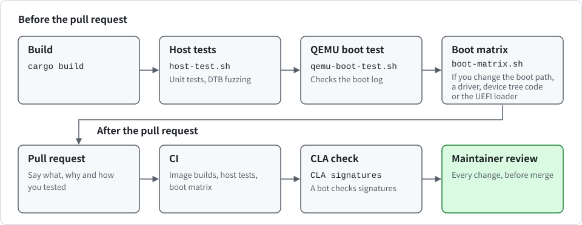

# Contributing to K0

<div align="center">

English | [한국어](CONTRIBUTING_KR.md)

</div>

Thank you for your interest in K0. K0 is a pre-release research microkernel. Before you change anything, read the isolation model in [SECURITY.md](SECURITY.md). It explains which guarantees the kernel does and does not provide today.

## Before you start

- **Security problems** never go into public issues or pull requests. Follow [SECURITY.md](SECURITY.md).
- **Small fixes** such as typos, test gaps or clear bugs can go straight to a pull request. Typo fixes in documentation or code comments do not need the CLA, as described below.
- **Anything larger** should start as an issue, so that the design can be agreed on before you write code. This applies to new system calls, new kernel objects, changes to the capability model and anything that touches `unsafe` code or assembly.
- **Read the design note** for the subsystem you want to change in [design/](design/en/README.md). Each note ends with the known gaps, which are good places to start.

## License and contributor agreement

K0 is licensed under the [PolyForm Noncommercial License 1.0.0](LICENSE). Quant Space may also offer K0 under separate commercial terms.

Before your first pull request can be merged, you must sign the [Contributor License Agreement](CLA.md), unless the pull request is trivial as described below.

> [!IMPORTANT]
> To sign it, comment on the first pull request that needs a signature with the following sentence, exactly as written.

```
I have read the K0 CLA version 1.0 (CLA.md) and I agree to its terms for this and all my future contributions to K0.
```

A pull request that only fixes spelling, grammar, punctuation, broken links or wrong paths and version numbers in documentation or code comments **does not need a signature**. The exact scope is in [section 12 of the CLA](CLA.md#12-changes-that-do-not-need-a-signature). A change to the code itself or to a log message always needs one, however small.

A bot checks every pull request and reports the result as the `CLA signatures` status check. It names everyone who still has to sign: the author of the pull request and every commit author. Therefore **every commit must be authored with an email address that is linked to a GitHub account**.

When you post the sentence, the bot records your signature (the link to your comment, your account, the agreement version and the date) on the `cla-signatures` branch, as section 11 of the CLA describes. If you signed on another pull request, comment `recheck`.

For a trivial pull request, a maintainer adds the `cla: trivial` label instead. The label is removed automatically when new commits are pushed, and a maintainer then looks again.

The agreement is currently a draft pending legal review. If it changes, you will be asked to sign the new version. It is governed by the laws of the Republic of Korea.

## Setting up

K0 **builds fully offline**. Every third-party crate is vendored under `vendor/`, and `.cargo/config.toml` forbids fetching anything else.

You need the following:

- **rustup**: the Rust installer. The pinned toolchain in `rust-toolchain.toml` (Rust 1.89.0 with `rust-src`, `llvm-tools` and the `aarch64-unknown-none-softfloat` and `aarch64-unknown-uefi` targets) is installed automatically on first use.
- **QEMU**: `qemu-system-aarch64` with its firmware ROMs. On Debian and Ubuntu this means the `qemu-system-arm` and `ipxe-qemu` packages. On macOS, `brew install qemu`. To boot through the UEFI loader you also need UEFI firmware for QEMU: Homebrew's `qemu` includes it, and on Debian and Ubuntu it is the `qemu-efi-aarch64` package.
- **Host C compiler and linker**: they are needed for build scripts. Use `gcc` or Xcode command line tools.

The file [ci/Dockerfile](ci/Dockerfile) is a complete, tested recipe for this environment.

## Building

You can enter the following commands:

```sh
$ cargo virt   # build the generic image with console and boot it on QEMU virt
$ cargo build -p k0-kernel --features console --offline   # build the generic 4 KiB image with console only
$ cargo build -p k0-kernel --offline --no-default-features --features granule-16k,console --target-dir target/g16   # 16 KiB image with console
$ cargo build -p k0-kernel --offline --target-dir target/quiet   # image without console
$ cargo build -p k0-kernel --features console,vault-ed25519 --offline --target-dir target/vault   # image with the signing oracle
$ tools/build-loader.sh   # put the built kernel into the UEFI loader, prints the .efi path
```

`tools/build-loader.sh` needs the kernel built first. See "Booting through UEFI" in [USAGE.md](USAGE.md#booting-through-uefi) for how to run it, and [design/en/uefi.md](design/en/uefi.md) for how the loader works.

Input and output are optional in K0. You can select them with Cargo features of the kernel crate.

> [!NOTE]
> A feature for input or for a terminal does not exist yet. Console output is the only thing you can select today.

Console output exists only in an image built with a console feature (`console-pl011`, `console-16550`, `console`). No image has input. `cargo virt` is an alias for `cargo run -p k0-kernel --features console`. [USAGE.md](USAGE.md#console-features) explains the features.

The kernel never exits. Once the root task finishes its self-tests, it yields forever and a kernel with console prints `k0: tick N` once a second. Stop QEMU with `Ctrl-A X`.

## Testing

Run **all three** before you open a pull request. If you change the boot path, a driver, the device tree code or the UEFI loader, also run `tools/boot-matrix.sh`. CI runs it, and [USAGE.md](USAGE.md) describes its rows.

The following picture shows the path of a change from the build to the review.

<p align="center">
  
</p>

You can run the three as follows:

```sh
$ tools/host-test.sh   # unit tests and DTB fuzzing on the host
$ cargo build -p k0-kernel --features console --offline
$ tools/qemu-boot-test.sh   # boot under QEMU and check the self-tests
```

`tools/host-test.sh` runs the tests of `k0-abi`, `k0-cap`, `k0-boot`, `k0-efi` and `k0-vault` on any host (276 tests on an AArch64 host, 190 elsewhere). It runs `k0-vault` twice, with and without the algorithm feature `vault-ed25519`, which gives 13 and 7 tests. The tests of `k0-mm` contain AArch64 inline assembly, so they only run on an AArch64 host (Apple Silicon or Linux arm64). The script runs them for both the 4 KiB and the 16 KiB granule.

`tools/qemu-boot-test.sh` boots the debug kernel, checks the boot log line by line in a fixed order, fails on any error marker, and stops QEMU as soon as the root task reports `root: sched tests pass`. Besides the pass lines, it expects `k0: kernel reserve ` before the `k0: untyped ` lines, `k0: idle (waiting for a timeout)` and `root: timeout tests pass` after `root: teardown tests pass`, and `root: kernel reserve tests pass` after `root: revocation tests pass`. Any line that starts with `k0: all tasks` is a failure. It also counts the timer tick lines between `root: teardown tests pass` and `root: timeout tests pass` and wants at least 4, because EL0 has no clock and this is how the lower bound of a timeout is checked. The timeout tests wait for real ticks, so a boot takes about 4 seconds longer than it did before. Set `K0_BOOT_TIMEOUT` (seconds) on slow machines. It reads the serial port, so it needs an image with a console driver. To test an image without console, use `K0_BOOT_MEMLOG`, `K0_BOOT_SERIAL=empty` and `K0_BOOT_CONSOLE_PAGE`, which are described in "Testing an image without console" in [USAGE.md](USAGE.md#testing-an-image-without-console).

An image with the signing oracle (`vault` or `vault-ed25519`) has two more intended faults, so it prints 8 `k0: task fault` lines instead of 6. Run the test with `K0_BOOT_FAULTS=8` and require `root: oracle tests pass` with `K0_BOOT_REQUIRE`. The boot matrix has the rows `vault`, `vault-max`, `vault-el2`, `vault-16k`, `vault-no-alg`, `hvf-vault` and the static check `vault-symbols` for it, and 61 rows in total on a Mac with HVF and 51 in CI. [USAGE.md](USAGE.md) describes the rows.

The default QEMU CPU model (`cortex-a72`) has no PAC, PAN or RNDR. To exercise those paths as well, boot on QEMU's `max` model and require the matching log lines. Any arguments after the kernel path are passed to QEMU. You can enter it as follows:

```sh
$ K0_BOOT_REQUIRE='rndr=on|k0: pac=on bti=present pan=on' \
    tools/qemu-boot-test.sh target/aarch64-unknown-none-softfloat/debug/k0-kernel -cpu max
```

To boot through the UEFI loader, pass the `.efi` file from `tools/build-loader.sh` instead of the kernel. The test then judges from the loader's first line on, because the firmware prints its own messages before it. You can enter it as follows:

```sh
$ tools/build-loader.sh
$ tools/qemu-boot-test.sh target/aarch64-unknown-none-softfloat/debug/k0-kernel.efi
```

> [!NOTE]
> Two things in the loader cannot be tested by QEMU: the cache flush and the MMU switch-off before the jump, because QEMU's software emulation has no caches.

`tools/pe-check.py <file>.efi` checks the form of the PE file and that these instructions and both flush calls are present, in the right order. It does not prove that they are right on real hardware, so a change to `loader/src/handoff.rs` needs a reviewer who knows the architecture rules.

### Where each part is tested

In the following table, you can see where each area is tested.

| Area | Host unit tests | Boot self-tests in the root task |
| --- | --- | --- |
| `k0-abi` constants and shared layouts | yes | indirectly |
| `k0-cap` untyped bootstrap and retype | yes | yes |
| `k0-boot` DTB parser, PAC key derivation, root task image | yes, plus fuzzing | yes |
| `k0-vault` request state machine, protocol, policy and provider boundary | yes, with and without `vault-ed25519` | yes, in images built with `vault`, through `test_oracle` and the `vault*` rows of the boot matrix |
| `k0-efi` memory plan from the UEFI memory map, DTB rewrite, independent check, ACPI table reader and tree synthesis | yes, plus fuzzing | yes, through the `uefi-*` rows of the boot matrix |
| `loader` (UEFI application: firmware calls, cache flush, MMU off, jump) | no | yes, through the `uefi-*` rows, plus the static check `tools/pe-check.py` |
| `k0-mm` page tables and W^X attributes | yes, on AArch64 hosts | yes |
| `k0-arch`, `k0-task`, `k0-sched`, `k0-ipc` | no | yes |

`k0-arch` assembles with ELF-only directives and the scheduler and IPC paths read system registers, so they are only exercised by booting. If you change them, extend the root task self-tests in `userspace/root-task/src/main.rs` and add the new pass line to the expected list in `tools/qemu-boot-test.sh`.

### Fuzzing the DTB parser and the loader's planning

The DTB parser treats the device tree as untrusted input. Its fuzzer is a deterministic mutation fuzzer that needs no extra crates. It generates random device trees, checks that the parser returns exactly what the generator described, then mutates the blob and checks that the parser never panics and that every accepted result stays within its limits. It does not use coverage feedback. You can run it as follows:

```sh
$ host="$(rustc -vV | sed -n 's/^host: //p')"
$ K0_FUZZ_ITERS=5000000 cargo test --release --offline --target "$host" -p k0-boot -p k0-efi fuzz -- --nocapture
```

The same command also runs the discovery fuzzer, which mutates four board-shaped trees and checks that `discover` never panics and that every accepted platform descriptor keeps its invariants.

With `-p k0-efi` it runs three more fuzzers, which work the same way. The UEFI memory map and the firmware device tree are untrusted input to the loader too.

- `fuzz_plan_with_random_maps` builds random UEFI memory maps (overlaps, odd types, zero-length entries) and checks that the plan passes the independent verifier and that every address it keeps lies in usable memory, outside every hole.
- `fuzz_rewrite_with_mutated_trees` mutates device trees and checks that the rewrite either refuses or produces a well-formed tree that the kernel's parser accepts with exactly the memory that was asked for.
- `fuzz_prepare_end_to_end` mixes both: measured memory maps with a few changed descriptors and mutated trees go through the whole preparation, and the result must be accepted by the kernel's parser with no memory inside a descriptor that is not usable.

`K0_FUZZ_ITERS`, `K0_FUZZ_SEED` and `K0_FUZZ_CASE` work the same for all of them. `K0_FUZZ_SEED` changes the base seed. Different base seeds give unrelated streams of cases. When a case fails, the test prints a `K0_FUZZ_CASE=0x...` value. Run the same command with that variable set to replay only that case and dump the input.

### Running exactly what CI runs

CI builds the container image from `ci/Dockerfile` and then runs the tests inside it with networking disabled. This proves that building and testing need nothing outside the repository. You can run it as follows:

```sh
$ docker build --file ci/Dockerfile --tag k0-ci .
$ docker run --rm --network none k0-ci tools/host-test.sh
$ docker run --rm --network none k0-ci tools/boot-matrix.sh
```

Run this from **a clean checkout**, because the build context is the working directory. The following list describes how the image is made.

- **Base image**: it is pinned by the digest of its multi-architecture index (`debian:bookworm@sha256:...`).
- **Rust toolchain**: the image does not use rustup. `ci/install-toolchain.py` pins the SHA-256 of the Rust 1.89.0 channel manifest and checks every package it installs (rustc, cargo, rust-std for the host and for `aarch64-unknown-none-softfloat` and `aarch64-unknown-uefi`, rust-src and llvm-tools) against the hashes in that manifest. A mismatch fails the image build.
- **Build context**: `.dockerignore` is an allowlist, so nothing enters the image unless it is listed there. **A new top-level file or directory** that the build or the tests need must be added to it. `.git` is kept in the image.

> [!NOTE]
> Not everything is pinned. The versions of the Debian packages float (apt checks them with the archive keys inside the pinned base image), and so do the GitHub runner images. The GitHub Actions used by the workflows are pinned by commit hash.

Developers still use rustup on their own machines. Only the CI image changed.

## Rules for kernel changes

- **Dependencies**: add no new dependency in kernel or root task crates. If a dependency is truly unavoidable, discuss it in an issue first. It must then be vendored and pinned.
- **unsafe blocks**: every `unsafe` block needs a `// SAFETY:` comment that says why the required invariant holds at that point. "This is safe" is not a reason.
- **Fail secure**: a failure during boot parks the core. A failing system call returns an error and leaves no partial state behind.
- **Outside input**: treat every input from outside the kernel as hostile. This includes the DTB and every system call argument. Use checked arithmetic and validate before you dereference.
- **W^X**: keep it. No mapping is ever both writable and executable, at either exception level.
- **New input or output paths**: every new path goes behind a Cargo feature from the start. Features only add I/O and are never put in `default`. Every supported combination gets a row in the boot matrix (`tools/boot-matrix.sh`), and the scripts, the `virt` alias and CI name the features explicitly. An image without the feature must contain none of that code and must not map or touch the device.
- **Confined task code**: code that runs in a confined task, such as the vault, must not use mutable statics or allocation. Its state lives on its own stack or in frames it was given.
- **New algorithms**: a new algorithm goes behind its own Cargo feature, which includes the feature of the service it belongs to. An image without it must contain none of its code. Give it a row in the boot matrix, and extend the static check `vault-symbols` if it adds code to the vault image.
- **Tests**: add a test with every behavior change. Pure logic gets a host unit test. System call behavior gets a root task self-test.
- **Code comments**: they are written in Korean in this repository. You may write yours in English. A maintainer may translate them when merging.

## Commits and pull requests

- One logical change per commit. A reviewer should be able to read each commit on its own.
- Keep the subject line short and plain. Korean or English are both fine. Do not use type prefixes such as `feat:` or `fix:`.
- In the pull request, say what changed, why, and how you tested it. Link the issue if there is one.
- **CI must pass**. It builds the 4 KiB and the 16 KiB image and the UEFI loader, runs the host tests on x86-64 and AArch64, and runs the boot matrix (`tools/boot-matrix.sh`) under QEMU, including the rows that boot through the UEFI loader, the rows for images without console and the rows for images with the signing oracle.

## AI-assisted contributions

Parts of K0 were written with AI assistance, and some commits in the history name an AI model as co-author. AI tools are allowed for contributions too, under these conditions:

- You understand every line you submit and can explain it in review. This applies above all to `unsafe` code, assembly and anything on a trust boundary.
- You say in the pull request description which parts were produced with AI assistance.
- You have the right to submit the output, as the [CLA](CLA.md) requires.

Every change is reviewed by a maintainer before it is merged, however it was produced.

## Code of conduct

Everyone who takes part in K0 is expected to follow the [Code of Conduct](CODE_OF_CONDUCT.md).
