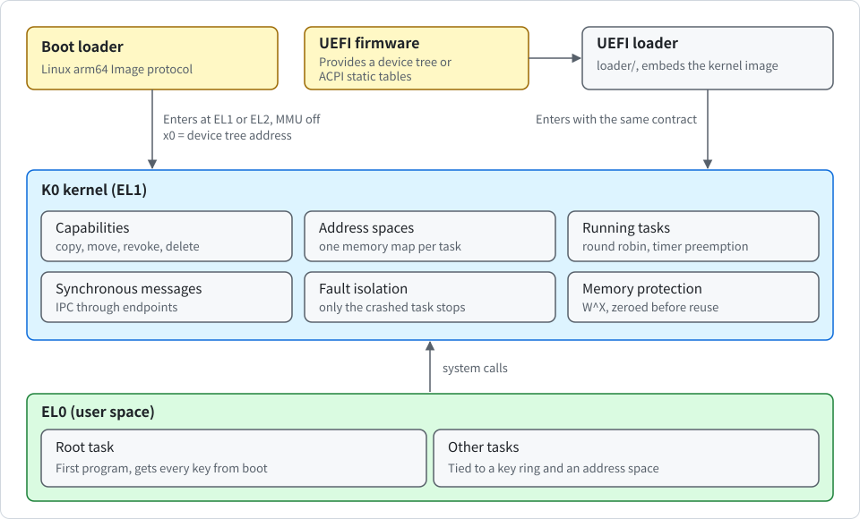
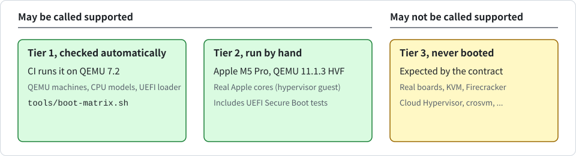

# Introduction to K0

English | [한국어](INTRODUCTION_KR.md)

This document explains in plain words what K0 is, what it can do today and what it cannot do yet. Each technical term appears once in parentheses, so that you can look it up in [SECURITY.md](SECURITY.md) and the [design notes](design/en/README.md).

## What K0 is

An operating system kernel is the program that controls the hardware and decides what every other program may do. Most kernels are large and do many jobs themselves. K0 is a **microkernel**: it does only the few jobs that must be done inside the kernel and leaves everything else to ordinary programs. The kernel side is about 7,400 lines of Rust and assembly (comments included, tests excluded). It is small enough to read from start to end.

The most important of those jobs is keeping programs apart. Think of a dormitory. Each room is a block of memory, each key opens one thing, and the kernel is the caretaker. A resident can open only the doors they hold a key for. A copy cannot be turned into a stronger key, and when a key is taken back, every copy made from it stops working too. In K0 these keys are called **capabilities**. The idea comes from the seL4 kernel.

The following picture shows how K0 is started and which parts it consists of.

  

## Words used here

In the following table, you can find the words used in this document.

| Word | Meaning |
| --- | --- |
| **Task** | One running program |
| **Root task** | The first program. It starts with every key the kernel hands out at boot |
| **Capability** | A key to one resource. A program names a key only by its slot number. The key itself stays in memory that only the kernel can touch, so it cannot be forged |
| **CNode** | A key ring: a table of slots that holds capabilities |
| **Address space** | The memory map of one program. Memory that is not on the map does not exist for that program |
| **Untyped memory** | Free memory with no purpose yet. A program turns it into kernel objects (retype) |
| **Endpoint** | A mailbox through which tasks exchange messages (IPC) |
| **System call** | A request that a program makes to the kernel |
| **Interrupt** | A signal from the hardware, such as a timer, that makes the processor stop and run the kernel |

## Goals

K0 is meant to become the isolation core of high-security systems. The targets are the following:

- **Separation kernel**: cross-domain guards and data diodes
- **Something like a software HSM**: key vaults and signing oracles
- **Measured boot**: measured-boot components on top of a hardware root of trust
- **Research base**: formal verification and certification research

> [!NOTE]
> None of these works yet. Today K0 is a research platform: it boots and checks its own security properties, but it does no useful work of its own yet.

## What works today

- **Starting up**: one generic image boots wherever the following holds.

  - The processor is ARMv8-A or ARMv9-A and little-endian.
  - The boot loader enters the kernel following the Linux arm64 Image protocol. The memory map is switched off (MMU off), the level is EL1 or the hypervisor level (EL2), and the address of the device tree is in register x0.
  - The interrupt controller is a GICv2 or GICv3, and the processor has the ARM generic timer.
  - RAM lies below 2^47 bytes (128 TiB).
  - The boot loader starts exactly one processor core. K0 uses that one core.

  The image can be loaded at any physical address that fits the page grid, and it always runs at the virtual address `0xFFFF_8000_0000_0000`. If it is started at EL2, the kernel sets up the EL2 state itself, steps down to EL1 once and never goes back. If it is started in any state it does not support, it stops instead of guessing.

- **Starting from UEFI firmware**: firmware that hands over a device tree, or that describes the machine with the ACPI static tables (RSDP, XSDT, MADT, GTDT and SPCR, never AML), can start K0 through the loader in `loader/` (see [design/en/uefi.md](design/en/uefi.md)). The loader is a UEFI application with the kernel image embedded in it, and it works in the following order:

  1. It plans which memory is RAM from the UEFI memory map.
  2. It rewrites the firmware's device tree to say so.
  3. It checks the result with the kernel's own device tree code.
  4. It exits the firmware services, turns the MMU off and enters the kernel with the same contract as above.

  Only free memory and the loader's own memory count as RAM. Memory that firmware still uses never does, so about 23 to 32 MiB of boot services memory stays unused on EDK2. The kernel does not change, and it also does not know it was started this way.

  - **Only this loader may start the kernel**: a generic UEFI boot loader that passes the firmware device tree through would hand firmware memory to user space. Under UEFI, only this loader may start the kernel.
  - **Refused firmware**: firmware that provides neither a device tree nor ACPI static tables is refused.
  - **Check of the embedded kernel**: the loader checks the embedded kernel with a SHA-256 hash. This catches corruption but is not a signature.
  - **Secure Boot**: the firmware verifies the whole loader file, kernel included.

- **Finding devices**: from the device tree the kernel takes only three things.

  - **Console**: the node named by `stdout-path` in `/chosen` (PL011, SBSA UART or 16550 family).
  - **Interrupt controller**: the interrupt parent of the timer node (GICv2 or GICv3).
  - **Timer interrupt**: the interrupt number of the EL1 virtual timer.

  They go into one platform descriptor that never changes, printed as a `k0: platform ...` line. It is checked against the memory map before any device page is mapped. The hardware must agree with the device tree (the identification registers of the GIC and the PL011), otherwise the kernel refuses to boot. With any other UART, or without `stdout-path`, there is no console. Every image finds and checks the console node this way, even an image that never drives the console (see the next item). A device tree whose console fails the checks is therefore refused by every image.

- **Console output is optional**: input and output are optional in K0. You can select them with Cargo features of the kernel crate.

> [!NOTE]
> A feature for input or for a terminal does not exist yet. Console output is the only thing you can select today.

Console output exists only in an image built with a console feature. No image has input. In the following table, you can find the Cargo features that add a transmit driver.

| Feature | Transmit driver it adds |
| --- | --- |
| `console-pl011` | PL011 and SBSA UART |
| `console-16550` | The 16550 family |
| `console` | Both of the above |

These features only add and are not in `default`, so **every build command must name the features**, for example `cargo build -p k0-kernel --features console --offline`. An image built without them has the following properties:

- It contains no UART driver code.
- It never maps the console device page.
- It writes nothing to a UART.
- It prints `k0: no console (driver not built in)`.
- All its output goes only to the boot log.

`DEBUG_PUTC`, the `Console` capability and the boot log stay in every image, and so does the check of the console node. `grep -a 'k0: console drivers' <image file>` tells which drivers an image has (a label, not proof), and `k0: device pages [...]` lists every device page the kernel keeps mapped. The UEFI loader still prints through the firmware console. See [design/en/boot.md](design/en/boot.md) and the section "Optional console output" in [SECURITY.md](SECURITY.md).

- **Boot log**: every line the kernel prints also goes into a 16 KiB buffer in kernel memory. Lines printed before the console is attached are replayed once it is. With no console, this buffer is the only record. `tools/boot-log.py` reads it from the memory of a QEMU guest. Output of user tasks is recorded only up to a quota (6 KiB of the 16 KiB), and only the first 4 timer tick lines are logged.
- **Timer**: only the EL1 virtual timer is used, so it works inside hypervisor guests. The image never touches the physical timer, and the boot matrix checks that.
- **Granule**: the page size is 4 KiB by default. A 16 KiB build is a build option (see [USAGE.md](USAGE.md)). It is not selected at run time, and on a processor without 16 KiB support the 16 KiB image refuses to boot.
- **Pinned build**: an image built with `K0_PIN` set to the platform line of a boot log refuses to boot when the discovered platform, the entry level or the RAM range differs. This catches a wrong board or a swapped device tree. It is not a defence against a hostile boot chain, because the comparison uses values that come from the device tree.
- **Protecting its own memory**: the kernel keeps the following.
  - No page of kernel memory is both writable and executable (W^X).
  - An empty guard page sits below the kernel's boot stack, so running off the end of the stack stops the kernel instead of damaging other memory.
  - At boot, the kernel asks the processor to look up its own memory map (address translation instructions) to check that these settings really took effect.
- **Distrusting boot input**: the hardware description handed over at boot (the device tree, DTB) is read as if an attacker wrote it. If it claims memory that overlaps hardware registers (MMIO) or lies beyond what the processor can address, the boot stops.
- **Processor security features**: when the processor has them, K0 uses the following.
  - It loads the keys that let the processor detect tampered pointers (pointer authentication, PAC).
  - It turns on the guard that keeps the kernel from accidentally using program memory (PAN).
  - Programs cannot read the hardware counters, debug registers or performance counters.

  The compiler does not produce pointer signing instructions yet, so the places where the kernel's functions return to are not protected yet.
- **Keys**: free memory can be turned into the following objects.
  - Blocks of memory (frames)
  - The tables that make up memory maps (page tables)
  - Tasks (TCB)
  - Mailboxes (Endpoint)
  - Key rings (CNode)
  - Address spaces (AddrSpace)

  Memory is placed on an address space's map only by showing that address space's key (MAP, UNMAP). Keys carry rights (read, write, execute). A mailbox key can carry a tag that tells the receiver who sent a message (badge). Keys can be copied with the same or fewer rights, or moved between slots (CAP_COPY, CAP_MOVE).
- **Running tasks**: a task is tied to one key ring and one address space when it is set up (TCB_CONFIGURE) and then started (TCB_RESUME). Tasks take turns, and a timer interrupts a task that runs too long (round-robin scheduling with timer preemption). A task can give up its turn (YIELD) or finish (EXIT).
- **Messages**: tasks exchange short messages that travel in processor registers. The sender waits until the receiver takes the message (synchronous IPC: SEND, RECV, CALL, REPLY_RECV). Sending needs the write right on the mailbox key and receiving needs the read right. The receiver learns the tag of the sender's key, and the right to reply can be used only once.
- **Crash containment**: when a task crashes, makes a system call the kernel does not know, or exits, only that task is stopped (fault isolation).
- **Task isolation and taking keys back**: tasks tied to different key rings and address spaces cannot reach each other's memory or keys. Every key remembers which key it was copied from (derivation list). Taking a key back (CAP_REVOKE) or deleting it (CAP_DELETE) has the following effects.
  - Every key copied from it is removed as well.
  - Memory is taken off the maps.
  - Objects whose original key is gone are shut down.
  - Tasks that lose their key ring or address space are stopped.
  - Freed memory is filled with zeros before it can be used again.

  No memory is ever writable in one place and executable in another.
- **Checking the first program**: the root task is built into the kernel image, and at every boot its fingerprint (a SHA-256 hash) is checked again. This catches corruption, but it does not prove who made the image the way a signature would. [SECURITY.md](SECURITY.md) explains why under "Scope".

The root task tests every item above with self-tests on every boot.

## Where it has run

The following picture summarizes what each evidence tier means.

  

> [!NOTE]
> Only the first two tiers may be called supported.

- **Tier 1**: checked by `tools/boot-matrix.sh` (CI runs it on QEMU 7.2).
  - **Direct boot rows**
    - QEMU virt with GICv3 and with GICv2, each entered at EL1 and at EL2
    - The CPU models cortex-a72, cortex-a53 and max
    - The security extensions switched on (`secure=on`) for both GIC versions
    - 4 processor cores started by the machine (K0 still uses one)
    - The 16 KiB image on max and its refusal on cortex-a72
    - The same image loaded at three other physical addresses (the header `text_offset` patched) and a refusal for an address off the 16 KiB grid
    - `xlnx-versal-virt` (RAM at address 0, GICv3 and PL011 elsewhere, entered at EL2)
    - A pinned image that boots on its own platform and refuses on another
    - A static check that the image does not touch the physical timer
  - **Console rows**: the rows in the following table cover the choice of console output.
  - **UEFI rows**: they boot the same kernel images through the loader on EDK2 firmware. CI uses Debian `qemu-efi-aarch64` 2022.11 and QEMU `virt` with `acpi=off`, and the `uefi-acpi-*` rows run with ACPI on.
    - GICv3 and GICv2, each at EL1 and at EL2
    - The max CPU (pointer authentication, BTI, PAN)
    - 4 cores
    - The 16 KiB image
    - A firmware random number generator (the entropy reaches the kernel)
    - Starting from a FAT drive instead of `-kernel`
    - A static check of the loader's PE file form and of the order of its cache and MMU instructions (`tools/pe-check.py`)
  - **ACPI rows**: the rows `uefi-acpi-gic3-el1`, `uefi-acpi-gic3-el2`, `uefi-acpi-gic2-el1`, `uefi-acpi-smp4`, `uefi-acpi-16k` and `uefi-acpi-rng` boot the default QEMU machine with ACPI on, without a device tree, through the tables.
  - **Refusal checks**: two refusals are read from the serial log.
    - The 16 KiB image on a CPU without 16 KiB pages
    - A loader whose embedded kernel has one flipped byte

In the following table, you can find what each console row checks.

| Row | What it checks |
| --- | --- |
| `console-symbols` | A static check. On the debug images, `llvm-nm` shows the driver symbols exactly as the features say, and each image file carries exactly its own `k0: console drivers` line |
| `quiet`, `quiet-16k` | They boot an image without console and judge the whole self-test from the boot log in guest memory. They require that not one byte came out of the serial port, and that the console page is not among the device pages |
| `console-pl011-only` | A row that covers the choice of console output |
| `console-16550-only` | It does the same as `quiet` for an image whose only driver does not fit QEMU virt, which has a PL011 |
| `pl011-identity` | It points the console node at the RTC and requires `k0: console is not a pl011, ignored`, no write and no page left mapped |
| `serial-check` | It judges a console image as if it were quiet and must fail |

The rows also ran locally on QEMU 11.1.3.

- **Tier 2**: run by hand.
  - **2026-11-11**: Apple M5 Pro, QEMU 11.1.3 with HVF, which runs real Apple cores as a hypervisor guest. The runs were the 4 KiB image at EL1, entry at guest EL2, the 16 KiB image and 4 cores (`K0_MATRIX_HVF=1 tools/boot-matrix.sh`).
  - **2026-11-12, UEFI loader**: on the same host and QEMU, the UEFI loader through HVF at EL1, at EL2 and with the 16 KiB image.
  - **2026-11-12, UEFI Secure Boot**: also on that day, the real loader under UEFI Secure Boot: Debian EDK2 2022.11 in QEMU 7.2 (TCG), with test keys enrolled in a throwaway container. A signed loader booted, both from the FAT drive and with `-kernel` (the firmware checks that path too). The firmware refused the following three cases before any loader code ran.
    - An unsigned loader
    - A signed loader with one byte of the embedded kernel flipped
    - A loader signed with a key that was not enrolled

    This used one firmware, and each boot was stopped after about 60 seconds.
- **Tier 3**: expected by the contract but never booted.
  - Any real board, KVM, Firecracker, Cloud Hypervisor, crosvm
  - The 16550 console driver: no machine in the matrix has one, so no test has ever executed it. It was checked by review only.
  - The SBSA UART: it uses the PL011 driver without an identity check.
  - Release (LTO) images of the feature sets without console: the matrix builds and boots only debug images, and the symbol check runs on them.
  - Any image without console booted through UEFI
  - GICs with real security extensions on hardware
  - Processors whose `HCR_EL2.E2H` is fixed to 1: the EL2 path for such processors follows Linux but has not been run anywhere. As with Linux, an EL3 firmware must enable the fine-grained-trap and HCRX controls when those features exist.
  - Under UEFI the following also apply.
    - Any real board
    - U-Boot's EFI implementation
    - Raspberry Pi UEFI
    - Any firmware other than EDK2 on QEMU `virt`
    - KVM
    - A pinned build (`K0_PIN`)
    - The cache flush before the MMU is turned off on real hardware

## How far the isolation goes

What it stops:

- **Access to resources and memory**: a task cannot use a resource it holds no key for, and it cannot see memory that is not on its own map.

> [!WARNING]
> Availability is not protected. A task can still bring everything to a halt.

What it does not stop:

- **Availability**: there are two cases.
  - If every task ends up waiting for a message, the kernel stops the processor core. A confined task can cause this by being the last one to wait.
  - A task given a lot of free memory can use up the kernel's fixed tables (40 page tables for the kernel's own use, 256 address space entries), and then nobody can create new objects.
- **Tasks that share a key ring and an address space**: such tasks are not isolated from each other. They behave like threads, parts of one program that share everything.
- **Control of a task**: whoever holds the key to a task, to its key ring or to its address space controls that task.

## Not there yet

> [!NOTE]
> Giving programs access to hardware devices does not exist yet. Until it does, K0 cannot exchange data with the outside world except through the text console that prints these messages, which exists only in images built with a console driver.

Missing features:

- **Input**: input of any kind does not exist yet. No code reads from a UART or from any other device, and no feature for input or for a terminal exists.
- **Capability transfer**: a key cannot be handed to another task inside a message (capability transfer over IPC).
- **Hardware interrupt notification**: a program cannot be told about hardware interrupts (Notification objects).
- **Crash reports**: a crashed task is only stopped. It is not reported to a handler task.
- **Timeouts and multicore**: there are no timeouts, and only one processor core is used.
- **Device access**: programs cannot access hardware devices (device memory and interrupts).
- **Loading new executable code after boot**: this is the flip side of the write-or-run rule. Executable memory exists only for the root task image, so a confined task runs code from that image.
- **Multi-level key lookup and ASIDs**: multi-level key lookup and hardware address space tags (ASIDs) do not exist. Today every switch to another address space empties the processor's cache of memory map lookups (the TLB).
- **Signature checking**: checking a digital signature (Ed25519) once the root task ships separately from the kernel.
- **Real boards and other virtualization**: K0 has not been booted on real boards, or on KVM, Firecracker, Cloud Hypervisor or crosvm (tier 3 above).
- **Entry from EL3 and ACPI beyond the static tables**: these two are missing.
  - UEFI with a firmware device tree, and UEFI with ACPI static tables only (the loader builds a minimal device tree), exist (see above).
  - Machines whose static tables give the console, GIC and timer are in by contract, AML never, and only QEMU virt has been booted.
  - Firmware other than EDK2 and real boards with UEFI are untested.
- **Excluded by decision**: the following are excluded by decision.
  - Interrupt controllers other than GICv2 and GICv3
  - Confidential VMs
  - A 64 KiB granule
  - Big-endian
  - Boards whose device tree declares a timer erratum
  - RAM above 2^47 bytes
- **Apple Silicon bare metal**: there is no plan for it.
- **Other architectures**: AMD64, the processors in most PCs, and other architectures.

Missing protection and assurance:

- **Availability guarantees**: see the previous section.
- **DMA isolation**: some devices read and write memory directly, without the processor (DMA). Once devices are handed to programs, a memory map for devices (an IOMMU, such as the SMMU on ARM) has to stop such a device from reading all memory. Nothing for this exists yet.
- **Side channels**: secrets can leak through timing or through caches the processor shares, rather than by direct access. A few such leaks are closed (programs cannot read the hardware counters, and the TLB is emptied whenever the address space changes). There is no general defence against cache or timing side channels, and they have not been analysed.
- **Waiting senders**: taking a key back does not cancel a sender already waiting at the mailbox. Its message is still delivered once.
- **Basis of assurance**: assurance comes from testing only.
  - Unit tests and fuzzing (feeding random, broken input to find crashes) on the build machine
  - Self-tests at boot in QEMU and in a hypervisor guest on real Apple cores

  There is no formal proof (a mathematical proof that the code does what it should), and nothing has run on a real board.

## Where the code lives

In the following table, you can find the contents of each path in the repository.

| Path | Contents |
| --- | --- |
| `kernel/` | The kernel program: startup assembly, the order of initialization, system call handling (`syscall.rs`), cleanup when a key is removed (`object.rs`), files that describe the memory layout of the kernel image (linker scripts) |
| `crates/k0-abi` | System call numbers, error codes and the boot information layout that programs share with the kernel |
| `crates/k0-arch` | Handling of errors, system calls and interrupts (exceptions), entering and leaving user mode, interrupt controller and timer, PAC and PAN, the boot log and the optional console drivers |
| `crates/k0-boot` | Device tree parser, the built-in root task image and its integrity check, PAC key derivation, the search for the boot memory window (shared with the loader) |
| `crates/k0-efi` | The loader's logic without `unsafe` code: planning RAM from the UEFI memory map, rewriting the firmware device tree, an independent re-check of the result, and the check of the kernel image header. It runs the kernel's own device tree code on the result before the jump |
| `crates/k0-cap` | Keys and their rights, key rings, the derivation list, untyped memory, retype, revoke and delete |
| `crates/k0-mm` | Kernel page tables, turning memory maps on (MMU), program address spaces and their registry |
| `crates/k0-task` | Tasks with their key ring and address space, mailboxes, loading the root task |
| `crates/k0-sched` | Round-robin scheduler |
| `crates/k0-ipc` | Synchronous messages |
| `loader/` | The UEFI application (`k0-loader`, target `aarch64-unknown-uefi`) that embeds a built kernel image and starts it: UEFI calls, the flow, and the final cache flush, MMU off and jump |
| `userspace/root-task` | The first program and its self-tests |
| `tools/` | QEMU runner (also for `.efi` files), boot test, boot matrix, boot log reader, host test, loader build (`build-loader.sh`), PE and instruction order check (`pe-check.py`) |
| `ci/` | The CI build and test image (`Dockerfile`) and the threat model (`threat_model.md`) |
| `vendor/` | Third-party crates kept in the repository (`sha2` and its dependencies) |
