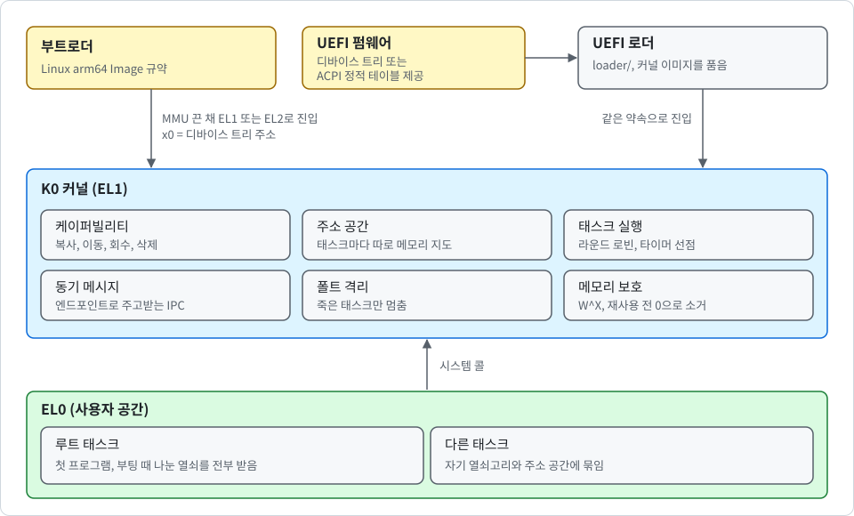
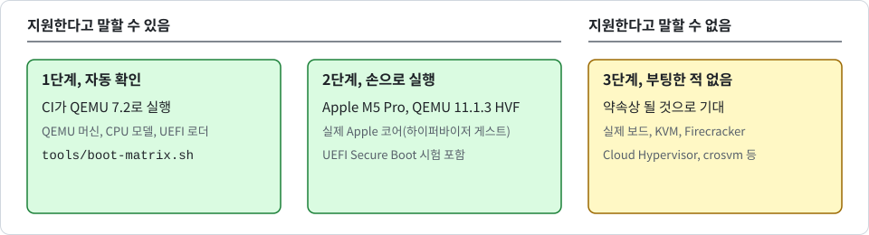

# K0 소개

<div align="center">

[English](INTRODUCTION.md) | 한국어

</div>

이 문서는 K0가 무엇인지, 지금 할 수 있는 것과 아직 못 하는 것을 쉬운 말로 설명합니다. 전문 용어는 처음 나올 때 괄호 안에 한 번 적어 두었으니 [SECURITY_KR.md](SECURITY_KR.md)와 [설계 문서](design/kr/README.md)에서 찾아볼 수 있습니다.

## K0는 무엇인가

운영체제 커널은 하드웨어를 다루고, 다른 모든 프로그램이 무엇을 할 수 있는지 정하는 프로그램입니다. 대부분의 커널은 크고 많은 일을 직접 합니다. K0는 **마이크로커널**이라서 커널 안에서만 할 수 있는 몇 가지 일만 하고, 나머지는 일반 프로그램에 맡깁니다. 커널 쪽 코드는 주석을 포함하고 테스트를 제외하면 Rust와 어셈블리 약 11,800줄입니다. 처음부터 끝까지 읽을 수 있는 크기입니다.

그 일 가운데 가장 중요한 것은 프로그램끼리 떼어 놓는 것입니다. 기숙사를 떠올려 보세요. 방 하나는 메모리 한 덩어리, 열쇠 하나는 무언가 하나를 여는 도구, 커널은 관리인입니다. 입주자는 열쇠를 가진 문만 열 수 있습니다. 복사한 열쇠를 더 강한 열쇠로 바꿀 수 없고, 열쇠를 회수당하면 거기서 복사한 열쇠도 전부 쓸 수 없게 됩니다. K0에서는 이 열쇠를 **케이퍼빌리티**라고 부릅니다. 이 생각은 seL4 커널에서 왔습니다.

다음 그림은 K0가 어떻게 시작되고, 어떤 부분으로 이루어지는지 보여 줍니다.

<p align="center">
  
</p>

## 이 문서에서 쓰는 말

다음 표는 이 문서에서 사용하는 말을 정리한 것입니다.

| 말 | 뜻 |
| --- | --- |
| **태스크** | 실행 중인 프로그램 하나입니다 |
| **루트 태스크** | 첫 프로그램입니다. 커널이 부팅 때 나눠 주는 열쇠를 전부 받고 시작합니다 |
| **케이퍼빌리티** | 자원 하나를 여는 열쇠입니다. 프로그램은 열쇠를 슬롯 번호로만 가리킵니다. 열쇠 자체는 커널만 만질 수 있는 메모리에 있어서 위조할 수 없습니다 |
| **CNode** | 열쇠고리입니다. 케이퍼빌리티를 담는 슬롯들의 표입니다 |
| **주소 공간** | 프로그램 하나의 메모리 지도입니다. 지도에 없는 메모리는 그 프로그램에게 존재하지 않습니다 |
| **untyped 메모리** | 아직 용도가 정해지지 않은 빈 메모리입니다. 프로그램이 이것을 커널 오브젝트로 바꿉니다(retype) |
| **엔드포인트** | 태스크끼리 메시지를 주고받는 우편함(IPC)입니다 |
| **시스템 콜** | 프로그램이 커널에 하는 요청입니다 |
| **인터럽트** | 타이머 같은 하드웨어가 보내는 신호입니다. 프로세서가 하던 일을 멈추고 커널을 실행하게 합니다 |
| **터미널** | 시리얼 줄로 사람이 명령을 입력하고 답을 읽는 화면입니다. K0에서는 일반 태스크 하나가 맡습니다 |

## 목표

K0는 고보안 시스템의 격리 코어가 되는 것을 목표로 합니다. 대상은 다음과 같습니다.

- **분리 커널**: 크로스 도메인 가드와 데이터 다이오드
- **소프트웨어 HSM 비슷한 구성**: 키 볼트와 서명 오라클
- **측정 부팅**: 하드웨어 신뢰 기점 위의 측정 부팅 컴포넌트
- **연구용 기반**: 정형 검증과 인증 연구

> [!NOTE]
> 첫 작은 걸음만 있습니다. "지금 동작하는 것"에 적은 선택 사항인 서명 오라클과, 그것을 시리얼 줄로 다루는 운영자 터미널입니다. 나머지는 아직 동작하지 않습니다. 지금의 K0는 연구용 플랫폼으로, 부팅해서 자신의 보안 성질을 스스로 확인하지만 기본값으로는 아직 그 자체로 쓸모 있는 일을 하지는 않습니다.

## 지금 동작하는 것

- **시작**: 범용 이미지 하나가 다음 조건이 맞는 곳이면 어디서든 부팅합니다.

  - 프로세서는 ARMv8-A 또는 ARMv9-A이고 리틀 엔디언입니다.
  - 부트로더는 Linux arm64 Image 규약에 따라 커널에 진입시킵니다. 이때 메모리 지도는 꺼져 있고(MMU 꺼짐), 단계는 EL1 또는 하이퍼바이저 단계(EL2)이며, x0 레지스터에 디바이스 트리 주소가 담겨 있습니다.
  - 인터럽트 컨트롤러는 GICv2 또는 GICv3이고, 프로세서에 ARM 범용 타이머가 있습니다.
  - RAM은 2^47 바이트(128 TiB) 아래에 있습니다.
  - 부트로더는 프로세서 코어를 정확히 하나만 시작시킵니다. K0는 그 코어 하나만 사용합니다.

  이미지는 페이지 격자에 맞는 어떤 물리 주소에든 적재할 수 있고, 실행은 항상 가상 주소 `0xFFFF_8000_0000_0000`에서 합니다. EL2로 시작되면 커널이 EL2 상태를 직접 설정하고 EL1로 한 번 내려오며, 다시 돌아가지 않습니다. 지원하지 않는 상태로 시작되면 짐작해서 진행하지 않고 멈춥니다.

- **UEFI 펌웨어에서 시작**: 디바이스 트리를 넘겨 주거나 ACPI 정적 테이블(RSDP, XSDT, MADT, GTDT, SPCR만 읽고 AML은 읽지 않음)로 기계를 설명하는 펌웨어에서는 `loader/`의 로더로 K0를 시작할 수 있습니다([design/kr/uefi_KR.md](design/kr/uefi_KR.md) 참고). 로더는 커널 이미지를 안에 품은 UEFI 응용 프로그램입니다. 다음 순서로 동작합니다.

  1. UEFI 메모리 맵을 보고 어느 메모리가 RAM인지 계획합니다.
  2. 펌웨어의 디바이스 트리를 그에 맞게 다시 작성합니다.
  3. 커널 자신의 디바이스 트리 코드로 결과를 검사합니다.
  4. 펌웨어 서비스를 끝내고 MMU를 끈 채, 위와 같은 약속으로 커널에 진입시킵니다.

  로더는 빈 메모리와 로더 자신의 메모리만 RAM으로 칩니다. 펌웨어가 아직 사용하는 메모리는 절대 RAM이 아니라서, EDK2에서는 부트 서비스 메모리 약 23~32 MiB가 사용되지 않고 남습니다. 커널은 바뀌지 않았고, 이런 식으로 시작됐는지도 모릅니다.

  - **이 로더만 커널을 시작해야 합니다**: 펌웨어의 디바이스 트리를 그대로 넘기는 일반 UEFI 부트로더는 펌웨어 메모리를 사용자 공간에 넘겨 주게 됩니다. UEFI에서는 이 로더만 커널을 시작해야 합니다.
  - **거부하는 펌웨어**: 디바이스 트리도 ACPI 정적 테이블도 주지 않는 펌웨어는 거부합니다.
  - **내장 커널 검사**: 로더는 내장된 커널을 SHA-256 해시로 검사합니다. 이것은 손상을 잡아낼 뿐 서명이 아닙니다.
  - **Secure Boot**: 펌웨어가 커널이 들어 있는 로더 파일 전체를 검증합니다.

- **장치 찾기**: 커널은 디바이스 트리에서 세 가지만 가져옵니다.

  - **콘솔**: `/chosen`의 `stdout-path`가 가리키는 노드입니다(PL011·SBSA UART·16550 계열). 노드에 `interrupts`가 있으면 인터럽트 번호도 가져오며, 이 번호는 입력에만 사용합니다. UEFI 로더를 거치면 ACPI SPCR 표에서 가져옵니다.
  - **인터럽트 컨트롤러**: 타이머 노드의 인터럽트 부모입니다(GICv2 또는 GICv3).
  - **타이머 인터럽트**: EL1 가상 타이머의 인터럽트 번호입니다.

  이 값들은 바뀌지 않는 플랫폼 기술자 하나에 담겨 `k0: platform ...` 줄로 출력됩니다. 장치 페이지를 하나라도 매핑하기 전에 메모리 맵과 대조합니다. 하드웨어가 디바이스 트리와 일치해야 하며(GIC와 PL011의 식별 레지스터), 맞지 않으면 커널은 부팅을 거부합니다. 다른 UART이거나 `stdout-path`가 없으면 콘솔이 없습니다. 모든 이미지가 콘솔 노드를 이렇게 찾고 검사합니다. 콘솔을 전혀 구동하지 않는 이미지도 마찬가지입니다(다음 항목 참고). 그래서 콘솔이 검사를 통과하지 못하는 디바이스 트리는 모든 이미지가 거부합니다. 콘솔 노드에 쓸 수 있는 인터럽트가 없는 것은 거부 사유가 아닙니다. 그 경우에는 입력만 꺼집니다.

- **콘솔 입출력은 선택 사항**: K0에서 입력 및 출력은 선택 사항입니다. 커널 크레이트의 Cargo features로 선택할 수 있습니다. 콘솔 출력은 콘솔 feature를 포함해 빌드한 이미지에만 있고, 콘솔 입력은 `console-input` 또는 `terminal`을 포함해 빌드한 이미지에만 있습니다. 다음 표는 Cargo feature를 정리한 것입니다.

| feature | 더하는 것 |
| --- | --- |
| `console-pl011` | PL011과 SBSA UART의 송신 드라이버 |
| `console-16550` | 16550 계열의 송신 드라이버 |
| `console` | 위의 두 송신 드라이버 모두 |
| `console-input` | 콘솔 UART의 수신 경로와 시스템 콜 `CONSOLE_READ`. 콘솔 드라이버 feature와 함께 써야 동작합니다 |
| `terminal` | 루트 태스크 이미지 안의 운영자 터미널 태스크. `console-input`을 함께 켭니다 |

> [!NOTE]
> 입력 받기는 PL011과 SBSA UART에만 있습니다. 16550 콘솔은 출력만 있고 입력이 없습니다.

이 feature는 더하기만 하며 `default`에 없습니다. 따라서 **모든 빌드 명령이 feature 이름을 직접 적어야 합니다**. 예를 들어 `cargo build -p k0-kernel --features console --offline`입니다. feature 없이 빌드한 이미지는 다음과 같습니다.

- UART 드라이버 코드가 아예 없습니다.
- 콘솔 장치 페이지를 매핑하지 않습니다.
- UART에 아무것도 쓰지 않습니다.
- 수신 코드와 `CONSOLE_READ`도 없습니다.
- `k0: no console (driver not built in)`을 출력합니다.
- 출력은 모두 부트 로그로만 갑니다.

`DEBUG_PUTC`, `Console` 케이퍼빌리티, 부트 로그는 모든 이미지에 남고, 콘솔 노드의 검사도 그대로입니다. `Console` 케이퍼빌리티에는 읽기(R, 입력)와 쓰기(W, 출력) 권한이 있습니다. 복사할 때 줄일 수만 있고, 루트 태스크의 케이퍼빌리티는 W를 가지며 `console-input` 이미지에서만 R도 가집니다. `grep -a 'k0: console drivers' <이미지 파일>`로 이미지에 어떤 드라이버가 있는지 알 수 있습니다(증거가 아니라 표지입니다). `k0: device pages [...]`는 커널이 매핑한 채로 두는 모든 장치 페이지를 나열합니다. UEFI 로더는 여전히 펌웨어 콘솔로 출력합니다. [design/kr/boot_KR.md](design/kr/boot_KR.md)와 [SECURITY_KR.md](SECURITY_KR.md)의 "선택적 콘솔 출력" 절을 참고하세요.

- **부트 로그**: 커널이 출력하는 모든 줄은 커널 메모리의 16 KiB 버퍼에도 들어갑니다. 콘솔이 붙기 전에 출력한 줄은 콘솔이 붙을 때 다시 출력합니다. 콘솔이 없으면 이 버퍼가 유일한 기록입니다. `tools/boot-log.py`가 QEMU 게스트의 메모리에서 이를 읽습니다. 사용자 태스크의 출력은 할당량(16 KiB 중 6 KiB)까지만 기록하고, 타이머 tick 줄은 처음 4개만 기록합니다.
- **타이머**: EL1 가상 타이머만 사용하므로 하이퍼바이저 게스트 안에서도 동작합니다. 이미지는 물리 타이머를 건드리지 않으며, 부팅 매트릭스가 이를 확인합니다.
- **그래뉼**: 페이지 크기는 기본 4 KiB입니다. 16 KiB 빌드는 빌드 옵션입니다([USAGE_KR.md](USAGE_KR.md) 참고). 실행 중에 선택하는 것이 아니며, 16 KiB 지원이 없는 프로세서에서는 16 KiB 이미지가 부팅을 거부합니다.
- **고정 빌드**: 부트 로그의 플랫폼 줄을 `K0_PIN`에 설정해 빌드한 이미지는 찾아낸 플랫폼, 진입 단계, RAM 범위가 다르면 부팅을 거부합니다. 플랫폼 줄에는 이제 콘솔 인터럽트 번호도 들어가므로(`con=pl011@0x9000000,irq33`) 이전에 만든 고정 문자열은 다시 만들어야 합니다. 보드를 잘못 선택했거나 디바이스 트리를 바꿔치기한 경우를 잡아냅니다. 비교에 사용하는 값이 디바이스 트리에서 나오므로, 악의적인 부트 체인을 막는 방어는 아닙니다.
- **커널 자신의 메모리 보호**: 다음을 지킵니다.
  - 커널 메모리의 어떤 페이지도 쓰기와 실행이 동시에 되지 않습니다(W^X).
  - 커널의 부트 스택 아래에는 빈 경계 페이지를 두어서, 스택 끝을 넘어가면 다른 메모리를 망가뜨리지 않고 커널이 멈춥니다.
  - 부팅 때 커널은 프로세서에게 자기 메모리 지도를 직접 찾아보게 해서(주소 변환 명령) 이 설정이 실제로 적용됐는지 확인합니다.
- **부팅 입력 불신**: 부팅 때 넘겨받는 하드웨어 설명(디바이스 트리, DTB)은 공격자가 쓴 것처럼 읽습니다. 하드웨어 레지스터 영역(MMIO)과 겹치거나 프로세서가 가리킬 수 없는 곳의 메모리를 주장하면 부팅을 멈춥니다.
- **프로세서 보안 기능**: 프로세서가 지원하면 다음을 사용합니다.
  - 조작된 포인터를 프로세서가 알아채게 하는 키를 설정합니다(포인터 인증, PAC).
  - 커널이 실수로 프로그램 메모리를 쓰지 못하게 막는 장치(PAN)를 켭니다.
  - 프로그램은 하드웨어 카운터, 디버그 레지스터, 성능 카운터를 읽을 수 없습니다.

  컴파일러가 아직 포인터 서명 명령을 만들지 않아서 커널 함수가 돌아갈 위치는 보호되지 않습니다.
- **열쇠**: 빈 메모리를 다음 오브젝트로 바꿀 수 있습니다.
  - 메모리 블록(프레임)
  - 메모리 지도를 이루는 표(페이지 테이블)
  - 태스크(TCB)
  - 우편함(Endpoint)
  - 열쇠고리(CNode)
  - 주소 공간(AddrSpace)

  메모리는 그 주소 공간의 열쇠를 보여 줘야만 그 주소 공간의 지도에 올릴 수 있습니다(MAP, UNMAP). 열쇠에는 권한(읽기, 쓰기, 실행)이 있습니다. 우편함 열쇠에는 누가 보냈는지 받는 쪽에 알려 주는 표식(배지)을 붙일 수 있습니다. 열쇠는 권한을 그대로 두거나 줄여서 복사하거나, 다른 슬롯으로 옮길 수 있습니다(CAP_COPY, CAP_MOVE).
- **태스크 실행**: 태스크는 준비할 때 열쇠고리 하나와 주소 공간 하나에 묶이고(TCB_CONFIGURE) 그다음 시작됩니다(TCB_RESUME). 태스크는 차례를 돌아가며 실행되고, 너무 오래 도는 태스크는 타이머가 끊습니다(타이머 선점이 있는 라운드 로빈 스케줄링). 태스크는 자기 차례를 양보하거나(YIELD) 끝낼 수 있습니다(EXIT).
- **메시지**: 태스크는 프로세서 레지스터에 담긴 짧은 메시지를 주고받습니다. 보내는 쪽은 받는 쪽이 메시지를 가져갈 때까지 기다립니다(동기 IPC: SEND, RECV, CALL, REPLY_RECV). 보내려면 우편함 열쇠에 쓰기 권한이, 받으려면 읽기 권한이 있어야 합니다. 받는 쪽은 보낸 쪽 열쇠의 표식을 알게 되고, 답장할 권리는 한 번만 사용할 수 있습니다.
- **타임아웃**: 이 호출들은 모두 제한 시간을 줄 수 있습니다. 단위는 타이머 틱입니다(1틱은 1초). 제한 시간 안에 상대가 오지 않으면 호출이 오류(`TIMEOUT`, 또는 `CALL`이 전달됐지만 답이 오지 않은 경우 `REPLY_TIMEOUT`)로 돌아옵니다. 제한 시간을 주지 않으면 태스크는 필요한 만큼 계속 기다립니다. 기다리는 시간은 준 틱 수 이상이며 조금 더 길 수 있습니다. 제한 시간은 태스크가 다시 준비 상태가 되는 때를 정할 뿐, 실행되는 때를 정하지는 않습니다.
- **대기 상태**: 실행할 수 있는 태스크가 없어도 커널은 더 이상 멈추지 않습니다. 다음 인터럽트를 기다리다가, 제한 시간이 지난 태스크를 깨우고 계속 진행합니다. 태스크를 깨울 수 있는 것이 아무것도 없으면 기계는 대기 상태로 남고, 부트 로그에 `k0: all tasks stopped (none ready, no timeout pending)`이 찍힙니다. 시간 제한이 걸린 대기도, 콘솔 입력을 기다리는 태스크도 없을 때만 이 줄이 찍힙니다. 터미널 이미지는 입력을 기다리는 것이 정상이라 아무것도 출력하지 않습니다.
- **부팅 때 크기를 정하는 커널 표**: 커널은 자신이 쓸 페이지 테이블과 주소 공간 항목의 메모리를 부팅할 때 따로 떼어 둡니다. 크기는 커널이 내어 주는 메모리에 비례합니다(RAM의 약 0.4 %). 그래서 태스크가 이 표들을 다 사용해 버릴 수 없고, 주소 공간의 수는 메모리로만 제한됩니다.
- **충돌 격리**: 태스크가 죽거나, 커널이 모르는 시스템 콜을 부르거나, 끝나면 그 태스크만 멈춥니다(폴트 격리).
- **태스크 격리와 열쇠 회수**: 서로 다른 열쇠고리와 주소 공간에 묶인 태스크는 서로의 메모리와 열쇠에 닿을 수 없습니다. 모든 열쇠는 어느 열쇠에서 복사됐는지 기억합니다(파생 목록). 열쇠를 회수하거나(CAP_REVOKE) 지우면(CAP_DELETE) 다음 일이 일어납니다.
  - 거기서 복사한 열쇠도 전부 사라집니다.
  - 메모리가 지도에서 내려갑니다.
  - 원본 열쇠가 사라진 오브젝트가 정리됩니다.
  - 열쇠고리나 주소 공간을 잃은 태스크가 멈춥니다.
  - 풀려난 메모리는 다시 쓰이기 전에 0으로 채워집니다.

  어떤 메모리도 한 곳에서는 쓰기 가능하고 다른 곳에서는 실행 가능한 일이 없습니다.
- **첫 프로그램 검사**: 루트 태스크는 커널 이미지 안에 들어 있고, 부팅할 때마다 그 지문(SHA-256 해시)을 다시 확인합니다. 이것은 손상을 잡아내지만, 서명처럼 누가 만들었는지를 증명하지는 않습니다. 이유는 [SECURITY_KR.md](SECURITY_KR.md)의 범위 절에 있습니다.

- **서명 오라클(선택 사항)**: 다른 프로그램을 위해 일하는 첫 번째 서비스입니다. 디지털 서명은 어떤 메시지를 비밀 키를 가진 쪽이 승인했음을 보여 주는 짧은 값이고, 짝이 되는 공개 키가 있으면 누구나 검증할 수 있습니다. 서명 오라클은 다른 프로그램의 메시지에 서명해 주면서 비밀 키는 절대 보여 주지 않는 프로그램입니다. K0에서는 볼트 태스크가 키 하나를 가집니다. 클라이언트 태스크는 우편함(IPC)으로 메시지를 보내 서명 또는 공개 키를 받지만 키는 받지 못합니다. 볼트는 자기만의 주소 공간에서 실행되므로 루트 태스크 이외의 어떤 태스크도 볼트의 메모리를 매핑할 수 없습니다.
  - **기본값은 꺼짐**: 커널 크레이트의 Cargo features 두 개로 추가합니다. `vault`는 서명 알고리즘 없이 서비스만 추가하며, 모든 서명 요청에 "unsupported"로 답합니다. `vault-ed25519`는 알고리즘을 추가합니다. 예를 들어 `cargo build -p k0-kernel --features console,vault-ed25519`입니다. 볼트의 코드는 루트 태스크 이미지의 일부이고 이전과 같이 부팅 때 검사하며, 부팅 뒤에는 아무것도 적재하지 않습니다. 기본 이미지에는 볼트 코드도 암호 코드도 없습니다.
  - **알고리즘**: Ed25519(FIPS 186-5와 RFC 8032의 SHA-512를 쓰는 PureEdDSA)입니다. 구현은 vendor에 둔 크레이트 `ed25519-dalek` 2.2.0이며 어떤 종류의 검증도 받지 않았습니다. 키는 승인된 난수 비트 생성기에서 나오지 않습니다.
  - **누가 무엇을 할 수 있나**: 규칙은 빌드 때 고정되며, 커널이 각 메시지에 붙이는 표식(배지)에 따라 정해집니다. 클라이언트는 이 표식을 위조할 수 없습니다. 역할은 네 가지입니다. 루트 태스크는 관리자로서 상태 조회, 시드 전달(INIT, 한 번만), 키 생성(KEYGEN), 키 소거(ZEROIZE)를 할 수 있지만 서명은 할 수 없습니다. 운영자(터미널)는 상태 조회, 공개 키 조회, 키 생성, 키 소거만 할 수 있고 서명도 시드 전달도 할 수 없습니다. 서명자는 상태와 공개 키를 조회하고 서명할 수 있습니다. 읽기 전용 역할은 상태와 공개 키만 조회할 수 있습니다. 알려진 표식이 없는 호출은 거부합니다. 서명자는 모두 키 하나를 공유하므로 서명만으로는 어느 클라이언트가 요청했는지 알 수 없습니다.
  - **키**: INIT은 부팅 시드를 전달할 뿐입니다. 볼트는 시드에 충분한 무작위성(디바이스 트리 `rng-seed` 32바이트 이상 또는 프로세서의 난수 명령 RNDR에서 256비트)이 있을 때만 시드를 받아 두고(`seeded`), 그렇지 않으면 거부합니다. KEYGEN이 받아 둔 시드로 고른 알고리즘의 키를 만들고 시드를 지웁니다(`ready`). 키는 부팅마다 하나뿐이어서 두 번째 KEYGEN은 거부되고, ZEROIZE 뒤에는 재부팅이 필요합니다. 커널은 루트 태스크를 시작하기 직전에 받은 디바이스 트리 안의 시드 바이트를 0으로 지우며, 부트 로그에 `k0: dtb seeds wiped <n>B`가 찍힙니다. 시드는 입력만큼만 좋습니다. 펌웨어나 UEFI 로더가 따로 가진 사본은 지우지 못합니다.
  - **자가 테스트**: `vault`를 포함해 빌드한 이미지는 모두 루트 태스크에서 테스트를 실행합니다. 루트 태스크가 관리자와 여러 클라이언트를 연기합니다. 이 테스트의 볼트는 공개된 RFC 8032 시험 시드로 키를 만들며, 엔트로피 규칙은 그대로 실행합니다. 테스트는 배지 없는 호출의 거부, 키가 한 번만 만들어짐, 관리자가 서명하지 못함, 서명자가 받은 서명이 검증되고 바뀐 메시지에서는 실패함, 읽기 전용 역할이 서명하지 못함, 읽기 전용 응답 메모리에 쓰거나 다른 클라이언트의 요청을 읽는 클라이언트가 폴트로 멈춤, ZEROIZE 뒤 서명 거부를 확인하고 `root: oracle tests pass`로 끝납니다. 테스트 클라이언트는 한 주소 공간에서 차례로 실행되므로, 이 테스트가 보여 주는 것은 볼트와 클라이언트 사이의 격리이며 클라이언트끼리의 격리가 아닙니다.

- **운영자 터미널(선택 사항)**: 사람이 시리얼 줄로 명령을 입력해 서명 오라클의 볼트를 다루게 해 주는 태스크입니다. 서명 오라클에 키를 만들게 하고 공개 키를 읽고 키를 지울 수 있지만, 서명은 할 수 없습니다.
  - **켜는 법**: 기본값은 꺼짐이고, 커널 크레이트의 Cargo feature `terminal`로 추가합니다. 볼트가 키를 만들려면 `vault-ed25519`도 필요합니다. 다음과 같이 빌드하고 QEMU에서 실행할 수 있습니다.

    ```sh
    $ cargo build -p k0-kernel --features console,terminal,vault-ed25519
    $ cargo run -p k0-kernel --features console,terminal,vault-ed25519
    ```

    `cargo run` 아래에서는 QEMU 자신의 탈출 키가 Ctrl-A라서(Ctrl-A 다음 X로 QEMU 종료) Ctrl-A는 K0에 닿지 않습니다.
  - **시작 순서**: 터미널 이미지는 자가 테스트를 모두 실행한 다음, 루트 태스크가 새 볼트를 시작해 부팅 시드를 건네고(`root: vault seeded`), 터미널과 똑같이 연결한 적대 태스크 둘이 거부되고 폴트로 끝나는지 확인한 뒤(`root: terminal wiring holds`), 자기 관리자 열쇠를 버리고 터미널을 시작합니다(`root: service started`). 그 뒤 배너 `K0 operator console, type 'help'`와 프롬프트 `k0> `가 나옵니다. 입력 경로가 없는 기계에서는 `root: no console input, terminal not started`가 나오고 터미널은 시작하지 않습니다.
  - **명령**: `help`, `vault status`(볼트 상태), `vault pubkey`(공개 키), `vault keygen ed25519`(키 만들기), `vault zeroize confirm`(키 지우기)이 있습니다. `vault zeroize`만 입력하면 지우지 않고 `err confirm-required`가 나옵니다. 모든 명령은 `ok` 또는 `err <이유>` 한 줄로 끝납니다. `vault status`는 항상 `validated=no`를 출력합니다. 구현이 어떤 검증도 받지 않았기 때문입니다. 자세한 사용법과 예시 화면은 [USAGE_KR.md](USAGE_KR.md)에 있습니다.
  - **입력 규칙**: 줄은 Enter(CR 또는 LF)로 끝나고 64자까지이며 출력할 수 있는 ASCII만 받습니다. Backspace와 DEL은 한 글자를 지우고, Ctrl-C와 Ctrl-U는 줄을 취소하며, 방향키 같은 ESC 열은 무시합니다. 프롬프트가 나오기 전에 UART에 도착한 바이트는 버립니다. 입력이 유실되면 다음 줄 끝까지 모두 버리고 `err input-lost`를 출력합니다.
  - **커널이 하는 일**: 커널은 UART에서 받은 바이트를 256바이트 링에 쌓기만 하고 해석하지 않습니다. 태스크는 시스템 콜 `CONSOLE_READ`로 한 번에 한 바이트씩 가져가며, 한 번에 한 태스크만 기다릴 수 있습니다. 수신 인터럽트는 어떤 태스크가 처음 입력을 읽을 때까지 꺼져 있습니다. 그때 `k0: tick lines off (console input in use)` 한 줄을 남기고 주기적인 `k0: tick N` 줄이 멈추지만 타이머, 선점, 제한 시간은 계속 동작합니다. 링이 차면 커널이 수신 인터럽트를 스스로 막았다가 태스크가 절반을 가져간 뒤 다시 열어서, 입력이 몰려도 커널의 일은 읽는 쪽 속도로 제한됩니다. 부팅 때 `k0: console input on (pl011 irq 33)` 또는 `k0: console input off (<이유>)`가 출력됩니다. 틀린 인터럽트 번호는 입력만 끄고 부팅은 막지 않습니다.
  - **인증이 없습니다**: 시리얼 줄을 쥔 사람이 곧 운영자이고, 운영자의 네 가지 일(상태, 공개 키, 키 만들기, 키 지우기)을 모두 할 수 있습니다. 키를 지워 서비스를 멈추게 하는 것까지 포함하며, 이것은 설계에 따른 것입니다. 서명을 받거나 정책을 바꾸지는 못합니다.
  - **화면을 믿으면 안 됩니다**: 커널 줄이 입력 도중에 끼어들면 화면의 줄은 갈라져 보이지만 입력 버퍼는 온전하고, Enter를 치면 버퍼 전체가 실행됩니다. 콘솔 출력을 가진 태스크는 커널이나 루트 태스크 줄처럼 보이는 줄을 아무거나 출력할 수 있어서 줄 머리말은 아무것도 증명하지 않습니다. 터미널은 거기에 더해 자기 줄 안에서 글자를 지울 수 있습니다(백스페이스 출력).
  - **알려진 한계**: 터미널과 볼트는 죽어도 다시 시작하지 않습니다(루트 태스크는 신뢰합니다). 서비스 모드에는 서명을 요청하는 클라이언트가 아직 없어서 키는 만들고 보여 줄 뿐 다른 태스크가 쓰지 못합니다(클라이언트의 서명은 자가 테스트가 보여 줍니다). 터미널 출력은 부트 로그의 사용자 몫을 차지하므로, 그 몫이 차면 이후 태스크 출력은 기록되지 않습니다.

위 항목은 전부 루트 태스크가 부팅할 때마다 자가 테스트로 확인합니다. 서명 오라클과 터미널은 그것을 포함해 빌드한 이미지에서 테스트합니다.

## 어디서 돌려 봤나

다음 그림은 세 증거 단계가 각각 무엇을 뜻하는지 요약한 것입니다.

<p align="center">
  
</p>

> [!NOTE]
> 앞의 두 단계만 지원한다고 말할 수 있습니다.

- **1단계**: `tools/boot-matrix.sh`가 확인합니다(CI가 QEMU 7.2로 실행). 행은 HVF가 있는 로컬에서 76개, CI에서 65개입니다.
  - **직접 부팅 행**
    - GICv3와 GICv2의 QEMU virt를 각각 EL1과 EL2로 진입
    - CPU 모델 cortex-a72, cortex-a53, max
    - 두 GIC 버전 모두에서 보안 확장을 켠 구성(`secure=on`)
    - 머신이 코어 4개를 시작시키는 구성(K0는 여전히 코어 하나만 사용합니다)
    - max에서의 16 KiB 이미지와 cortex-a72에서의 거부
    - 같은 이미지를 다른 물리 주소 세 곳에 적재(헤더의 `text_offset`을 고쳐서)한 경우와 16 KiB 격자에 맞지 않는 주소에서의 거부
    - `xlnx-versal-virt`(RAM이 주소 0, GICv3와 PL011은 다른 곳, EL2 진입)
    - 고정 빌드 이미지가 자기 플랫폼에서는 부팅하고 다른 플랫폼에서는 거부하는지
    - 이미지가 물리 타이머를 건드리지 않는지 정적 검사
  - **콘솔 행**: 다음 표의 행은 콘솔 출력의 선택을 확인합니다.
  - **UEFI 행**: 같은 커널 이미지를 로더를 거쳐 EDK2 펌웨어에서 부팅합니다. CI는 Debian `qemu-efi-aarch64` 2022.11과 QEMU `virt`에 `acpi=off`를 사용하고, `uefi-acpi-*` 행은 ACPI를 켠 채 실행합니다.
    - GICv3와 GICv2를 각각 EL1과 EL2로
    - max CPU(포인터 인증, BTI, PAN)
    - 코어 4개
    - 16 KiB 이미지
    - 펌웨어 난수 생성기(엔트로피가 커널에 전달됨)
    - `-kernel` 대신 FAT 드라이브에서 시작
    - 로더 PE 파일의 형식과 캐시·MMU 명령의 순서에 대한 정적 검사(`tools/pe-check.py`)
  - **ACPI 행**: `uefi-acpi-gic3-el1`, `uefi-acpi-gic3-el2`, `uefi-acpi-gic2-el1`, `uefi-acpi-smp4`, `uefi-acpi-16k`, `uefi-acpi-rng` 행은 ACPI를 켠 기본 QEMU 머신을 디바이스 트리 없이 테이블만으로 부팅합니다.
  - **서명 오라클 행**: `vault`, `vault-max`(RNDR 포함), `vault-el2`, `vault-16k`, `vault-no-alg`(서명 알고리즘 없음), `hvf-vault`(HVF가 있는 Mac에서만)는 오라클을 포함한 이미지를 부팅해 그 자가 테스트를 판정합니다. 정적 행 `vault-symbols`는 기본 이미지에 볼트 코드와 암호 코드가 없는지 확인합니다.
  - **입력 행**: `input-only`, `input-gicv2`, `input-16550`, `input-bad-irq`는 입력 경로를 켠 이미지를 부팅해 입력이 켜졌는지(또는 꺼져야 하는 곳에서 꺼졌는지)와 그 자가 테스트를 판정합니다. 정적 행 `input-symbols`는 입력 feature 없이 빌드한 이미지에 수신 코드, `CONSOLE_READ`, 새 로그 줄이 없는지 확인합니다.
  - **터미널 행**: `term`, `term-max`, `term-el2`, `term-gicv2`, `term-16k`, `term-no-vault`, `term-no-alg`, `term-uefi`, `term-uefi-acpi`, `hvf-term`(HVF가 있는 Mac에서만)은 터미널 이미지를 부팅합니다. `tools/term-test.py <이미지>`는 QEMU의 시리얼 포트를 파이프로 이어 모든 명령과 오류, 지우기와 취소, 너무 긴 줄, 키 생성과 공개 키 형식, 키 소거, 줄 끝 없는 200 kB, 연속 2000줄, 시리얼 break까지 정해 둔 대화를 그대로 실행합니다.
  - **거부 확인**: 시리얼 로그로 확인하는 거부는 두 가지입니다.
    - 16 KiB 페이지가 없는 CPU에서의 16 KiB 이미지
    - 내장 커널의 한 바이트를 뒤집은 로더

다음 표는 콘솔 행이 각각 무엇을 확인하는지 정리한 것입니다.

| 행 | 확인하는 것 |
| --- | --- |
| `console-symbols` | 정적 검사입니다. 디버그 이미지에서 `llvm-nm`이 보여 주는 드라이버 심볼이 feature의 설명과 정확히 같고, 각 이미지 파일에 자기 `k0: console drivers` 줄만 정확히 하나 있는지 봅니다 |
| `quiet`, `quiet-16k` | 콘솔 없는 이미지를 부팅해 자가 테스트 전체를 게스트 메모리의 부트 로그에서 판정합니다. 직렬 포트에서 단 한 바이트도 나오지 않았음과 콘솔 페이지가 장치 페이지 목록에 없음을 요구합니다 |
| `console-pl011-only` | 콘솔 출력의 선택을 확인하는 행입니다 |
| `console-16550-only` | 드라이버가 QEMU virt(PL011이 있습니다)에 맞지 않는 이미지에 대해 `quiet`과 같은 것을 확인합니다 |
| `pl011-identity` | 콘솔 노드가 RTC를 가리키게 하고, `k0: console is not a pl011, ignored`, 쓰기 없음, 매핑된 채 남는 페이지 없음을 요구합니다 |
| `serial-check` | 콘솔 이미지를 조용한 이미지인 것처럼 판정해 보고, 이것이 실패해야 합니다 |

이 행들은 QEMU 11.1.3에서 로컬로도 돌렸습니다.

- **2단계**: 손으로 실행했습니다.
  - **2026-11-11**: Apple M5 Pro에서 HVF를 켠 QEMU 11.1.3이 실제 Apple 코어를 하이퍼바이저 게스트로 돌립니다. 4 KiB 이미지의 EL1 진입, 게스트 EL2 진입, 16 KiB 이미지, 코어 4개를 실행했습니다(`K0_MATRIX_HVF=1 tools/boot-matrix.sh`).
  - **2026-11-12, UEFI 로더**: 같은 호스트와 QEMU에서 UEFI 로더를 HVF로 EL1, EL2, 16 KiB 이미지에 대해 돌렸습니다.
  - **2026-11-12, UEFI Secure Boot**: 같은 날 실제 로더를 UEFI Secure Boot에서도 돌렸습니다. QEMU 7.2(TCG)의 Debian EDK2 2022.11에 일회용 컨테이너에서 시험용 키를 등록했습니다. 서명한 로더는 FAT 드라이브에서도 `-kernel`로도 부팅했습니다(펌웨어는 이 경로도 검사합니다). 다음 세 경우는 모두 로더 코드가 한 줄도 실행되기 전에 펌웨어가 거부했습니다.
    - 서명하지 않은 로더
    - 내장 커널의 한 바이트를 뒤집은 서명된 로더
    - 등록하지 않은 키로 서명한 로더

    펌웨어는 하나만 썼고, 부팅마다 약 60초 뒤에 중단했습니다.
- **3단계**: 약속상 될 것으로 기대하지만 부팅한 적이 없습니다.
  - 모든 실제 보드, KVM, Firecracker, Cloud Hypervisor, crosvm
  - **16550 콘솔 드라이버**: 매트릭스의 어떤 머신에도 없어서 어떤 테스트도 실행한 적이 없고, 리뷰로만 확인했습니다.
  - **SBSA UART**: 식별 검사 없이 PL011 드라이버를 사용합니다.
  - **입력의 일부**: 16550 콘솔에는 입력이 없습니다. SBSA UART의 수신 경로, FIFO 넘침, 수신 시간 초과 인터럽트는 QEMU가 실행하지 않아서 가짜 UART를 쓰는 호스트 테스트로만 확인했습니다. 설명 없이 계속 울리는 인터럽트 선을 끊는 장치도 호스트 테스트로만 확인했습니다. 입력이 몰릴 때 커널이 쓰는 시간을 실제 기계에서 잰 테스트는 없고, 상한은 설계에서 따져 보고 호스트 테스트로 보인 것입니다.
  - **콘솔 없는 feature 조합의 릴리즈(LTO) 이미지**: 매트릭스는 디버그 이미지만 빌드하고 부팅하며 심볼 검사도 거기서 합니다.
  - UEFI로 부팅한 콘솔 없는 이미지
  - 실제 하드웨어의 보안 확장이 있는 GIC
  - `HCR_EL2.E2H`가 1로 고정된 프로세서: 그런 프로세서를 위한 EL2 경로는 Linux를 따르지만 어디서도 실행해 보지 않았습니다. Linux와 마찬가지로 EL3 펌웨어는 세분화된 트랩(fine-grained trap)과 HCRX 제어 기능이 있으면 이를 켜 주어야 합니다.
  - UEFI에서는 다음도 해당합니다.
    - 모든 실제 보드
    - U-Boot의 EFI 구현
    - Raspberry Pi UEFI
    - QEMU `virt`의 EDK2 이외 펌웨어
    - KVM
    - 고정 빌드(`K0_PIN`)
    - 실제 하드웨어에서 MMU를 끄기 전의 캐시 비우기

## 격리가 어디까지 지켜 주는가

막는 것:

- **자원과 메모리 접근**: 태스크는 열쇠가 없는 자원을 쓸 수 없고, 자기 지도에 없는 메모리를 볼 수 없습니다.

> [!WARNING]
> 가용성은 전반적으로 지키지 못합니다. 아래 목록처럼 태스크 하나가 여전히 다른 태스크를 느리게 하거나 막을 수 있습니다.

막지 못하는 것:

- **가용성**: 세 가지는 나아졌지만, 열려 있는 부분이 많습니다.
  - 모든 태스크가 기다리고 있어도 커널은 더 이상 멈추지 않습니다. 대기 상태로 있으면서 타이머 틱을 계속 처리합니다.
  - 태스크는 타임아웃으로 자기 대기 시간을 제한할 수 있습니다.
  - 페이지 테이블과 주소 공간을 위한 커널의 두 표를 태스크가 다 사용해 버릴 수 없게 됐습니다.

  아직 열려 있는 부분은 다음과 같습니다.

  - 타임아웃 없이 기다리는 태스크는 상대가 끝내 행동하지 않으면 영원히 기다릴 수 있습니다. 타임아웃은 호출마다 주는 것이라서, 계속 응답해야 하는 서버는 모든 대기에 타임아웃을 줘야 합니다.
  - 우선순위와 CPU 예산이 없습니다. 태스크는 같은 길이의 시간 조각으로 돌아가며 실행되고, 빈 메모리를 많이 가진 태스크는 태스크를 많이 만들어 다른 태스크의 몫을 줄일 수 있습니다.
  - 커널은 시스템 콜을 처리하는 동안 중단할 수 없습니다. 큰 메모리 블록의 열쇠를 회수하는 것 같은 긴 호출은 다른 모든 태스크와 모든 타임아웃을 늦춥니다.
  - 커널 안의 치명적 오류, 또는 커널이 한 태스크의 탓으로 돌릴 수 없는 하드웨어 오류는 여전히 기계 전체를 멈춥니다.
  - 부트 로그의 커널 부분은 충돌과 종료 줄로 가득 찰 수 있습니다.
  - 서명 오라클도 예외가 아닙니다. 클라이언트는 볼트로 가는 우편함 하나를 함께 사용하므로 모든 호출에 타임아웃을 줘야 하며, 그렇지 않으면 멈춘 볼트가 클라이언트를 붙잡습니다.
  - 입력을 켠 이미지에서는 바깥 쪽이 태스크가 실행되는 동안에도 인터럽트를 일으킬 수 있습니다. 그 횟수는 읽는 쪽 속도로 제한되지만, 읽는 태스크는 타이머 틱보다 더 잘게 도착 시각을 알 수 있고 다른 태스크도 빼앗긴 시간을 눈치챌 수 있습니다. 이 시간 채널은 분석하지 않았습니다.
  - 입력은 실행 중인 태스크 뒤에서 기다립니다. 우선순위가 없어서 지연은 준비된 태스크마다 최대 한 틱입니다.
  - 입력 수신 코드는 커널(EL1)에서 실행됩니다. 작고 바이트를 해석하지 않지만, 바깥 쪽이 움직이는 커널 코드입니다. 이것을 사용자 공간 드라이버로 옮기려면 장치와 인터럽트를 넘겨 주는 기능이 필요한데, K0에는 아직 없습니다.
- **열쇠고리와 주소 공간을 함께 사용하는 태스크**: 이런 태스크끼리는 격리되지 않습니다. 모든 것을 함께 사용하는 한 프로그램의 일부, 즉 스레드처럼 동작합니다.
- **태스크 통제**: 어떤 태스크나 그 태스크의 열쇠고리, 주소 공간의 열쇠를 가진 쪽이 그 태스크를 통제합니다.
- **루트 태스크**: 모든 태스크, 열쇠고리, 주소 공간을 만들기 때문에 신뢰해야 하며 격리 바깥에 있습니다. 서명 오라클의 메모리와 그 안의 키를 읽을 수 있습니다. "루트 태스크 이외의 어떤 태스크도 볼트의 메모리를 매핑할 수 없다"만 성립합니다.

## 아직 없는 것

> [!NOTE]
> 프로그램이 하드웨어 장치를 쓰게 해 주는 기능이 아직 없어서, K0는 지금 이 메시지들을 출력하는 텍스트 콘솔 말고는 바깥과 데이터를 주고받을 수 없습니다. 이 콘솔은 콘솔 드라이버를 포함해 빌드한 이미지에만 있습니다.

없는 기능:

- **입력의 나머지**: 콘솔 UART의 입력만 있습니다(PL011과 SBSA UART, 선택 사항). 16550 콘솔과 다른 장치의 입력은 아직 없습니다. 입력을 사용자 공간 드라이버로 처리하는 것도 아직 없습니다.
- **케이퍼빌리티 전송**: 메시지에 열쇠를 담아 다른 태스크에 넘기는 기능입니다(IPC를 통한 케이퍼빌리티 전송).
- **하드웨어 인터럽트 알림**: 하드웨어 인터럽트를 프로그램에 알려 주는 기능입니다(Notification 오브젝트).
- **죽은 태스크 통지**: 죽은 태스크를 멈추기만 하지 않고 처리 담당 태스크에 알려 주는 기능입니다.
- **멀티코어**: 여러 프로세서 코어입니다. 지금은 코어 하나만 사용합니다.
- **장치 접근**: 프로그램이 하드웨어 장치를 쓰게 해 주는 기능입니다(장치 메모리와 인터럽트).
- **부팅 뒤 새 실행 코드 적재**: 쓰기와 실행을 함께 허용하지 않는 규칙의 대가입니다. 실행 가능한 메모리는 루트 태스크 이미지에만 있어서 격리된 태스크도 그 이미지의 코드를 실행합니다.
- **여러 단계의 열쇠 조회와 ASID**: 여러 단계의 열쇠 조회, 하드웨어 주소 공간 표식(ASID)입니다. 지금은 다른 주소 공간으로 바꿀 때마다 프로세서가 메모리 지도 조회 결과를 담아 두는 캐시(TLB)를 전부 비웁니다.
- **서명 오라클의 남은 한계**: 오라클에는 지금 다음 한계가 있습니다.
  - 영속성이 없습니다. 키는 메모리에만 있고 재부팅이나 ZEROIZE 뒤에는 사라집니다.
  - 키는 하나뿐이며, 키를 가져오거나 내보내는 방법이 없습니다.
  - 양자내성(PQC) 알고리즘은 아직 없습니다.
  - 운영자의 인증이 없습니다. 시리얼 줄에서 입력하는 터미널은 있지만 줄을 쥔 사람이 곧 운영자입니다. 서비스 모드에서 키를 쓰는 서명 클라이언트도 아직 없습니다.
  - 구현은 검증받지 않았고, 이 커널에서 암호 크레이트의 타이밍·캐시 사이드 채널을 분석하지 않았으며, 부팅 시드 이외의 난수 비트 생성기도 없습니다.
  - QEMU(TCG와 HVF)에서만 실행했고, 실제 하드웨어에서는 실행한 적이 없습니다.
- **서명 검증**: 루트 태스크를 커널과 따로 배포할 때의 디지털 서명(Ed25519) 검증입니다. 서명 오라클은 서명을 만들지만, 그 서명으로 루트 태스크를 검증하지는 않습니다.
- **실제 보드와 가상화 환경 부팅**: 실제 보드, 그리고 KVM·Firecracker·Cloud Hypervisor·crosvm에서의 부팅입니다(위 3단계).
- **EL3 진입과 정적 테이블 너머의 ACPI**: 이 둘은 없습니다.
  - 펌웨어 디바이스 트리가 있는 UEFI와 ACPI 정적 테이블만 있는 UEFI(로더가 최소한의 디바이스 트리를 만듦)는 위와 같이 있습니다.
  - 정적 테이블이 콘솔, GIC, 타이머를 알려 주는 머신은 약속상 들어갑니다. AML은 끝내 들어가지 않습니다. 부팅해 본 것은 QEMU virt뿐입니다.
  - EDK2 이외의 펌웨어와 UEFI를 사용하는 실제 보드는 시험하지 않았습니다.
- **결정에 따라 제외한 것**: 다음은 결정에 따라 제외했습니다.
  - GICv2와 GICv3 이외의 인터럽트 컨트롤러
  - 기밀 VM
  - 64 KiB 그래뉼
  - 빅 엔디언
  - 디바이스 트리가 타이머 결함을 선언하는 보드
  - 2^47 바이트를 넘는 RAM
- **Apple Silicon 베어메탈**: 계획이 없습니다.
- **다른 아키텍처**: 대부분의 PC에 들어가는 AMD64 프로세서를 비롯한 다른 아키텍처입니다.

없는 보호와 보증:

- **가용성 보장**: 앞 절을 참고하세요. 다른 태스크를 막는 길이 여럿 남아 있습니다.
- **DMA 격리**: 어떤 장치는 프로세서를 거치지 않고 메모리를 직접 읽고 씁니다(DMA). 장치를 프로그램에 넘기게 되면, 장치용 메모리 지도(IOMMU, 예를 들어 ARM의 SMMU)로 그런 장치가 메모리 전체를 읽지 못하게 막아야 합니다. 이를 위한 것은 아직 없습니다.
- **사이드 채널**: 직접 읽지 않고 실행 시간이나 프로세서가 함께 사용하는 캐시를 통해 비밀이 새는 길입니다. 몇 가지는 막혀 있지만(프로그램은 하드웨어 카운터를 읽을 수 없고, 주소 공간이 바뀔 때마다 TLB를 비움), 타임아웃은 프로그램에 타이머 틱 한 번 정도로 거친 시계를 줍니다. 이것이 공격에 도움이 될 수 있는지는 분석하지 않았습니다. 캐시나 실행 시간을 이용한 사이드 채널 전반에 대한 대책은 없고 분석도 하지 않았습니다.
- **대기 중인 송신자**: 열쇠를 회수해도 이미 우편함 앞에서 기다리던 송신자는 취소되지 않습니다. 그 메시지는 한 번 전달됩니다.
- **보증의 근거**: 보증은 테스트에서만 나옵니다.
  - 빌드한 컴퓨터에서의 단위 테스트와 퍼징(무작위로 망가뜨린 입력을 넣어 충돌을 찾는 방법)
  - QEMU와, 실제 Apple 코어 위의 하이퍼바이저 게스트에서 부팅할 때의 자가 테스트

  코드가 해야 할 일을 한다는 수학적 증명(정형 증명)은 없고, 실제 보드에서 돌려 본 적도 없습니다.

## 코드가 있는 곳

다음 표는 저장소의 경로별 내용을 정리한 것입니다.

| 경로 | 내용 |
| --- | --- |
| `kernel/` | 커널 프로그램. 시작 어셈블리, 초기화 순서, 시스템 콜 처리(`syscall.rs`), 열쇠가 지워질 때의 정리(`object.rs`), 커널 이미지의 메모리 배치를 정하는 파일(링커 스크립트) |
| `crates/k0-abi` | 프로그램과 커널이 함께 사용하는 시스템 콜 번호, 에러 코드, 부팅 정보 레이아웃 |
| `crates/k0-arch` | 에러, 시스템 콜, 인터럽트 처리(예외), 사용자 모드 진입과 복귀, 인터럽트 컨트롤러와 타이머, PAC과 PAN, 부트 로그와 선택적 콘솔 드라이버 |
| `crates/k0-conin` | 콘솔 입력의 수신 논리(링과 유실 표시). 가짜 UART로 호스트에서 테스트합니다 |
| `crates/k0-boot` | 디바이스 트리 파서, 내장된 루트 태스크 이미지와 무결성 검사, PAC 키 파생, 부트 메모리 창 탐색(로더와 공유) |
| `crates/k0-efi` | `unsafe` 없는 로더의 논리. UEFI 메모리 맵에서 RAM 계획, 펌웨어 디바이스 트리 고쳐 쓰기, 결과의 독립적인 재검사, 커널 이미지 헤더 검사. 점프 전에 결과에 커널 자신의 디바이스 트리 코드를 돌려 봅니다 |
| `crates/k0-cap` | 열쇠와 권한, 열쇠고리, 파생 목록, untyped 메모리, retype, revoke와 delete |
| `crates/k0-mm` | 커널 페이지 테이블, 메모리 지도 켜기(MMU), 프로그램 주소 공간과 그 등록부 |
| `crates/k0-task` | 열쇠고리와 주소 공간에 묶인 태스크, 우편함, 루트 태스크 적재 |
| `crates/k0-sched` | 라운드 로빈 스케줄러 |
| `crates/k0-ipc` | 동기 메시지 |
| `loader/` | 빌드된 커널 이미지를 품고 시작시키는 UEFI 응용 프로그램(`k0-loader`, 타겟 `aarch64-unknown-uefi`). UEFI 호출, 흐름, 마지막의 캐시 비우기·MMU 끄기·점프 |
| `userspace/root-task` | 첫 프로그램과 자가 테스트, 서명 오라클의 연결과 자가 테스트(`oracle.rs`), 터미널 서비스의 시작(`service.rs`) |
| `userspace/k0-term` | 운영자 터미널. 줄 편집, 명령 해석, 볼트로 보내는 요청 |
| `userspace/k0-vault` | 서명 오라클 서비스. 프로토콜과 고정 정책, 요청 처리, 암호 크레이트를 감싸는 경계 |
| `tools/` | QEMU 러너(`.efi`도 지원), 부팅 테스트, 부팅 매트릭스, 터미널 대화 테스트(`term-test.py`), 부트 로그 읽기, 호스트 테스트, 로더 빌드(`build-loader.sh`), PE와 명령 순서 검사(`pe-check.py`) |
| `ci/` | CI 빌드·테스트 이미지(`Dockerfile`)와 위협 모델(`threat_model.md`) |
| `vendor/` | 저장소 안에 함께 넣어 둔 서드파티 크레이트(`sha2`, `ed25519-dalek`과 그 의존성) |
