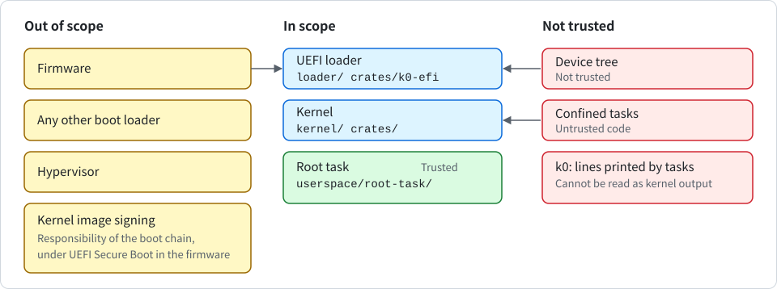

# Security Policy

<div align="center">

English | [한국어](SECURITY_KR.md)

</div>

K0 is a **pre-release research microkernel**. The released version has no task isolation. The unreleased `main` branch has it, but with the limits described below, and **those limits are security relevant**.

> [!IMPORTANT]
> Read this document before running any code on K0 that you do not fully trust.

## Supported versions

| Version | Status | Notes |
| --- | --- | --- |
| 0.1.0 (tag `v0.1.0`) and every earlier commit on `main` | Pre-release | No task isolation. See "Isolation model" below. |
| Current `main` branch | Unreleased | Task isolation with known limits. See "Isolation model" below. |

There is no fixed version yet. Every commit up to and including the `v0.1.0` tag is affected by the advisories listed in "Known advisories". The version number follows SemVer: while the major version is 0, any minor release may break the system call ABI. The first release that ships per-task capability spaces will be `0.2.0`.

## Isolation model

This section describes two different states of the code. Do not mix them up.

### Released tag `v0.1.0` and every earlier commit

These provide **no isolation between tasks**. This is a known design gap, not an incidental bug, and it holds for every task those versions can run.

- There is exactly one capability space, the static root CNode. Every system call resolves its slot arguments in that CNode regardless of which task made the call.
- There is exactly one address space, the root task's TTBR0 root. `TCB_CONFIGURE` can only bind a TCB to that address space.
- There is no capability derivation tree, no `MINT`, no `revoke`, and no capability transfer over IPC.

A task created with `TCB_CONFIGURE` and `TCB_RESUME` in those versions is a **thread of the root task**, not a confined process. Such a task can do the following:

- It holds every capability the root task holds.
- It can read and write all of the root task's memory.
- It can retype any `Untyped` capability.
- It can configure and resume every other TCB.
- It can send to or receive from every `Endpoint`.

Treat every task as fully trusted in those versions.

> [!CAUTION]
> Do not run untrusted or third-party code as a K0 task. There is no workaround at the kernel level.

### The current `main` branch (unreleased)

The current `main` branch contains task isolation. No release or tag contains it yet, and its system call ABI is incompatible with `v0.1.0` (bootinfo layout version 4).

A confined task has the following properties:

- **Capability space**: every task is bound to a capability space, a CNode object, when it is configured. Slot numbers are resolved only in the calling task's own CNode, so a slot number of one task means nothing in another.
- **Address space**: every task runs in the address space named by an `AddrSpace` capability. A task reaches exactly the memory that the holder of its `AddrSpace` capability mapped into that address space.
- **Bindings**: both bindings are held as capabilities inside the task's TCB. If either capability is revoked or deleted, the task is torn down.
- **Scope of isolation**: isolation holds between tasks bound to different CNodes and address spaces. Tasks that share them, as the root task's helper threads do, are threads of one another. Whoever holds a task's TCB, CNode or AddrSpace capability controls that task.
- **Rights**: capabilities carry rights (R, W, X). Rights can only be removed by `CAP_COPY`, never added. `Endpoint` capabilities can carry a badge, set once by `CAP_COPY`, which the receiver sees. The `Console` capability carries R (read input) and W (write output) in the same way. Retyped frames never gain X, and X exists only on the root task's text frames, so no physical frame is writable in one place and executable in another.
- **Derivation and teardown**: capabilities form a derivation list. `CAP_REVOKE` removes everything derived from a capability, `CAP_DELETE` also removes the slot, an object is finalized when its original capability is removed, and the underlying `Untyped` memory can then be retyped again. Retyped objects are zeroed before a capability to them exists.
- **Fault isolation**: a fault, an exit, or an unknown system call in a confined task terminates only that task.

What is still NOT provided on `main`:

- **Availability**: isolation does not cover it. The kernel no longer halts when every task is blocked, a task can bound its own waits with a timeout (GHSA-q99x-2wrv-358p, see "Known advisories"), and the two kernel tables for alias mappings and address spaces can no longer be exhausted. The following is still open:
  - A task that waits without a timeout can wait forever if its partner never acts. A timeout is opt-in per call, so a server or the root task that must stay responsive has to give a timeout on every wait.
  - A timeout says when a task becomes ready, not when it runs. There is no priority and no CPU budget: a CPU-bound task uses its whole turn and nothing caps it. The scheduler is round-robin with a tick of one second. A task that holds `Untyped` memory can create many tasks and dilute the share of every other task, because with N ready tasks the bound below is 1/N and N grows with every task created.
  - Taking the CPU from the next task by yielding or blocking just before the tick is addressed on `main`. `YIELD` needs no capability, and before this change the next task then got only the rest of that period, while the yielding task was back at the head of the queue for the next full period (two CPU-bound tasks in QEMU: the other task fell from about 52 % to 8 % to 11 % of the CPU, and to 3.5 % when the kernel measured time with the counter). The rule now: a task that gets the CPU between two ticks (the previous task yielded, blocked, exited or was killed, or the kernel was idle and woke up for something other than a tick) is not preempted by the first tick it meets. A task is therefore not cut before it has run one full period, and a task that never yields or blocks keeps at least 1/N of the CPU with N ready tasks. That bound was checked by search in a model of the scheduler (up to 6 tasks) and by host tests (`crates/k0-slice`), and it was seen in QEMU (with the attacker yielding at 90 % of the period, the other task had 53.8 % to 54.9 %). It is not a proof and not a budget. A self-test at every boot (`root: slice test yield pass`, `root: slice test block pass`) checks that such a task is not cut at its first tick, on the yield path and on the block path.
  - Timing channels through the scheduler are open. A task still changes when, and now also for how long, another task runs by choosing when to yield or block. This has not been analysed, and closing it would need fixed time partitions, which K0 does not have.
  - There is no real-time or latency promise. The kernel is not preemptible and the tick is one second. A task that becomes ready with k tasks to run before it (the running one included) now starts within k + 1 tick periods, where it used to start within k, so a wait can be up to one tick longer. A caller and a server that exchange calls behind one CPU-bound task needed 2 ticks per round trip in the model and need 4 now. A run of one to two periods and a wait of k + 1 periods describe this version of the scheduler and are not an interface.
  - Some mistakes in connecting the rule to the scheduler would be seen by no test on the real kernel: the tick's own switch passing the wrong entry kind, the idle loop reporting the wrong thing about a tick, and the entry kind at the hand-off to the root task. They change how long a task runs before it is cut, not its share. The host model covers the rule for these cases, not the kernel's use of it. The boot test does catch the old rule and a wrong entry kind on the yield path or the block path.
  - The measurements used an attacker whose yield point was set for it from a loop count that the root task measured. What an attacker needs to find that point by itself was not measured. Everything ran in QEMU (TCG and HVF), nothing on hardware.
  - The kernel is not preemptible. A long system call, for example `CAP_REVOKE` on an `Untyped` with many objects, delays every other task and every timeout.
  - A `k0_arch::fatal` or a kernel panic still stops the machine, and so does an SError taken from EL0.
  - The kernel part of the boot log can be filled by fault and exit lines.
- **Kernel resource exhaustion**: at boot the kernel reserves the page tables and the address space registry entries that the memory it hands out as `Untyped` can need, taking them from the top of each range. `RETYPE` therefore no longer fails with `KERNEL_RESOURCE` for lack of page tables, and the number of address spaces is limited only by memory. The reserve costs about 0.4 % of RAM with the 4 KiB granule (about 0.2 % each for the page tables and for the registry entries). A range that is too small for its own reserve is not handed out as `Untyped`.
- **Missing features**: no fault delivery to a handler task, no notifications, and no capability transfer over IPC.
- **Time visible to EL0**: EL0 still cannot read any hardware counter or timer. IPC timeouts give a task a clock as coarse as the scheduler tick (1 second) and a wake-up aligned to the timer interrupt. Whether that can be amplified into a usable timing source for cache or speculation attacks has not been analysed.
- **Sender after revoke**: a sender already queued on an endpoint still delivers once after its capability is revoked.
- **Serial line**: in an image built with the features `console-input` or `terminal`, an outside party can reach the kernel through the serial line. The operator terminal has no authentication, an outside party can cause interrupts while tasks run, and input waits behind running tasks. See "Serial input and the operator terminal".
- **Cores**: one core only.
- **Executable code**: new executable code cannot be loaded after boot, so a confined task runs code from the root task image.
- **Supported scope**: only the evidence tiers in [INTRODUCTION.md](INTRODUCTION.md) count as supported. Real boards, KVM and other hypervisors, the 16550 console driver, and processors with `HCR_EL2.E2H` fixed to 1 have never been booted.
- **Device tree**: the device tree is not trusted, but it now supplies device addresses. A wrong or hostile device tree can point the console at another device. The kernel limits this: it checks the platform descriptor against the memory map, checks the identification registers of the GIC and the PL011 (the PL011 through a temporary probe mapping, so a device that fails the check is not left mapped; no such register exists for a 16550 or an SBSA UART, so those have no such check), maps a device page only after validation, bounds every console wait, and offers a pinned build (`K0_PIN`) that refuses a different platform. The pinned build compares values that come from the device tree, so it does not stop a hostile boot chain.
- **Device tree address**: the address of the device tree cannot be checked before the first read. The boot loader passes it in `x0`, and the kernel has no memory map until it has read that blob. The kernel refuses a null or misaligned address, an address at or above 2^47 and a range that overlaps the kernel image. It then maps the address as read-only normal memory and reads eight bytes. It reads further, up to 2 MiB, only if those bytes look like a device tree header. A boot loader that passes the address of a device therefore makes the kernel read device registers as if they were memory, and reading some registers has side effects. The mapping is cacheable, so the processor may fetch more of that page than the eight bytes the kernel asks for. The later check that the device tree lies inside declared memory uses the memory map from the same blob. The only write through this mapping happens once, after the blob was parsed and validated: right before the kernel enters the root task, it zeroes the `rng-seed` and `kaslr-seed` values (see "Boot seed and seed wipe" under "The signing oracle"). A second `/chosen` node is refused.
- **Source of output**: kernel output and task output share one boot log, and in an image built with a console driver also one console. A line does not say who wrote it. A task that holds a `Console` capability with the write right can print a line that starts with `k0:`. The kernel replaces control bytes and limits how much of the boot log task output may use, but nothing that reads the console or the log, including `tools/qemu-boot-test.sh`, can treat a `k0:` line printed after `k0: entering root task (el0)` as written by the kernel. This includes the `k0: console drivers [...]` line (see "Optional console output").
- **Trap to EL2**: isolation covers confidentiality and integrity, not availability. A trap to EL2 after the kernel has stepped down to EL1 parks the whole machine by design.
- **Entry at EL2**: entry at EL2 relies on the firmware contract that Linux also uses: an EL3 firmware must enable the fine-grained-trap and HCRX controls when those features exist.
- **Root task**: the root task is still trusted and holds the initial `Untyped` capabilities, and `write_bootinfo` still exposes their physical addresses to it. In an image with the signing oracle it also builds the vault and could read the vault's memory (see "The signing oracle"). In an image with the feature `terminal` it also starts the terminal task and is not restarted if the terminal or the vault dies.

> [!WARNING]
> Even on `main`, treat running untrusted code as experimental. The availability limits above still apply.

The isolation is exercised by the host tests and the boot self-tests. Isolation bypasses on `main` are welcome reports.

## The UEFI loader

`loader/` is a UEFI application that embeds a built kernel and starts it with the usual boot contract, and `crates/k0-efi` holds its logic. The kernel does not change. What the loader does and why it exists are in [design/en/uefi.md](design/en/uefi.md). The security-relevant facts:

- **RAM decision**: the loader decides what the kernel will treat as RAM. Only free memory and loader memory count. Everything else never does: boot services memory, runtime memory, unknown types, overlapping descriptors, reservations and devices found in the firmware device tree. It drops the firmware tree's own memory description, because on QEMU with EDK2 that tree declares all 512 MiB as RAM although firmware regions lie inside, and an unmodified kernel would hand about 5.5 MiB of firmware memory to user space. It then checks its own result with a second classifier and with the kernel's own parser and validation before it jumps.
- **Refusal**: a firmware device tree that the kernel's parser would refuse, and firmware that gives neither a device tree nor readable ACPI static tables, are refused by the loader before boot services end. It prints `k0-loader: refused: <reason>`, wipes what it allocated and returns an error to the firmware.
- **ACPI path**: when the firmware gives no device tree, the loader reads the ACPI static tables RSDP, XSDT, MADT, GTDT and SPCR and builds a minimal device tree from them. It never reads or runs AML. It reads a table only when the whole table lies inside one memory map descriptor that is memory, and it checks lengths and checksums. A device named by the tables (GIC frames, console) must not lie in RAM or in firmware memory, otherwise the loader refuses. A console it cannot use means a boot without console, not a refusal. The finished tree then takes the same checks as a firmware tree.
- **SHA-256 and signing**: the SHA-256 of the embedded kernel is a corruption check, not a signature. The loader has no signature code. Authenticity comes only from Secure Boot in the firmware, which verifies the whole loader file with the kernel inside it, using keys the owner enrols. This was tried once with test keys (see "Where it has run" in [INTRODUCTION.md](INTRODUCTION.md)). The Microsoft third-party route (shim) is not prepared.

Limits and residual risks of the loader:

1. The firmware runs before the loader at the same or a higher privilege. The loader guards against firmware that is wrong, not firmware that is hostile.
2. **Only this loader may start the kernel** under UEFI. A generic UEFI boot loader that passes the firmware device tree through hands firmware memory to user space.
3. The embedded hash does not prove who built the kernel (see above).
4. A refusal returns to the firmware, which tries its next boot option. A machine that must boot K0 or nothing needs a loader built with the feature `refuse-halt`, which parks instead. After the first attempt to exit boot services, every failure parks.
5. QEMU cannot test the cache flush and MMU-off sequence: TCG has no caches, and HVF did not expose a missing flush either. It rests on the architecture rules, on the sequence Linux used when it entered the kernel with the MMU off, and on `tools/pe-check.py`, which checks that the instructions and both flush calls are present, not that they are right on real hardware.
6. A pinned build (`K0_PIN`) under UEFI is untested. The pin line includes the RAM range, which under UEFI depends on the firmware build and the RAM size. A mismatch stops the kernel with nothing on the screen. The reason is in the kernel's boot log in memory, and the loader prints the address needed to read it (`k0-loader: image at 0x..., dtb at 0x...`).
7. Boot services memory is never used, but nothing stops a device that firmware left running from writing to other memory after the firmware services end. K0 has no IOMMU support.
8. The entropy the loader adds stays readable in the device tree in memory until the kernel zeroes the `rng-seed` bytes right before it enters the root task. Copies that the firmware or the loader keep elsewhere are not wiped. Without `EFI_RNG_PROTOCOL` the kernel gets only what the firmware device tree carried, and nothing at all when the tree was built from ACPI tables (the kernel then relies on RNDR if the CPU has it).
9. The kernel never calls UEFI runtime services: no variable access, no reset or power-off through firmware. Runtime regions stay unused.
10. Firmware that describes device registers as `EfiReservedMemoryType` (instead of leaving them out of the map or typing them as MMIO) makes the loader refuse, and one malformed descriptor makes it refuse the whole map. Both fail closed.
11. The paths that move the block to another place and that free memory after a refusal could not be exercised under QEMU.
12. The loader file is not reproducible bit for bit across build directories. The embedded kernel hash that the loader prints is.
13. The only ACPI machine ever booted is QEMU virt. Real ACPI machines, firmware other than EDK2 ArmVirtQemu, GICv4 and redistributors described by CPU entries are untested.
14. The SBSA UART and the 16550 have no identification check, and a 16550 with wider registers gives no console.
15. GICv2 frame sizes are not in the ACPI tables. The loader assumes 4 KiB and 8 KiB, as Linux does.
16. The check that a device named by a table does not lie in memory exists only in the loader. The kernel receives no firmware-owned ranges, so it cannot repeat it.
17. A table kept in memory of the reserved type is not read.

## Optional console output

Input and output are optional in K0. You can select them with Cargo features of the kernel crate.

> [!NOTE]
> Input exists only in an image built with the feature `console-input`, and only for the PL011 and the SBSA UART. A 16550 console has output and no input. See "Serial input and the operator terminal".

Console output exists only in an image built with a console feature. An image built without `console-input` has no input code at all. The following table lists the console features of `k0-kernel`.

| Feature | Drivers it includes |
| --- | --- |
| `console-pl011` | A transmit driver for the PL011 and for the SBSA UART, which use the same registers |
| `console-16550` | A transmit driver for the 16550 family |
| `console` | Both drivers above |

These features only add console output and are never in `default`, like every feature of `k0-kernel`, so every build command names them. The following commands build the 4 KiB image with console and an image without console:

```sh
$ cargo build -p k0-kernel --features console --offline
$ cargo build -p k0-kernel --offline
```

A new input or output path must go behind a feature from the start.

What **an image without a console feature** removes:

- The UART driver code is not in the image.
- The kernel never maps the console device page and writes nothing to a UART.
- Every kernel line and every line from user tasks goes only to the boot log in kernel memory. The kernel prints `k0: no console (driver not built in)`. An image with one driver treats a console of the other kind the same way.

What stays in **every image**:

- The kernel still finds and checks the console node of the device tree, with the same judgement, the same `K0_PIN` line and the same self-check in the UEFI loader. A device tree whose console fails the checks is refused even by an image that would never use the console.
- The `DEBUG_PUTC` system call and the `Console` capability stay, and what a task prints still reaches the boot log. `DEBUG_PUTC` needs the write right (W) of the `Console` capability.
- The boot log stays.
- The UEFI loader prints its own lines through the firmware console before it exits boot services, whatever its embedded kernel was built with.

Two lines let a reader check an image.

- `k0: console drivers [pl011 16550]` (or `[pl011]`, `[16550]`, `[none]`) is the first line of platform bring-up, and it is one string inside the image.
- `k0: device pages [...] of 0x1000 bytes` is printed just before the kernel enters user space and lists every device page the kernel keeps mapped. After it the kernel maps no further device.

Because the first line is a string inside the image, you can enter the following command to tell which console drivers an image was built with, without booting it:

```sh
$ grep -a 'k0: console drivers' <image file>
```

The boot matrix checks both lines (see [design/en/boot.md](design/en/boot.md)).

The limits are as follows:

1. The empty serial log of the `quiet` rows shows only that no byte reached the serial port of QEMU virt, which is a PL011. It says nothing about register reads. Those are covered by the symbol check and by the device page list, which is the kernel's own report.
2. The symbol check runs on debug images. Release (LTO) images of the feature sets without console are not built or booted by the matrix, and no image without console is booted through UEFI.
3. The 16550 driver has never been executed by any test, because QEMU virt has no such UART, and it has no input path. Its code was checked by review only. The SBSA UART uses the PL011 driver without an identity check. Nothing has run on real hardware.
4. An image without console reduces the output path, not what the kernel holds in memory. The boot log is plain kernel memory, and anyone who can read RAM or attach a debugger sees it.
5. A task that holds a `Console` capability can print lines that look like kernel lines, and that includes `k0: console drivers [...]`. Only the first occurrence of that line in the log, or the image file, identifies a build. The line is a label, not proof.

## Serial input and the operator terminal

Input is a second path for outside data into the kernel, so it is off by default and gets its own features. In the following table, both features of `k0-kernel` only add code and are never in `default`.

| Feature | Adds |
| --- | --- |
| `console-input` | The kernel's receive path for the console UART and the system call `CONSOLE_READ`. It needs a console driver feature to do anything. Receive exists for the PL011 and the SBSA UART only. |
| `terminal` | The operator terminal task in the root task image, started as a service after the self-tests. It turns `console-input` on. With `vault` the terminal is the vault's operator, and with `vault-ed25519` it can make an Ed25519 key. |

> [!WARNING]
> There is no authentication on the serial line. Whoever holds the line is the operator and can do exactly the operator's four operations (`STATUS`, `PUBLIC_KEY`, `KEYGEN`, `ZEROIZE`), including erasing the key. The operator cannot get a signature, cannot deliver a seed and cannot change the policy.

An image without `console-input` contains no receive code, no `CONSOLE_READ` and none of the new log lines (a static boot matrix row, `input-symbols`, checks this). An image without `terminal` has no terminal code.

What the kernel does with input:

- **Receive path**: the kernel's UART driver puts received bytes into a ring of 256 bytes. The kernel never interprets a byte. Loss (a FIFO overrun, a break, a framing or parity error) is marked on the byte after the hole.
- **Reading input**: `CONSOLE_READ` (system call 16). The caller names a `Console` slot and flags (`NONBLOCK`, `FLUSH`, a timeout in ticks in bits 63..32, other bits refused with `BAD_FLAGS`). It returns one byte per call. Only one task can wait at a time, and a second reader gets `BUSY`. It returns `NO_DEVICE` when there is no input path or it was turned off. A waiter whose capability is deleted, revoked or moved wakes at once with `REVOKED`. A woken reader goes to the end of the ready queue, so input does not preempt.
- **Console capability rights**: R (read input) and W (write output). `CAP_COPY` can only remove them. The root task's capability has W, and R only in images with `console-input`. `bootinfo::VERSION` is 4.
- **Output filter**: unchanged, except that a `Console` capability with R (the terminal's) may also emit backspace (0x08). Every other control byte is still printed as `?`.
- **Receive interrupts stay off** until a task first reads console input with the right. That first read discards what the device holds, and the periodic `k0: tick N` lines stop after one line `k0: tick lines off (console input in use)`. Ticks, preemption and timeouts keep working.
- **Bound on interrupt work**: when the ring is full, the kernel masks the UART's receive interrupt itself and reopens it after the reader has taken half of the ring. Under a flood the interrupt rate is therefore bounded by the reader. The same drain also runs once per tick, so input still arrives, up to a tick late, when the interrupt does not.
- **Interrupt number**: it comes from the device tree (`interrupts` of the console node: one SPI, level, active high, of the discovered GIC) or, through the UEFI loader, from the ACPI SPCR table. It is printed in the platform line (`k0: platform con=pl011@0x9000000,irq33 ...`) and is therefore pinned by `K0_PIN`. Pin strings made before this change no longer match and must be made again.
- **A wrong interrupt number costs only the input path**: out of range or not available gives `k0: console input off (...)` at boot, and a line that keeps firing without a UART cause is switched off after 8 entries with `k0: console input off (interrupt N fired without a uart cause)`. A console node without a usable interrupt is not a boot refusal, and input is just off.
- **Boot log**: `k0: console input on (pl011 irq 33)` or `k0: console input off (<reason>)`.

What the terminal is:

- **Isolation**: the terminal is a task in its own address space with two capabilities: a `Console` copy with R and W, and the vault endpoint with the send right and the operator badge. The vault's response frame is mapped read-only for it.
- **Start**: after the self-tests, the root task starts a new vault, hands it the boot seed, runs two hostile tasks wired exactly like the terminal (they must be refused and end in a fault), drops its admin capability, starts the terminal and blocks for ever. The lines `root: terminal wiring holds` and `root: service started` report this. On a machine without an input path the root task prints `root: no console input, terminal not started`.
- **Input rules**: a line is at most 64 printable ASCII characters. The terminal drops what reached the UART before the prompt, and a reported loss discards everything up to the next line end (`err input-lost`).

The limits are as follows:

1. The serial line is as trusted as whoever can reach it. The operator can erase the key, which is a denial of service by design.
2. The kernel's receive code runs at EL1. It is small and never interprets bytes, but it is kernel code driven by an outside party. A user-space driver needs device and interrupt delegation, which K0 does not have.
3. An outside party can now cause interrupts while tasks run, bounded by the reader. The reader learns arrival times finer than the tick, and other tasks can notice the stolen time. This is a timing channel that has not been analysed.
4. Input waits behind running tasks. There are no priorities, so the latency is up to a tick per ready task, plus one more tick when the running task got the CPU between two ticks.
5. A 16550 console has no input. The SBSA UART path, FIFO overruns and the receive timeout interrupt are not exercised by QEMU, and host tests with a fake UART (`crates/k0-conin`) are their only coverage. The cut-off for an interrupt line that fires without a UART cause is covered by host tests only.
6. No test measures kernel time under a flood on a machine. The bound is argued from the gate and shown in host tests.
7. "Dropped before the prompt" counts bytes that reached the UART. An emulator or adapter that holds bytes back delivers them later, and QEMU does.
8. If a kernel line appears while the operator is typing, the screen line is split but the buffer is whole, and Enter runs the whole buffer.
9. Any task with `Console` output can still print lines that look like kernel or root task lines, and nothing authenticates the prefix. The terminal can additionally erase within its current line.
10. No signing client exists in service mode. The vault's key is made and shown but not used by another task. Client signing is shown by the self-test.
11. The terminal and the vault are not restarted if they die. The root task is trusted.
12. Terminal output counts against the user share of the in-memory boot log. Once that share is full, later task output is not recorded there.
13. The vault limits under "The signing oracle" all stay. Nothing ran on real hardware.

## The signing oracle

The signing oracle is the first service on top of the isolation core. A vault task holds one Ed25519 key. Client tasks get signatures and the public key over IPC and never the key. It is optional and off by default.

> [!WARNING]
> The Ed25519 implementation has no validation of any kind, and the key does not come from an approved random bit generator. Do not read this feature as FIPS validated, certified or compliant.

What the oracle claims:

- **Key separation**: the key lives in the vault's own address space and stack. The root task builds the vault, and no other task can map the vault's memory. A client's CNode holds only a send-only, badged copy of the vault endpoint.
- **Frame rights**: per caller there is a request frame (caller read-write, vault read-only) and a response frame (vault read-write, caller read-only), enforced by reduced-rights copies of the frame capabilities. The operator has a response frame and no request frame. The vault decides from the badge and the operation alone which frame it reads or writes, and a request that claims a body its role cannot have is refused without touching memory.
- **Fixed policy**: the policy is fixed at build time and keyed by the endpoint badge, which the kernel delivers and a client cannot forge. Four roles are fixed at build time: admin (the root task: STATUS, INIT, KEYGEN, ZEROIZE, not SIGN), operator (the terminal: STATUS, PUBLIC_KEY, KEYGEN, ZEROIZE, not SIGN and not INIT), signer (STATUS, PUBLIC_KEY, SIGN) and reader (STATUS, PUBLIC_KEY). A call without a badge or with an unknown badge is refused. No operation changes the policy.
- **Fixed image**: the vault code is part of the root task image, which is checked by SHA-256 at boot like before. Nothing is loaded after boot.
- **Single read of the request**: the vault reads the request body once into a private buffer, with the length fixed first, and uses only that copy. A reply always sets four registers: status, length, indicator bits and the caller's nonce. A client must trust the response frame only after an OK reply that carries its own nonce.
- **Failure state**: a failed known-answer self-test (two RFC 8032 vectors) or a failed pairwise consistency test after key generation puts the vault into a failed state that refuses everything but STATUS. Every way into the failed state wipes seed and key. Verification is strict (`verify_strict`). There is no key export, and ZEROIZE drops the key and ends SIGN and PUBLIC_KEY.

What the oracle does not claim:

1. The algorithm is Ed25519 (PureEdDSA with SHA-512, as in FIPS 186-5 and RFC 8032). The implementation is the vendored crate `ed25519-dalek` 2.2.0 and has no validation of any kind. The key does not come from an approved random bit generator.
2. There is no side-channel analysis of the crate on this kernel.
3. There is one key per boot (a second KEYGEN is refused with `key-exists`, and after ZEROIZE a reboot is needed), no persistence, no key import or export and no DRBG. The only operator input is the serial terminal, which has no authentication (see "Serial input and the operator terminal"). No post-quantum algorithm exists yet.
4. All signers share the one key, so a signature carries no client identity.
5. Availability of the vault is not protected. Clients share one endpoint and must use timeouts, and the operator can erase the key.
6. The root task is trusted and could read the vault.
7. The oracle was only run in QEMU (TCG and HVF). The scrubs of stack copies (kernel boot stack, vault stack after signing) are best effort.
8. The self-test runs its clients one after another in one client address space, so it shows isolation between the vault and a client, not between clients. It makes its key from the public RFC 8032 test seed, with the real seed information, so the entropy rule is still exercised.

Seed and key: the vault has the states `fresh`, `seeded`, `ready`, `zeroized` and `failed`. INIT (admin only, once) only delivers the seed. The vault checks the entropy rule and holds the seed (`seeded`). KEYGEN (admin and operator) makes the key from the held seed with the chosen algorithm and wipes the seed (`ready`). A vault in an image without an algorithm refuses the seed and stays `fresh`, and an all-zero seed is refused.

Entropy rule: the vault refuses the boot seed (status `NO_ENTROPY`) unless the boot seed contains at least 32 bytes of `rng-seed` or 256 bits from RNDR. QEMU virt provides a 32-byte `rng-seed`. Every reply carries indicator bits: the algorithm is in FIPS 186-5, the self-tests passed, at least 32 `rng-seed` bytes went into the key seed, and RNDR went into the key seed. These bits report what happened. They are not a validation claim. The STATUS reply packs the state, the key's algorithm and the algorithms in the image into one word.

### Boot seed and seed wipe

The kernel derives 32 bytes for the root task with SHA-256 under its own domain string from the device tree entropy, the counter and, when the CPU has RNDR, four fresh RNDR words. It is independent of the PAC keys by domain separation. The seed is as good as its inputs and no better. It reaches the root task in the entry registers `x0` to `x3`, and `x4` tells how many `rng-seed` bytes were used and whether RNDR contributed. It is not in the bootinfo page, and the root task prints only the source, never the seed. The real boot seed is used exactly once, by the service vault in images with `terminal` and `vault`. In every other image the root task wipes it at entry.

Right before the kernel enters the root task it zeroes the `rng-seed` and `kaslr-seed` bytes in the device tree: it switches the read-only alias entry of that page to read-write in place, writes zeros, cleans and invalidates the cache lines, switches it back and reads the bytes back. It then wipes its own copy in `BootInfo`, prints `k0: dtb seeds wiped <n>B` and zeroes the boot stack below the live frames. Copies that the firmware or the UEFI loader keep, and anything in the live frames of the boot stack, are not wiped.

## Known advisories

The following advisories are tracked as GitHub Security Advisories in this repository. The first two were published on 2026-11-07. All of them affect version 0.1.0 and earlier, and none has a fixed version yet.

> [!NOTE]
> GHSA-hj3f-38h9-hrpj is still an unpublished draft, so its identifier does not resolve publicly yet. This table is its public record until it is published.

| Advisory | Severity | Summary |
| --- | --- | --- |
| [GHSA-vmpv-qc49-3p6r](https://github.com/Quant-Off/k0/security/advisories/GHSA-vmpv-qc49-3p6r) | High | All tasks share the root CNode and address space, so any spawned task holds full root authority. |
| [GHSA-q99x-2wrv-358p](https://github.com/Quant-Off/k0/security/advisories/GHSA-q99x-2wrv-358p) | Medium | A task that blocks on IPC while every other task is blocked halts the whole system. |
| GHSA-hj3f-38h9-hrpj | Low | DTB memory regions are not bounded by the physical address width. |

The current `main` branch contains changes that address the subject of some of these advisories. No release contains them yet, and **advisory status is updated only at release**.

## Reporting a vulnerability

> [!IMPORTANT]
> Please do not open a public issue for a security problem.

You can report a problem in the following ways:

- **Preferred**: open a draft security advisory at <https://github.com/Quant-Off/k0/security/advisories/new>.
- **Alternative**: email the maintainer at <qtfelix@qu4nt.space>. Include the affected commit hash, the platform (QEMU machine and CPU model, hypervisor, or board), the entry level (EL1 or EL2), the page size (4 KiB or 16 KiB), the `k0: platform ...` line from the boot log, and a reproduction if you have one.

Isolation gaps in `v0.1.0` and earlier commits, and the availability and resource limits listed under "What is still NOT provided on `main`", are already known and **do not need to be filed again**. Isolation bypasses on the current `main` branch are welcome, for example a task reaching another task's memory or capabilities, a revoked capability that keeps working, or a stale mapping that survives unmap, revoke or address space destruction. Reports about the signing oracle are welcome, for example a key disclosure to a client, a policy bypass, or a reply that reaches the wrong caller. Reports about the serial input path and the operator terminal are welcome too, for example a byte stream that makes the kernel misbehave, a wake-up of the wrong task, or an operator operation beyond the four listed. Reports about the UEFI loader are welcome too, for example a memory map or device tree that makes it hand the kernel memory that firmware still uses, or a refusal that does not happen. Reports about anything else, including boot-time memory map validation, exception handling, scheduler policy, and IPC state machines, are welcome.

## Scope

The following picture shows how this document divides what is in scope, what is out of scope and what is not trusted.

<p align="center">
  
</p>

**In scope**: everything under `kernel/`, `crates/` (including `crates/k0-efi`), `loader/`, `userspace/root-task/` and `userspace/k0-vault` and `userspace/k0-term` with their wiring in the root task. The UEFI loader is part of the boot chain, but it is code of this repository, so its handling of the memory map, the device tree and the kernel image is in scope.

**Out of scope**: the rest of the boot chain before the kernel entry point (for example firmware, any other boot loader and the hypervisor), and the integrity of the kernel image itself. Kernel image signing is the boot chain's responsibility. Under UEFI that means Secure Boot in the firmware, because the loader's SHA-256 check is not a signature (see "The UEFI loader").

The kernel checks the embedded root task image against a SHA-256 hash at every boot. This is a **corruption check**, not a signature check. The reference hash lives in the same kernel image as the root task, so anyone who can modify the kernel image can change both. Reports that rely on modifying the kernel image, or the kernel embedded in the loader, are therefore out of scope.
