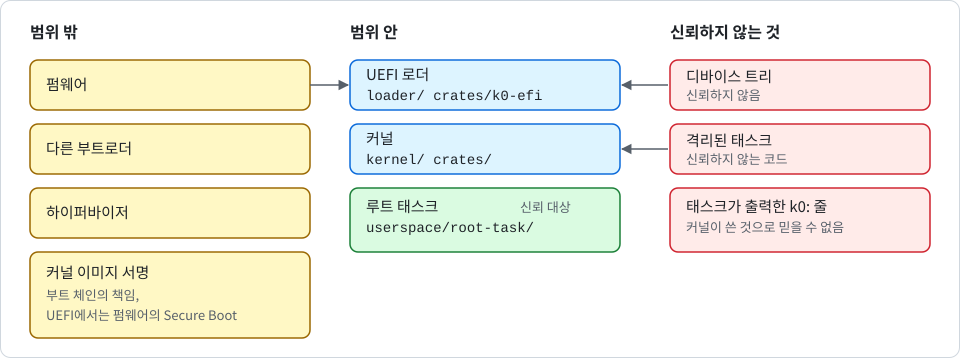

# 보안 정책

<div align="center">

[English](SECURITY.md) | 한국어

</div>

K0는 **정식 릴리즈 전 단계의 연구용 마이크로커널**입니다. 릴리즈된 버전에는 태스크 격리가 없습니다. 릴리즈 전인 `main` 브랜치에는 격리가 있지만 뒤에 적은 한계가 있습니다. **이 한계들은 보안과 직결**됩니다.

> [!IMPORTANT]
> 완전히 신뢰하지 않는 코드를 K0 위에서 실행하기 전에 이 문서를 먼저 읽어 주세요.

## 지원 버전

| 버전                                              | 상태      | 비고                                      |
|---------------------------------------------------|-----------|-------------------------------------------|
| 0.1.0(태그 `v0.1.0`)과 그 이전의 `main` 모든 커밋 | 릴리즈 전 | 태스크 격리 없음(뒤의 "격리 모델" 절 참고) |
| 현재 `main` 브랜치                                | 릴리즈 전(미배포) | 알려진 한계가 있는 태스크 격리(뒤의 "격리 모델" 절 참고) |

아직 수정된 버전은 없습니다. `v0.1.0` 태그를 포함한 그 이전 모든 커밋이 "알려진 어드바이저리"에 적힌 문제의 영향을 받습니다. 버전 번호는 SemVer를 따릅니다. 메이저 버전이 0인 동안에는 마이너 릴리즈에서 시스템 콜 ABI가 바뀔 수 있습니다. 태스크별 케이퍼빌리티 공간을 처음 제공하는 릴리즈는 `0.2.0`이 됩니다.

## 격리 모델

이 절은 서로 다른 두 상태의 코드를 구분해서 설명합니다. 둘을 섞어 읽지 마세요.

### 릴리즈된 태그 `v0.1.0`과 그 이전의 모든 커밋

이 버전들은 **태스크 간 격리를 제공하지 않습니다**. 이것은 우연한 버그가 아니라 알려진 설계의 공백입니다. 해당 버전이 실행할 수 있는 모든 태스크에 해당합니다.

- 케이퍼빌리티 공간은 정적 루트 CNode 하나뿐입니다. 어떤 태스크가 호출하든 모든 시스템 콜은 슬롯 인자를 이 CNode에서 해석합니다.
- 주소 공간은 루트 태스크의 TTBR0 루트 하나뿐입니다. `TCB_CONFIGURE`는 TCB를 이 주소 공간에만 바인딩할 수 있습니다.
- 케이퍼빌리티 파생 계보 구조(CDT), `MINT`, `revoke`, IPC를 통한 케이퍼빌리티 전송이 없습니다.

이 버전에서 `TCB_CONFIGURE`와 `TCB_RESUME`으로 만든 태스크는 격리된 프로세스가 아니라 **루트 태스크의 스레드**입니다. 이 태스크는 다음을 할 수 있습니다.

- 루트 태스크가 가진 모든 케이퍼빌리티를 그대로 사용할 수 있습니다.
- 루트 태스크의 메모리 전체를 읽고 쓸 수 있습니다.
- 임의의 `Untyped` 케이퍼빌리티를 retype할 수 있습니다.
- 다른 모든 TCB를 설정하고 재개할 수 있습니다.
- 모든 `Endpoint`에 송수신할 수 있습니다.

해당 버전에서는 모든 태스크를 완전히 신뢰하는 것으로 취급해야 합니다.

> [!CAUTION]
> 신뢰하지 않는 코드나 서드파티 코드를 K0 태스크로 실행하지 마세요. 커널 수준의 우회책은 없습니다.

### 현재 `main` 브랜치(릴리즈 전)

현재 `main` 브랜치에는 태스크 격리가 들어 있습니다. 아직 어떤 릴리즈나 태그에도 포함되지 않았고, 시스템 콜 ABI가 `v0.1.0`과 호환되지 않습니다(bootinfo 레이아웃 버전 2).

격리된 태스크의 성질은 다음과 같습니다.

- **케이퍼빌리티 공간**: 태스크는 구성될 때 케이퍼빌리티 공간(CNode 오브젝트) 하나에 묶입니다. 슬롯 번호는 호출한 태스크 자신의 CNode에서만 해석되므로, 한 태스크의 슬롯 번호는 다른 태스크에서 아무 의미가 없습니다.
- **주소 공간**: 태스크는 `AddrSpace` 케이퍼빌리티가 가리키는 주소 공간에서 실행됩니다. 태스크는 그 `AddrSpace` 케이퍼빌리티를 가진 쪽이 해당 주소 공간에 매핑해 준 메모리에만 접근합니다.
- **바인딩**: 두 바인딩은 모두 태스크의 TCB 안에 케이퍼빌리티로 보관됩니다. 둘 중 하나가 revoke되거나 삭제되면 그 태스크는 해체됩니다.
- **격리의 범위**: 격리는 서로 다른 CNode와 주소 공간에 묶인 태스크 사이에서 성립합니다. 루트 태스크의 보조 스레드처럼 같은 것을 함께 사용하는 태스크끼리는 서로의 스레드입니다. 태스크의 TCB, CNode, AddrSpace 케이퍼빌리티를 가진 쪽이 그 태스크를 통제합니다.
- **권한**: 케이퍼빌리티는 권한(R, W, X)을 가집니다. 권한은 `CAP_COPY`로 줄이기만 할 수 있고 늘릴 수는 없습니다. `Endpoint` 케이퍼빌리티는 `CAP_COPY`로 한 번 설정하는 배지를 가질 수 있고, 수신자가 이 배지를 받습니다. retype된 프레임은 X를 얻을 수 없고 X는 루트 태스크의 text 프레임에만 있으므로, 어떤 물리 프레임도 한 곳에서 쓰기 가능하면서 다른 곳에서 실행 가능하지 않습니다.
- **파생과 해체**: 케이퍼빌리티는 파생 목록을 이룹니다. `CAP_REVOKE`는 파생된 모든 케이퍼빌리티를 제거하고, `CAP_DELETE`는 슬롯까지 제거합니다. 오브젝트는 원본 케이퍼빌리티가 제거될 때 finalize되며, 그 뒤 해당 `Untyped` 메모리를 다시 retype할 수 있습니다. retype된 오브젝트는 케이퍼빌리티가 만들어지기 전에 0으로 지워집니다.
- **폴트 격리**: 격리된 태스크의 폴트, 종료, 알 수 없는 시스템 콜은 그 태스크만 종료시킵니다.

`main`에서도 **여전히 제공하지 않는 것**은 다음과 같습니다.

- **가용성**: 격리는 가용성을 보장하지 않습니다. 모든 태스크가 블록되면 커널은 여전히 코어를 정지시키며(GHSA-q99x-2wrv-358p), 격리된 태스크가 마지막으로 블록되는 방식으로 이를 일으킬 수 있습니다.
- **커널 자원 고갈**: `Untyped` 메모리를 많이 가진 태스크는 별칭 매핑에 사용하는 정적 커널 페이지 테이블 풀(40개)을 소진시킬 수 있습니다. 그러면 모든 태스크의 `RETYPE`가 `KERNEL_RESOURCE`로 실패합니다. 정적 주소 공간 레지스트리도 소진시킬 수 있습니다.
- **미구현 기능**: 핸들러 태스크로의 폴트 전달, 알림(notification), 타임아웃, IPC를 통한 케이퍼빌리티 전송이 아직 없습니다.
- **revoke 뒤의 송신자**: 엔드포인트에 이미 대기 중인 송신자는 케이퍼빌리티가 revoke된 뒤에도 한 번 전달됩니다.
- **코어 수**: 단일 코어만 지원합니다.
- **실행 코드**: 부팅 후에는 새 실행 코드를 로드할 수 없으므로, 격리된 태스크는 루트 태스크 이미지의 코드를 실행합니다.
- **지원 범위**: [INTRODUCTION_KR.md](INTRODUCTION_KR.md)의 증거 단계에 든 것만 지원한다고 봅니다. 실제 보드, KVM 등 다른 하이퍼바이저, 16550 콘솔 드라이버, `HCR_EL2.E2H`가 1로 고정된 프로세서는 한 번도 부팅한 적이 없습니다.
- **디바이스 트리**: 디바이스 트리는 신뢰하지 않지만, 이제 장치 주소를 여기서 가져옵니다. 잘못되었거나 악의적인 디바이스 트리가 콘솔을 다른 장치로 향하게 할 수 있습니다. 커널은 이를 다음과 같이 제한합니다. 플랫폼 기술자를 메모리 맵과 대조합니다. GIC와 PL011의 식별 레지스터를 확인합니다(PL011은 임시 프로브 매핑으로 확인하므로 확인에 실패한 장치는 매핑된 채 남지 않습니다. 16550과 SBSA UART에는 그런 레지스터가 없어서 이 확인이 없습니다). 검증이 끝난 뒤에만 장치 페이지를 매핑합니다. 콘솔 대기는 모두 시간 제한으로 묶습니다. 다른 플랫폼을 거부하는 고정 빌드(`K0_PIN`)도 제공합니다. 고정 빌드는 디바이스 트리에서 나온 값을 비교하므로 악의적인 부트 체인은 막지 못합니다.
- **디바이스 트리의 주소**: 디바이스 트리의 주소는 처음 읽기 전에 검사할 방법이 없습니다. 부트로더가 이 주소를 `x0`로 넘기는데, 커널은 그 블롭을 읽기 전에는 메모리 맵을 모릅니다. 커널은 널이거나 정렬이 맞지 않는 주소, 2^47 이상인 주소, 커널 이미지와 겹치는 구간을 거부합니다. 그런 다음 그 주소를 읽기 전용 일반 메모리로 매핑하고 8바이트를 읽습니다. 그 바이트가 디바이스 트리 헤더처럼 보일 때만 더 읽습니다(최대 2 MiB). 따라서 부트로더가 장치의 주소를 넘기면 커널은 장치 레지스터를 메모리처럼 읽게 되고, 일부 레지스터는 읽기만 해도 부작용이 생깁니다. 이 매핑은 캐시 가능한 메모리라서 프로세서가 커널이 요청한 8바이트보다 그 페이지를 더 많이 가져올 수 있습니다. 디바이스 트리가 선언된 메모리 안에 있는지 보는 나중의 검사는 같은 블롭에서 나온 메모리 맵을 사용합니다. 커널은 이 매핑으로 쓰기를 하지 않습니다.
- **출력의 출처**: 커널 출력과 태스크 출력은 부트 로그 하나를 함께 사용합니다. 콘솔 드라이버를 포함해 빌드한 이미지에서는 콘솔 하나도 함께 사용합니다. 줄에는 누가 썼는지 표시가 없습니다. `Console` 케이퍼빌리티를 가진 태스크는 `k0:`로 시작하는 줄을 출력할 수 있습니다. 커널은 제어 바이트를 바꾸고 태스크 출력이 부트 로그에서 차지할 수 있는 양을 제한합니다. 그래도 콘솔이나 로그를 읽는 쪽은 `tools/qemu-boot-test.sh`를 포함해 누구도 `k0: entering root task (el0)` 뒤에 나온 `k0:` 줄을 커널이 쓴 것으로 믿을 수 없습니다. `k0: console drivers [...]` 줄도 여기에 포함됩니다("선택적 콘솔 출력" 참고).
- **EL2 트랩**: 격리는 기밀성과 무결성을 다루고 가용성은 다루지 않습니다. 커널이 EL1로 내려온 뒤 EL2로 트랩이 오면 설계상 기계 전체를 멈춥니다.
- **EL2 진입**: EL2 진입은 Linux와 같은 펌웨어 약속을 전제로 합니다. EL3 펌웨어는 세분화된 트랩과 HCRX 제어 기능이 있으면 이를 켜 주어야 합니다.
- **루트 태스크**: 루트 태스크는 여전히 신뢰 대상이며 최초의 `Untyped` 케이퍼빌리티를 가지고, `write_bootinfo`는 그 물리 주소를 루트 태스크에 계속 노출합니다.

> [!WARNING]
> `main`에서도 신뢰하지 않는 코드의 실행은 실험적인 것으로 취급하세요. 위의 가용성 한계는 그대로 적용됩니다.

격리는 호스트 테스트와 부팅 자가 검증으로 검증합니다. `main`의 격리 우회는 언제든 환영하는 신고입니다.

## UEFI 로더

`loader/`는 빌드된 커널을 품고 평소의 부팅 약속대로 시작시키는 UEFI 응용 프로그램이고, `crates/k0-efi`가 그 논리를 담습니다. 커널은 바뀌지 않았습니다. 로더가 하는 일과 있는 이유는 [design/kr/uefi_KR.md](design/kr/uefi_KR.md)에 있습니다. 보안과 관련된 사실은 다음과 같습니다.

- **RAM 판정**: 로더가 커널이 RAM으로 볼 메모리를 정합니다. 빈 메모리와 로더 메모리만 RAM으로 칩니다. 그 밖의 것은 절대 RAM이 아닙니다. 부트 서비스 메모리, 런타임 메모리, 알 수 없는 유형, 겹치는 디스크립터, 펌웨어 디바이스 트리에서 찾은 예약 영역과 장치가 그렇습니다. 로더는 펌웨어 트리의 메모리 기술을 버립니다. EDK2를 사용하는 QEMU에서는 그 트리가 펌웨어 영역이 그 안에 있는데도 512 MiB 전체를 RAM이라고 선언하며, 수정하지 않은 커널은 펌웨어 메모리 약 5.5 MiB를 사용자 공간에 넘겨 주기 때문입니다. 그런 다음 점프하기 전에 두 번째 분류기와 커널 자신의 파서·검증으로 자기 결과를 다시 검사합니다.
- **거부**: 펌웨어가 커널의 파서가 거부할 디바이스 트리를 주거나, 디바이스 트리도 읽을 수 있는 ACPI 정적 테이블도 주지 않으면 부트 서비스가 끝나기 전에 로더가 거부합니다. `k0-loader: refused: <사유>`를 출력하고, 할당한 것을 지운 뒤 펌웨어에 에러를 돌려줍니다.
- **ACPI 경로**: 펌웨어가 디바이스 트리를 주지 않으면 로더가 ACPI 정적 테이블(RSDP, XSDT, MADT, GTDT, SPCR)을 읽어 최소한의 디바이스 트리를 만듭니다. AML은 읽지도 실행하지도 않습니다. 테이블 전체가 메모리인 메모리 맵 디스크립터 하나 안에 들어 있을 때만 테이블을 읽고, 길이와 체크섬을 검사합니다. 테이블이 가리키는 장치(GIC 프레임, 콘솔)가 RAM이나 펌웨어 메모리에 있으면 로더가 거부합니다. 쓸 수 없는 콘솔은 거부가 아니라 콘솔 없는 부팅이 됩니다. 완성된 트리는 펌웨어 트리와 같은 검사를 받습니다.
- **SHA-256과 서명**: 내장 커널의 SHA-256은 손상 검사이지 서명이 아닙니다. 로더에는 서명 코드가 없습니다. 진위는 펌웨어의 Secure Boot에서만 나옵니다. 소유자가 등록한 키로, 커널이 들어 있는 로더 파일 전체를 펌웨어가 검증합니다. 시험용 키로 한 번 해 보았습니다([INTRODUCTION_KR.md](INTRODUCTION_KR.md)의 "어디서 돌려 봤나" 참고). Microsoft 제3자 경로(shim)는 준비하지 않았습니다.

로더의 한계와 남은 위험은 다음과 같습니다.

1. 펌웨어는 로더보다 먼저, 같거나 더 높은 권한으로 실행됩니다. 로더는 틀린 펌웨어를 막을 뿐, 악의적인 펌웨어는 막지 못합니다.
2. UEFI에서는 **이 로더만 커널을 시작해야 합니다**. 펌웨어 디바이스 트리를 그대로 넘기는 일반 UEFI 부트로더는 펌웨어 메모리를 사용자 공간에 넘겨 줍니다.
3. 내장 해시는 누가 커널을 만들었는지 증명하지 않습니다(위 참고).
4. 거부하면 펌웨어로 돌아가고, 펌웨어는 다음 부팅 옵션을 시도합니다. K0가 아니면 부팅하지 않아야 하는 기계에는 `refuse-halt` 기능을 켜고 빌드한 로더가 필요하며, 이 로더는 대신 멈춥니다. 부트 서비스 종료를 처음 시도한 뒤에는 모든 실패에서 멈춥니다.
5. QEMU로는 캐시 비우기와 MMU 끄기 순서를 시험할 수 없습니다. TCG에는 캐시가 없고, HVF도 빠진 비우기를 드러내지 못했습니다. 이 순서는 아키텍처 규칙, Linux가 MMU를 끈 채 커널에 진입할 때 쓰던 순서, 그리고 명령과 두 번의 비우기 호출이 있는지를 보는 `tools/pe-check.py`에 의존하며, 이 검사는 실제 하드웨어에서 옳은지가 아니라 있는지만 봅니다.
6. UEFI에서의 고정 빌드(`K0_PIN`)는 시험하지 않았습니다. 고정 줄에는 RAM 범위가 들어 있는데, UEFI에서는 이 값이 펌웨어 빌드와 RAM 크기에 따라 달라집니다. 맞지 않으면 커널은 화면에 아무것도 없이 멈춥니다. 사유는 메모리에 있는 커널의 부트 로그에 있고, 로더는 그것을 읽는 데 필요한 주소를 출력합니다(`k0-loader: image at 0x..., dtb at 0x...`).
7. 부트 서비스 메모리는 사용하지 않지만, 펌웨어가 켜 둔 채 남긴 장치가 펌웨어 서비스가 끝난 뒤 다른 메모리에 쓰는 것은 막을 방법이 없습니다. K0에는 IOMMU 지원이 없습니다.
8. 로더가 더하는 엔트로피는 실행 내내 메모리의 디바이스 트리에서 읽을 수 있는 채로 남습니다. `EFI_RNG_PROTOCOL`이 없으면 커널은 펌웨어 디바이스 트리에 있던 것만 받고, 트리를 ACPI 테이블로 만들었다면 아무것도 받지 못합니다(이때 커널은 CPU에 RNDR이 있으면 그것에 의존합니다).
9. 커널은 UEFI 런타임 서비스를 부르지 않습니다. 변수 접근도, 펌웨어를 통한 리셋이나 전원 끄기도 없으며, 런타임 영역은 사용되지 않은 채 남습니다.
10. 장치 레지스터를 `EfiReservedMemoryType`으로 기술하는 펌웨어(맵에서 제외하거나 MMIO 유형으로 적는 대신)는 로더가 거부하고, 잘못된 디스크립터가 하나만 있어도 맵 전체를 거부합니다. 둘 다 안전한 쪽으로 실패합니다.
11. 블록을 다른 자리로 옮기는 경로와, 거부한 뒤 메모리를 해제하는 경로는 QEMU에서 실행해 볼 수 없었습니다.
12. 로더 파일은 빌드 디렉터리가 다르면 비트 단위로 같지 않습니다. 로더가 출력하는 내장 커널 해시는 같습니다.
13. 부팅해 본 ACPI 머신은 QEMU virt뿐입니다. 실제 ACPI 머신, EDK2 ArmVirtQemu 이외의 펌웨어, GICv4, CPU 항목으로 기술된 리디스트리뷰터는 시험하지 않았습니다.
14. SBSA UART와 16550에는 식별 검사가 없고, 레지스터가 더 넓은 16550은 콘솔을 주지 못합니다.
15. GICv2 프레임 크기는 ACPI 테이블에 없습니다. 로더는 Linux처럼 4 KiB와 8 KiB로 가정합니다.
16. 테이블이 가리키는 장치가 메모리에 있지 않은지 확인하는 검사는 로더에만 있습니다. 커널은 펌웨어 소유 범위를 받지 못하므로 이것을 되풀이할 수 없습니다.
17. reserved 유형의 메모리에 있는 테이블은 읽지 않습니다.

## 선택적 콘솔 출력

K0에서 입력 및 출력은 선택 사항입니다. 커널 크레이트의 Cargo features로 선택할 수 있습니다.

> [!NOTE]
> 입력 또는 터미널용 feature는 아직 없습니다. 지금 선택할 수 있는 것은 콘솔 출력뿐입니다.

콘솔 출력은 콘솔 feature를 포함해 빌드한 이미지에만 있습니다. 입력은 어떤 이미지에도 없습니다. `k0-kernel`의 콘솔 feature는 다음과 같습니다.

| feature | 포함하는 드라이버 |
| --- | --- |
| `console-pl011` | PL011과 SBSA UART의 송신 드라이버(둘은 같은 레지스터를 사용합니다) |
| `console-16550` | 16550 계열의 송신 드라이버 |
| `console` | 위의 두 드라이버 모두 |

이 feature는 콘솔 출력을 더하기만 하며 `default`에는 절대 추가하지 않습니다. 따라서 모든 빌드 명령이 이름을 직접 적습니다. 다음 명령은 각각 콘솔이 있는 4 KiB 이미지와 콘솔이 없는 이미지를 만듭니다.

```sh
$ cargo build -p k0-kernel --features console --offline
$ cargo build -p k0-kernel --offline
```

새로운 입력 또는 출력 경로는 처음부터 feature 뒤에 두어야 합니다.

**콘솔 feature 없이 빌드한 이미지**에서는 다음이 빠집니다.

- UART 드라이버 코드가 이미지에 없습니다.
- 커널은 콘솔 장치 페이지를 매핑하지 않고 UART에 아무것도 쓰지 않습니다.
- 모든 커널 줄과 사용자 태스크의 모든 줄은 커널 메모리의 부트 로그로만 갑니다. 커널은 `k0: no console (driver not built in)`을 출력합니다. 드라이버 하나만 포함한 이미지는 다른 종류의 콘솔을 똑같이 취급합니다.

**모든 이미지**에는 다음이 남습니다.

- 커널은 여전히 디바이스 트리의 콘솔 노드를 찾아 검사합니다. 판단 기준, `K0_PIN` 줄, UEFI 로더의 자가 검사가 모두 같습니다. 콘솔이 검사를 통과하지 못하는 디바이스 트리는 콘솔을 전혀 쓰지 않을 이미지도 거부합니다.
- `DEBUG_PUTC` 시스템 콜과 `Console` 케이퍼빌리티가 남고, 태스크가 출력한 것은 여전히 부트 로그에 닿습니다.
- 부트 로그가 남습니다.
- UEFI 로더는 내장한 커널을 어떻게 빌드했든, 부트 서비스를 종료하기 전에는 자기 줄을 펌웨어 콘솔로 출력합니다.

다음 두 줄로 이미지를 확인할 수 있습니다.

- `k0: console drivers [pl011 16550]`(또는 `[pl011]`, `[16550]`, `[none]`)은 플랫폼 기동의 첫 줄이며 이미지 안의 문자열 하나입니다.
- `k0: device pages [...] of 0x1000 bytes`는 커널이 사용자 공간에 들어가기 직전에 출력되며, 커널이 매핑한 채로 두는 모든 장치 페이지를 나열합니다. 이 줄 뒤에 커널은 더 이상 장치를 매핑하지 않습니다.

첫 번째 줄은 이미지 안의 문자열이므로, 다음과 같이 입력하면 부팅하지 않고도 이미지가 어떤 콘솔 드라이버로 빌드되었는지 알 수 있습니다.

```sh
$ grep -a 'k0: console drivers' <이미지 파일>
```

부팅 매트릭스가 두 줄을 모두 확인합니다([design/kr/boot_KR.md](design/kr/boot_KR.md) 참고).

다음은 한계입니다.

1. `quiet` 행의 비어 있는 직렬 로그는 PL011인 QEMU virt의 직렬 포트로 한 바이트도 나오지 않았다는 것만 보여 줍니다. 레지스터 읽기에 대해서는 아무것도 말하지 않습니다. 그것은 심볼 검사와, 커널 자신의 보고인 장치 페이지 목록이 다룹니다.
2. 심볼 검사는 디버그 이미지에서 실행합니다. 콘솔 없는 feature 조합의 릴리즈(LTO) 이미지는 매트릭스가 빌드하거나 부팅하지 않으며, 콘솔 없는 이미지를 UEFI로 부팅해 본 적도 없습니다.
3. 16550 드라이버는 어떤 테스트로도 실행된 적이 없습니다. QEMU virt에 그런 UART가 없기 때문입니다. 코드는 리뷰로만 확인했습니다. SBSA UART는 식별 확인 없이 PL011 드라이버를 사용합니다. 실제 하드웨어에서 실행한 것은 없습니다.
4. 콘솔 없는 이미지가 줄이는 것은 출력 경로이지 커널이 메모리에 가진 내용이 아닙니다. 부트 로그는 평범한 커널 메모리이며, RAM을 읽거나 디버거를 붙일 수 있는 사람은 누구나 봅니다.
5. `Console` 케이퍼빌리티를 가진 태스크는 커널 줄처럼 보이는 줄을 출력할 수 있으며, `k0: console drivers [...]`도 여기에 포함됩니다. 로그에서 그 줄의 첫 번째 등장 또는 이미지 파일만이 빌드를 식별합니다. 이 줄은 증거가 아니라 표지입니다.

## 알려진 어드바이저리

다음 어드바이저리는 이 저장소의 GitHub Security Advisories에서 추적합니다. 앞의 두 건은 2026-11-07에 게시했습니다. 모두 0.1.0 이하 버전에 영향을 주며, 아직 수정된 버전은 없습니다.

> [!NOTE]
> GHSA-hj3f-38h9-hrpj는 아직 게시 전인 draft라서 식별자가 외부에서는 조회되지 않습니다. 게시되기 전까지는 이 표가 공개 기록입니다.

| 어드바이저리                                                                                   | 심각도 | 요약                                                                                    |
|------------------------------------------------------------------------------------------------|--------|-----------------------------------------------------------------------------------------|
| [GHSA-vmpv-qc49-3p6r](https://github.com/Quant-Off/k0/security/advisories/GHSA-vmpv-qc49-3p6r) | High   | 모든 태스크가 루트 CNode와 주소 공간을 공유하므로 스폰된 태스크가 루트 권한 전체를 가짐 |
| [GHSA-q99x-2wrv-358p](https://github.com/Quant-Off/k0/security/advisories/GHSA-q99x-2wrv-358p) | Medium | 다른 모든 태스크가 블록된 상태에서 한 태스크가 IPC로 블록되면 시스템 전체가 정지함      |
| GHSA-hj3f-38h9-hrpj                                                                            | Low    | DTB 메모리 영역이 물리 주소 폭으로 제한되지 않음                                        |

현재 `main` 브랜치에는 이 어드바이저리 중 일부의 주제를 다루는 변경이 들어 있습니다. 이 변경을 담은 릴리즈는 아직 없으며, **어드바이저리 상태는 릴리즈 시점에만 갱신**합니다.

## 취약점 신고

> [!IMPORTANT]
> 보안 문제는 공개 이슈로 게시하지 말아 주세요.

다음 방법으로 신고할 수 있습니다.

- **권장**: <https://github.com/Quant-Off/k0/security/advisories/new>에서 draft advisory를 작성하세요.
- **대안**: 메인테이너 <qtfelix@qu4nt.space>에게 메일을 보내세요. 영향을 받는 커밋 해시, 플랫폼(QEMU 머신과 CPU 모델, 하이퍼바이저 또는 보드), 진입 단계(EL1 또는 EL2), 페이지 크기(4 KiB 또는 16 KiB), 부트 로그의 `k0: platform ...` 줄, 재현 방법이 있으면 포함해 주세요.

`v0.1.0` 이하의 격리 공백과, "`main`에서도 여전히 제공하지 않는 것"에 적은 가용성·자원 한계는 이미 알려진 문제이기 때문에 **다시 신고하실 필요는 없습니다**. 현재 `main` 브랜치의 격리 우회는 환영합니다. 예를 들어 한 태스크가 다른 태스크의 메모리나 케이퍼빌리티에 닿는 경우, revoke된 케이퍼빌리티가 계속 동작하는 경우, unmap·revoke·주소 공간 파괴 뒤에도 낡은 매핑이 남는 경우입니다. UEFI 로더에 관한 신고도 환영합니다. 예를 들어 펌웨어가 아직 쓰는 메모리를 커널에 넘기게 만드는 메모리 맵이나 디바이스 트리, 일어나야 할 거부가 일어나지 않는 경우입니다. 그 외의 문제, 예를 들어 부팅 시 메모리 맵 검증, 예외 처리, 스케줄러 정책, IPC 상태 기계에 관한 신고는 언제든 환영합니다.

## 범위

다음 그림은 이 문서가 범위 안과 밖, 그리고 신뢰하지 않는 것을 어떻게 나누는지 보여 줍니다.



**범위 안**: `kernel/`, `crates/`(`crates/k0-efi` 포함), `loader/`, `userspace/root-task/` 하위의 모든 코드입니다. UEFI 로더는 부트 체인의 일부이지만 이 저장소의 코드이므로, 메모리 맵과 디바이스 트리와 커널 이미지를 다루는 부분은 범위 안입니다.

**범위 밖**: 커널 진입점 이전의 나머지 부트 체인(예: 펌웨어, 다른 부트로더, 하이퍼바이저)과 커널 이미지 자체의 무결성입니다(커널 이미지 서명은 부트 체인의 책임입니다). UEFI에서는 이것이 펌웨어의 Secure Boot를 뜻합니다. 로더의 SHA-256 검사는 서명이 아니기 때문입니다("UEFI 로더" 절 참고).

커널은 부팅할 때마다 내장 루트 태스크 이미지를 SHA-256 기준 해시와 대조합니다. 이것은 서명 검증이 아니라 **손상 검사**입니다. 기준 해시가 루트 태스크와 같은 커널 이미지 안에 있어서, 커널 이미지를 수정할 수 있는 사람은 둘 다 바꿀 수 있습니다. 따라서 커널 이미지나 로더에 내장된 커널의 수정을 전제로 하는 신고는 범위 밖입니다.
