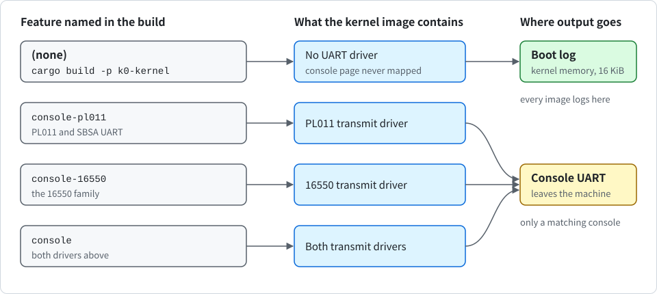
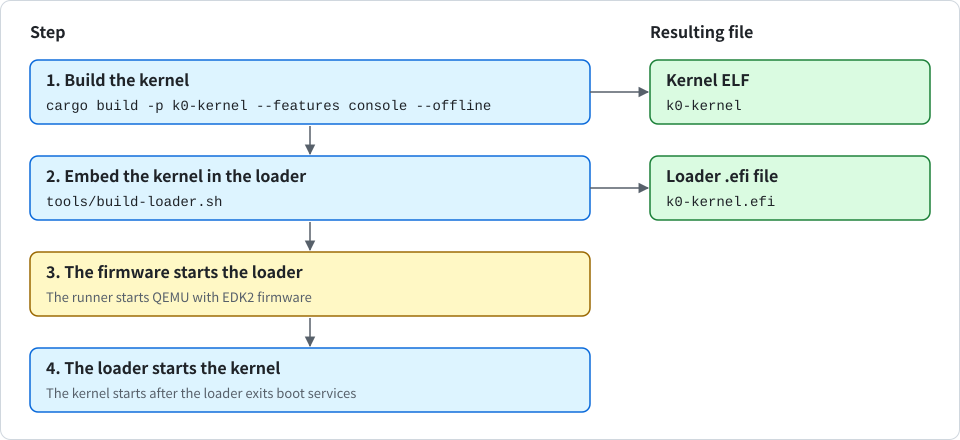
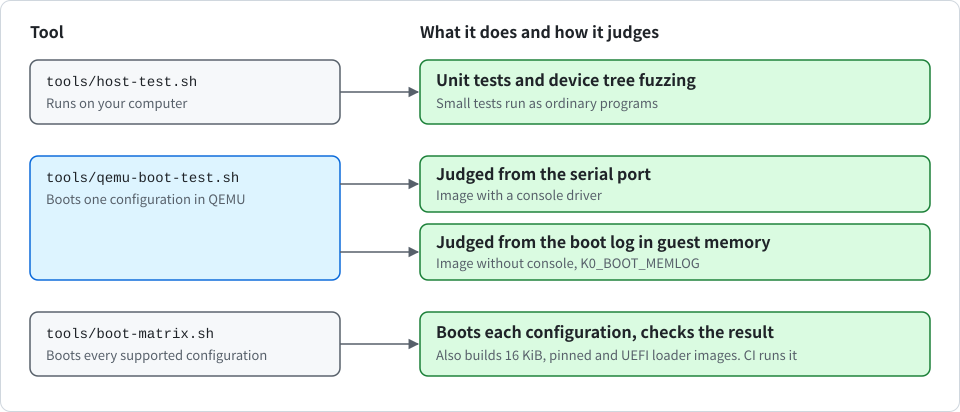

# Using K0

<div align="center">

English | [한국어](USAGE_KR.md)

</div>

This document shows how to build K0, run it, and check that it works. You do not need any ARM hardware. Everything runs in QEMU, a program that behaves like an ARM computer.

## What you need

- **rustup**: the Rust installer. On the first build it downloads the exact compiler and tools K0 uses (the toolchain: Rust 1.89.0 and the parts listed in `rust-toolchain.toml`) by itself.
- **QEMU**: you need `qemu-system-aarch64` with its firmware files. On macOS, run `brew install qemu`. On Debian or Ubuntu, install the `qemu-system-arm` and `ipxe-qemu` packages.
- **C compiler**: it is needed for the build scripts. Use the Xcode command line tools on macOS, or `gcc` elsewhere.
- **UEFI firmware**: it is for QEMU and is needed only to boot through UEFI (see "Booting through UEFI" below). Homebrew's `qemu` already contains it. On Debian or Ubuntu, install the `qemu-efi-aarch64` package.

Every outside library is already in the `vendor/` folder. Once the toolchain is installed, building therefore needs no internet connection.

## Running K0

```sh
$ cargo virt
```

This builds the kernel with a console driver and starts it in QEMU. The boot messages appear in your terminal. When the self-tests are done, the kernel keeps running and prints `k0: tick N` once a second.

> [!TIP]
> The kernel never exits on its own. To quit QEMU, press `Ctrl-A`, then `X`.

### Console features

Input and output are optional in K0. You can select them with Cargo features of the kernel crate.

> [!NOTE]
> A feature for input or for a terminal does not exist yet. Console output is the only thing you can select today.

Console output exists only in an image built with a console feature. No image has input. `cargo virt` is an alias for `cargo run -p k0-kernel --features console`, so it always includes the console. The following picture shows where the output goes, depending on the features in the build.

<p align="center">
  
</p>

The following table lists the features and what each one adds.

| Feature | What it adds |
| --- | --- |
| `console-pl011` | A transmit driver for the PL011 UART and for the SBSA UART, which uses the same registers |
| `console-16550` | A transmit driver for the 16550 family of UARTs |
| `console` | Both drivers |

None of them is in `default`. `default` holds only `granule-4k`. The features only add console output and are never made default, and the 16 KiB image is built with `--no-default-features`. Therefore **every command has to name the features it wants**. You can enter them as follows:

```sh
$ cargo build -p k0-kernel --features console --offline                                                             # 4 KiB image with console
$ cargo build -p k0-kernel --offline --no-default-features --features granule-16k,console --target-dir target/g16   # 16 KiB image with console
$ cargo build -p k0-kernel --offline                                                                                # image without console
```

An image built without a console feature contains no UART driver code. It never maps the console device page and writes nothing to a UART. Every kernel line and every line from the first program goes only to the boot log in kernel memory (see "Reading the boot log from memory" below). The kernel then prints `k0: no console (driver not built in)`. An image with one driver treats a console of the other kind the same way. For example, QEMU virt has a PL011, so an image with only `console-16550` stays silent there.

Some things do not change with the features.

- The kernel still finds and validates the console node of the device tree. A device tree whose console fails validation is therefore refused even by an image that would never use the console.
- The `DEBUG_PUTC` system call and the Console capability are still there. The output of the first program still reaches the boot log.
- The UEFI loader still prints its own lines through the firmware console.

**All feature sets write the same ELF path**. To keep a console image, build the other one into its own folder, for example with `--target-dir target/quiet`.

To see which console drivers an image was built with, without booting it, you can enter the following:

```sh
$ grep -a 'k0: console drivers' <image file>
```

The line reads `k0: console drivers [pl011 16550]`, or `[pl011]`, `[16550]` or `[none]`. The kernel prints the same line first when it brings up the platform. It is a label, not proof. A plain `cargo run -p k0-kernel` boots the image without console, and `tools/qemu-virt-runner.sh` then tells you so.

### Reading the output

The following table lists the lines that an image with a console driver prints, and what they mean. Lines that start with `k0:` come from the kernel. Lines that start with `root:` come from the root task, the first program.

| Line | Meaning |
| --- | --- |
| `root: hello from EL0` | The first program is running in user mode |
| `root: ... pass` | One group of self-tests passed |
| `root: secret at 0x...`, then `k0: task fault ... far 0x...` with the same address | A confined task tried to read memory that only the root task may see, and it was stopped at exactly that address |
| `k0: task fault ...` and `k0: unknown syscall 65535, killing task` | Rule violations that the tests cause on purpose. Each one stops only the task that broke the rule. A normal run has exactly 6 `k0: task fault` lines and 1 `k0: unknown syscall` line |
| `root: sched tests pass` | The last group of self-tests passed |
| `k0: tick N` | The kernel is still running |

Lines such as `root: FAIL`, `k0: FATAL`, `k0: PANIC` or `k0: EXCEPTION` mean that **something went wrong**. The automatic boot test described under "Testing automatically" checks the whole list for you.

### Other ways to run

You can change how K0 runs by setting environment variables, as follows:

```sh
$ cargo virt --release                                              # optimized build
$ K0_QEMU_CPU=max cargo virt                                        # newer CPU model with more security features (PAC, PAN, RNDR)
$ K0_QEMU_MACHINE=virt,gic-version=3,virtualization=on cargo virt   # ask QEMU to start the kernel at the hypervisor level (EL2)
$ K0_QEMU_MACHINE=virt,gic-version=2 cargo virt                     # a GICv2 interrupt controller
$ K0_QEMU_MEM=4G cargo virt                                         # more memory
```

The runner script `tools/qemu-virt-runner.sh` builds the QEMU command line from these variables. Setting a variable to an empty value leaves that QEMU option out. The following table lists the variables and their defaults.

| Variable | Default |
| --- | --- |
| `K0_QEMU_MACHINE` | `virt,gic-version=3` |
| `K0_QEMU_CPU` | `cortex-a72` |
| `K0_QEMU_SMP` | `1` |
| `K0_QEMU_MEM` | `512M` |
| `K0_QEMU_ACCEL` | none (QEMU's software emulation, TCG) |
| `K0_IMAGE_TEXT_OFFSET` | none. Boots a copy of the image whose header `text_offset` is changed, so the same image is loaded at another physical address |
| `K0_QEMU_MONITOR` | none. Path of a Unix socket for the QEMU monitor, used to read the boot log from memory |

Everything after `--` is still passed to QEMU.

### 16 KiB build

The kernel uses 4 KiB memory pages by default. The 16 KiB version is a build option and cannot be selected at run time. You can build and test it as follows:

```sh
$ cargo build -p k0-kernel --offline --no-default-features --features granule-16k,console --target-dir target/g16
$ K0_QEMU_CPU=max tools/qemu-boot-test.sh target/g16/aarch64-unknown-none-softfloat/debug/k0-kernel
```

`--no-default-features` is needed because the 4 KiB feature is on by default, and the build stops if both are on. `--target-dir` keeps the 16 KiB image apart from the normal one. The 16 KiB image refuses to boot on a CPU without 16 KiB page support, for example `cortex-a72`.

> [!IMPORTANT]
> Because `--no-default-features` is used, the console feature must be named too.

### Pinned build

To tie an image to one platform, boot the target once, copy the text after `k0: platform ` from its boot log, and build with it in `K0_PIN`. You can enter it as follows:

```sh
$ K0_PIN='<text after "k0: platform ">' cargo build -p k0-kernel --features console --offline --target-dir target/pin
```

The pinned image refuses to boot when the discovered platform, the entry level or the RAM range differs. A pinned build names the features it wants, like any other build. This catches a wrong board or a swapped device tree.

> [!NOTE]
> A pinned build is not a defence against a hostile boot chain, because the comparison uses values taken from the device tree.

### Reading the boot log from memory

Every line the kernel prints is also kept in a 16 KiB buffer in memory. EL0 output may use 6 KiB of it, and only the first 4 timer tick lines are logged. If the kernel refuses to boot, there is no supported console, or the image was built without a console feature, **this buffer is the only record**. If QEMU was started with `K0_QEMU_MONITOR=<socket path>`, you can read it as follows:

```sh
$ tools/boot-log.py <kernel ELF> <load address> <QEMU monitor socket>
```

The load address is the physical address where the image was loaded. On QEMU `virt` with an unchanged image it is `0x40080000`.

## Booting through UEFI

UEFI is the standard way for firmware to start a program on many computers. The firmware loads a program file with the ending `.efi` from a disk, runs it, and describes the machine to it. A loader is a small program that does this one job: it prepares the machine and then starts another program. K0 has its own UEFI loader, `crates/k0-efi` and `loader/`. It carries the kernel inside itself, so the one `.efi` file is all the firmware needs. The kernel does not change and boots the same way as without UEFI. The following picture shows the path of a UEFI boot.

<p align="center">
  
</p>

You can build the kernel and the loader and run them in QEMU as follows:

```sh
$ cargo build -p k0-kernel --features console --offline
$ tools/build-loader.sh
$ tools/qemu-virt-runner.sh target/aarch64-unknown-none-softfloat/debug/k0-kernel.efi
```

QEMU's default machine has ACPI on and gives no device tree. The loader reads the ACPI static tables and builds a minimal device tree from them, so that machine boots too. You can try it as follows:

```sh
$ K0_QEMU_MACHINE=virt,gic-version=3 tools/qemu-boot-test.sh target/aarch64-unknown-none-softfloat/debug/k0-kernel.efi
```

The loader then prints `k0-loader: device tree built from ACPI tables (MADT, GTDT and SPCR)`. The runner still uses `acpi=off` for a `.efi` file unless you set `K0_QEMU_MACHINE`.

`tools/build-loader.sh` takes an already built kernel and embeds it into the loader. Without an argument it uses the debug 4 KiB kernel above. It prints the path of the result, which is the kernel file with `.efi` added. Before that it prints `build-loader: embedding a kernel with: k0: console drivers [...]`, taken from the kernel image, so that nobody embeds a silent kernel unknowingly. To embed another kernel, pass its path, for example the 16 KiB build from "16 KiB build".

The loader prints its own lines through the firmware console before it exits boot services, whatever the embedded kernel was built with. After that, a kernel without console prints nothing more to the screen.

The runner starts QEMU with the EDK2 firmware (a UEFI firmware that QEMU can load) and the machine `virt,gic-version=3,acpi=off`. It looks for the firmware in Homebrew's QEMU and then in `/usr/share/AAVMF/AAVMF_CODE.fd`. To quit QEMU, press `Ctrl-A`, then `X`.

To test it, give the `.efi` file to the boot test:

```sh
$ tools/qemu-boot-test.sh target/aarch64-unknown-none-softfloat/debug/k0-kernel.efi
```

The memory judgement of the boot test (`K0_BOOT_MEMLOG`, see "Testing an image without console" below) cannot be used with a UEFI loader, because the load address is not fixed. The boot test starts judging at the loader's first line, because the firmware prints its own messages before it, and some of those contain words like `failed`. Set `K0_BOOT_REUSE=skip` if you change the machine to a memory layout without an untyped region of the right size, as described under "Testing automatically".

The variables in the following table belong to the UEFI path. The rest of the `K0_QEMU_*` variables work as before.

| Variable | Meaning |
| --- | --- |
| `K0_QEMU_FIRMWARE` | Path of the UEFI firmware image. Default: the search described above |
| `K0_QEMU_ESP` | If set, QEMU boots the loader from a FAT drive, as a real computer boots a removable disk, instead of passing it with `-kernel`. The runner makes the drive from the folder `<file>.efi.esp` and puts the loader at `EFI/BOOT/BOOTAA64.EFI`, the standard path on AArch64 for a bootable removable drive |
| `K0_QEMU_EXTRA` | More QEMU arguments, split at spaces. For example `-device virtio-rng-pci` gives the firmware a random number source |
| `K0_LOADER_FEATURES` | Cargo features for the loader, given to `tools/build-loader.sh`. The only one is `refuse-halt`, explained under "When the loader refuses" |

You can test the FAT drive path as follows:

```sh
$ K0_QEMU_ESP=1 tools/qemu-boot-test.sh target/aarch64-unknown-none-softfloat/debug/k0-kernel.efi
```

### What the loader prints

Firmware messages come first. Then the loader prints lines that start with `k0-loader:`, and then the kernel's own lines follow. The following table lists the loader's lines and what they mean.

| Line | Meaning |
| --- | --- |
| `k0-loader: start at el1, kernel image 664 KiB with 4K granule, sha-256 b4554f24` | The loader runs at this exception level, and shows the size, the page size and the first bytes of the SHA-256 of the kernel inside it |
| `k0-loader: entropy none from the firmware` | The firmware has no random number source (or `entropy from the firmware` when it has one, which the loader then hands to the kernel) |
| `k0-loader: platform con=pl011@0x9000000 gic=v3@0x8000000 ...` | The console, interrupt controller and timer that the kernel found in the device tree |
| `k0-loader: memory 8 regions, 478 of 478 MiB usable kept, 0 ranges dropped, 27 MiB of boot services memory left unused` | The RAM the kernel will be told about. Boot services memory is never used, on purpose |
| `k0-loader: image at 0x5c410000, dtb at 0x5c1fc000` | Where the loader put the kernel and the device tree. Write it down if you need to read the boot log from memory |
| `k0-loader: exiting boot services` | The last line before the kernel starts. After this the firmware is out of the picture |

The numbers differ per machine and build. A line `k0-loader: the kernel will have no console (...)` warns that the kernel found no supported console. A line `k0-loader: panic at <file>:<line>` means a bug in the loader.

### When the loader refuses

Before it leaves the firmware, the loader checks everything it can. If a check fails, it prints `k0-loader: refused: <reason>`, wipes and frees the memory it took, and returns an error to the firmware. The firmware then usually tries its next boot option. To make the loader stop instead, so that a machine boots K0 or nothing, build with `K0_LOADER_FEATURES=refuse-halt tools/build-loader.sh`. Once the loader has started to leave the firmware, every failure stops it. The following table lists the reasons and what they mean.

| Reason | Meaning |
| --- | --- |
| `the firmware provides neither a device tree nor ACPI tables` | The configuration table has no device tree and no ACPI RSDP. QEMU with EDK2 always gives one of the two |
| `ACPI tables: <reason>` | An ACPI table is damaged, has a bad checksum or length, lies outside readable memory, or names a device in RAM or firmware memory (see design/en/uefi.md) |
| `device tree from ACPI tables: <reason>` | The values read from ACPI do not fit the minimal tree |
| `this cpu has no 16K translation granule` | A 16 KiB kernel on a CPU without 16 KiB pages. Use `K0_QEMU_CPU=max` |
| `embedded kernel image is corrupt (sha-256 mismatch)` | The kernel inside the file was changed after the build |
| `the firmware device tree ...` or `device tree for the kernel: ...` | The device tree from the firmware is damaged or has something the kernel refuses (see [design/en/uefi.md](design/en/uefi.md)) |

> [!IMPORTANT]
> Only this loader may start K0 under UEFI. The kernel would also accept the firmware's device tree as it is, but on QEMU that tree lists memory that the firmware still uses.

The loader replaces the memory description with one built from the UEFI memory map. Its design, its limits and what it does and does not protect against are in [design/en/uefi.md](design/en/uefi.md). Its place in the security model is in [SECURITY.md](SECURITY.md).

The loader has **no signature check of its own**. The SHA-256 of the kernel inside it only catches a damaged file. If you need to know who built the file, use Secure Boot in the firmware, with keys you enrol yourself: the firmware then checks the whole `.efi` file, kernel included.

What was tested:

- **CI**: the UEFI rows of `tools/boot-matrix.sh` (see "Testing automatically" below) run on QEMU with EDK2.
- **By hand, 2026-11-12**: the rows `uefi-hvf-acpi`, `uefi-hvf-el1`, `uefi-hvf-el2` and `uefi-hvf-16k` ran on an Apple M5 Pro with HVF, and a signed loader ran under Secure Boot on one firmware (Debian's EDK2 2022.11 on QEMU 7.2). An unsigned, a tampered and a wrong-key loader were refused by the firmware.
- **Not tested**: real ACPI machines, real boards, other firmware such as U-Boot, GICv4, redistributors described by CPU entries, the SBSA UART and 16550 consoles, KVM, the pinned build under UEFI and the cache flush on real hardware.

## Testing automatically

Automatic testing has three tools. The following picture shows how they relate.

<p align="center">
  
</p>

You can run them one after the other as follows:

```sh
$ tools/host-test.sh                                      # unit tests on your computer, plus device tree fuzzing
$ cargo build -p k0-kernel --features console --offline   # build the kernel with console
$ tools/qemu-boot-test.sh                                 # boot in QEMU and check every self-test
$ tools/boot-matrix.sh                                    # boot every supported configuration (builds the 16 KiB, pinned and UEFI loader images too)
```

- `tools/host-test.sh` runs the 221 host tests (161 on an x86-64 computer): small tests of single parts of the kernel (unit tests) as ordinary programs on your computer. It also does **fuzzing**: it feeds the device tree parser and the UEFI loader's planning code random, broken input to find crashes. The 221 are 12 (`k0-abi`), 41 (`k0-cap`), 76 (`k0-boot`), 32 (`k0-efi`) and 30 for each of the two page sizes (`k0-mm`). The memory management tests use ARM instructions, so they run only on an ARM computer (an Apple Silicon Mac or Linux arm64), and the x86-64 count leaves out those 60.
- `tools/qemu-boot-test.sh` boots the kernel and reads the log line by line in a fixed order. It fails on any error line, checks the exact number of intentional fault lines, and stops QEMU when it is done. It prints `boot-test: pass` on success and saves the full log in `target/qemu-boot-test.log`. It takes the machine from the `K0_QEMU_*` variables above. It accepts `K0_BOOT_REUSE=skip` for memory layouts that have no untyped region of the right size, where the root task skips its reuse test. It reads the kernel lines from the **serial port**, so it needs an image with a console driver. For an image without one, see "Testing an image without console" below. If the serial log has no kernel line, it prints a hint about a kernel built without a console feature.
- `tools/boot-matrix.sh` boots the kernel in **each** configuration that K0 calls supported and checks the result. It boots QEMU virt with GICv3 and GICv2 at EL1 and EL2, and also three CPU models, 4 cores, the 16 KiB image, other load addresses, `xlnx-versal-virt` and a pinned image. It also checks statically that the image does not touch the physical timer. You can name single rows as arguments. CI runs it.

The console rows check the console features. The following table lists the console rows and what they check.

| Row | What it checks |
| --- | --- |
| `console-symbols` | A static check that `llvm-nm` on the debug images shows the driver symbols exactly as the features say, and that each image file carries exactly its own `k0: console drivers` line |
| `quiet`, `quiet-16k` | An image without console, judged from memory, with an empty serial log and an unmapped console page |
| `console-pl011-only`, `console-16550-only` | Images with one driver. QEMU virt has a PL011, so the `console-16550-only` image has no driver for it and stays silent |
| `pl011-identity` | The device tree is patched so that the console node points at the RTC, and the kernel must print `k0: console is not a pl011, ignored`, write nothing and not keep that page mapped |
| `serial-check` | The judgement itself: a console image judged as quiet must fail on its serial output |

The `uefi-*` rows boot the kernel through the UEFI loader on EDK2: GICv3 and GICv2 at EL1 and EL2, the `max` CPU, 4 cores, the 16 KiB image, a random number source from the firmware and the FAT drive path. The `uefi-acpi-*` rows (`uefi-acpi-gic3-el1`, `uefi-acpi-gic3-el2`, `uefi-acpi-gic2-el1`, `uefi-acpi-smp4`, `uefi-acpi-16k`, `uefi-acpi-rng`) boot QEMU's default machine with ACPI on and no device tree. A static check (`tools/pe-check.py`) covers the loader file's form and its cache and MMU instruction order, which QEMU cannot test.

For configurations that must be refused, it reads the reason from the boot log in memory, or for the loader from the serial log. These are a 16 KiB kernel on `cortex-a72` and a kernel with one changed byte.

On an Apple Silicon Mac, `K0_MATRIX_HVF=1 tools/boot-matrix.sh` adds rows that run the kernel, also through the UEFI loader, on the real CPU cores through QEMU's HVF accelerator. Among them is `hvf-quiet` for the image without console.

### Testing an image without console

An image without console writes nothing to the serial port, so the boot test reads the kernel lines from the boot log in guest memory through the QEMU monitor. The following three settings of `tools/qemu-boot-test.sh` do this.

| Setting | Meaning |
| --- | --- |
| `K0_BOOT_MEMLOG=<address>` | The physical address where the image was loaded, `0x40080000` on QEMU virt. The kernel lines are read from the boot log in guest memory instead of the serial port. Not usable with a UEFI loader |
| `K0_BOOT_SERIAL=empty` | Needs `K0_BOOT_MEMLOG`. Also requires that not one byte came out of the serial port |
| `K0_BOOT_CONSOLE_PAGE=mapped` or `unmapped` | Compares the console address in the `k0: platform` line with the list in `k0: device pages`. That line is printed just before the kernel enters user space and lists every device page the kernel keeps mapped. After it the kernel maps no further device |

You can enter it as follows:

```sh
$ cargo build -p k0-kernel --offline --target-dir target/quiet
$ K0_BOOT_MEMLOG=0x40080000 K0_BOOT_SERIAL=empty K0_BOOT_CONSOLE_PAGE=unmapped \
  tools/qemu-boot-test.sh target/quiet/aarch64-unknown-none-softfloat/debug/k0-kernel
```

What this shows and what it does not:

- An empty serial log shows only that no byte reached the serial port of QEMU virt, a PL011. It says nothing about register reads. Those are covered by the symbol check and by the device page list, which is the kernel's own report.
- The symbol check runs on debug images. Release (LTO) images of the feature sets without console are not built or booted by the matrix, and no image without console is booted through UEFI.
- An image without console reduces the output path, not what the kernel holds in memory. The boot log is plain kernel memory, and anyone who can read RAM or attach a debugger sees it.
- The line `k0: console drivers` can be imitated later by output from the first program, which can print lines that look like kernel lines while it holds the Console capability. Only its first occurrence, or the image file, identifies a build.

> [!NOTE]
> The 16550 driver has never been executed by any test, because QEMU virt has no such UART. Its code was checked by review only. The SBSA UART uses the PL011 driver without an identity check, and the identity check of the PL011 itself runs only for a device tree node that says `arm,pl011` and declares the full 4 KiB frame. Nothing has run on real hardware.

The default QEMU CPU model has no PAC, PAN or RNDR. To test those as well, boot on the `max` model and require the matching log lines. You can enter it as follows:

```sh
$ K0_QEMU_CPU=max K0_BOOT_REQUIRE='rndr=on|k0: pac=on bti=present pan=on' \
  tools/qemu-boot-test.sh target/aarch64-unknown-none-softfloat/debug/k0-kernel
```

GitHub also runs these tests automatically on every pull request and every push to `main` (CI), on x86-64 and ARM64 Linux, inside sealed build environments (containers) with networking turned off, and runs a longer fuzzing campaign every week. To fuzz the device tree parser yourself or to run exactly what CI runs, see [CONTRIBUTING.md](CONTRIBUTING.md).

## When something goes wrong

The following table lists what to do for each problem.

| Problem | What to do |
| --- | --- |
| `qemu-system-aarch64` is not found | Install QEMU as described under "What you need" |
| `boot-test: kernel ELF not found` | Build first with `cargo build -p k0-kernel --features console --offline` |
| The terminal stays blank after `cargo run -p k0-kernel` without features | The image has no console driver and prints nothing. Build with `--features console`, or use `cargo virt` |
| `runner: this kernel has no console driver and prints nothing here (build with --features console to see output)` | The image was built without a console feature, or the runner found `k0: console drivers [none]` in it. Build with `--features console` to see output, or read the boot log from memory |
| `boot-test: the serial log has no kernel line` | The same cause: a kernel built without a console feature writes nothing to the serial port. Build with `--features console`, or judge the log in guest memory with `K0_BOOT_MEMLOG=<load address>` |
| The boot test times out on a slow computer | Give it more time, for example `K0_BOOT_TIMEOUT=300 tools/qemu-boot-test.sh` |
| The 16 KiB image does not boot on `cortex-a72` | Expected: that CPU has no 16 KiB page support. Use `K0_QEMU_CPU=max` |
| A boot stops early and nothing is printed | There may be no supported console, or the image has no driver for it (an image with only one driver is silent on a console of the other kind). Read the boot log from memory with `tools/boot-log.py` |
| `runner: no UEFI firmware found, set K0_QEMU_FIRMWARE` | Install the firmware as described under "What you need", or set `K0_QEMU_FIRMWARE` to the path of an EDK2 `aarch64` code image |
| `build-loader: kernel ELF not found` | Build the kernel first with `cargo build -p k0-kernel --features console --offline` |
| `build-loader: embedding a kernel with: k0: console drivers [none]` | The loader will carry a kernel without console. It still prints its own lines, and the kernel prints nothing after them. Build the kernel with `--features console` and run `tools/build-loader.sh` again if you want output |
| The screen shows only firmware messages, or the firmware menu | The firmware could not start the loader, or the loader refused and the firmware went on. Look for `k0-loader:` lines. With none, check that the `.efi` file exists and, with `K0_QEMU_ESP`, that the drive is found |
