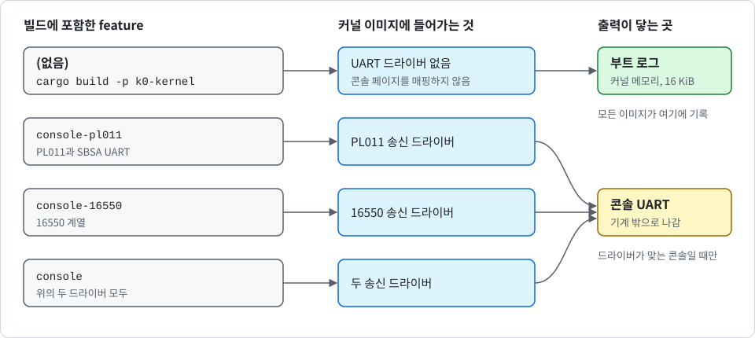
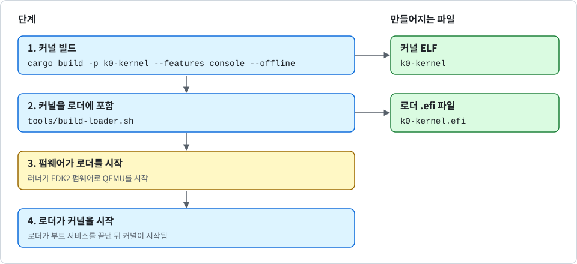
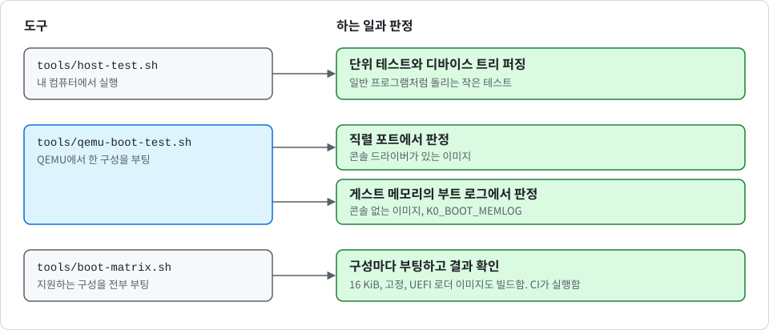

# K0 사용법

<div align="center">

[English](USAGE.md) | 한국어

</div>

이 문서는 K0를 빌드하고 실행해서 제대로 동작하는지 확인하는 방법을 설명합니다. ARM 하드웨어는 필요 없습니다. 모든 것을 ARM 컴퓨터처럼 동작하는 프로그램인 QEMU에서 실행합니다.

## 준비물

- **rustup**: Rust 설치 도구입니다. 첫 빌드 때 K0가 사용하는 컴파일러와 도구 묶음(툴체인: Rust 1.89.0과 `rust-toolchain.toml`에 적힌 구성 요소)을 알아서 내려받습니다.
- **QEMU**: 펌웨어 파일을 포함한 `qemu-system-aarch64`가 필요합니다. macOS에서는 `brew install qemu`, Debian이나 Ubuntu에서는 `qemu-system-arm`과 `ipxe-qemu` 패키지를 설치합니다.
- **C 컴파일러**: 빌드 스크립트에 필요합니다. macOS에서는 Xcode 명령줄 도구, 그 밖의 환경에서는 `gcc`를 사용합니다.
- **UEFI 펌웨어**: QEMU용이며, UEFI로 부팅할 때만(뒤의 "UEFI로 부팅" 참고) 필요합니다. Homebrew의 `qemu`에는 이미 들어 있습니다. Debian이나 Ubuntu에서는 `qemu-efi-aarch64` 패키지를 설치합니다.

외부 라이브러리는 전부 `vendor/` 폴더에 들어 있습니다. 따라서 툴체인을 한 번 설치한 뒤에는 빌드에 인터넷 연결이 필요 없습니다.

## K0 실행

```sh
$ cargo virt
```

커널을 콘솔 드라이버와 함께 빌드하고 QEMU에서 시작합니다. 부팅 메시지는 터미널에 나타납니다. 자가 테스트가 끝나도 커널은 계속 돌면서 1초마다 `k0: tick N`을 출력합니다.

> [!TIP]
> 커널이 스스로 끝나지 않으므로 QEMU를 끄려면 `Ctrl-A`를 누른 다음 `X`를 누르세요.

### 콘솔 feature

K0에서 입력 및 출력은 선택 사항입니다. 커널 크레이트의 Cargo features로 선택할 수 있습니다.

> [!NOTE]
> 입력 또는 터미널용 feature는 아직 없습니다. 지금 선택할 수 있는 것은 콘솔 출력뿐입니다.

콘솔 출력은 콘솔 feature를 포함해 빌드한 이미지에만 있습니다. 입력은 어떤 이미지에도 없습니다. `cargo virt`는 `cargo run -p k0-kernel --features console`의 별칭이므로 항상 콘솔을 포함합니다. 다음 그림은 빌드에 포함한 feature에 따라 출력이 어디에 닿는지 보여 줍니다.

<p align="center">
  
</p>

다음 표는 feature와 각 feature가 더하는 것입니다.

| feature | 더하는 것 |
| --- | --- |
| `console-pl011` | PL011 UART와, 같은 레지스터를 사용하는 SBSA UART용 송신 드라이버 |
| `console-16550` | 16550 계열 UART용 송신 드라이버 |
| `console` | 두 드라이버 모두 |

셋 다 `default`에 들어 있지 않습니다. `default`에는 `granule-4k`만 있습니다. feature는 콘솔 출력을 더하기만 하고 기본으로 켜지지 않으며, 16 KiB 이미지는 `--no-default-features`로 빌드합니다. 따라서 **모든 명령에 원하는 feature를 직접 적어야 합니다**. 다음과 같이 입력할 수 있습니다.

```sh
$ cargo build -p k0-kernel --features console --offline                                                             # 콘솔이 있는 4 KiB 이미지
$ cargo build -p k0-kernel --offline --no-default-features --features granule-16k,console --target-dir target/g16   # 콘솔이 있는 16 KiB 이미지
$ cargo build -p k0-kernel --offline                                                                                # 콘솔이 없는 이미지
```

콘솔 feature 없이 빌드한 이미지에는 UART 드라이버 코드가 없습니다. 이 이미지는 콘솔 장치 페이지를 매핑하지 않으며 UART에 아무것도 쓰지 않습니다. 커널의 모든 줄과 첫 프로그램의 모든 줄은 커널 메모리의 부트 로그에만 남습니다(뒤의 "메모리에서 부트 로그 읽기" 참고). 이때 커널은 `k0: no console (driver not built in)` 줄을 출력합니다. 드라이버가 하나뿐인 이미지는 다른 종류의 콘솔도 같은 방식으로 다룹니다. 예를 들어 QEMU virt에는 PL011이 있으므로 `console-16550`만 포함한 이미지는 거기서 조용합니다.

feature와 상관없이 바뀌지 않는 것도 있습니다.

- 커널은 여전히 디바이스 트리의 콘솔 노드를 찾아 검증합니다. 따라서 콘솔을 사용하지 않을 이미지라도 콘솔 검증에 실패하는 디바이스 트리는 거부합니다.
- `DEBUG_PUTC` 시스템 콜과 Console 케이퍼빌리티도 그대로 있습니다. 첫 프로그램의 출력은 여전히 부트 로그에 닿습니다.
- UEFI 로더는 여전히 펌웨어 콘솔로 자기 줄을 출력합니다.

feature 조합마다 **같은 ELF 경로**에 결과가 기록됩니다. 콘솔 이미지를 남겨 두려면 다른 이미지는 별도 폴더에 빌드하세요. 예를 들어 `--target-dir target/quiet`를 사용합니다.

부팅하지 않고 이미지가 어떤 콘솔 드라이버로 빌드됐는지 확인하려면 다음과 같이 입력할 수 있습니다.

```sh
$ grep -a 'k0: console drivers' <이미지 파일>
```

이 줄은 `k0: console drivers [pl011 16550]`이거나 `[pl011]`, `[16550]`, `[none]`입니다. 커널도 플랫폼을 올릴 때 같은 줄을 맨 먼저 출력합니다. 이것은 표지일 뿐 증명이 아닙니다. `cargo run -p k0-kernel`만 사용하면 콘솔 없는 이미지가 부팅되고, `tools/qemu-virt-runner.sh`가 그 사실을 알려 줍니다.

### 출력 읽는 법

다음 표는 콘솔 드라이버가 있는 이미지가 출력하는 줄과 그 뜻입니다. `k0:`로 시작하는 줄은 커널이, `root:`로 시작하는 줄은 첫 프로그램인 루트 태스크가 출력한 것입니다.

| 줄 | 뜻 |
| --- | --- |
| `root: hello from EL0` | 첫 프로그램이 사용자 모드에서 돌기 시작함 |
| `k0: dtb seeds wiped <n>B` | 루트 태스크를 시작하기 직전에, 커널이 디바이스 트리 사본 안의 난수 시드 바이트(`rng-seed`, `kaslr-seed`)를 0으로 지우고 다시 읽어 확인함. QEMU virt에서는 `40B`로 나옴. 모든 이미지가 출력함 |
| `root: boot seed from rng-seed bytes 0x... and rndr` 또는 `... without rndr` | 커널이 루트 태스크에 넘긴 부트 시드에 난수 재료를 얼마나 넣었는지 알려 줌. `rng-seed` 바이트 수와, CPU의 난수 명령 RNDR이 보탰는지 여부임. 시드 자체는 출력하지 않음. 모든 이미지가 출력함 |
| `root: ... pass` | 자가 테스트 한 묶음이 통과함 |
| `root: secret at 0x...` 다음에 같은 주소의 `k0: task fault ... far 0x...` | 격리된 태스크가 루트 태스크만 볼 수 있는 메모리를 읽으려다 정확히 그 주소에서 멈춤 |
| `k0: task fault ...`와 `k0: unknown syscall 65535, killing task` | 테스트가 일부러 일으킨 규칙 위반. 매번 규칙을 어긴 태스크만 멈춤. 정상 실행에서는 `k0: task fault` 줄이 정확히 6개, `k0: unknown syscall` 줄이 1개 나옴. `vault` feature를 포함해 빌드한 이미지에서는 `k0: task fault` 줄이 8개 나옴 |
| `k0: kernel reserve <T> tables + <E> address space entries = <B> bytes in <N> ranges` | 커널이 넘겨 주는 메모리 범위마다 맨 위에 자기 페이지 테이블과 주소 공간 목록용 메모리를 따로 떼어 둠. `k0: untyped` 줄보다 먼저 출력됨. QEMU virt 512 MiB에서는 `262 tables + 130130 address space entries = 0x206000 bytes in 3 ranges`로 나오며, 항목 수는 이미지 크기에 따라 달라짐 |
| `k0: memory <base> + <size> not handed out (<reason>)` | 메모리 범위가 너무 작아 그 예비 몫을 담지 못하거나 몫을 매핑하지 못해서, 커널이 그 범위를 넘겨 주지 않음. 부팅은 계속됨. QEMU virt의 정상 실행에서는 나오지 않음 |
| `root: timeout tests pass` | IPC 타임아웃 자가 테스트가 통과함 |
| `root: kernel reserve tests pass` | 커널 예비 공간 자가 테스트가 통과함(주소 공간 300개를 동시에 유지, 여러 페이지 테이블 블록에 걸친 untyped 메모리에서 프레임 생성) |
| `root: oracle tests pass` | 서명 오라클 자가 테스트가 통과함. `vault` feature를 포함해 빌드한 이미지만 출력함(뒤의 "서명 오라클" 참고) |
| `root: oracle made no key (boot seed has no entropy)` | 부트 시드가 약해서 볼트가 키 생성을 거부함. `vault` feature를 포함해 빌드한 이미지만 출력할 수 있으며, 이때 `root: oracle tests pass`는 뒤따르지 않음 |
| `root: sched tests pass` | 마지막 자가 테스트 묶음이 통과함 |
| `k0: idle (waiting for a timeout)` | 모든 태스크가 기다리는 중이고 시간 제한이 있는 대기가 하나 이상이어서, 커널이 멈추지 않고 다음 인터럽트를 기다림. 부팅당 최대 한 번 출력됨 |
| `k0: all tasks stopped (none ready, no timeout pending)` | 모든 태스크가 기다리는 중이고 시간 제한이 있는 대기가 없음. 지금은 태스크를 깨울 수 있는 것이 없어서 머신은 유휴 상태로 남음. 정상 실행에서는 나오지 않고, 부팅 테스트는 이 줄을 실패로 처리함. 부팅당 최대 한 번 출력됨 |
| `k0: tick N` | 커널이 아직 돌고 있음 |

`root: FAIL`, `k0: FATAL`, `k0: PANIC`, `k0: EXCEPTION` 같은 줄은 **문제가 생겼다는 뜻**입니다. "자동 테스트"에서 설명하는 부팅 테스트가 전체 목록을 대신 확인해 줍니다.

### 다른 실행 방법

다음과 같이 환경 변수를 지정해 실행 방식을 바꿀 수 있습니다.

```sh
$ cargo virt --release                                              # 최적화 빌드
$ K0_QEMU_CPU=max cargo virt                                        # 보안 기능(PAC, PAN, RNDR)이 더 있는 최신 CPU 모델
$ K0_QEMU_MACHINE=virt,gic-version=3,virtualization=on cargo virt   # QEMU가 커널을 하이퍼바이저 단계(EL2)에서 시작하게 함
$ K0_QEMU_MACHINE=virt,gic-version=2 cargo virt                     # GICv2 인터럽트 컨트롤러
$ K0_QEMU_MEM=4G cargo virt                                         # 메모리 늘리기
```

러너 스크립트 `tools/qemu-virt-runner.sh`가 이 변수들로 QEMU 명령줄을 만듭니다. 변수를 빈 값으로 두면 해당 QEMU 옵션을 제거합니다. 다음 표는 변수와 기본값입니다.

| 변수 | 기본값 |
| --- | --- |
| `K0_QEMU_MACHINE` | `virt,gic-version=3` |
| `K0_QEMU_CPU` | `cortex-a72` |
| `K0_QEMU_SMP` | `1` |
| `K0_QEMU_MEM` | `512M` |
| `K0_QEMU_ACCEL` | 없음(QEMU의 소프트웨어 에뮬레이션, TCG) |
| `K0_IMAGE_TEXT_OFFSET` | 없음. 이미지 헤더의 `text_offset`을 바꾼 사본으로 부팅해서 같은 이미지를 다른 물리 주소에 적재함 |
| `K0_QEMU_MONITOR` | 없음. QEMU 모니터용 유닉스 소켓 경로로, 메모리에서 부트 로그를 읽을 때 사용함 |

`--` 뒤의 인자도 여전히 그대로 QEMU에 전달됩니다.

### 16 KiB 빌드

커널은 기본으로 4 KiB 메모리 페이지를 사용합니다. 16 KiB 버전은 빌드 옵션이며 실행 중에 선택할 수 없습니다. 다음과 같이 빌드하고 시험할 수 있습니다.

```sh
$ cargo build -p k0-kernel --offline --no-default-features --features granule-16k,console --target-dir target/g16
$ K0_QEMU_CPU=max tools/qemu-boot-test.sh target/g16/aarch64-unknown-none-softfloat/debug/k0-kernel
```

4 KiB feature가 기본으로 켜져 있고 둘이 함께 켜지면 빌드가 멈추기 때문에 `--no-default-features`가 필요합니다. `--target-dir`은 16 KiB 이미지를 일반 이미지와 따로 둡니다. 16 KiB 이미지는 16 KiB 페이지를 지원하지 않는 CPU(예: `cortex-a72`)에서는 부팅을 거부합니다.

> [!IMPORTANT]
> `--no-default-features`를 사용하므로 콘솔 feature도 직접 적어야 합니다.

### 고정 빌드

이미지를 한 플랫폼에 묶으려면 먼저 타겟을 한 번 부팅해서 부트 로그의 `k0: platform ` 뒤에 나오는 글자를 복사합니다. 그다음 그 글자를 `K0_PIN`에 설정해 빌드합니다. 다음과 같이 입력할 수 있습니다.

```sh
$ K0_PIN='<"k0: platform " 뒤의 글자>' cargo build -p k0-kernel --features console --offline --target-dir target/pin
```

고정한 이미지는 찾아낸 플랫폼, 진입 단계, RAM 범위가 다르면 부팅을 거부합니다. 고정 빌드도 다른 빌드와 마찬가지로 원하는 feature를 직접 적습니다. 이 기능은 보드를 잘못 선택했거나 디바이스 트리를 바꿔치기한 경우를 잡아냅니다.

> [!NOTE]
> 고정 빌드는 악의적인 부트 체인을 막는 방어가 아닙니다. 비교에 사용하는 값이 디바이스 트리에서 나오기 때문입니다.

### 메모리에서 부트 로그 읽기

커널이 출력하는 모든 줄은 메모리의 16 KiB 버퍼에도 남습니다. 이 중 6 KiB까지를 EL0 출력이 사용할 수 있고, 타이머 틱 줄은 처음 4개만 기록됩니다. 커널이 부팅을 거부했거나, 지원하는 콘솔이 없거나, 콘솔 feature 없이 빌드한 이미지일 때는 **이 버퍼가 유일한 기록**입니다. QEMU를 `K0_QEMU_MONITOR=<소켓 경로>`로 시작했다면 다음과 같이 읽을 수 있습니다.

```sh
$ tools/boot-log.py <커널 ELF> <적재 주소> <QEMU 모니터 소켓>
```

적재 주소는 이미지를 올린 물리 주소입니다. 이미지를 고치지 않은 QEMU `virt`에서는 `0x40080000`입니다.

### 서명 오라클

서명 오라클은 격리 코어 위에서 도는 첫 번째 서비스입니다. 볼트 태스크가 Ed25519 키 하나를 가지고 있고, 클라이언트 태스크는 IPC로 서명과 공개 키를 받을 뿐 키는 보지 못합니다. 오라클은 선택 사항이며 기본으로는 꺼져 있습니다. 커널 크레이트에는 이를 위한 feature가 두 개 있으며, feature는 더하기만 합니다.

| Feature | 추가하는 것 |
| --- | --- |
| `vault` | 볼트 서비스와 그 프로토콜, 고정된 정책, 자가 테스트. 서명 알고리즘은 없으며 모든 서명 요청에 "unsupported"로 답함 |
| `vault-ed25519` | `vault`를 포함하고 Ed25519(FIPS 186-5와 RFC 8032의 SHA-512를 사용하는 PureEdDSA)를 추가함 |

볼트의 코드는 루트 태스크 이미지에 포함되므로 빌드할 때 feature를 직접 적어야 하며, `cargo virt`에는 들어 있지 않습니다. 오라클이 있는 이미지는 다음과 같이 빌드하고 실행할 수 있습니다.

```sh
$ cargo run -p k0-kernel --features console,vault-ed25519
```

부팅 테스트로도 확인할 수 있습니다. 오라클 자가 테스트는 일부러 일으키는 폴트를 두 번 더 추가하므로, 테스트는 `k0: task fault` 줄이 6개가 아니라 8개라고 기대해야 합니다. 다음과 같이 입력할 수 있습니다.

```sh
$ cargo build -p k0-kernel --features console,vault-ed25519 --offline
$ K0_BOOT_FAULTS=8 K0_BOOT_REQUIRE='k0: dtb seeds wiped 40B|root: oracle tests pass' tools/qemu-boot-test.sh
```

부트 로그에는 "출력 읽는 법"의 줄에 더해 다음 줄이 보여야 합니다.

- `k0: dtb seeds wiped 40B`와 `root: boot seed from rng-seed bytes 0x0000000000000020 without rndr`입니다(`K0_QEMU_CPU=max`에서는 두 번째 줄이 `and rndr`로 끝납니다). QEMU virt는 32바이트 `rng-seed`를 제공하며, 이것이 `0x20`입니다.
- `k0: task fault` 줄이 두 개 더 나와 모두 8개입니다. 자가 테스트가 일부러 메모리 규칙을 어기게 하는 클라이언트 둘에서 나온 줄입니다.
- `root: sched tests pass` 앞의 `root: oracle tests pass`입니다. 이 줄은 오라클의 검사가 모두 통과했다는 뜻입니다. 볼트가 부트 시드로 키를 만들었고, 서명자가 검증되는 서명을 받았으며, 메시지나 서명을 바꾸면 검증되지 않고, 관리자와 읽기 전용 클라이언트는 서명을 요청했을 때 거부되었으며, 키를 지운 뒤에는 서명이 거부되었습니다.

볼트는 부트 시드에 `rng-seed` 바이트가 32개 이상 있거나 RNDR에서 온 256비트가 있을 때만 키를 만듭니다. 그렇지 않으면, 예를 들어 디바이스 트리에 `rng-seed`가 없고 CPU에 RNDR도 없는 머신에서는 볼트가 `NO_ENTROPY`로 답하고 키를 만들지 않습니다. 그러면 루트 태스크가 `root: oracle made no key (boot seed has no entropy)`를 출력하고 오라클 테스트를 거기서 멈춥니다. `root: oracle tests pass`는 나오지 않으므로 이 줄을 요구하는 부팅 테스트는 실패하며, 이것이 의도한 결과입니다.

> [!NOTE]
> Ed25519 구현은 vendor에 넣은 `ed25519-dalek` 2.2.0 크레이트이며 어떤 종류의 검증도 받지 않았고, 키는 승인된 난수 비트 생성기에서 나오지 않습니다. 키는 하나뿐이고, 영속성도 키의 가져오기나 내보내기도 운영자 입력도 아직 없습니다. 클라이언트가 엔드포인트 하나를 함께 사용하므로 볼트의 가용성은 보호되지 않으며 타임아웃을 써야 합니다. 루트 태스크는 신뢰 대상이며 볼트를 읽을 수 있습니다. 오라클은 QEMU(TCG와 HVF)에서만 실행해 보았습니다. 자세한 내용과 한계는 [SECURITY_KR.md](SECURITY_KR.md)에 있습니다.

## UEFI로 부팅

UEFI는 많은 컴퓨터에서 펌웨어가 프로그램을 시작하는 표준 방식입니다. 펌웨어가 디스크에서 확장자가 `.efi`인 프로그램 파일을 읽어 실행하고, 그 프로그램에 기계의 구성을 알려 줍니다. 로더는 기계를 준비한 다음 다른 프로그램을 시작하는 일 하나만 하는 작은 프로그램입니다. K0에는 자체 UEFI 로더(`crates/k0-efi`와 `loader/`)가 있습니다. 로더가 커널을 안에 품고 있으므로, 펌웨어에는 `.efi` 파일 하나만 있으면 됩니다. 커널은 바뀌지 않으며 UEFI 없이 부팅할 때와 똑같이 시작합니다. 다음 그림은 UEFI 부팅의 경로를 보여 줍니다.

<p align="center">
  
</p>

다음과 같이 입력하면 커널과 로더를 빌드하고 QEMU에서 실행할 수 있습니다.

```sh
$ cargo build -p k0-kernel --features console --offline
$ tools/build-loader.sh
$ tools/qemu-virt-runner.sh target/aarch64-unknown-none-softfloat/debug/k0-kernel.efi
```

QEMU의 기본 머신은 ACPI가 켜져 있고 디바이스 트리를 주지 않습니다. 로더는 ACPI 정적 테이블을 읽어 거기서 최소한의 디바이스 트리를 만들기 때문에 이 머신도 부팅합니다. 다음과 같이 입력하면 시험해 볼 수 있습니다.

```sh
$ K0_QEMU_MACHINE=virt,gic-version=3 tools/qemu-boot-test.sh target/aarch64-unknown-none-softfloat/debug/k0-kernel.efi
```

그러면 로더가 `k0-loader: device tree built from ACPI tables (MADT, GTDT and SPCR)`를 출력합니다. `K0_QEMU_MACHINE`을 지정하지 않으면 러너는 `.efi` 파일에 여전히 `acpi=off`를 사용합니다.

`tools/build-loader.sh`는 이미 빌드된 커널을 로더 안에 포함합니다. 인자가 없으면 앞의 디버그 4 KiB 커널을 사용합니다. 결과 파일의 경로를 출력하며, 이 경로는 커널 파일 이름 뒤에 `.efi`가 붙은 것입니다. 그 전에 커널 이미지에서 읽은 `build-loader: embedding a kernel with: k0: console drivers [...]`를 출력해서, 아무도 모르는 채 조용한 커널을 넣는 일이 없게 합니다. 다른 커널을 포함하려면 경로를 인자로 주면 됩니다. 예를 들어 "16 KiB 빌드"의 커널입니다.

로더는 부트 서비스를 끝내기 전까지 안에 든 커널이 어떻게 빌드됐든 자기 줄을 펌웨어 콘솔로 출력합니다. 그 뒤로 콘솔 없는 커널은 화면에 더는 아무것도 출력하지 않습니다.

러너는 EDK2 펌웨어(QEMU가 올릴 수 있는 UEFI 펌웨어)와 머신 `virt,gic-version=3,acpi=off`로 QEMU를 시작합니다. 펌웨어는 Homebrew의 QEMU에서 먼저 찾고, 없으면 `/usr/share/AAVMF/AAVMF_CODE.fd`를 사용합니다. QEMU를 끄려면 `Ctrl-A`를 누른 다음 `X`를 누르세요.

시험하려면 다음과 같이 `.efi` 파일을 부팅 테스트에 주면 됩니다.

```sh
$ tools/qemu-boot-test.sh target/aarch64-unknown-none-softfloat/debug/k0-kernel.efi
```

부팅 테스트의 메모리 판정(`K0_BOOT_MEMLOG`, 뒤의 "콘솔 없는 이미지 시험" 참고)은 적재 주소가 고정이 아니므로 UEFI 로더와 함께 사용할 수 없습니다. 부팅 테스트는 로더의 첫 줄부터 판정합니다. 그 앞에 펌웨어가 자기 메시지를 출력하고, 그 안에 `failed` 같은 낱말이 섞여 있기 때문입니다. 머신을 바꿔서 맞는 크기의 untyped 영역이 없는 메모리 배치가 되면 "자동 테스트"에 적은 대로 `K0_BOOT_REUSE=skip`을 지정하세요.

다음 표의 변수는 UEFI 경로에서만 사용합니다. 나머지 `K0_QEMU_*` 변수는 전과 같이 동작합니다.

| 변수 | 뜻 |
| --- | --- |
| `K0_QEMU_FIRMWARE` | UEFI 펌웨어 이미지 경로. 기본값은 앞에서 설명한 탐색 |
| `K0_QEMU_ESP` | 값이 있으면 로더를 `-kernel`로 넘기지 않고 FAT 드라이브에서 부팅함. 실제 컴퓨터가 이동식 디스크로 부팅하는 방식과 같음. 러너가 `<파일>.efi.esp` 폴더로 드라이브를 만들고 로더를 `EFI/BOOT/BOOTAA64.EFI`에 둠. AArch64에서 부팅 가능한 이동식 드라이브의 표준 경로임 |
| `K0_QEMU_EXTRA` | QEMU에 더 넘길 인자. 공백으로 나눔. 예를 들어 `-device virtio-rng-pci`는 펌웨어에 난수 장치를 줌 |
| `K0_LOADER_FEATURES` | `tools/build-loader.sh`에 넘기는 로더의 cargo feature. 하나뿐이며 `refuse-halt`입니다. "로더가 거부할 때"에서 설명 |

FAT 드라이브 경로는 다음과 같이 입력해 시험할 수 있습니다.

```sh
$ K0_QEMU_ESP=1 tools/qemu-boot-test.sh target/aarch64-unknown-none-softfloat/debug/k0-kernel.efi
```

### 로더가 출력하는 것

먼저 펌웨어 메시지가 나옵니다. 그다음 `k0-loader:`로 시작하는 로더의 줄이 나오고, 이어서 커널 자신의 줄이 나옵니다. 다음 표는 로더의 줄과 그 뜻입니다.

| 줄 | 뜻 |
| --- | --- |
| `k0-loader: start at el1, kernel image 664 KiB with 4K granule, sha-256 b4554f24` | 로더가 이 예외 레벨에서 돌고 있고, 안에 든 커널의 크기, 페이지 크기, SHA-256의 앞부분을 보여 줌 |
| `k0-loader: entropy none from the firmware` | 펌웨어에 난수 장치가 없음(있으면 `entropy from the firmware`가 나오고 로더가 그 난수를 커널에 넘김) |
| `k0-loader: platform con=pl011@0x9000000 gic=v3@0x8000000 ...` | 커널이 디바이스 트리에서 찾은 콘솔, 인터럽트 컨트롤러, 타이머 |
| `k0-loader: memory 8 regions, 478 of 478 MiB usable kept, 0 ranges dropped, 27 MiB of boot services memory left unused` | 커널에 알려 줄 RAM. 부트 서비스 메모리는 일부러 사용하지 않음 |
| `k0-loader: image at 0x5c410000, dtb at 0x5c1fc000` | 로더가 커널과 디바이스 트리를 둔 주소. 메모리에서 부트 로그를 읽어야 할 때 적어 두세요 |
| `k0-loader: exiting boot services` | 커널이 시작되기 전 마지막 줄. 이후 펌웨어는 손을 뗌 |

숫자는 머신과 빌드마다 다릅니다. `k0-loader: the kernel will have no console (...)` 줄은 커널이 지원하는 콘솔을 찾지 못했다는 경고입니다. `k0-loader: panic at <파일>:<줄>`은 로더의 버그입니다.

### 로더가 거부할 때

로더는 펌웨어에서 벗어나기 전에 확인할 수 있는 것을 전부 확인합니다. 하나라도 실패하면 `k0-loader: refused: <사유>`를 출력하고, 가져온 메모리를 지운 뒤 돌려주고, 펌웨어에 오류를 반환합니다. 그러면 펌웨어는 보통 다음 부팅 항목을 시도합니다. K0가 아니면 부팅하지 않아야 하는 기계라면 `K0_LOADER_FEATURES=refuse-halt tools/build-loader.sh`로 빌드하세요. 그러면 로더가 되돌아가지 않고 멈춥니다. 로더가 펌웨어를 떠나기 시작한 뒤에는 어떤 실패든 멈춥니다. 다음 표는 거부 사유와 그 뜻입니다.

| 사유 | 뜻 |
| --- | --- |
| `the firmware provides neither a device tree nor ACPI tables` | 구성 테이블에 디바이스 트리도 ACPI RSDP도 없음. EDK2를 사용하는 QEMU는 항상 둘 중 하나를 줍니다 |
| `ACPI tables: <reason>` | ACPI 테이블이 손상됐거나, 체크섬이나 길이가 틀렸거나, 읽을 수 있는 메모리 밖에 있거나, RAM이나 펌웨어 메모리에 있는 장치를 가리킴(design/kr/uefi_KR.md 참고) |
| `device tree from ACPI tables: <reason>` | ACPI에서 읽은 값이 최소 트리에 맞지 않음 |
| `this cpu has no 16K translation granule` | 16 KiB 페이지를 지원하지 않는 CPU에서 16 KiB 커널을 돌림. `K0_QEMU_CPU=max`를 사용하세요 |
| `embedded kernel image is corrupt (sha-256 mismatch)` | 파일 안의 커널이 빌드 뒤에 바뀜 |
| `the firmware device tree ...` 또는 `device tree for the kernel: ...` | 펌웨어의 디바이스 트리가 깨졌거나 커널이 받지 않는 내용이 있음([design/kr/uefi_KR.md](design/kr/uefi_KR.md) 참고) |

> [!IMPORTANT]
> UEFI에서 K0를 시작해도 되는 것은 이 로더뿐입니다. 커널은 펌웨어의 디바이스 트리도 그대로 받아들이지만, QEMU에서 그 트리에는 펌웨어가 아직 사용하는 메모리가 RAM으로 적혀 있습니다.

로더는 메모리 설명을 UEFI 메모리 맵에서 새로 만든 것으로 교체합니다. 로더의 설계, 한계, 무엇을 막고 무엇을 막지 못하는지는 [design/kr/uefi_KR.md](design/kr/uefi_KR.md)에, 보안 모델에서의 위치는 [SECURITY_KR.md](SECURITY_KR.md)에 있습니다.

로더에는 **자체 서명 검사가 없습니다**. 안에 든 커널의 SHA-256은 파일이 깨졌는지만 잡습니다. 누가 만든 파일인지 확인해야 한다면 펌웨어의 Secure Boot를 사용하세요. 키는 직접 등록해야 하며, 그러면 펌웨어가 커널을 포함한 `.efi` 파일 전체를 검사합니다.

시험한 범위는 다음과 같습니다.

- **CI**: `tools/boot-matrix.sh`의 UEFI 행(뒤의 "자동 테스트" 참고)을 EDK2를 사용하는 QEMU에서 돌립니다.
- **손으로 실행, 2026-11-12**: Apple M5 Pro에서 HVF로 `uefi-hvf-acpi`, `uefi-hvf-el1`, `uefi-hvf-el2`, `uefi-hvf-16k` 행을 돌렸고, 서명한 로더를 펌웨어 하나(QEMU 7.2의 Debian EDK2 2022.11)의 Secure Boot에서 시험했습니다. 서명 없는 로더, 변조한 로더, 다른 키로 서명한 로더는 펌웨어가 거부했습니다.
- **시험하지 못한 것**: 실제 ACPI 머신, 실제 보드, U-Boot 같은 다른 펌웨어, GICv4, CPU 항목으로 기술된 리디스트리뷰터, SBSA UART와 16550 콘솔, KVM, UEFI에서의 고정 빌드, 실제 하드웨어에서의 캐시 비우기입니다.

## 자동 테스트

자동 테스트에는 도구 세 가지가 있습니다. 다음 그림은 도구가 서로 어떻게 이어지는지 보여 줍니다.

<p align="center">
  
</p>

다음과 같이 차례로 실행할 수 있습니다.

```sh
$ tools/host-test.sh                                      # 내 컴퓨터에서 단위 테스트와 디바이스 트리 퍼징
$ cargo build -p k0-kernel --features console --offline   # 콘솔이 있는 커널 빌드
$ tools/qemu-boot-test.sh                                 # QEMU에서 부팅하고 자가 테스트를 전부 확인
$ tools/boot-matrix.sh                                    # 지원하는 구성을 전부 부팅(16 KiB 이미지, 고정 이미지, UEFI 로더 이미지도 빌드함)
```

- `tools/host-test.sh`는 호스트 테스트 276개를 실행합니다(x86-64 컴퓨터에서는 190개). 커널의 부분 하나하나를 내 컴퓨터에서 일반 프로그램처럼 돌리는 작은 테스트(단위 테스트)입니다. **퍼징**도 합니다. 디바이스 트리 파서와 UEFI 로더의 계획 코드에 무작위로 망가뜨린 입력을 넣어 충돌을 찾는 방법입니다. 276개는 `k0-abi` 14개, `k0-cap` 42개, `k0-boot` 82개, `k0-efi` 32개, `k0-vault` 20개(Ed25519를 포함하면 13개, 없으면 7개), `k0-mm` 43개씩 두 페이지 크기분입니다. 메모리 관리 테스트는 ARM 명령을 사용하므로 ARM 컴퓨터(Apple Silicon Mac이나 Linux arm64)에서만 돌고, x86-64의 개수는 그 86개를 뺀 것입니다.
- `tools/qemu-boot-test.sh`는 커널을 부팅하고, 로그를 정해진 순서대로 한 줄씩 확인합니다. 에러 줄이 하나라도 나오면 실패하고, 일부러 일으킨 폴트 줄의 개수를 정확히 맞춘 뒤 QEMU를 끕니다. 루트 태스크의 타임아웃 테스트는 실제 타이머 틱을 기다리므로, 부팅 한 번이 그 테스트가 생기기 전보다 약 4초 더 걸립니다. `root: teardown tests pass`와 `root: timeout tests pass` 사이의 틱 줄도 세어 4개 이상을 요구하는데, 이것이 타임아웃이 일찍 끝나지 않는지 확인하는 방법입니다. 성공하면 `boot-test: pass`를 출력하고 전체 로그를 `target/qemu-boot-test.log`에 남깁니다. 머신은 앞의 `K0_QEMU_*` 변수에서 가져옵니다. 맞는 크기의 untyped 영역이 없는 메모리 배치에서는 루트 태스크가 재사용 시험을 건너뛰므로, 그때는 `K0_BOOT_REUSE=skip`을 받습니다. 커널 줄을 **직렬 포트**에서 읽으므로 콘솔 드라이버가 있는 이미지가 필요합니다. 콘솔 없는 이미지는 뒤의 "콘솔 없는 이미지 시험"을 보세요. 직렬 로그에 커널 줄이 하나도 없으면 콘솔 feature 없이 빌드한 커널이 아닌지 알려 주는 힌트를 출력합니다.
- `tools/boot-matrix.sh`는 K0가 지원한다고 말하는 **구성마다** 커널을 부팅해서 결과를 확인합니다. GICv3와 GICv2의 QEMU virt를 EL1과 EL2에서 부팅하고, CPU 모델 세 가지, 코어 4개, 16 KiB 이미지, 다른 적재 주소, `xlnx-versal-virt`, 고정 이미지, 서명 오라클이 있는 이미지도 부팅합니다. 이미지가 물리 타이머를 건드리지 않는지는 정적으로 검사합니다. 행렬은 HVF가 있는 Mac에서 61행, CI에서 51행입니다. 행 이름을 인자로 주면 그 행만 돌립니다. CI가 이것을 실행합니다.

콘솔 행은 콘솔 feature를 확인합니다. 다음 표는 콘솔 행과 확인하는 내용입니다.

| 행 | 확인하는 것 |
| --- | --- |
| `console-symbols` | 정적 검사. 디버그 이미지에 `llvm-nm`을 돌렸을 때 드라이버 심볼이 feature가 말하는 그대로 나오고, 각 이미지 파일에 자기 `k0: console drivers` 줄이 정확히 하나만 들어 있는지 봄 |
| `quiet`, `quiet-16k` | 콘솔 없는 이미지를 메모리에서 판정하고, 직렬 로그가 비어 있고, 콘솔 페이지가 매핑되지 않았는지 확인 |
| `console-pl011-only`, `console-16550-only` | 드라이버가 하나뿐인 이미지. QEMU virt에는 PL011이 있으므로 `console-16550-only` 이미지에는 그 드라이버가 없어 조용함 |
| `pl011-identity` | 콘솔 노드가 RTC를 가리키도록 디바이스 트리를 고치면, 커널이 `k0: console is not a pl011, ignored`를 출력하고 아무것도 쓰지 않으며 그 페이지를 매핑한 채로 두지 않아야 함 |
| `serial-check` | 판정 자체를 시험. 콘솔 이미지를 조용한 이미지로 판정하면 직렬 출력 때문에 실패해야 함 |

오라클 행은 서명 오라클을 확인합니다. 다음 표에서 부팅 행은 모두 `root: oracle tests pass`를 요구하고, 폴트 줄 8개를 기대합니다.

| 행 | 확인하는 것 |
| --- | --- |
| `vault` | 기본 CPU에서 `vault-ed25519`를 포함한 이미지. `k0: dtb seeds wiped 40B`도 요구함 |
| `vault-max` | 같은 이미지를 `max` CPU에서 부팅해, RNDR이 부트 시드에 들어가는지 확인(`... and rndr`) |
| `vault-el2` | 같은 이미지를 EL2에서 시작 |
| `vault-16k` | `vault-ed25519`를 포함한 16 KiB 이미지 |
| `vault-no-alg` | `vault`만 포함한 이미지. 모든 서명 요청에 "unsupported"로 답함 |
| `vault-symbols` | 정적 검사. 기본 이미지에는 볼트 코드와 암호 코드가 없고, 볼트 이미지에는 그 코드의 쓰기 가능한 정적 변수가 없음 |

`uefi-*` 행은 EDK2 위에서 UEFI 로더를 거쳐 커널을 부팅합니다. GICv3와 GICv2를 EL1과 EL2에서, `max` CPU, 코어 4개, 16 KiB 이미지, 펌웨어의 난수 장치, FAT 드라이브 경로를 부팅합니다. ACPI를 켠 QEMU 기본 머신을 디바이스 트리 없이 부팅하는 `uefi-acpi-*` 행(`uefi-acpi-gic3-el1`, `uefi-acpi-gic3-el2`, `uefi-acpi-gic2-el1`, `uefi-acpi-smp4`, `uefi-acpi-16k`, `uefi-acpi-rng`)도 있습니다. 정적 검사(`tools/pe-check.py`)는 로더 파일의 형식과, QEMU로는 시험할 수 없는 캐시와 MMU 명령의 순서를 확인합니다.

거부해야 하는 구성에서는 커널의 사유를 메모리에 남은 부트 로그에서 읽고, 로더의 사유는 직렬 로그에서 읽습니다. 이런 구성으로 `cortex-a72`에서의 16 KiB 커널과 한 바이트를 바꾼 커널이 있습니다.

Apple Silicon Mac에서는 `K0_MATRIX_HVF=1 tools/boot-matrix.sh`로 QEMU의 HVF 가속기를 통해 실제 CPU 코어에서 커널을 (UEFI 로더를 거치는 경우도 포함해) 돌리는 행을 더할 수 있습니다. 콘솔 없는 이미지용으로는 `hvf-quiet`이, 오라클이 있는 이미지용으로는 `hvf-vault`가 있습니다.

### 콘솔 없는 이미지 시험

콘솔 없는 이미지는 직렬 포트에 아무것도 출력하지 않으므로, 부팅 테스트는 QEMU 모니터를 통해 게스트 메모리의 부트 로그에서 커널 줄을 읽습니다. `tools/qemu-boot-test.sh`의 다음 설정 세 가지가 이 일을 합니다.

| 설정 | 뜻 |
| --- | --- |
| `K0_BOOT_MEMLOG=<주소>` | 이미지를 올린 물리 주소로, QEMU virt에서는 `0x40080000`. 커널 줄을 직렬 포트 대신 게스트 메모리의 부트 로그에서 읽음. UEFI 로더와는 사용할 수 없음 |
| `K0_BOOT_SERIAL=empty` | `K0_BOOT_MEMLOG`가 필요함. 직렬 포트로 한 바이트도 나오지 않았다는 것까지 요구함 |
| `K0_BOOT_CONSOLE_PAGE=mapped` 또는 `unmapped` | `k0: platform` 줄의 콘솔 주소를 `k0: device pages`의 목록과 비교함. 이 줄은 커널이 사용자 공간에 들어가기 직전에 출력되며 커널이 매핑해 둔 장치 페이지를 전부 나열함. 그 뒤로 커널은 장치를 더 매핑하지 않음 |

다음과 같이 입력할 수 있습니다.

```sh
$ cargo build -p k0-kernel --offline --target-dir target/quiet
$ K0_BOOT_MEMLOG=0x40080000 K0_BOOT_SERIAL=empty K0_BOOT_CONSOLE_PAGE=unmapped \
  tools/qemu-boot-test.sh target/quiet/aarch64-unknown-none-softfloat/debug/k0-kernel
```

이 시험이 보여 주는 것과 보여 주지 못하는 것은 다음과 같습니다.

- 빈 직렬 로그는 QEMU virt의 직렬 포트(PL011)로 한 바이트도 나가지 않았다는 것만 보여 줍니다. 레지스터를 읽었는지는 말해 주지 않습니다. 그것은 심볼 검사와, 커널 자신의 보고인 장치 페이지 목록이 다룹니다.
- 심볼 검사는 디버그 이미지에서 돌립니다. 콘솔 없는 feature 조합의 릴리즈(LTO) 이미지는 행렬이 빌드하지도 부팅하지도 않으며, 콘솔 없는 이미지를 UEFI로 부팅한 적도 없습니다.
- 콘솔 없는 이미지는 출력 경로를 줄일 뿐, 커널이 메모리에 가진 것을 줄이지 않습니다. 부트 로그는 평범한 커널 메모리라서, RAM을 읽거나 디버거를 붙일 수 있는 사람에게는 보입니다.
- `k0: console drivers` 줄은 나중에 첫 프로그램의 출력으로 흉내 낼 수 있습니다. Console 케이퍼빌리티를 가진 동안 커널 줄처럼 보이는 줄을 출력할 수 있기 때문입니다. 빌드를 식별하는 것은 이 줄의 첫 등장이나 이미지 파일뿐입니다.

> [!NOTE]
> 16550 드라이버는 어떤 테스트로도 실행된 적이 없습니다. QEMU virt에 그런 UART가 없기 때문이며, 코드는 리뷰로만 확인했습니다. SBSA UART는 신원 확인 없이 PL011 드라이버를 사용합니다. PL011 자체의 신원 확인은 디바이스 트리 노드가 `arm,pl011`이라고 하고 4 KiB 프레임 전체를 선언할 때만 돌아갑니다. 실제 하드웨어에서는 아무것도 돌려 보지 않았습니다.

QEMU의 기본 CPU 모델에는 PAC, PAN, RNDR이 없습니다. 이것까지 시험하려면 `max` 모델로 부팅하고 해당 로그 줄을 요구하세요. 다음과 같이 입력할 수 있습니다.

```sh
$ K0_QEMU_CPU=max K0_BOOT_REQUIRE='rndr=on|k0: pac=on bti=present pan=on' \
  tools/qemu-boot-test.sh target/aarch64-unknown-none-softfloat/debug/k0-kernel
```

GitHub도 풀 리퀘스트와 `main` 푸시가 있을 때마다 이 테스트를 자동으로 돌립니다(CI). x86-64와 ARM64 Linux에서, 네트워크를 끈 밀폐된 빌드 환경(컨테이너) 안에서 돌리고, 매주 더 긴 퍼징도 돌립니다. 디바이스 트리 파서를 직접 퍼징하거나 CI와 똑같이 돌리는 방법은 [CONTRIBUTING_KR.md](CONTRIBUTING_KR.md)에 있습니다.

## 문제가 생기면

다음 표는 증상별 해결 방법입니다.

| 증상 | 해결 |
| --- | --- |
| `qemu-system-aarch64`를 찾을 수 없음 | "준비물"에 적힌 대로 QEMU를 설치하세요 |
| `boot-test: kernel ELF not found` | 먼저 `cargo build -p k0-kernel --features console --offline`로 빌드하세요 |
| feature 없이 `cargo run -p k0-kernel`을 하면 터미널이 빈 채로 있음 | 이미지에 콘솔 드라이버가 없어서 아무것도 출력하지 않습니다. `--features console`로 빌드하거나 `cargo virt`를 사용하세요 |
| `runner: this kernel has no console driver and prints nothing here (build with --features console to see output)` | 이미지를 콘솔 feature 없이 빌드했거나, 러너가 이미지에서 `k0: console drivers [none]` 줄을 찾았습니다. 출력을 보려면 `--features console`로 빌드하거나 메모리에서 부트 로그를 읽으세요 |
| `boot-test: the serial log has no kernel line` | 같은 원인입니다. 콘솔 feature 없이 빌드한 커널은 직렬 포트에 아무것도 쓰지 않습니다. `--features console`로 빌드하거나 `K0_BOOT_MEMLOG=<적재 주소>`로 게스트 메모리의 로그를 판정하세요 |
| `boot-test`가 `k0: all tasks`로 시작하는 줄에서 실패함 | 모든 태스크가 기다리는 중인데 시간 제한이 있는 대기가 없어서 태스크를 깨울 수 있는 것이 없습니다. 기본 자가 테스트에서는 일어나지 않습니다. 루트 태스크를 바꿨다면 대기마다 타임아웃을 지정하세요 |
| 부트 로그에 `k0: memory <base> + <size> not handed out (<reason>)`가 나옴 | 커널이 자기 예비 공간을 담기에 너무 작거나 그 몫을 매핑하지 못하는 메모리 범위를 찾았습니다. 그 범위를 제외하고 부팅을 계속했으며, 해당 범위는 untyped 메모리로 쓸 수 없습니다. QEMU에 준 메모리 크기와 적재 주소를 확인하세요 |
| `root: oracle made no key (boot seed has no entropy)`가 나오거나 `root: oracle tests pass`가 없음 | 부트 시드에 `rng-seed` 바이트가 32개보다 적고 RNDR도 없었음. QEMU virt처럼 디바이스 트리에 `rng-seed`가 있는 머신이나 RNDR이 있는 CPU(`K0_QEMU_CPU=max`)를 사용하세요 |
| `vault` feature를 포함한 이미지에서 `boot-test`가 `k0: task fault` 줄 수 때문에 실패 | 그 이미지는 8개를 출력함. `K0_BOOT_FAULTS=8`로 테스트를 실행하세요 |
| 느린 컴퓨터에서 부팅 테스트가 시간 초과 | 시간을 늘리세요. 예: `K0_BOOT_TIMEOUT=300 tools/qemu-boot-test.sh` |
| 16 KiB 이미지가 `cortex-a72`에서 부팅되지 않음 | 정상입니다. 그 CPU는 16 KiB 페이지를 지원하지 않습니다. `K0_QEMU_CPU=max`를 사용하세요 |
| 부팅이 일찍 멈추고 아무것도 출력되지 않음 | 지원하는 콘솔이 없거나, 이미지에 그 콘솔의 드라이버가 없을 수 있습니다(드라이버가 하나뿐인 이미지는 다른 종류의 콘솔에서 조용합니다). `tools/boot-log.py`로 메모리에서 부트 로그를 읽으세요 |
| `runner: no UEFI firmware found, set K0_QEMU_FIRMWARE` | "준비물"에 적힌 대로 펌웨어를 설치하거나, `K0_QEMU_FIRMWARE`에 EDK2 `aarch64` 코드 이미지 경로를 지정하세요 |
| `build-loader: kernel ELF not found` | 먼저 `cargo build -p k0-kernel --features console --offline`로 커널을 빌드하세요 |
| `build-loader: embedding a kernel with: k0: console drivers [none]` | 로더가 콘솔 없는 커널을 품게 됩니다. 로더는 자기 줄을 계속 출력하고, 그 뒤로 커널은 아무것도 출력하지 않습니다. 출력이 필요하면 `--features console`로 커널을 빌드하고 `tools/build-loader.sh`를 다시 실행하세요 |
| 화면에 펌웨어 메시지나 펌웨어 메뉴만 나옴 | 펌웨어가 로더를 시작하지 못했거나, 로더가 거부해서 펌웨어가 다음으로 넘어간 것입니다. `k0-loader:` 줄이 있는지 보세요. 없다면 `.efi` 파일이 있는지, `K0_QEMU_ESP`를 사용했다면 드라이브가 보이는지 확인하세요 |
