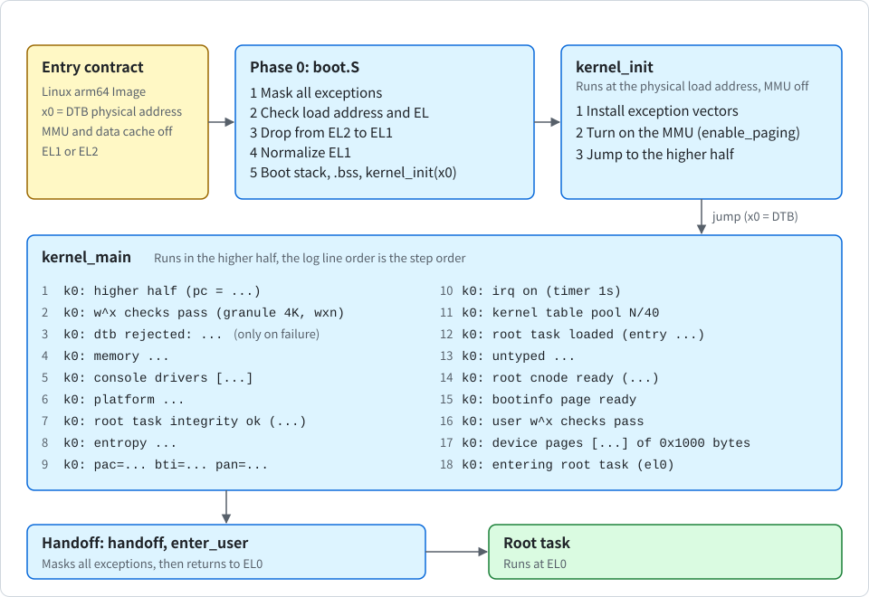
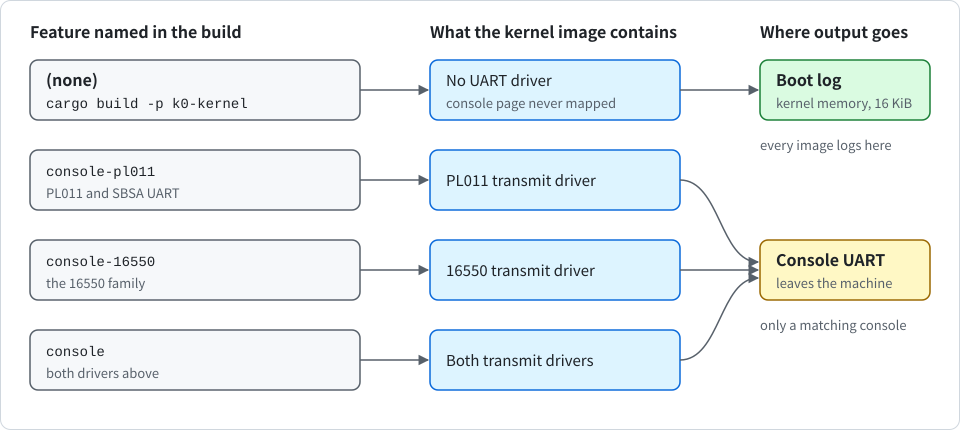

# Boot and the jump to the higher half

<div align="center">

English | [한국어](../kr/boot_KR.md)

</div>

This note follows K0 from the first instruction to the moment the root task runs at EL0. It covers `kernel/src/arch/aarch64/boot.S`, `kernel_init` and `kernel_main` in `kernel/src/main.rs`, the linker script template `kernel/kernel.ld`, and `kernel/build.rs`, which turns that template into the script for the chosen granule.

The following figure shows the stages from the entry to the root task, in order.

<p align="center">
  
</p>

## The entry contract

K0 is one generic image. It is loaded as a Linux arm64 Image. The first 64 bytes of the image are the Image header. The header holds a branch to the real entry point, the load offset, the image size, flags and the `ARM\x64` magic, and the linker script fills in the offset, size and flags. **Any boot loader that follows the Linux arm64 boot protocol** can enter the kernel.

UEFI firmware does not follow this protocol. So a separate UEFI loader (`loader/`, see [uefi.md](uefi.md)) embeds the kernel Image, rewrites the device tree from the UEFI memory map and enters the kernel with this contract. The kernel does not know whether it was entered by that loader or by another boot loader. The image boots on a machine that offers all of the following:

- **Architecture**: ARMv8-A or ARMv9-A, little-endian.
- **Register x0**: it holds the physical address of the device tree blob (DTB).
- **The MMU and the data cache**: both are off.
- **Exception level**: the CPU is at EL1 or EL2.
- **CPU count**: exactly one CPU is entered. The kernel runs on a single core.
- **Interrupt controller and timer**: the interrupt controller is GICv2 or GICv3, and the CPU has the ARM generic timer.
- **RAM**: it lies below 2^47 (128 TiB).

> [!IMPORTANT]
> The boot loader must enter exactly one CPU. The kernel no longer checks which CPU that is, so the boot loader must keep the others out.

The image may be loaded at any physical address on the granule grid (4 KiB, or 16 KiB for the 16 KiB build). It is linked at one fixed virtual address, `0xFFFF_8000_0000_0000`, and starts running at the physical address where it was loaded. Everything in this note follows from **that gap**. `boot.S` finds its own position with PC-relative addresses only.

Not supported, by decision:

- Entry at EL3
- ACPI as a source for more than the static tables MADT, GTDT and SPCR (AML is never read)
- UEFI entry through any program other than the K0 loader (a generic UEFI boot loader would pass on a firmware memory description that hands firmware memory to user space, see [uefi.md](uefi.md))
- Apple Silicon bare metal
- Interrupt controllers other than GICv2 and GICv3
- Confidential VMs
- The 64 KiB granule
- Big-endian
- Boards whose DTB declares a timer erratum
- RAM above 2^47

### The granule

The default granule is 4 KiB. The build option `--no-default-features --features granule-16k` makes a 16 KiB image. You can use it as follows:

```sh
$ cargo build -p k0-kernel --offline --no-default-features --features granule-16k,console --target-dir target/g16
```

> [!IMPORTANT]
> This build uses `--no-default-features`, so the console features are never put in `default`, and every command must name the features (see "Optional console output").

The granule is **chosen when the image is built**, never at run time. `kernel/build.rs` prepends the granule, the Image flags and the fixed virtual address to `kernel/kernel.ld` and passes the result to the linker, so section and guard page alignment follow the granule. On a CPU without support for the chosen granule, `k0_mm::enable_paging` fails and the kernel refuses to boot (`k0: mmu enable failed`). A load address off the granule grid is refused the same way. The 16 KiB image has been booted under QEMU with `-cpu max` and, by hand, on Apple cores under HVF (see "What has been booted").

## Phase 0: `boot.S`

The assembly entry does the minimum needed to reach Rust safely, and parks the core in a `wfe` loop whenever something is unexpected.

1. **Mask all exceptions**. No vector table is installed yet, so any exception would be undefined behavior.
2. **Check the load address and the exception level**. A load address that is not 4 KiB aligned makes every PC-relative address wrong, so the core parks without doing anything else (the Rust side checks the real granule later and leaves a reason in the log). EL1 continues. EL2 drops to EL1. EL0 and EL3 park. There is no check of which CPU this is. The entry exception level is kept in `x19` and stored in `K0_ENTRY_EL` after `.bss` is zeroed.
3. **Drop from EL2 to EL1**. The kernel **does not trust** what firmware left in EL2 registers, including registers whose reset value is UNKNOWN. It installs EL2 vectors, then writes the EL2 state it needs and leaves every other trap and routing bit at 0: `HCR_EL2` (`RW` makes EL1 AArch64, `HCD` turns `hvc` into an undefined instruction at EL1, and `APK` and `API` stop pointer authentication use from trapping), `SCTLR_EL2`, `CNTHCTL_EL2` and `CNTVOFF_EL2` (zero virtual counter offset), `VPIDR_EL2` and `VMPIDR_EL2` (copies of the real `MIDR_EL1` and `MPIDR_EL1`), `CPTR_EL2`, `MDCR_EL2`, `HSTR_EL2` and `VTTBR_EL2`. When the GIC system register interface exists, it enables `ICC_SRE_EL2` so that EL1 can use it. When the CPU implements `HCRX_EL2` or the fine-grained trap registers, it writes them so that nothing the kernel uses traps to EL2. It also puts `SCTLR_EL1` in a known state, and then returns to EL1h with all exceptions masked. The kernel never returns to EL2.
   - **EL2 vectors**: if anything traps to EL2 after the drop, the vector code records `ESR_EL2`, `ELR_EL2` and `FAR_EL2` in `K0_EL2_TRAP` and parks the whole machine. This is by design: the kernel has no reason to continue after an event it did not expect.
   - **Fixed E2H**: on a CPU with `HCR_EL2.E2H` fixed to 1, the code reads `ID_AA64MMFR4_EL1.E2H0`. Where that does not settle it, it tests whether an EL1 register name is redirected to the EL2 register. In that case it uses the register layout that Linux uses (for example `CNTHCTL_EL2`, `CPTR_EL2` and `SCTLR_EL12`).
   - **Firmware contract**: as for Linux, an EL3 must enable the fine-grained-trap and `HCRX` controls when those features exist. The kernel cannot do this from EL2.
4. **Normalize EL1**. Whatever the bootloader left behind, `SCTLR_EL1` is set to a known value: MMU and caches off, little-endian, stack alignment checks at EL0 and EL1, `WFI` and `WFE` trapped at EL0, and EL0 access to the interrupt mask bits denied. `CPACR_EL1` is set to zero, so FP/SIMD, SVE and SME instructions trap at both EL0 and EL1. The kernel is built for a soft-float target and keeps no vector register state for tasks.
5. **Set the boot stack**. Set it to `__boot_stack_top`, zero `.bss`, store the entry level and call `kernel_init(x0)`. `x0` is never touched on the way, so the DTB address arrives as the first argument.

> [!NOTE]
> The path for a CPU with E2H fixed to 1 follows Linux but has not been run on any CPU.

## `kernel_init`: before the jump

`kernel_init` runs at the physical load address with the MMU off. Code that forms addresses relative to the program counter (`adr`, `adrp`) gets correct physical addresses. Data that contains absolute pointers was relocated by the linker to higher-half addresses, though. That covers string slices stored in statics, vtables and `core::fmt` machinery.

> [!IMPORTANT]
> Dereferencing such a pointer now faults. So this stage prints **only literal strings and hexadecimal integers**, and it does nothing that needs `writeln!`.

It does three things:

It does three things:

1. **Installs the exception vectors**. It uses their physical address, so that any fault from here on prints a diagnosis instead of hanging.
2. **Turns on the MMU**. It uses `k0_mm::enable_paging`. The layout comes from linker symbols and covers only the kernel image: text, read-only data, data and `.bss`, and the boot stack. The image is mapped twice, once at its physical address (identity, through `TTBR0`) and once at the fixed virtual address (through `TTBR1`). Neither the DTB nor any device is mapped yet, and `kernel_init` does not read the DTB: the boot loader may have written it only to the data cache, so it is read only through a mapping with the MMU on. [memory.md](memory.md) describes the tables and permissions.
3. **Jumps**. Inline assembly adds the difference between the fixed virtual address and the load address to the stack pointer, builds the absolute address of `kernel_main` with `movz` and `movk`, and branches to it with `x0` still holding the DTB address.

Before the console is known, all output goes only to the kernel boot log (see below).

## `kernel_main`: after the jump

The program counter and stack pointer now sit in the higher half, relocated data is valid, and normal Rust works. Before the jump, typestate tokens such as `Mmu` and `Vectors` prove that one step happened before another. Every failure prints a reason and parks the core. Because the console is not known yet at the start, the early lines are replayed on the console when it attaches, in an image built with a driver for it.

> [!IMPORTANT]
> The order of the steps below is the security argument, so `kernel_main` is one straight sequence. Typestate tokens cannot cross the jump, so after it the order of the code is the enforcement.

In the following table, each row gives a log line and the step it stands for, in order.

| Log line | Step |
| --- | --- |
| `k0: higher half (pc = ...)` | Vectors reinstalled at their virtual address. |
| `k0: w^x checks pass (granule 4K, wxn)` | Address translation instructions confirm that text is readable and not writable, read-only data is not writable, the stack guard page is unmapped, the stack is writable, and the image has no linear alias. The granule shown is 16K in the 16 KiB build. |
| `k0: dtb rejected: ...` (only on failure) | `map_dtb` maps the DTB read-only through the alias. It checks the pointer (not null, 8-byte aligned) and `dtb_span`, which reads only the magic and total size. |
| `k0: memory ...` | The DTB is parsed through the alias. [dtb.md](dtb.md) covers the parser. |
| `k0: console drivers [...]` | The first line of platform bring-up, printed even when the platform is later refused. It names the console drivers built into this image (see "Optional console output"). |
| `k0: platform ...` | `bring_up_platform` finds the console, the interrupt controller and the timer interrupt in the DTB and builds one immutable platform descriptor. It checks the descriptor against the memory map before it maps any device page: RAM must lie below 2^47, the kernel image and the DTB must lie inside declared memory, and no device range, widened to whole granules, may overlap memory or a reserved range or reach beyond the CPU's physical address width (`k0_mm::pa_bits`). In pinned mode it then compares the line with the expected one. Only after that does it attach the console. An image with a driver for this kind of console maps it and attaches it, which replays the buffered log. An image without one maps nothing and prints `k0: no console (driver not built in)`. If the platform is refused, the kernel attaches the console first when the console alone passes the checks (and the image is not pinned, and a driver exists), so that the reason is visible. `k0: no console (...)` names the reason when there is none. See [dtb.md](dtb.md). |
| `k0: root task integrity ok (...)` | The embedded root task image is hashed again and compared with the hash fixed at build time. |
| `k0: entropy ...`, `k0: pac=... bti=... pan=...` | PAC keys are derived and loaded, and the key words are wiped from the boot stack. The 32-byte seed for the root task is derived here too, independent of the PAC keys, and kept for the handoff. PAN is enabled and EL0 access to counters, debug and PMU is turned off. See [hardening.md](hardening.md). |
| `k0: irq on (timer 1s)` | `setup_irq` maps only the interrupt controller pages it needs. For GICv3 it looks at the redistributor frames one at a time to find the boot CPU's frame, then maps that frame and its SGI frame. The driver checks the GIC identification registers against what the DTB claimed. The EL1 virtual timer is programmed with the interrupt number from the platform descriptor. IRQ and SError are unmasked. |
| `k0: kernel table pool N/40` | A 2 MiB boot frame window is chosen and mapped, then the number of kernel page tables in use is printed (for example `16/40` on QEMU virt). The static pool of 40 tables is used only during boot. |
| `k0: root task loaded (entry ...)` | The root task is copied into frames from the window, its root TCB is made in the window, and its address space is built. The kernel does not print the physical address of the user root table. The address space is then entered in the address space registry. See [user-address-space.md](user-address-space.md). |
| `k0: memory <base> + <size> not handed out (<reason>)` (only when it happens), `k0: kernel reserve <T> tables + <E> address space entries = <B> bytes in <N> ranges` | `reserve_kernel_share` carves the kernel share out of each free physical range before any untyped capability exists (see "Carving the kernel share out of untyped memory"). A range that cannot hold its share is not handed out, and the kernel prints the first kind of line with the reason. The second line is printed once, for example `k0: kernel reserve 262 tables + 130130 address space entries = 0x206000 bytes in 3 ranges` on QEMU virt with 512 MiB and the 4 KiB granule. |
| `k0: untyped ...`, `k0: root cnode ready (N caps, N untyped, N image frames, N slots)` | The root CNode (an object in the window with `ROOT_CNODE_SLOTS` = 512 slots, as the log shows) is filled: slot 1 the root TCB, slot 2 the root address space, slot 3 the console, slot 4 the root CNode itself, then every free physical range that was handed out as an untyped capability, then one Frame capability per mapped granule of the root task image (text with R and X, read-only data with R, data with R and W). Finally the root task is bound to its CNode and address space, exactly as any other task is: copies of those two capabilities go into its TCB. See [capabilities.md](capabilities.md). |
| `k0: bootinfo page ready` | The capability list is written into the read-only bootinfo page (layout version 3): a header and one descriptor per slot, with the VA, size and rights of every image Frame. The page does not hold the boot seed. |
| `k0: user w^x checks pass` | `TTBR0` now points at the user tables, the identity map is gone, and the user mappings are checked from both EL0 and EL1. |
| `k0: dtb seeds wiped <n>B` | The DTB is not needed any more, so the kernel zeroes the `rng-seed` and `kaslr-seed` bytes in it (through the read-only alias, switched to read-write for the write), reads them back, and wipes its own copy. The line is `40B` on QEMU virt. If the read-back is not zero, the line is `k0: WARNING dtb seeds not wiped`. See [hardening.md](hardening.md). |
| `k0: device pages [...] of 0x1000 bytes` | Every device page the kernel keeps mapped. After this line the kernel maps no further device. |
| `k0: entering root task (el0)` | `k0_sched::handoff` enters EL0. The boot seed travels in the root task's entry registers `x0` to `x3`, with `x4` saying how many `rng-seed` bytes went in and whether `RNDR` did. Just after this line the kernel zeroes the boot stack below its live frames. |
| `root: boot seed from rng-seed bytes 0x... and rndr` or `... without rndr` | An early line of the root task, not of the kernel. After the bootinfo version check it prints where the seed material came from, never the seed. |

### Choosing the boot frame window

`boot_window` is in `crates/k0-boot/src/window.rs` and is shared with the UEFI loader. The loader runs it before the jump so that the kernel is sure to find a window. It looks for the window by these rules:

- **Search**: it looks for 2 MiB of RAM right after the kernel image.
- **Overlap**: if the candidate overlaps the DTB, the kernel image or a firmware reserved region, it moves past the obstacle and tries again, for at most 64 rounds.
- **Result**: it returns a range only if the whole window fits inside one memory region from the DTB.
- **No room above the image**: if the image sits near the end of RAM, it searches again from the lowest memory address.
- **Physical address 0**: the first granule is never handed out as an object, because address 0 means "none" inside the kernel.
- **Contents**: the window holds the root task image, its stack, its page tables, the bootinfo page, the root TCB and the root CNode.
- **Excluded from untyped**: the window is excluded from the untyped capabilities, so the root task can never retype memory the kernel is still using.

### Carving the kernel share out of untyped memory

`reserve_kernel_share` in `kernel/src/main.rs` runs after the root task is loaded and before the untyped capabilities are made. For each free physical range it works as follows:

- **Share**: it computes the largest number of page tables that mapping every granule of the range can need (`k0_mm::alias_tables_for`) and the number of granules for one 8-byte address space entry per granule of the range.
- **Placement**: it takes that share from the top of the range. The tables become the table reserve (`k0_mm::reserve_tables`) and the entries become the address space registry for the range (`add_range`). The entry area is mapped into the kernel alias window and zeroed. Tables from the reserve are zeroed when they are handed out, not at boot.
- **Result**: the range that remains, without its share, is handed out as one `Untyped` capability. After boot, `alias_object` takes its tables from the reserve, so a task cannot use them up.
- **A range that cannot hold its share**: a range that is too small, or whose share cannot be mapped, is not handed out as `Untyped` at all. The kernel prints `k0: memory <base> + <size> not handed out (<reason>)` and continues. A range that does not fit in the buffer of ranges is skipped the same way (`too many ranges`).
- **A gap without a whole granule**: it is handed out unchanged, because no object can be made from it and it needs no share.

This step **never refuses to boot**. The worst case is that memory is not handed out and a log line says so. The overhead is about 0.2 % of RAM with the 4 KiB granule and about 0.05 % with the 16 KiB granule. The root task's address space has its root table in the boot window and uses one dedicated registry entry.

### After the handoff

The root task starts with the boot seed in its registers `x0` to `x3` and the seed info word in `x4`. These values are in its saved context, and the first time the root task enters the kernel, its own registers overwrite them. The kernel's copies of the seed on its stack were zeroed before, and the stack scrub described in the table above is best effort: the live frames of `kernel_main` cannot be cleared. See [hardening.md](hardening.md).

`handoff` records the root task as the running task and points the vector code at its saved context. `enter_user` then masks all exceptions (`DAIFSet`), rewinds the kernel stack to the top, and returns to EL0 through the same path every later return uses. **The mask comes first** because that path writes `ELR_EL1` and `SPSR_EL1` before `eret`. The boot path has already unmasked the timer, and an interrupt in between would overwrite both registers with EL1 values. From then on, kernel code runs only in response to an exception: a system call, a fault, or the timer interrupt. [exceptions.md](exceptions.md) describes that path.

## The boot log

Every line the kernel prints also goes into a **16 KiB buffer** in kernel memory (`K0_BOOT_LOG`). Output printed before the console is known is replayed when the console attaches, so a generic image keeps the boot record in order. When there is no console, **the log is the only record**, and an image built without a console driver never has a console. Of the 16 KiB, user task output may use 6 KiB, and only the first 4 timer tick lines are logged. `tools/boot-log.py <kernel ELF> <load address> <QEMU monitor socket>` reads it out of guest memory. The log fills from the front and drops what does not fit. Output from user tasks through the Console capability is recorded only up to a quota, so it cannot push out kernel diagnostics. Neither the console nor the log marks which lines came from a task (see [hardening.md](hardening.md)).

## Optional console output

Input and output are optional in K0. You can select them with Cargo features of the kernel crate (`k0-kernel`).

> [!NOTE]
> A feature for input or for a terminal does not exist yet. Console output is the only thing you can select today.

Console output exists only in an image built with a console feature (opt-in). No image has input. The following figure shows where the output goes, depending on the features in the build.

<p align="center">
  
</p>

The following table lists the console features of `k0-kernel` and what each one adds.

| Feature | Adds |
| --- | --- |
| `console-pl011` | the transmit driver for the PL011 and for the SBSA UART, which uses the same registers |
| `console-16550` | the transmit driver for the 16550 family |
| `console` | both |

`default` stays `["granule-4k"]`. Features only add console output and are never put in `default`, because the 16 KiB image is built with `--no-default-features` and would lose them silently. So the scripts, the `cargo virt` alias (`run -p k0-kernel --features console`) and CI **name the features**.

A plain `cargo run -p k0-kernel` boots an image without console, and `tools/qemu-virt-runner.sh` then prints `runner: this kernel has no console driver and prints nothing here (build with --features console to see output)`. A pinned build also names its features. You can use it as follows:

```sh
$ K0_PIN='...' cargo build -p k0-kernel --features console --offline --target-dir target/pin
```

All feature sets write the same ELF path, so a separate `--target-dir`, for example `target/quiet`, keeps an image without console from overwriting one with it.

**What is compiled out**: an image without a console feature contains no UART driver code (`crates/k0-arch/src/earlycon/uart.rs`), never maps the console device page and writes nothing to a UART. Every kernel line and every line from EL0 goes only to the boot log in kernel memory. The kernel prints `k0: no console (driver not built in)`. An image with one driver treats a console of the other kind the same way.

**What stays**: in every image the kernel still finds and validates the console node of the device tree: the same judgement of a device tree, the same `K0_PIN` line, the same self-check in the UEFI loader. A device tree whose console fails validation is therefore refused even by an image that would never use the console. The `DEBUG_PUTC` system call and the `Console` capability stay, and EL0 output still reaches the boot log. The boot log is in every image. The UEFI loader still prints its own lines through the firmware console before it exits boot services, whatever the embedded kernel was built with.

**The driver decision before mapping**: the driver decision comes before the device page is mapped. `attach_console` in `kernel/src/main.rs` looks at the kind of console and at the drivers built into the image before it calls the function that maps device pages. A kind without a driver is dropped there, and its page is never mapped.

**The identity check through the probe mapping**: for a device tree node that says `arm,pl011` and declares the whole 4 KiB frame, the identification registers are read through the temporary probe mapping, the probe mapping is cleared, and only then is the permanent mapping made. A device that fails the check (`k0: console is not a pl011, ignored`) is not left mapped. The SBSA UART and the 16550 still cannot be checked.

**Two lines that make the I/O visible**: the following two lines make the I/O visible.

- `k0: console drivers [pl011 16550]` (or `[pl011]`, `[16550]`, `[none]`) is the first line of platform bring-up. The whole line is one string inside the image, so `grep -a 'k0: console drivers' <image file>` tells which I/O an image was built with without booting it. `tools/build-loader.sh` prints it as `build-loader: embedding a kernel with: k0: console drivers [...]`, so that nobody embeds a silent kernel unknowingly. It is a label, not proof.
- `k0: device pages [0x8000000 0x800f000 ...] of 0x1000 bytes` is printed just before the kernel enters user space. It comes from the one function that maps device pages, and it lists every device page the kernel keeps mapped. After it the kernel maps no further device.

**Evidence**: the rows in the following table are in `tools/boot-matrix.sh`. Each console image is built with its features named.

| Row | What it does |
| --- | --- |
| `console-symbols` | A static row. On the debug images, `llvm-nm` must show the driver symbols exactly as the features say, and each image file must carry exactly its own `k0: console drivers` line. |
| `quiet`, `quiet-16k` | Boot an image without console. The whole self-test is judged from the boot log in guest memory (`K0_BOOT_MEMLOG=0x40080000`, the load address on QEMU virt), `K0_BOOT_SERIAL=empty` requires that not one byte came out of the serial port, and `K0_BOOT_CONSOLE_PAGE=unmapped` requires that the console address of the `k0: platform` line is not in the `k0: device pages` list. |
| `console-pl011-only` | Boots an image with the PL011 driver only. |
| `console-16550-only` | Boots an image with the 16550 driver only. QEMU virt has a PL011, so this image has no driver for it and stays silent. |
| `pl011-identity` | Patches the device tree so that the console node points at the RTC. The kernel must print `k0: console is not a pl011, ignored`, write nothing, and not keep that page mapped. |
| `serial-check` | Tests the judgement itself: a console image judged as quiet must fail on its serial output. |
| `hvf-quiet` | Is among the rows that need `K0_MATRIX_HVF=1`. |

`tools/qemu-boot-test.sh` also prints a hint about a kernel built without a console feature when the serial log has no kernel line. The memory judgement cannot be used with a UEFI loader, because the load address is not fixed.

**Limits**: this evidence has the following limits.

- The empty serial log shows only that no byte reached the serial port of QEMU virt, which is a PL011. It says nothing about register reads. Those are covered by the symbol check and by the device page list, which is the kernel's own report.
- The symbol check runs on debug images. Release (LTO) images of the feature sets without console are not built or booted by the matrix, and no image without console is booted through UEFI.
- The 16550 driver has **never been executed** by any test, because QEMU virt has no such UART. Its code was moved into its own feature and checked by review only. The SBSA UART uses the PL011 driver without an identity check. Nothing has run on real hardware.
- An image without console reduces the output path, not what the kernel holds in memory. The boot log is plain kernel memory, and anyone who can read RAM or attach a debugger sees it.
- The `k0: console drivers` line can be imitated by EL0 output, as any `k0:` line can (see [hardening.md](hardening.md)). Only its first occurrence, or the image file, identifies a build.

**Rule for contributors**: you must follow these rules.

- Every new input or output path goes behind a Cargo feature from the start (today the only one is console output).
- Features only add and are never in `default`.
- Every supported combination gets a row in the boot matrix.
- The scripts, the `virt` alias and CI name the features explicitly.

## Trust

The DTB now supplies device addresses, so a wrong or hostile DTB can point the console at some other device. The kernel limits this in five ways:

1. **Validation**: it validates the descriptor against the memory map.
2. **Identification**: it checks identification registers where they exist (GIC, PL011; the 16550 and the SBSA UART have none).
3. **Mapping time**: it maps a device only after validation.
4. **Time bound**: its console waits for the transmitter are bounded in time.
5. **Pinned mode**: it can fix the expected platform (below).

An image built without a console driver removes the console path altogether (see "Optional console output"). A trap to EL2 after the drop parks the whole machine by design.

> [!NOTE]
> Isolation still covers confidentiality and integrity, not availability. The DTB pointer itself cannot be validated before its first read (see "Known gaps" in [dtb.md](dtb.md)).

### Pinned mode

If the environment variable `K0_PIN` is set at build time to the text that follows `k0: platform ` in a boot log of the target machine, the image refuses to boot when the discovered platform, the entry exception level or the RAM range differs. The check catches a wrong board or a swapped DTB. It is **not a defence against a hostile boot chain**, because the compared values come from the DTB itself.

## What has been booted

> [!NOTE]
> Only tiers 1 and 2 may be called supported.

The following list shows what has been booted, by tier.

- **Tier 1, Linux arm64 Image entry**: `tools/boot-matrix.sh` runs it. CI runs it on QEMU 7.2, and the rows also run locally on QEMU 11.1.3. It tests the following:
  - QEMU virt with GICv3 and GICv2, each entered at EL1 and at EL2.
  - CPU models `cortex-a72`, `cortex-a53` and `max`.
  - `secure=on` for both GIC versions.
  - Four CPUs.
  - The 16 KiB image boots on `max` and is refused on `cortex-a72`.
  - One image loaded at three other physical addresses (the header `text_offset` patched), and a refusal for an address off the 16 KiB grid.
  - `xlnx-versal-virt`, which has RAM at address 0, GICv3 and PL011 elsewhere, entered at EL2.
  - A pinned image booting on its platform and refusing on another.
  - A static check that the image never touches the physical timer registers (the kernel uses the EL1 virtual timer, which also works in hypervisor guests).
  - The rows `console-symbols`, `quiet`, `quiet-16k`, `console-pl011-only`, `console-16550-only`, `pl011-identity` and `serial-check`, described in "Optional console output".
- **Tier 2, by hand on 2026-11-11**: Apple M5 Pro, QEMU 11.1.3 with HVF (`K0_MATRIX_HVF=1 tools/boot-matrix.sh`). It tested the 4 KiB image at EL1, entry at guest EL2, the 16 KiB image, and 4 CPUs.
- **Tier 1, UEFI rows**: the UEFI rows of the same script (2026-11-12). They boot the same kernel binaries, embedded in the UEFI loader, through EDK2 on QEMU virt with `acpi=off`. They test the following:
  - GICv3 and GICv2 at EL1 and EL2.
  - `max`, 4 CPUs, the 16 KiB image, a firmware RNG, and a boot from a FAT drive.
  - Two refusals read from the serial log (16 KiB on `cortex-a72`, one flipped byte in the embedded kernel).
  - The rows `uefi-acpi-gic3-el1`, `uefi-acpi-gic3-el2`, `uefi-acpi-gic2-el1`, `uefi-acpi-smp4`, `uefi-acpi-16k` and `uefi-acpi-rng` boot the same machine with ACPI on, without a device tree.
  - A static check of the PE files.
  - CI runs these on QEMU 7.2.22 with Debian's `qemu-efi-aarch64` 2022.11. [uefi.md](uefi.md) lists the rows.
- **Tier 2, UEFI, by hand on 2026-11-12**: the 4 KiB image at EL1 and EL2 and the 16 KiB image through the loader, on the Apple M5 Pro with HVF (`K0_MATRIX_HVF=1`). It also ran a Secure Boot test of the real loader: the signed loader boots, and the unsigned, tampered and wrong-key loaders are refused by the firmware.
- **Tier 3, expected by contract and never booted**: any real board, KVM, Firecracker, Cloud Hypervisor, crosvm, the 16550 driver (it has never run), the SBSA UART, release (LTO) images and UEFI boots of the feature sets without console, GICs with real security extensions on hardware, and CPUs with `E2H` fixed to 1. For the UEFI loader also: U-Boot's EFI implementation, Raspberry Pi UEFI, firmware other than EDK2 ArmVirtQemu, pinned mode under UEFI, and the cache flush on real hardware.

## How it is tested

`tools/qemu-boot-test.sh` boots the debug kernel under QEMU and checks the log lines above in order, then the root task self-tests. It reads them from the serial port, so the image must be built with a console feature. You can build it as follows:

```sh
$ cargo build -p k0-kernel --features console --offline
```

When the serial log has no kernel line, the script prints a hint about a kernel built without one. A failure line from any step fails the test. The script takes the machine from the environment. The following table lists the variables.

| Variable | Meaning |
| --- | --- |
| `K0_QEMU_MACHINE`, `K0_QEMU_CPU`, `K0_QEMU_SMP`, `K0_QEMU_MEM`, `K0_QEMU_ACCEL`, `K0_IMAGE_TEXT_OFFSET` | The machine and the image load settings |
| `K0_BOOT_REUSE=skip` | Accept a memory layout where the root task skips its untyped reuse test. |
| `K0_BOOT_MEMLOG=<physical load address of the image>` | Read the kernel lines from the boot log in guest memory through the QEMU monitor instead of the serial port. It is `0x40080000` on QEMU virt. |
| `K0_BOOT_SERIAL=empty` | Used together with `K0_BOOT_MEMLOG`, it additionally requires that not one byte came out of the serial port. |
| `K0_BOOT_CONSOLE_PAGE=mapped\|unmapped` | Compare the console address in the `k0: platform` line with the `k0: device pages` list. |

`tools/boot-matrix.sh` runs the rows listed above. For rows that must be refused, it reads the reason from the boot log in memory. The UEFI rows boot a `.efi` through EDK2 with the same scripts. `tools/build-loader.sh` embeds the kernel that the other rows use, and `tools/qemu-boot-test.sh` judges a UEFI failure from the loader's first line. The two UEFI refusals are read from the serial log, because the loader refuses before the kernel runs. `tools/pe-check.py` checks the loader's PE form and the order of its cache and MMU instructions. See [uefi.md](uefi.md).

The self-checks inside `kernel_main` are themselves tests: if a mapping is wrong, the boot stops with the name of the failing check.

## Known gaps

> [!NOTE]
> The evidence above is QEMU and HVF only. No real board has booted K0.

- Only one core runs, and the boot loader must enter exactly one CPU. K0 has no code to start or park other CPUs.
- The kernel always sits at the same virtual address. There is no address randomization.
- A release build prints nothing on panic. That is intentional, but it also means a release build gives no diagnosis on panic.
- No image has input. Console output exists only in an image built with a console feature, and the limits of that evidence are listed in "Optional console output".
- Under UEFI, the cache flush and the MMU switch-off in the loader cannot be tested by QEMU (it has no caches), and ACPI-only firmware boots only through the three static tables (only QEMU virt has been booted). [uefi.md](uefi.md) lists all the limits of the loader.
