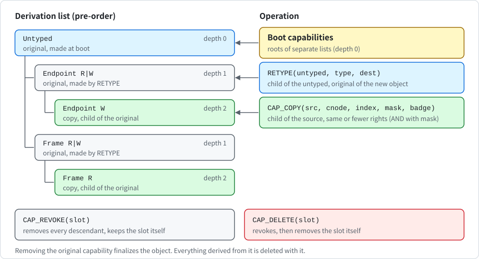

# Capabilities, untyped memory and retype

English | [한국어](../kr/capabilities_KR.md)

This note describes K0's capability model as it exists on the current `main` branch (unreleased). It covers the following:

- the slot format and per-task CNodes
- how free memory becomes untyped capabilities at boot
- how user space turns untyped memory into kernel objects with `RETYPE`
- the derivation list, and what copying, moving, deleting and revoking do

The related code is in the files of the following table.

| File | Responsibility |
| --- | --- |
| `crates/k0-cap/src/lib.rs` | bookkeeping |
| `kernel/src/syscall.rs` | system call layer |
| `kernel/src/object.rs` | object finalization |
| `crates/k0-abi/src/lib.rs` | numbers and error codes (the source of truth for the ABI) |

> [!IMPORTANT]
> The system call ABI changed incompatibly with this model (bootinfo layout version 2). Read the "Known gaps" section before relying on any of this.

Capability-based isolation covers confidentiality and integrity between tasks. It does not cover availability.

## What a capability is in K0

A **capability** is an entry in a slot of a CNode. User space names a capability by a slot number, and the kernel resolves the number on every system call. There is no other way to name a kernel resource.

System calls that change memory or another task always take a capability for the object they change. Only calls about the caller itself, such as `YIELD` and `EXIT`, act on the calling task without one.

**Slot numbers mean something only in the caller's own CNode**. Every task is bound to a capability space, which is a CNode object. Tasks may share one, and then they are not isolated from each other. The kernel resolves every slot number argument in the CNode of the task that made the call.

There is no global CNode. A task cannot name a capability in another task's CNode, because nothing in the ABI can express it. A slot number that is 0, out of range or empty returns `BAD_SLOT`. So slot 0 never names anything, and a zeroed argument is harmless.

### The slot

A **slot** is 64 bytes: four capability words, the `prev` and `next` links of the derivation list, the derivation depth, and one auxiliary word. A slot of all zero bytes is empty, so zeroed memory is an empty CNode.

Capabilities are stored as raw words and decoded with validation on every use. A word that does not decode is never interpreted. The following cases do not decode:

- an unknown kind
- rights on a kind that has none
- stray bits
- a mapping record on an unmapped capability
- an empty slot that is still linked into a list

> [!IMPORTANT]
> The kernel treats a word that does not decode as a broken invariant, prints `k0: FATAL <what>` and halts.

### Kinds

In the following table, each kind is listed with the time it is created and what it grants.

| Kind | Created | Grants |
| --- | --- | --- |
| `Untyped` | at boot | a range of physical memory that can be retyped |
| `Frame` | by `RETYPE`, and at boot for the root task image | one granule of memory that can be mapped into an address space |
| `PageTable` | by `RETYPE` | one page table that can be installed in an address space |
| `Tcb` | by `RETYPE`, and at boot for the root task | a task that can be configured and resumed |
| `Endpoint` | by `RETYPE` | a rendezvous point for synchronous IPC |
| `CNode` | by `RETYPE`, and at boot for the root CNode | an array of slots, used as a capability space and as a destination for copies and moves |
| `AddrSpace` | by `RETYPE`, and at boot for the root task | an address space: the right to map into it and to run a task in it |
| `Console` | at boot | the right to write bytes to the debug output: the boot log, and the console in an image built with a console driver |

### Rights

The **rights bits** are `R` = 1, `W` = 2 and `X` = 4. They have meaning on two kinds only.

- **Frame**: the ceiling for mapping permissions. `RO` needs `R`, `RW` needs `R|W`, `RX` needs `R|X`. A frame made by `RETYPE` has `R|W` and can never gain `X`.
- **Endpoint**: `R` is the right to receive, `W` the right to send. A new endpoint capability has both.

All other kinds carry no rights, and the rights mask of `CAP_COPY` is ignored for them. **Rights can only be removed**, and only by `CAP_COPY`.

### Badge

An endpoint capability can carry a **badge**, with 0 meaning none. A badge can be set once, by `CAP_COPY`, on a capability that has none.

- Copying a badged capability with badge 0 or with the same badge keeps the badge.
- Any other badge fails with `BAD_BADGE`, as does a nonzero badge on any other kind.

The receiver gets the badge of the sender's capability in `x1`. So it can tell its senders apart without trusting a message field. On the reply path `x1` is 0.

### The original flag

The capability that `RETYPE` creates, or that boot creates, is the **original** capability of its object. There is exactly one per object, and a copy is never an original. An object is finalized when its original capability is removed (see "Finalization"). Capabilities placed in a TCB's embedded slots are also marked as bound to that task.

## CNodes

A **CNode** is an object of exactly one granule that holds `granule / 64` slots: 64 at 4 KiB and 256 at 16 KiB. Slot 0 is always null. It is also the place where the kernel threads its pending list during finalization (see below), which is why a container's slot 0 must stay empty.

A task gets its CNode through `TCB_CONFIGURE`, which takes a `CNode` capability and an `AddrSpace` capability. The task's TCB has three embedded slots.

- Slot 1 holds the task's CNode capability.
- Slot 2 holds the task's AddrSpace capability.

Both are copies (children) of the capabilities given to `TCB_CONFIGURE` and are marked as bound to the task. A task can therefore keep running only as long as its CNode and its address space exist.

`CAP_COPY` and `CAP_MOVE` name their destination as a `CNode` capability plus a slot index inside that CNode. So a task can place capabilities into another CNode it holds a capability for, for example to equip a new task before starting it. The index is checked against the slot count in the `CNode` capability (slot 0 excluded).

## The root CNode and the boot capabilities

The root task's CNode is the root CNode. It has `ROOT_CNODE_SLOTS` (512) slots and lives in the 2 MiB boot frame window, together with the bootinfo page, the root TCB, and the root task's image, stack and page tables. None of these boot objects is untyped, so they can never be retyped. Boot capabilities are originals and each is the root (depth 0) of its own derivation list.

`bootstrap` fills the root CNode in the order of the following table.

| Slot | Capability |
| --- | --- |
| 0 | null |
| 1 | `Tcb` of the root task |
| 2 | `AddrSpace` of the root task |
| 3 | `Console` |
| 4 | `CNode`, a capability to the root CNode itself, so it can be used as a copy or move destination |
| 5 and up | `Untyped` capabilities, then one `Frame` capability per mapped granule of the root task image |

The image `Frame` capabilities have rights fixed by the segment: text is `R|X` (no `W`), read-only data is `R`, data is `R|W` (no `X`). The text frames are the only frames in the system that carry `X`, and their contents are the image whose hash was verified at boot. The root task's own boot mappings are permanent and are not represented by these capabilities.

The untyped capabilities cover every byte of RAM reported by the device tree, minus every reserved range. The kernel passes these reserved ranges:

- the kernel image
- the DTB
- the 2 MiB boot frame window
- every firmware reserved range from the DTB, both the memory reservation block and the children of `/reserved-memory`

Reserved ranges may overlap one another and may arrive in any order. For each memory region, a cursor walks forward through the reserved ranges in address order and emits the gaps between them. So overlapping reservations simply merge.

> [!IMPORTANT]
> Memory regions themselves must not overlap. If two regions overlapped, the same physical frame would sit in two untyped capabilities and could be retyped into two different objects. `bootstrap` rejects such a map, and the kernel stops booting.

Running out of slots also stops the boot. A DTB memory region beyond the CPU's physical address width stops the boot as well.

## The bootinfo page

Just before the handoff, the kernel writes a description of the root CNode into the bootinfo page, which is mapped read-only for the root task at `bootinfo::VA`. This is layout version 2 (`bootinfo::VERSION`). A root task that sees another version must not proceed.

The page starts with a header `{version, frame_size, cap_count, cnode_slots}`, followed by `cap_count` descriptors `{kind, base, size, rights}`. The index of a descriptor is its slot number in the root CNode, and every slot at or beyond `cap_count` is empty. A descriptor is filled in by kind as follows:

- **Untyped**: `base` and `size` are the physical range.
- **Image Frame**: `base` is the virtual address where the granule is mapped in the root address space, `size` is the frame size and `rights` the rights bits.
- **Everything else**: all zero, so kernel object addresses are not exposed. The kernel also no longer prints the root page table's physical address.

The page is a snapshot. Capabilities created later by `RETYPE` do not appear in it, because the caller chooses their slots. `crates/k0-boot/build.rs` fails the build if the root image maps more 4 KiB frames than the page can describe.

## Retype

`RETYPE(untyped, type, dest)` takes an untyped slot, an object type and a **destination slot chosen by the caller**, and creates one new object of exactly one granule. The types are `FRAME`, `PAGE_TABLE`, `TCB`, `ENDPOINT`, `CNODE` and `ADDR_SPACE`. Because the caller names the destination, the kernel never searches for a free slot, and the cost does not depend on how full the CNode is.

Each untyped capability has a **watermark**: how much of it has been used, counted from its base. A retype rounds the watermark up to the granule, takes the next granule as the new object, and moves the watermark past it. The new capability is the object's original and is inserted into the derivation list as a **child of the untyped** capability.

As long as live children exist, the watermark only grows. So two live objects carved from the same untyped capability never overlap. An untyped capability cannot be split.

The checks run in the following order, and the order is the important part.

1. The type must be known, otherwise `BAD_TYPE`.
2. The untyped and destination slot numbers must lie inside the caller's CNode and not be 0, otherwise `BAD_SLOT`.
3. The source slot must hold an untyped capability, otherwise `NOT_UNTYPED` (an empty slot counts as not untyped).
4. The destination slot must be empty, otherwise `OCCUPIED`.
5. If the untyped has no descendants, the watermark restarts at the base (memory reuse, see below).
6. The rounded watermark plus one granule must fit inside the untyped range, with every addition checked for overflow, and the object's physical address must be encodable in a slot. Otherwise `EXHAUSTED`.
7. The new capability's derivation depth must stay within `MAX_DEPTH`, otherwise `TOO_DEEP`.
8. Only then does the kernel prepare the memory. The callback in `sys_retype` maps the granule into the kernel alias (see [memory.md](memory.md); re-mapping an identical alias is accepted) and zeroes it. For an `ADDR_SPACE` it also registers the new address space in the registry. A failure here returns `KERNEL_RESOURCE`.
9. Only if the preparation succeeds does the watermark move and the new capability go into the destination slot.

> [!IMPORTANT]
> If any step fails, nothing has changed. The watermark, the destination slot, the registry and the kernel table pool are exactly as before, and the caller gets an error code. The memory is zeroed before the capability exists, so no task can observe the previous contents of retyped memory.

Zeroing is a security step and a design choice at the same time. It keeps previous contents from leaking into the new object, and it means a zeroed frame already is a valid initial object. In the following table, you can see how each zeroed object is interpreted.

| Object | State when zeroed |
| --- | --- |
| `Tcb` | `Inactive` |
| `Endpoint` | empty queues |
| `CNode` | a CNode full of empty slots |
| `AddrSpace` | a level-0 table without mappings |

No object needs further initialization.

### Memory reuse

Memory goes back to its untyped capability when everything derived from it is gone. If the untyped has no descendants at the time of a `RETYPE`, no live object occupies its range, so the watermark restarts at the base. Typically a task calls `CAP_REVOKE` on the untyped, which finalizes every object cut from it, and then retypes the same memory again. The memory is zeroed again each time.

## The derivation list

All capabilities are linked into one doubly linked list in preorder, and every slot stores its depth. The descendants of a slot are the slots that follow it directly with a greater depth, so finding them needs no tree and no allocation. The following figure shows how the list grows from a boot capability through `RETYPE` and `CAP_COPY`, and what `CAP_REVOKE` and `CAP_DELETE` do.

  

Each operation changes the list as follows:

- **Boot capability**: a root (depth 0) of its own list.
- **RETYPE**: inserts the new capability right after the untyped, one level deeper.
- **CAP_COPY**: inserts the copy right after its source, one level deeper. **Copies are children of their source**. That is what makes "revoke the parent" remove the copies, and it is the reason a copy can never outlive the capability it was made from.
- **CAP_MOVE**: keeps the position in the list, the depth, the flags and the mapping record.

The depth is capped at `MAX_DEPTH`. A `CAP_COPY` or `RETYPE` that would exceed it fails with `TOO_DEEP`, so the depth counter cannot overflow. Every list operation checks that the neighbours point back at the slot. If a link is broken the operation changes nothing and the kernel halts with `k0: FATAL cap derivation list corrupt`.

## Copy, move, delete and revoke

`CAP_COPY(src, cnode, index, mask, badge)` creates a child of `src` in the slot `index` of the CNode named by `cnode`.

- `mask` must be a subset of `R|W|X`, otherwise `BAD_PERM`. It is ANDed with the rights of a `Frame` or `Endpoint`. If no rights remain, the result is `NO_RIGHTS`.
- `badge` follows the rules above.
- The copy has an empty mapping record, and a copy is never an original.
- `Untyped` and `PageTable` capabilities cannot be copied (`BAD_CAP`). Copying an untyped would allow retyping the same memory twice, and copying a page table would allow installing it in two address spaces.

`CAP_MOVE(src, cnode, index)` moves a capability to an empty slot. Its place in the list and its mapping record move with it. A capability bound to a TCB cannot be moved (`BAD_CAP`). `Untyped` and `PageTable` capabilities can be moved, which is the only way to hand them to another CNode.

`CAP_REVOKE(slot)` removes every descendant of the slot and keeps the slot itself.

`CAP_DELETE(slot)` is revoke followed by removing the slot itself.

These two are stricter than seL4 on purpose. In seL4, deleting a capability does not touch its children, so a copy can outlive the capability it was copied from.

> [!WARNING]
> In K0, deleting any capability deletes everything derived from it. A copy never outlives its source, and an object dies with its original capability.

Revoking an untyped finalizes everything cut from it. Within one revoke of an ancestor, an object's original may be removed before its copies, so a finalization callback must tolerate callbacks for copies of an object that is already finalized. All of them are gone before the system call returns.

## Finalization and the pending list

When an original capability is removed, its object is finalized by the callbacks in `kernel/src/object.rs`, which cut every kernel-side reference to it so that the memory can be retyped without stale state. The handling depends on the kind:

- **Frame**: the mapping this capability made is removed. This happens for any `Frame` capability that has a mapping record, including copies.
- **PageTable**: it is detached from its address space (the same, for any capability with a record).
- **Endpoint** (original): every queued task is woken with `REVOKED`.
- **Tcb** (original), and any capability bound to a task: the task is torn down, see [scheduling.md](scheduling.md) and [ipc.md](ipc.md).
- **AddrSpace** (original): it is released in the registry (which bumps its generation). If it is installed in TTBR0, TTBR0 is switched to an empty table from the kernel pool.

A **mapping record** is `(id, generation, va, level)`. Unmapping, deleting and revoking only walk a root that the registry confirms is still the same address space, and only clear an entry that still points at that very frame or table. See [user-address-space.md](user-address-space.md).

**No recursion**. A CNode or a TCB holds slots, so finalizing one means deleting what it holds, which may finalize more containers. k0-cap does not recurse. It links the slot array of a finalized container onto a pending list, threaded through the array's slot 0, and the same call drains the list in a loop. Kernel stack use does not grow with derivation depth or CNode nesting. Time is proportional to the number of capabilities removed, and interrupts are masked meanwhile.

A task that is torn down during its own system call is handled by the exit path `finish`, which runs after all capability cleanup. This happens when the task deleted its own TCB, CNode or address space, or revoked the untyped it was carved from. The path zeroes the dead task's context, never writes a return value into it, and switches to the next ready task.

## Using capabilities

The following table lists the capabilities and rights each system call requires.

| System call | Capabilities and rights it requires |
| --- | --- |
| `DEBUG_PUTC` | `Console` |
| `RETYPE` | an `Untyped`, and a free destination slot in the caller's CNode |
| `MAP` | a `Frame` whose rights cover the permission (`RO` needs `R`, `RW` needs `R\|W`, `RX` needs `R\|X`) or a `PageTable`, and an `AddrSpace` naming the target |
| `UNMAP` | a `Frame` or `PageTable` that is mapped |
| `TCB_CONFIGURE` | a `Tcb` in the `Inactive` state, an `AddrSpace` and a `CNode` |
| `TCB_RESUME` | a `Tcb` in the `Stopped` state |
| `SEND`, `CALL` | an `Endpoint` with `W` |
| `RECV`, `REPLY_RECV` | an `Endpoint` with `R` |
| `CAP_COPY` | the source, and a `CNode` naming the destination |
| `CAP_MOVE` | the source, and a `CNode` naming the destination |
| `CAP_DELETE`, `CAP_REVOKE` | the slot itself |

> [!IMPORTANT]
> There is no implicit authority. The target of `MAP` is always the `AddrSpace` the caller presents, never "the current address space".

`TCB_CONFIGURE` is atomic: both bindings are validated before either is written, and a failure leaves both embedded slots empty. It is accepted only on an `Inactive` TCB, forces the saved state to EL0t, and gives the new task its argument in `x0`.

Because mappings are limited to `RO`, `RW` and `RX`, and `X` exists only on the root task's text frames (without `W`), no physical frame is ever writable in one place and executable in another. The consequence is that new executable code cannot be loaded after boot, and a confined task runs code from the root task image.

### Error codes for slot problems

The following table lists the error codes for slot problems and their meaning.

| Code | Meaning |
| --- | --- |
| `BAD_SLOT` | the slot number is 0, out of range, or the slot is empty (also when the task has no CNode bound) |
| `BAD_CAP` | the slot holds a capability of the wrong kind, or one that cannot be copied or moved |
| `NOT_UNTYPED` | `RETYPE` source is not an untyped |
| `OCCUPIED` | the destination slot is not empty (this replaces the old `OUT_OF_SLOTS`, still -4) |
| `NO_RIGHTS` | the capability lacks the right the call needs, or a copy mask leaves no rights |
| `BAD_PERM` | the mapping permission or the rights mask is not valid |
| `BAD_BADGE` | a badge on a kind that cannot carry one, or a different badge on an already badged capability |
| `TOO_DEEP` | the derivation depth limit would be exceeded |
| `REVOKED` | returned to a task that was waiting on an endpoint that was deleted |
| `KERNEL_RESOURCE` | an internal pool is exhausted (kernel table pool for alias mappings, address space registry) |

## How it is tested

- **Host unit tests**: they are in `crates/k0-cap/src/tests.rs` and run by `tools/host-test.sh`. They check the following:
  - that slots are 64 bytes and zero is empty
  - that every kind round-trips through the raw words and malformed words are rejected
  - that bootstrap produces exactly "memory minus reserved" for thousands of random layouts
  - that bad and overlapping regions are rejected
  - that the watermark is aligned and monotonic
  - that a failed preparation leaves no trace
  - that bad sources are rejected before any preparation runs
  - that retyped frames never carry execute
  - the copy rules per kind
  - that a move keeps the subtree attached
  - that deleting finalizes only with the original
  - that untyped memory is reused only when nothing is left
  - that a pair copy is all-or-nothing
  - that depth is bounded
  - that broken links stop the operation
- **Model tests**: `random_operation_sequences_keep_every_invariant` runs random sequences of retype, copy, move, pair-bind, delete and revoke over both granules (160 worlds of 260 steps). After every step, it checks the following:
  - that the list is a valid preorder
  - that every live object has exactly one original
  - that no capability names a finalized object
  - that destroyed slot arrays are empty
  - that retype never hands out a live object's memory

  It also asserts that the run exercised enough finalizations, task teardowns and memory reuse. A second test (`revoking_every_untyped_empties_the_world`) revokes every untyped capability after random activity and checks that no retyped object survives.
- **Destruction tests**: they run a very deep derivation chain and deeply nested CNodes on a small fixed stack, to show that destruction is iterative.
- **Boot self-tests**: the root task builds confined tasks, each with its own CNode and its own address space that maps only the image text and read-only data. Among other things, the tests check the following:
  - that slot numbers of the root task mean nothing in the confined CNode
  - that a read of a root-only address faults at exactly that address
  - that writes to a read-only page, execution from a stack page and reads of a kernel address fault
  - that an unknown system call kills only the caller
  - that a task can be deleted in every state
  - that endpoints are deleted with waiters queued
  - that a task dies when its CNode is revoked or its address space is deleted
  - that a task can delete its own TCB and revoke the untyped it was carved from
  - that revoked untyped memory is retyped again (to exhaustion, three rounds, zeroed each time)

  The markers are listed in `tools/qemu-boot-test.sh`. The script also requires an exact number of `k0: task fault` lines and exactly one `k0: unknown syscall` line. So a task that is resumed after it was destroyed, or that dies for the wrong reason, fails the test.

The 16 KiB image boots and passes the boot checks on QEMU `-cpu max`, and it boots under HVF on Apple cores. The default 4 KiB image passes the boot matrix in CI.

## Known gaps

> [!NOTE]
> Capability transfer does not exist yet. Capabilities cannot be sent over IPC, and tasks get capabilities only by `CAP_COPY` and `CAP_MOVE` into a CNode they already hold. Notifications, fault delivery to a handler task and timeouts are not in the model yet, and there is one core.

- **Availability**: it is not isolated. If every task is blocked, the kernel still parks the core (see GHSA-q99x-2wrv-358p in [SECURITY.md](../../SECURITY.md)), and a confined task can cause this by blocking last. A task that holds a lot of untyped memory can exhaust the static pool of 40 kernel page tables used for alias mappings, or the address space registry. Then `RETYPE` fails with `KERNEL_RESOURCE` for everyone.
- **A queued sender**: a sender already queued on an endpoint still delivers its message once more after its capability is revoked.
- **Differences from seL4**: they are the following:
  - Single-level CSpace (no guards, no multi-level lookup).
  - Deleting a capability also deletes everything derived from it. An object dies with its original capability.
  - All objects are exactly one granule, and an untyped cannot be split.
  - No capability transfer over IPC.
  - No hardware ASIDs: TTBR0 changes flush the whole TLB, as does every unmap, table detach and address space destruction.
- **Control capabilities**: they are all or nothing. `Tcb`, `CNode` and `AddrSpace` capabilities carry no rights, so there is no reduced copy of one. Whoever holds such a capability has full control of the object, and a task is controlled by whoever holds a capability to its TCB, its CNode or its address space.
- **New code after boot**: it cannot be loaded. Because of W^X by capability rights, executable memory exists only in the root task image.
- **Interrupts during revoke**: they are masked. The time of `CAP_REVOKE` and `CAP_DELETE` is proportional to the number of capabilities removed.
- **Not verified here**: anything in tier 3: any real board, KVM, Firecracker, Cloud Hypervisor, crosvm, the 16550 console driver (never run), GICs with real security extensions on hardware, and CPUs with `HCR_EL2.E2H` fixed to 1 (that path follows Linux and has not run anywhere). Tier 1 (`tools/boot-matrix.sh`, run in CI and locally) and tier 2 (by hand on 2026-11-11 and 2026-11-12, Apple M5 Pro, QEMU HVF) are the supported set. The UEFI rows are listed in [uefi.md](uefi.md).
