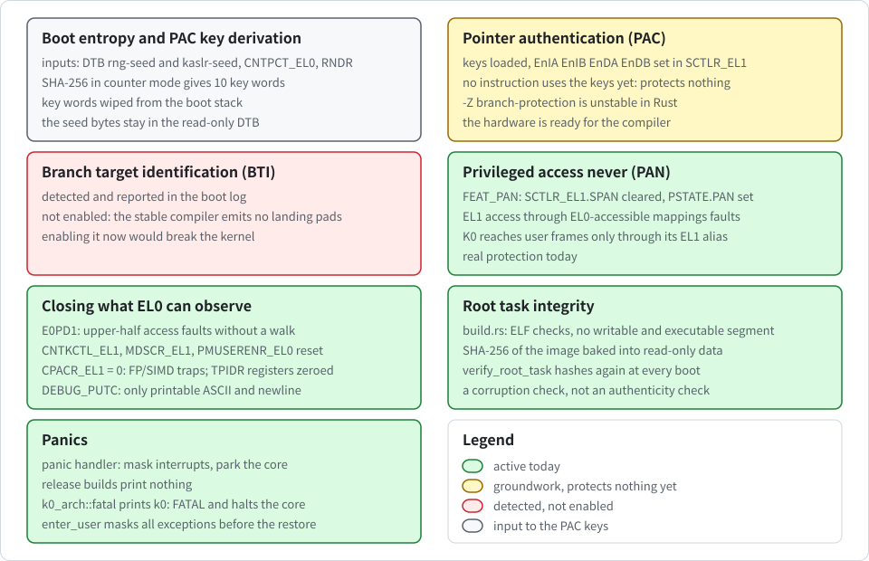

# Boot hardening: PAC, PAN, EL0 exposure and root task integrity

English | [한국어](../kr/hardening_KR.md)

This note covers the CPU security features K0 turns on at boot, what each one protects today and what it does not yet protect, and how the embedded root task image is checked. The code is in `crates/k0-arch/src/hardening.rs`, `crates/k0-boot/src/entropy.rs`, `crates/k0-boot/src/roottask.rs`, `crates/k0-boot/build.rs` and the boot path in `kernel/src/main.rs`.

The following figure groups the protections the way the sections of this note do.

  

> [!NOTE]
> Some of these features are groundwork, not working protection yet. Each section says which is which.

## Boot entropy and PAC key derivation

`derive_pac_keys` produces the ten 64-bit words that make up the PAC keys: an instruction key pair A and B, a data key pair A and B, and the generic key, two words each. It mixes the following three inputs:

- **DTB seed**: the bytes of `rng-seed` and `kaslr-seed` from the DTB's `/chosen` node (up to 72 bytes, possibly none). Under UEFI the UEFI loader adds 32 bytes from `EFI_RNG_PROTOCOL` to `rng-seed` when the firmware has it, and the kernel wipes these bytes from the DTB in memory just before it enters the root task (see "Wiping the seed from the DTB" below and [uefi.md](uefi.md)).
- **System counter**: `CNTPCT_EL0`.
- **Random number instruction**: one value from the `RNDR` instruction, if the CPU implements FEAT_RNG and the instruction succeeds.

The derivation is SHA-256 in counter mode. Each 32-byte block hashes the following, in this order:

1. a fixed domain string (`k0-pac-boot-key-v1`)
2. a one-byte block counter
3. the length of the DTB entropy as a little-endian 64-bit value
4. the DTB entropy itself
5. the other inputs as little-endian words

The length prefix keeps DTB bytes from being confused with the words that follow them. Three blocks give the ten words.

After `hardening::enable` has loaded the keys into system registers, `kernel_main` overwrites the ten words on the boot stack with volatile stores followed by a compiler fence. The boot stack becomes the system call stack later, so no copy of the keys is left there.

Because the inputs are hashed together, a hostile or predictable input cannot cancel out the entropy of another input.

> [!WARNING]
> The result is still no better than the best input. If the DTB provides no seed and the CPU has no `RNDR`, the only input is the counter, and the boot log says `k0: WARNING pac key entropy low (cntpct only)`.

### Root seed for the root task

The kernel also derives a 32-byte seed for the root task (`k0_boot::derive_root_seed`). It is SHA-256 over its own domain string (`k0-root-task-seed-v1`), the length of the DTB entropy, the DTB entropy itself, the counter and, when the CPU has `RNDR`, four fresh `RNDR` words. The domain string differs from the one of the PAC keys, so the two outputs are independent of each other by domain separation: knowing one does not give the other. They do share the DTB entropy and the counter, so the seed is as good as its inputs and no better.

The seed is not in the bootinfo page. The kernel puts it into the saved context of the root task, so it arrives in the entry registers `x0` to `x3`. Register `x4` is the seed info word: bits 15..0 hold how many `rng-seed` bytes went into the seed, and bit 16 is set when `RNDR` contributed. The layout of the bootinfo page is now version 3 (`bootinfo::VERSION`), and a root task that sees another version stops. The kernel wipes its own copies of the seed from the boot stack. The root task prints only the material, never the seed: `root: boot seed from rng-seed bytes 0x... and rndr` or `... without rndr`.

### Wiping the seed from the DTB

Hashing the seed into keys is not enough if the original bytes stay in memory, because anyone who could later read that memory could recompute the keys. So the kernel wipes them. The FDT parser records where the values of `rng-seed` and `kaslr-seed` lie in the blob (`seed_spans`), and a second `/chosen` node is refused (`DuplicateChosen`), so the recorded places are the only ones.

Right before the kernel enters the root task, after it has finished reading the DTB, `wipe_dtb_seeds` does the following for each recorded span:

1. `k0_mm::wipe_ro_alias` changes the read-only alias entry of the page to read-write in place, with break-before-make.
2. It writes zeros.
3. It cleans and invalidates the cache lines, so that a read-back comes from memory.
4. It switches the entry back to read-only.

The kernel then reads the bytes back through the read-only alias and checks that they are zero. Only then does it wipe its own copy in `BootInfo` and print `k0: dtb seeds wiped <n>B` (`40B` on QEMU virt). If a span cannot be wiped or the read-back is not zero, it prints `k0: WARNING dtb seeds not wiped`. Last, the kernel zeroes the boot stack below its live frames, which clears the leftovers of the hash computations.

> [!NOTE]
> The wipe is not complete. Copies that the firmware or the UEFI loader keep in their own memory are out of reach, and so is anything in the live frames of the boot stack. The scrubs of stack copies are best effort.

## Pointer authentication (PAC)

If the CPU implements address authentication, `hardening::enable` writes the four address keys and, if generic authentication exists, the generic key. It then sets `EnIA`, `EnIB`, `EnDA` and `EnDB` in `SCTLR_EL1`. When the kernel entered at EL2, `boot.S` already set `HCR_EL2.APK` and `HCR_EL2.API`, so key access and PAC instructions at EL1 do not trap to EL2.

> [!NOTE]
> PAC protects nothing yet. It only helps when the code signs and checks pointers, and no instruction in the kernel or the root task uses the keys.

The `-Z branch-protection` option that makes the Rust compiler sign return addresses is unstable, and K0 builds with the stable 1.89 toolchain. The hardware is ready for the day the compiler can emit those instructions.

## Branch target identification (BTI)

BTI is detected and reported in the boot log, but it is not enabled. Turning on the guarded page bit would make every indirect branch fault unless it lands on a `BTI` instruction, and the stable compiler does not emit those landing pads.

> [!NOTE]
> BTI is not enabled yet. Enabling BTI now would break the kernel.

## Privileged access never (PAN)

If the CPU implements FEAT_PAN, the kernel clears `SCTLR_EL1.SPAN`, so that the CPU sets `PSTATE.PAN` on every exception entry to EL1, and sets `PSTATE.PAN` immediately with a raw instruction encoding. With PAN set, any EL1 load or store through a mapping that EL0 can access faults.

This is **real protection today**. It turns a whole class of kernel bugs, dereferencing a pointer supplied by user space, into a fault instead of a silent read or write. K0 never needs such access: it reaches user frames only through its own EL1-only alias (see [user-address-space.md](user-address-space.md)). With FEAT_PAN2, the boot self-check uses `AT S1E1RP` to confirm that PAN really blocks an EL1 read of user text.

## Closing what EL0 can observe

`TCR_EL1.E0PD1` is set when the CPU implements FEAT_E0PD, so an EL0 access to the upper (kernel) half faults without a translation walk and EL0 cannot probe the kernel layout by timing (see [memory.md](memory.md)). The default QEMU CPU does not implement it.

The bootloader may leave registers in states that let user space observe or control more than it should. K0 resets them to known values instead of trusting them. In the following table, you can see the settings and their effect for EL0.

| Setting | Effect for EL0 |
| --- | --- |
| `CNTKCTL_EL1 = 0` | reading the counter or the timer registers traps |
| `MDSCR_EL1 = 0` | no breakpoint, watchpoint or single-step events are armed |
| `PMUSERENR_EL0 = 0`, only when a standard PMUv3 is present | reading or programming the performance counters traps |
| `SCTLR_EL1` from `boot.S` | `WFI` and `WFE` trap, interrupt mask bits are inaccessible, stack alignment is checked |
| `CPACR_EL1 = 0` from `boot.S` | every FP/SIMD, SVE and SME instruction traps |

A trap at EL0 is handled as a fault, and the task is terminated (see [exceptions.md](exceptions.md)). The only exception is `WFI` and `WFE`, which the kernel skips. Trapping FP/SIMD means the kernel never has to save vector registers, so a task can never read vector state left behind by another task.

EL0 still cannot read any hardware counter or timer. IPC timeouts, however, give EL0 **a clock that is as coarse as the scheduler tick** (one second), together with a wake-up that is aligned to the timer interrupt (see [ipc.md](ipc.md)). The **tick period is therefore a side-channel decision**. Whether this clock can be amplified into a useful timing source for cache or speculation attacks has not been analysed.

The EL0 thread pointer registers `TPIDR_EL0` and `TPIDRRO_EL0` are part of each task's saved context. `TCB_CONFIGURE` zeroes them, so a new task starts without the creator's values.

`DEBUG_PUTC` requires the `Console` capability and replaces every byte that is neither printable ASCII nor a newline with `?`. A task cannot send terminal escape sequences to whoever reads the console (in an image built with a console driver) or the boot log.

The filter does not mark who wrote a line. Kernel output and task output share the boot log, and in an image built with a console driver also the console.

> [!WARNING]
> A task with a `Console` capability can print a newline followed by text that starts with `k0:`. A reader of the console or the log, including `tools/qemu-boot-test.sh`, cannot treat a `k0:` line that appears after `k0: entering root task (el0)` as written by the kernel.

This includes the `k0: console drivers [...]` line: only its first occurrence in the log, or the image file, identifies a build. Task output is recorded in the boot log only up to a quota, so it cannot push kernel lines out of the log, but it is not marked there either. Give the `Console` capability **only to tasks whose output may be mixed with the kernel's**.

## Root task integrity

The kernel contains no ELF loader. `crates/k0-boot/build.rs` builds the root task on the build host, parses its ELF file there, and converts it into a flat image plus a short list of segments. During the conversion it enforces:

- a little-endian AArch64 ELF64 executable with in-bounds headers and segments
- no segment that is both writable and executable
- 16 KiB alignment for every segment, which fits both granules, with segments sorted and not overlapping
- an entry point inside an executable segment
- at most four segments and at most 1 MiB of flat image

Any violation fails the build. Before it hashes anything, the build script also checks the vendored `sha2` crate against two FIPS 180-4 test vectors. It then bakes the image, the segment list and the image's SHA-256 hash into the kernel's read-only data.

At every boot, `verify_root_task` hashes the embedded image again and compares the result with the baked-in hash. On a mismatch, the boot stops. The first bytes of the hash appear in the boot log for comparison with the build output.

> [!NOTE]
> This is a corruption check, not an authenticity check. The image, the reference hash and the code that compares them all live in the same kernel image.

Anyone who can modify the kernel image can change all three. Signing the root task with an asymmetric key would not change that while the public key also lives in the kernel image. Protection against a modified kernel image belongs to the boot chain, which has to verify the whole image. The check does catch build pipeline mistakes, damage on the loading path, and a tampered image blob when the rest of the kernel is intact. The plan is to add Ed25519 verification when the root task is shipped separately from the kernel, so that only the public key stays in the kernel.

## Panics

The panic handler masks all interrupts and parks the core. Debug builds print the panic message first. Release builds print nothing, so that a panic in the field does not leak internal state.

`k0_arch::fatal` is the fail-secure stop for kernel invariant violations, such as an undecodable capability slot, a broken derivation list link, a corrupt user page table, or a corrupt ready, endpoint or reply queue. It masks all exceptions, prints `k0: FATAL <what>` and halts the core. It prints in release builds too, since it names only the violated invariant. Continuing on a corrupt structure would mean making authority decisions from it. `enter_user` also masks all exceptions before it restores the user context, so a boot-time interrupt cannot land between the restore of `ELR_EL1`/`SPSR_EL1` and `eret`.

## How it is tested

- `crates/k0-boot/src/entropy/tests.rs` pins the key derivation with known answers computed independently with Python's `hashlib`, and checks that flipping any input bit changes the keys and that the length prefix separates the inputs. The same file tests the root seed, including that it differs from the PAC keys.
- `crates/k0-boot/src/roottask/tests.rs` checks the embedded image against its own hash and the layout rules from the consumer side.
- The default QEMU CPU (`cortex-a72`) has none of PAC, PAN or RNDR. CI therefore boots a second time on QEMU's `max` CPU and requires `rndr=on` and `k0: pac=on bti=present pan=on` in the log, along with every other boot check and self-test, including the PAN-aware user check.
- The root task self-tests confirm that a new task starts with zeroed thread pointer registers, that the root task's values survive the other task's changes, and that an FP/SIMD instruction terminates only the task that issued it.

## Known gaps

- **PAC unused**: PAC keys are loaded, but no code uses them yet, so return addresses are not protected. The key words are wiped from the boot stack, and the seed bytes in the DTB are wiped before the root task starts. Copies kept by the firmware or the UEFI loader and the live frames of the boot stack are not wiped, and the scrubs of stack copies are best effort.
- **Whole core stops**: `k0_arch::fatal` and the panic handler stop the whole core. They are the intended response to a corrupt kernel structure, but they also mean one such bug is a denial of service for every task.
- **Shared PAC keys**: the same PAC keys serve EL0 and EL1 and every task. Once code starts signing pointers, a task could forge pointers the kernel accepts. Per-task or per-level keys are not implemented.
- **BTI**: BTI is not enabled.
- **Root task check**: the root task check proves integrity against accidents and limited tampering, not authenticity.
- **Real boards**: no real board has been tried. CI uses QEMU only. Manual runs on 2026-11-11 and 2026-11-12 used QEMU with HVF on an ARM Mac.
