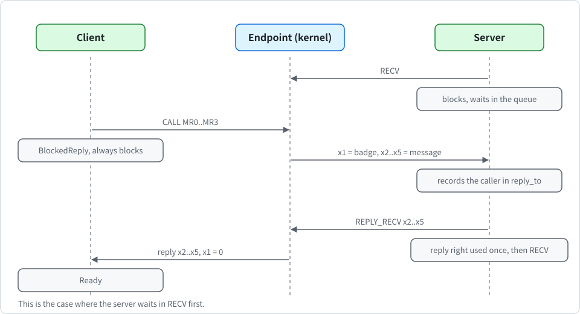

# Synchronous IPC

English | [한국어](../kr/ipc_KR.md)

This note describes K0's inter-process communication. It covers the following:

- endpoints
- the four IPC system calls
- the badge that tells a server its clients apart
- the single-use reply right that makes `CALL` safe

The code is in `crates/k0-ipc/src/lib.rs`, with the endpoint queue in `crates/k0-task/src/lib.rs`.

## Design in one paragraph

IPC in K0 is a **synchronous rendezvous** in the style of seL4. A message is four 64-bit words carried in registers `x2` to `x5`, called MR0 to MR3. When both sides are ready, the kernel copies the four words from the sender's saved context into the receiver's saved context. If one side is not ready, the other waits in the endpoint's queue.

> [!IMPORTANT]
> The kernel never buffers a message, never allocates memory for IPC, and never reads user memory. That leaves no buffer for user space to fill up, and no user buffer that could change between the kernel's check and its use.

## Endpoints

An **endpoint** is a kernel object created by `RETYPE` (see [capabilities.md](capabilities.md)). It holds the head and tail of one queue of blocked TCBs, linked through the TCBs' own `next` and `prev` fields. A zeroed endpoint is an empty endpoint.

The queue is doubly linked. A TCB also records which endpoint it waits on (`blocked_on`). So a task can be taken out of the middle of a queue in constant time when it is destroyed. Removal checks that the links are consistent and halts the kernel with `k0: FATAL` if they are not.

At any moment the queue holds either waiting senders or waiting receivers, never both. A sender that finds a receiver waiting delivers at once, and a receiver that finds a sender waiting takes the message at once. Only one kind can therefore pile up. The kernel tells the two kinds apart by the state of the TCB at the head of the queue. Queues are first in, first out.

### Finding the endpoint, and rights

The slot number in `x0` is looked up only in the calling task's own CNode (see [capabilities.md](capabilities.md)). A slot number means nothing outside the CNode of the task that uses it. So a task can reach only the endpoints whose capabilities it holds.

The capability must carry the right the call needs. A capability without that right is refused with `NO_RIGHTS`.

| Call | Required right |
| --- | --- |
| `SEND`, `CALL` | `W` |
| `RECV`, `REPLY_RECV` | `R` |

Rights can only be removed, and only by `CAP_COPY`. So a server can hand out send-only capabilities to its clients and keep the receive side for itself.

### Badges

An endpoint capability can carry a **badge**, a 64-bit value where 0 means none. The badge is set once, by `CAP_COPY` on an endpoint capability that has no badge yet. Setting a badge on any other capability, or a different badge on an already badged one, fails with `BAD_BADGE`. Copies of a badged capability keep its badge.

When a message is received, the kernel puts the badge of the sender's capability into the receiver's `x1`. The sender never supplies it. The kernel reads it from the capability the sender used, so **a client cannot forge another client's badge**.

A sender that has to wait in the queue keeps the badge of its send in its TCB (`ipc_badge`). So the badge delivered is the one of the call that queued it. On the reply path `x1` is always 0.

## The four calls

All four take an `Endpoint` capability in `x0` and flags in `x1`. The flags register has the following layout:

| Bits | Name | Meaning |
| --- | --- | --- |
| 0 | `NONBLOCK` | if the other side is not ready, the call returns `WOULD_BLOCK` instead of waiting |
| 31 to 1 | reserved (`k0_abi::ipc::RESERVED`) | must be 0 |
| 63 to 32 | timeout | the longest wait in scheduler ticks, 0 means wait forever (see [Timeouts](#timeouts)) |

`k0_abi::ipc::timeout(ticks)` builds the timeout value, and `k0_abi::ipc::TIMEOUT_SHIFT` is 32. `NONBLOCK` wins over a timeout. A call with any reserved bit set fails with `BAD_FLAGS` before anything else is looked at. For `REPLY_RECV`, this happens before the pending reply is consumed. The following figure shows the order of `CALL` and `REPLY_RECV` in the case where the server waits in `RECV` first.

  

The four calls work as follows.

**SEND** delivers MR0 to MR3. If a receiver is waiting, the kernel copies the message into the receiver's context, makes the receiver ready, and the sender continues. Otherwise the sender waits in the queue as `BlockedSend` until a receiver arrives.

**RECV** waits for a message. If a sender is waiting, the kernel copies its message into the receiver's context at once. The receiver gets `x0 = 0`, `x1 = ` the badge of the sender's capability, and the message in `x2` to `x5`. A plain sender is released and made ready. A sender that used `CALL` is not released. It moves on to wait for the reply, as described in the next entry.

**CALL** sends a message and waits for the reply in a single trap. If a receiver is waiting, the message is delivered and the caller moves straight to `BlockedReply`. Otherwise the caller waits in the queue as `BlockedCall`. Either way, **the caller always blocks**. Because sending and waiting happen in one step, the reply can never arrive in the gap between them.

**REPLY_RECV** is the server loop in one trap. If the calling task holds a reply right, the kernel delivers `x2` to `x5` as the reply to the waiting caller, makes the caller ready, and drops the right. Then it continues exactly like `RECV`, including a timeout, which applies to this receive phase only.

The endpoint is checked first. If the endpoint capability is invalid or lacks `R`, the call fails without using up the reply. The reply is delivered with `x1 = 0`.

## The reply right

When a receiver takes a message from a `CALL`, the kernel records the caller in a field of the receiver's TCB called `reply_to`. That field is the **reply right**. It is not a capability and does not occupy a slot, so user space can neither forge it, copy it, nor pass it on. The following three rules keep it safe.

1. **Single use**: `REPLY_RECV` clears the field the moment it delivers the reply.
2. **At most one per task**: if a task that already holds a reply right receives a new `CALL`, the old caller is woken with `NO_REPLY` before the new right is recorded.
3. **No orphaned callers**: if a task holding a reply right exits, faults or is destroyed, the kernel first wakes the caller with `NO_REPLY`.

The right is linked in both directions: the server's `reply_to` names the caller, and the caller's `reply_from` names the server. That lets either side be destroyed without leaving a pointer behind. A caller therefore always wakes up, either with a reply or with `NO_REPLY`, as long as the system keeps running.

## Destroying tasks and endpoints

A task is torn down in the following cases:

- it exits, faults or makes an unknown system call
- its TCB's original capability is removed
- the CNode or address space bound to it is revoked or deleted

The teardown looks only at the task's state and cuts every kernel pointer to it:

- **Ready**: removed from the ready queue.
- **Blocked in SEND, RECV or CALL**: removed from the queue of the endpoint it waits on, whether it is the head, the middle or the tail.
- **Waiting for a reply** (`BlockedReply`): the reply right is cut in both directions. So the server holds no right to answer it, and a late reply cannot wake a dead task.
- **Holding a reply right**: the caller waiting for it wakes with `NO_REPLY`.
- **Inactive, stopped or running**: nothing to unlink.

A task that waits with a deadline is also removed from the timed list of the scheduler. The state then becomes `Dead` and the saved registers are zeroed. If the task that made the system call is the one that died, the kernel never writes a return value into it and switches to the next ready task.

When the original capability of an endpoint is deleted, every task still queued on it wakes with `REVOKED`, and no TCB points at the endpoint afterwards. Deleting only a copy of the capability does not touch the queue.

## Timeouts

Every wait can be bounded. A timeout is the upper 32 bits of the flags register `x1`, counted in scheduler ticks. The tick period is 1 second (a kernel constant), so the tick is the unit of every timeout. The following rules apply.

- **Deadline rule**: a timeout of n ticks ends at the (n+1)-th timer tick after the call. As long as ticks are handled on time, the wait lasts between n and n+1 tick periods.
- **Lower bound, not wall-clock time**: the kernel runs with interrupts masked during every system call, and a long one such as a large `CAP_REVOKE` makes a tick late. The wait is then that much longer.
- **0 means no deadline**: the task waits until its partner acts, as before.
- **One deadline for a call**: the deadline of `CALL` covers both phases, waiting for a receiver and then waiting for the reply.
- **Reply and receive**: `REPLY_RECV` applies the timeout to its receive phase only.

The following table lists what the caller gets when a wait ends by timeout.

| Call | Where it waited | Result | What happened to the message |
| --- | --- | --- | --- |
| `SEND` | in the endpoint queue | `TIMEOUT` | not delivered |
| `RECV`, `REPLY_RECV` | in the endpoint queue | `TIMEOUT` | nothing received (a reply given by `REPLY_RECV` was already delivered) |
| `CALL` | in the endpoint queue | `TIMEOUT` | not delivered |
| `CALL` | `BlockedReply` | `REPLY_TIMEOUT` | delivered, and the server may or may not have acted |

When a `CALL` ends with `REPLY_TIMEOUT`, the kernel clears the reply right of the server that holds it. If the server answers later, its `REPLY_RECV` finds no reply right to use, and the late reply is dropped. The next caller receives its own reply.

### The timed list

Each TCB has the fields `deadline`, `tnext` and `tprev`. `k0-sched` keeps an unsorted, intrusive list of the timed waiters (`arm_timeout`, `disarm_timeout`, `expired`, `has_timed`), plus a lower bound of the earliest deadline so that most ticks do not walk the list. A task leaves a blocked state in only two ways, and both remove it from the list:

- `k0_sched::enqueue` (a wake-up), so a waiter woken by a message keeps no deadline, and
- `k0_ipc::teardown` (death).

`k0_ipc::expire_timeouts` handles the expired waiters. It removes a waiter from its endpoint queue and wakes it with `TIMEOUT`, or it clears the reply link of the task that holds its reply and wakes it with `REPLY_TIMEOUT`. A link that does not match the state halts the kernel with `k0: FATAL`, as in teardown. It runs on every timer tick:

- from `k0_preempt`, when a task was running, and
- from the idle loop, when none was.

The walk costs O(number of timed waiters) with interrupts masked, at most once per tick.

> [!NOTE]
> EL0 still cannot read any hardware counter or timer. A timeout gives EL0 a clock as coarse as the scheduler tick and a wake-up aligned to the timer interrupt. Whether that can be amplified into a useful timing source for cache or speculation attacks has not been analysed.

## Blocking and deadlock

A task that has to wait is marked with its blocked state and linked into the endpoint queue or held by a reply right. If the call has a timeout, the task is also put in the timed list. Then the scheduler switches to the next ready task (see [scheduling.md](scheduling.md)). Its return registers are written later, by the task that releases it.

If no task is ready at that point, the kernel does not stop. It idles in `idle_until_ready` (`kernel/src/syscall.rs`): it waits for the next interrupt, wakes every waiter whose deadline has passed, and switches to a ready task if there is one. Timer ticks keep being counted and handled meanwhile. The idle loop prints one of two lines, each at most once per boot:

- `k0: idle (waiting for a timeout)`: at least one waiter has a deadline, so something will wake a task.
- `k0: all tasks stopped (none ready, no timeout pending)`: no waiter has a deadline. Nothing can wake a task in that state today, because K0 has no notification objects and no device interrupts for tasks, so the machine stays idle. `tools/qemu-boot-test.sh` treats any line that starts with `k0: all tasks` as a failure.

> [!WARNING]
> The kernel no longer halts when every task is blocked, and a task can bound its own waits with timeouts. Availability is still not protected. A task that waits without a timeout can wait forever if its partner never acts, and a confined task that holds a capability to an endpoint can still make others wait. This is the subject of advisory GHSA-q99x-2wrv-358p in [SECURITY.md](../../SECURITY.md). The advisory is updated at release time.

A server, or the root task, that must stay responsive has to give a timeout on every wait. Task isolation does not change this.

## Errors

The following table lists the error codes and their causes.

| Code | Cause |
| --- | --- |
| `BAD_SLOT` | the slot number is 0, beyond the calling task's CNode, or empty there |
| `BAD_CAP` | the slot holds something other than an endpoint |
| `NO_RIGHTS` | the endpoint capability lacks `W` (`SEND`, `CALL`) or `R` (`RECV`, `REPLY_RECV`) |
| `WOULD_BLOCK` | `NONBLOCK` was set and the other side was not ready |
| `NO_REPLY` | the receiver of a `CALL` exited, faulted or took a newer `CALL` without replying, or was destroyed |
| `REVOKED` | the original capability of the endpoint was deleted while the caller was queued on it |
| `TIMEOUT` | the wait ended before a partner arrived, and the message was not delivered |
| `REPLY_TIMEOUT` | a `CALL` was delivered but no reply came in time, and the server may or may not have acted |
| `BAD_FLAGS` | a reserved bit (31 to 1) of the flags register was set |

## How it is tested

IPC and teardown are tested by booting. The root task starts a server task and client tasks and checks:

- that `NONBLOCK` returns `WOULD_BLOCK` for each call on an empty endpoint, and that a non-endpoint slot is refused,
- a `SEND` to a waiting receiver and a `SEND` that has to wait for one, with the data checked on arrival,
- `CALL` with a reply, `CALL` queued before the server is ready, the content of each reply, and `x1 = 0` on the reply,
- first in, first out order with two queued senders,
- a server that receives a new `CALL` while it still holds a reply right, so that the first caller gets `NO_REPLY`, and
- a server that exits while a caller waits, so that the caller gets `NO_REPLY`.

The timeout tests (`test_timeouts` in `userspace/root-task/src/main.rs`) wait for real ticks and check the following:

- that reserved flag bits are refused, and that `NONBLOCK` beats a timeout,
- a `CALL` whose server never answers, which returns `REPLY_TIMEOUT` while every other task is blocked too,
- three waiters in `RECV`, `SEND` and `CALL`, which return `TIMEOUT`,
- that the late reply of the server is dropped and the next call gets its own reply,
- that a timed waiter can be deleted, and
- that a waiter woken by a message keeps no deadline.

The timeout tests take their objects from the largest untyped. The tests wait for real ticks, so a boot test takes about 4 seconds longer.

The capability tests check that a badge can be set once and is refused a second time, that a copy keeps the badge, that a send-only capability cannot receive and a receive-only one cannot send (`NO_RIGHTS`), and that revoking an endpoint removes every copy while the original stays.

The isolation tests start a confined task whose CNode holds only a send-only, badged endpoint capability. The root task checks that the task receives the badge it was given in `x1` and that slot numbers of the root task mean nothing in the confined CNode (`BAD_SLOT`).

The teardown tests delete tasks in each state and check the queues afterwards:

- a task blocked alone in a queue, and the middle, tail and head of a queue of four, with the survivor's message still arriving,
- ready tasks, an inactive TCB and a stopped TCB whose CNode is revoked,
- a task blocked in `RECV` and a task queued by `CALL`,
- a caller waiting for a reply, so that the server's reply right is withdrawn,
- a server that holds a reply right, so that the caller gets `NO_REPLY`, and
- an endpoint deleted with a receiver queued, and with a sender and a caller queued, so that every waiter gets `REVOKED`.

The boot test script also requires an exact number of `k0: task fault` lines and exactly one `k0: unknown syscall` line, so a task that keeps running after it was destroyed fails the test.

`tools/qemu-boot-test.sh` requires `root: ipc tests pass`, `k0: idle (waiting for a timeout)` and `root: timeout tests pass`. When it judges by the serial port, it also counts the timer tick lines between `root: teardown tests pass` and `root: timeout tests pass`. There must be at least 4, which is how the lower bound of a timeout is checked, because EL0 has no clock.

## Known gaps

> [!NOTE]
> Capability transfer over IPC and notification objects do not exist yet. Timeouts are opt-in per call, so a task that waits without one still waits until its partner acts.

- **Timeouts say when a task becomes ready, not when it runs**: there is no priority and no CPU budget, and the scheduler is round robin with a one-tick slice (see [scheduling.md](scheduling.md)).
- **Long system calls**: the kernel is not preemptible, so a long call such as `CAP_REVOKE` on an untyped with many objects delays every other task and every timeout.
- **Fatal stops**: a `k0_arch::fatal` or a kernel panic still stops the machine.
- **Timing source for EL0**: whether the tick-aligned wake-up can be used for timing attacks has not been analysed.
- **A queued sender**: it delivers once after revocation. A sender that is already waiting on an endpoint keeps the badge of the send that queued it. If its capability is revoked while it waits, its message is still delivered once to the next receiver.
- **Four words per message**: larger data needs shared memory. The holder of a task's `AddrSpace` capability must map it into that task's address space, since tasks can now run in separate address spaces.
