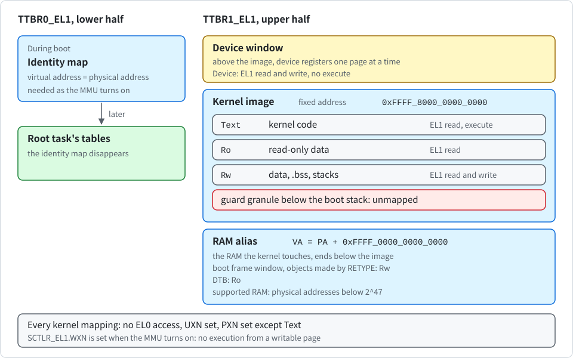

# Kernel page tables and W^X

English | [한국어](../kr/memory_KR.md)

This note describes how the kernel maps itself: the translation setup, the static table pool, the permission scheme, and the checks that confirm the result at boot. The code is in `crates/k0-mm/src/paging.rs`. User address spaces are covered in [user-address-space.md](user-address-space.md).

## Two halves

AArch64 splits the virtual address space between two table roots. The following figure shows the two halves and the permissions of each region.

- `TTBR0_EL1` covers the **lower half**. During boot it holds an identity map, where each virtual address equals its physical address. The kernel needs it to keep running at the moment the MMU turns on. Later, `TTBR0_EL1` is switched to the root task's tables and the identity map disappears.
- `TTBR1_EL1` covers the **upper half**. This half consists of the following three regions.
  - **Kernel image**: it is always mapped at the fixed virtual address `0xFFFF_8000_0000_0000`, whatever physical address the boot loader loaded it at.
  - **RAM alias**: it maps the RAM the kernel touches (the boot frame window, objects created by `RETYPE`, the DTB) at a fixed offset. Virtual address = physical address + `0xFFFF_0000_0000_0000`.
  - **Device window**: it sits above the image, and device registers are mapped there one page at a time.

After the jump to the higher half, the kernel uses only these mappings.

> [!NOTE]
> The alias must end below the image, so the kernel supports RAM only below physical address 2^47. It refuses anything higher.

Both halves use 48-bit virtual addresses (`T0SZ = T1SZ = 16`) and four levels of tables. The **granule** is a build option: 4 KiB by default (`granule-4k`), or 16 KiB with `--no-default-features --features granule-16k`. There is no run-time selection, and exactly one of the two features must be set. Otherwise the build fails. 64 KiB is not supported. The boot checks `ID_AA64MMFR0_EL1` and refuses to boot on a CPU that does not support the chosen granule. `TG0` and `TG1` encode the same granule with different values, and the code handles that explicitly. The physical address size (`IPS`) comes from the CPU's reported range, capped at 48 bits.

The image can be loaded at any physical address on the granule grid. The entry code finds its own position relative to the program counter and maps itself at the fixed virtual address. The identity map in `TTBR0_EL1` exists only for the moment of the switch.

The kernel maps **only pages**, never blocks. Every mapping goes through the same walk to the last level, so there is one code path to reason about.

## The static table pool

The kernel has no heap. Its page tables come from a **pool of 40 tables** in `.bss`, handed out by a counter that only goes up. Three tables are taken when the MMU is set up:

- the roots of the two halves (two tables)
- an empty `TTBR0_EL1` root with no mappings in it (`null_user_root`)

The kernel switches `TTBR0_EL1` to that empty root when the address space that is currently installed is destroyed, so the hardware never walks a table that no longer exists. The rest become intermediate tables as mappings are added. On QEMU virt with the default build, the boot log line `k0: kernel table pool N/40`, printed after the boot frame window is mapped, shows `16/40`. Later `RETYPE` calls can use more.

When the walk follows an existing table entry, `index_of` converts the address in that entry back into a pool index. It rejects any address that does not land exactly on an allocated table in the pool. A corrupted or forged table address therefore stops the walk with `BadTable`. It is never followed into arbitrary memory.

### Failed mappings are rolled back

`map_page` remembers every link it creates on the way down. If the walk fails, for example because the pool runs out or the leaf entry is already in use, it clears those links and restores the counter. The pool ends up exactly as it was before the call.

This matters after boot. Each `RETYPE` system call maps the new object into the kernel alias through this pool. Without the rollback, a user task could issue retypes that fail halfway and drain the pool a few tables at a time, until the kernel itself could no longer map anything. With the rollback, a failed retype costs nothing. Two host tests show this:

- One fails a walk midway and checks that the pool is unchanged.
- The other fails a thousand times in a row on a nearly full pool.

## Permissions

> [!IMPORTANT]
> All kernel mappings follow one rule: nothing is writable and executable at the same time, and nothing the kernel maps for itself is accessible from EL0.

In the following table, you can see the kinds of kernel mappings and their permissions.

| Kind | Used for | EL1 access | EL1 execute | EL0 access |
| --- | --- | --- | --- | --- |
| `Text` | kernel code | read | yes | none |
| `Ro` | read-only data, the DTB | read | no | none |
| `Rw` | data, `.bss`, stacks, frame windows | read and write | no | none |
| `Device` | console UART (only in an image built with a driver for it), interrupt controller | read and write | no | none |

Every kernel mapping sets `UXN`, and every one except `Text` sets `PXN`. Memory attribute index 0 is normal write-back memory and index 1 is Device-nGnRE.

`SCTLR_EL1.WXN` is set when the MMU turns on. With `WXN`, the hardware **refuses to execute from any writable page**, whatever its execute bits say. A bug that produced a writable and executable entry would still not give an executable writable page.

The linker script supports this split. `kernel/build.rs` generates it from one template (`kernel/kernel.ld`), prepending the granule size, so alignment follows the granule feature. It aligns text, read-only data and data to granule boundaries, and its ELF program headers carry the same R+X, R and R+W flags.

## Device and DTB mapping

The DTB is mapped read-only through the alias only after its header has been checked, and the kernel reads the platform description from it. A device page is mapped only after the platform descriptor has been checked against the memory map. The following are refused:

- a device range that overlaps RAM, the kernel image or the DTB
- a physical address beyond the CPU's address width

Device pages go into the device window one page at a time, so a large register range (for example the GICv3 redistributors) is never mapped as a whole. See [exceptions.md](exceptions.md) for the interrupt controller.

The **boot frame window** is 2 MiB of RAM that the kernel picks inside the memory map. The function that picks it is `boot_window` in `crates/k0-boot/src/window.rs`, which the UEFI loader also runs before the jump. It looks first right after the kernel image (after the DTB if they overlap), and if there is no room above, from the lowest memory upward.

## Guard pages

The boot stack is 64 KiB and sits after `.bss`. The granule just below it is left out of both halves, so a stack overflow **faults immediately** instead of overwriting `.bss`. The exception vectors have their own 8 KiB stack in `.bss`. The fatal path switches to it, so the kernel can still print a diagnosis when the fault was itself a stack overflow.

## Turning the MMU on

`switch_on` works in the following order.

1. It writes `MAIR_EL1`, `TCR_EL1` and both table roots.
2. It issues barriers.
3. It invalidates the TLB.
4. It invalidates the whole instruction cache.
5. It sets `SCTLR_EL1.M`, `C`, `I` and `WXN`.

The instruction cache invalidation is there because the kernel does not trust anything the bootloader may have left in the cache.

If `ID_AA64MMFR2_EL1` reports FEAT_E0PD, `enable_paging` also sets `TCR_EL1.E0PD1`. With it, an EL0 access to the upper half (the `TTBR1_EL1` range) faults without a translation walk, so EL0 cannot tell from timing which kernel alias addresses are mapped. On a core without FEAT_E0PD, such as the default QEMU `cortex-a72`, the bit is left clear and the access still faults on the missing permission.

`enable_paging` can run only once. A second call returns `AlreadyEnabled`. On success it returns an `Mmu` token that is meant to prove paging is on.

> [!NOTE]
> No later step consumes the `Mmu` token yet. The token cannot be carried across the jump to the higher half, so the order of `kernel_main` enforces that sequence instead.

## Adding mappings later

Two functions add read-write ranges to the higher half after boot. Both share one walker and differ in a single flag.

- `map_kernel_window` maps the 2 MiB boot frame window before the root task is loaded. Any existing translation in the range is an error (`Overlap`), identical or not.
- `alias_object` maps one granule for an object created by `RETYPE`, so that the kernel can zero and use it through the alias. If the leaf already holds exactly the same mapping (same physical address, same attributes), the call succeeds. Any different mapping is still `Overlap`.

The identical case exists because aliases are never removed. When a `CAP_REVOKE` or `CAP_DELETE` returns untyped memory and it is retyped again, the alias of the same physical frame is already there. Accepting **only an identical entry** keeps reuse working without letting a retype replace a mapping that points somewhere else. The window mapping does not get this leniency, because a boot window overlapping an existing mapping would be a mistake.

These calls only turn invalid entries into valid ones. Existing translations never change, so no break-before-make sequence is needed. A store barrier and an instruction barrier make the new entries visible to the table walker before the memory is used.

## Self-checks at boot

Right after the jump, `check_wx` in `kernel/src/main.rs` asks the hardware with address translation instructions (`AT S1E1R`, `AT S1E1W`) whether each case behaves as intended. In the following table, you can see the checks and their expected results.

| Check | Expected |
| --- | --- |
| kernel text readable | yes |
| kernel text writable | no |
| read-only data writable | no |
| boot stack guard page readable | no |
| boot stack writable | yes |
| identity map of kernel text readable | yes, until the user tables replace it |

Any mismatch **stops the boot** with the name of the check. These checks test the tables the hardware actually walks, not the code that built them.

## How it is tested

- `tools/boot-matrix.sh` boots the default build and the 16 KiB build on several QEMU configurations, and checks that unsupported configurations are refused with a reason in the boot log.
- Host unit tests in `crates/k0-mm/src/paging/tests.rs` check the index arithmetic for both granules, the W^X properties of every kernel permission, the rollback after a failed walk, the rejection of forged or block entries, and that an identical leaf is accepted only when the caller asks for it (`an_identical_leaf_is_accepted_only_when_asked`). They run on AArch64 hosts.
- `tools/qemu-boot-test.sh` requires the line `k0: w^x checks pass`.

## Known gaps

- **Pool exhaustion**: the pool size is fixed at 40 tables. If retypes spread over enough distinct address ranges, the pool runs out and `RETYPE` returns `KERNEL_RESOURCE`. Nothing leaks, but the pool is never reclaimed.
- **Aliases stay**: kernel alias mappings are never removed. A retyped object stays mapped in the kernel alias even after its capability is revoked and its memory is retyped again. Reuse no longer fails, because an identical alias is accepted, but the alias itself and the tables that hold it stay.
- **Availability limit**: because of the previous two points, a task that holds a lot of untyped memory can retype across enough distinct address ranges to use up the pool. `RETYPE` then returns `KERNEL_RESOURCE` for every task, not only for the one that caused it. Isolation between tasks does not cover this availability limit.
- **No ASIDs**: address space identifiers (ASIDs) are not used. Every switch to a different user address space invalidates the whole TLB.
