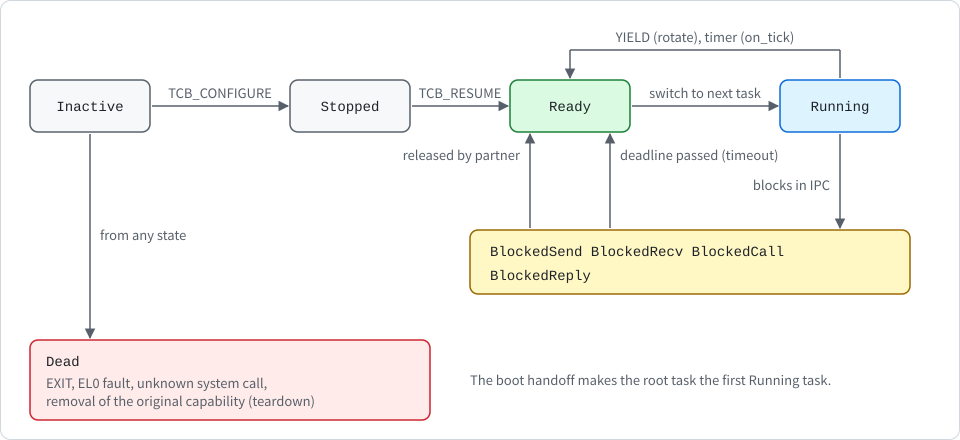
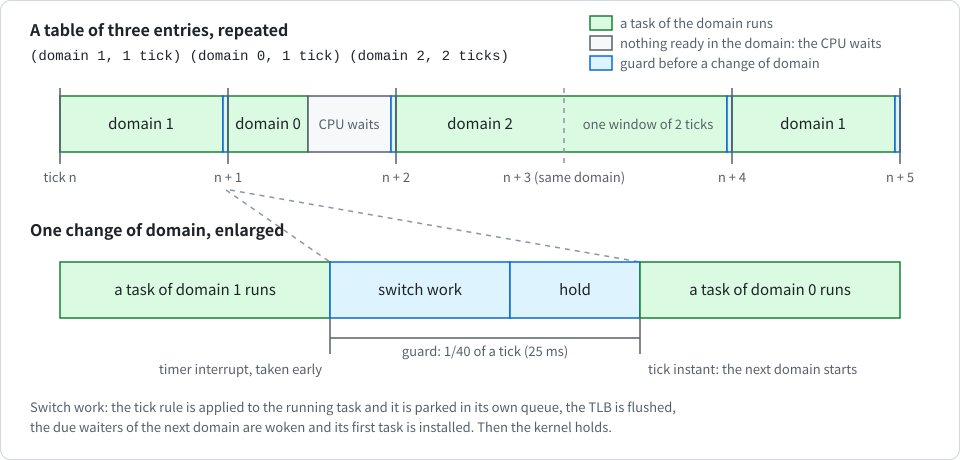

# Tasks and scheduling

English | [한국어](../kr/scheduling_KR.md)

This note describes the following:

- how K0 represents a task
- how user space creates, starts and tears down tasks
- how the round-robin scheduler switches between tasks and decides when a timer tick cuts a task
- how fixed time partitions give each domain of tasks its own windows of ticks, and what that does and does not claim

The code is in the following places:

- `crates/k0-task/src/lib.rs`
- `crates/k0-part/src/lib.rs` (every scheduling decision, type `Core`) and `crates/k0-part/src/clock.rs` (the arithmetic of tick instants)
- `crates/k0-slice/src/lib.rs` (the rule for one tick, used by `Core`)
- `crates/k0-sched/src/lib.rs` (the queues and the installed task, around `Core`)
- the timer in `crates/k0-arch/src/irq.rs`
- `teardown` in `crates/k0-ipc/src/lib.rs`
- `sys_tcb_configure`, `sys_tcb_resume`, `sys_part_set_table`, `sys_part_set_domain`, `k0_preempt`, `k0_leave`, `wait_for_work`, `kill_current` and `finish` in `kernel/src/syscall.rs`

The note describes the current `main` branch (unreleased).

## The task control block

A **task control block** (TCB) holds the following:

- **Saved user context**: 31 general-purpose registers, the stack pointer, the return address, the saved processor state, and the two EL0 thread pointer registers.
- **Top-level page table address** (`ttbr0_pa`): a copy of the address space root that is valid only while the task's embedded slots are bound.
- **State**: the current state of the task.
- **Domain**: the number of the time partition domain the task belongs to, 0 to 7 (see [Time partitions](#time-partitions)). Domain 0 is the root domain. The byte sits in what was padding after the state, so the TCB did not grow.
- **Queue links**: `next` and `prev`, the links to its neighbours in whatever queue the task is in.
- **Reply right**: the single-use reply right (`reply_to`) and its reverse link (`reply_from`), described in [ipc.md](ipc.md).
- **IPC wait information**: `blocked_on`, the endpoint the task is queued at, and `ipc_badge`, the badge of the message it is waiting to send.
- **Timeout fields**: `deadline`, the tick at which the task's IPC wait ends, and `tnext` and `tprev`, the links of the timed waiter list (see [Timeouts](#timeouts)).
- **Three embedded capability slots**: slot 1 holds the task's `CNode` capability and slot 2 its `AddrSpace` capability. Slot 0 is unused.

The **embedded slots** are what bind a task to its capability space and its address space. System calls resolve slot numbers only in the CNode named by slot 1 (see [capabilities.md](capabilities.md)), and the task runs in the address space named by slot 2. Both are copies, that is children in the derivation list, of the capabilities given to `TCB_CONFIGURE`, and they are marked as bound to the task. When either one is removed, the task is torn down (see [Teardown](#teardown)).

Every TCB, including the root task's, is an ordinary object at the start of a granule-sized frame. The root task's TCB lives in the 2 MiB boot frame window and is reached through a `Tcb` capability in the root CNode. Every other TCB is a frame that user space retyped from untyped memory.

The kernel reaches a TCB only through its own alias, and it is never mapped at EL0. Compile-time assertions keep the TCB within a granule, so that the TCB can be found again by rounding an embedded slot's address down to the granule.

## States

The following figure shows the task states and the transitions between them. The meaning of each state is in the table after it.

  

| State | Meaning |
| --- | --- |
| `Inactive` | just retyped, not configured |
| `Stopped` | configured, not yet started |
| `Ready` | in the ready queue of its domain |
| `Running` | the current task |
| `BlockedSend`, `BlockedRecv`, `BlockedCall` | waiting in an endpoint queue |
| `BlockedReply` | waiting for the answer to a `CALL` |
| `BlockedConsole` | waiting for console input in `CONSOLE_READ` (only in an image built with `console-input`). The task is in no queue. One kernel waiter slot points at it, and only one task can wait at a time. |
| `Dead` | exited, killed, or torn down |

A task in any of the blocked states can also become `Ready` when its deadline passes. A `BlockedConsole` task also becomes `Ready` when a byte arrives or when its capability is deleted, revoked or moved (for deadlines see [Timeouts](#timeouts)).

`Inactive` has the value 0. A freshly retyped frame is all zeroes, so it already is a valid `Inactive` TCB of the root domain with empty queue links, empty embedded slots and no reply right. Retype needs no constructor.

## Creating a task

`TCB_CONFIGURE` takes six arguments: the `Tcb` slot, an entry address, a stack top, an `AddrSpace` slot, a `CNode` slot and one argument value that the new task receives in `x0`. All slots are looked up in the caller's own CNode. The kernel checks that:

- the entry address is 4-byte aligned, above the first granule and inside the 48-bit user range,
- the stack top is 16-byte aligned, above the first granule and inside the user range,
- the capabilities are of the right kinds (`Tcb`, `AddrSpace`, `CNode`), and
- the TCB is in the `Inactive` state, so each TCB can be configured only once and a running task can never be reconfigured. The state is read through a raw pointer before any mutable reference to the TCB is formed.

> [!IMPORTANT]
> The two bindings are written together. Both capabilities are validated first, and then copies are written into slots 1 and 2 in one step, so a TCB that is bound to only one of the two cannot exist.

If any check fails, both embedded slots stay empty and the TCB stays `Inactive`.

The kernel then zeroes the saved context and sets the entry address, the stack pointer, `x0` and `ttbr0_pa`. It sets the saved processor state itself, to EL0 with interrupts unmasked. User space never supplies processor state, so it cannot ask to return to EL1 or to run with interrupts masked. The thread pointer registers start at zero, so the new task does not inherit the creator's values. The new task gets **the domain of the task that configured it**. The TCB moves to `Stopped`.

`TCB_RESUME` accepts only a `Stopped` TCB and puts it in the ready queue of its domain. A TCB that is already queued, running, blocked or dead is refused, so the same TCB can never sit in a queue twice.

Between the two calls, and only then, the holder of the control capability can put the task in another domain with `PART_SET_DOMAIN` (see [The control capability and the two system calls](#the-control-capability-and-the-two-system-calls)). A task's domain never changes after its first `TCB_RESUME`.

## The ready queue

The scheduler keeps the installed task and, **for each of the 8 domains**, the head and tail of a ready queue and the head of a list of timed waiters. Each value is the kernel address of a TCB, with 0 meaning none. A queue is linked through the TCBs' own `next` and `prev` fields, so it needs no memory of its own. Its length is bounded by the number of TCBs, which user space paid for with untyped memory. The scheduler cannot become a way to exhaust kernel memory.

A task is only ever put in the queue of its own domain. `k0_sched::enqueue`, which every wake-up uses, reads the domain from the TCB, and the caller cannot choose the queue. When the scheduler itself queues a task (at a rotation or at the end of a window), it checks that the queue is the task's own and halts with `k0: FATAL task queued outside its domain` otherwise. With no table set, every task is in domain 0 and one queue is in use, as before.

The queue is doubly linked so that a task can be removed from anywhere in it in constant time. That matters because a task can be torn down while it is ready, and the kernel must not walk the queue to find it. Removal checks that the links agree with the queue's head and tail. If they do not, the queue is corrupt and the kernel halts with `k0: FATAL ready queue corrupt`.

The same `next` and `prev` fields also link a blocked task into an endpoint queue, which has the same structure. The state machine keeps these uses apart. A task is either ready, or blocked in one endpoint, or running, never two at once.

## Switching tasks

When an exception arrives from EL0, the vector code saves all user registers into the context of the current TCB before any Rust code runs (see [exceptions.md](exceptions.md)). On the way back, it restores registers from whatever context the global `__current_context` pointer names. A task switch is therefore just two steps:

1. Point `__current_context` at the next task's saved context.
2. If the next task uses a different top-level page table, load it into `TTBR0_EL1` and invalidate the whole TLB. K0 does not use address space identifiers, so every switch between tasks in different address spaces flushes the TLB. Switching between tasks in the same address space does not touch `TTBR0_EL1`. A change of domain flushes the TLB too, even when the address space stays the same.

Tasks can run in different address spaces, so `TTBR0_EL1` really changes between them. If an address space is destroyed while it is installed, the kernel first switches `TTBR0_EL1` to an empty table.

Every decision about who runs next is made in one place, the type `Core` of the crate `k0-part`. `Core` holds the table, the running domain, the running task and the mark of the slice rule, and it reaches the queues only through a small trait (`Env`), so the host tests run the same code on a fake environment. `k0-sched` implements that trait on the real queues. The kernel tells the scheduler only **which event happened**, by calling one of the functions in the following table. It never passes an entry kind or a "a tick went by" flag, so it cannot pass a wrong one.

The entry kind says how the next task got the CPU: `Tick` if by a tick's own decision, `Between` if between two ticks. The next sections explain why `Core` keeps this.

| Function of `k0-sched` | Called for | What happens to the current task | Entry kind of the next task |
| --- | --- | --- | --- |
| `rotate` | `YIELD` | goes to the tail of its domain's ready queue, unless nothing else is ready in the domain, in which case it simply continues | `Between` |
| `on_tick` | a timer tick taken from EL0 | inside a window: if it got the CPU between two ticks and has met no tick yet, it continues and the exemption is used up. Otherwise it goes to the tail of the queue, unless nothing else is ready. At the end of a window it is parked in its domain's queue (see [Windows](#windows)) | `Tick` |
| `block_and_switch` | IPC, `CONSOLE_READ`, and the system call exit path when the current task died | stays out of the ready queue. The caller has already put it in an endpoint queue, behind a reply right or in the console waiter slot, or it is `Dead`. | `Between` |
| `poll` | the wait loop, after every interrupt | (no task is running) | `Tick` if the tick number went up while the kernel waited, otherwise `Between` |
| `handoff` | boot, once | the root task becomes the first `Running` task | `Between` |
| `set_table` | `PART_SET_TABLE` | continues | (no switch) |

None of these functions ever takes a task from another domain's queue. If the running domain has nothing ready, `block_and_switch`, `on_tick` and `poll` report that, and the kernel waits (see [When there is nothing left to run](#when-there-is-nothing-left-to-run)).

## Preemption

The tick is one second. Tick number n is due at a fixed instant: the counter value read when the timer was set up, plus n periods. The timer is always armed at such an absolute instant, so a handler that runs late does not push the later ticks back (see [The tick clock and skipped ticks](#the-tick-clock-and-skipped-ticks)).

When the timer fires while EL0 is running, the IRQ path acknowledges it, works out the tick number, arms the next tick, prints `k0: tick N` and calls `k0_preempt`. That function calls `k0_sched::on_tick`. Inside a window, the scheduler first wakes the console reader and the timeout waiters of the running domain that are due, and then decides whether this tick cuts the current task (see [The slice rule](#the-slice-rule)). At the end of a window it parks the current task and enters the next domain (see [Windows](#windows)).

With no table set, a task that never yields or blocks therefore **loses the CPU after at most two seconds**, and after one second if it got the CPU at a tick. Under a table the same holds inside the task's own windows, and the end of a window takes the CPU whatever the task did.

The `k0: tick N` line goes to the console in an image built with a console driver. Only the first 4 tick lines are logged, and they are logged even when a number was skipped or a table is set. The later lines, which go to the console only, are not printed while a table that names a domain other than the root domain is set or pending. Once a task has read console input, the tick lines stop after one line `k0: tick lines off (console input in use)`, but the tick, the preemption and the timeouts go on.

> [!IMPORTANT]
> The kernel itself is never preempted. Exception entry masks interrupts, and the kernel keeps them masked while it handles a system call or fault.

Inside a window, a tick still cuts a task only when another task of the same domain is ready. A timer interrupt that arrives at EL1 is possible only during boot, before the handoff, or while the kernel waits with nothing to run. It only counts the tick, and the wait loop hands the new number to the scheduler right after (`poll`). `on_tick` is called exactly once for every tick event taken from EL0, and a timer interrupt that arrives before the instant it was armed for is not a tick. In an image with `console-input`, an arriving input byte does not preempt: the woken reader goes to the end of its domain's ready queue like any other woken task. There are no priorities, so input latency is up to one tick per ready task, plus one more tick when the running task got the CPU between two ticks.

## The slice rule

Ticks fall at fixed instants, and a task switch does not move them. A task that gets the CPU between two ticks therefore receives only the rest of a period. Before this rule, the next tick moved it to the end of the queue however short a time it had run. A task could call `YIELD`, which needs no capability, shortly before each tick. The task behind it then got only the sliver after the yield, and the yielding task was back at the head of the queue for the next full period. In a QEMU run with two CPU-bound tasks, the other task fell from about 52 % of the CPU to between 7.9 % and 11.1 % when the attacker yielded at 90 % of the period. The yield point in that run was set from a loop count that the root task had measured for the attacker. No attacker that finds the tick phase by itself was built.

The rule is in the crate `k0-slice`, which only answers the question "does this tick cut the current task". `Core` keeps one mark next to the running task and writes it in one function, the only one that changes the running task:

- A task that gets the CPU **between two ticks** (`Entry::Between`) is not cut by the first tick it meets. That tick uses up the exemption, and the task runs on to the tick after it. This covers a previous task that called `YIELD`, blocked (IPC or `CONSOLE_READ`), exited or was killed, and a kernel that was waiting and woke for something that was not a tick, such as console input.
- A task that gets the CPU **by a tick's own decision** (`Entry::Tick`) starts at the beginning of a period and is cut by the next tick, as before. That includes a task the waiting kernel switches to after a tick woke it, for example an expired timeout, and the first task of a domain whose window opens. If a tick and console input arrive in the same wake-up, it counts as a tick: `Core::poll` decides by the tick number alone.
- The root task at boot counts as entering between two ticks, because the timer already runs during boot.
- Waking a task never grants the exemption. A woken task goes to the end of the ready queue of its domain as before, and console input still does not preempt.
- `YIELD` with nothing else ready changes nothing.

`Slice::entered` assigns the mark from the entry kind alone and never reads the previous value, so a mark left by the previous task cannot survive a switch, and neither can a mark left by a task of another domain. Blocking and exiting grant the exemption as well as `YIELD`. If only `YIELD` did, two tasks that start timed waits just before each tick would starve the task between them (the model shows this case).

What follows from the rule, with one domain:

- A task that was switched in is not cut by the timer before it has had one full tick period, unless it gives up the CPU itself. Before a forced preemption it runs at least one period and at most two.
- With N ready tasks, a task that never yields or blocks keeps at least 1/N of the CPU in the long run, whatever the other tasks do with `YIELD`, blocking and timed waits. This was checked by search in a model, and a Lean theorem states it for a model of one domain (see [How it is tested](#how-it-is-tested)). It is **not a proof about the Rust code**, there is no such statement for a table with several domains, and it is **not a budget**: nothing caps what a task may use, and N grows with every task that is created.
- It costs latency. A task that becomes ready with k tasks to run before it (the running one included) used to start within k tick periods and now starts within k + 1. In the model, a caller and a server that exchange calls and replies behind one CPU-bound task need 4 ticks per round trip instead of 2. With no CPU-bound task nothing changes.

Under a table, read these points on the domain's own time, that is its windows put end to end. The tick that ends a window applies the same rule to the running task and then parks it (see [Windows](#windows)), so a task can be taken off the CPU by the end of its window before it has run a full period. It continues in the next window of its domain. A window that ends in a change of domain is also shorter by the guard (see [The guard and the hold](#the-guard-and-the-hold)).

> [!NOTE]
> The numbers in this section (one to two periods per run, k + 1 periods of waiting) describe this version of the scheduler. They are not an interface. The tick is still one second and timeouts are still counted in ticks.

## Timeouts

The tick is the unit of every IPC timeout, as described in [ipc.md](ipc.md). The scheduler keeps the waiters that have a deadline in timed lists, **one per domain** (`arm_timeout`, `disarm_timeout`, `expired`, `has_timed` in `k0-sched`). A list is unsorted, and a lower bound of its earliest deadline lets most ticks skip it. A new waiter is linked at the head.

A task leaves a blocked state only through `k0_sched::enqueue` (wake-up) or `k0_ipc::teardown` (death), and both remove it from the timed list of its domain. A deadline is a global tick number: a timeout of n ticks ends at the (n+1)-th tick after the call, whichever domains run in between.

`k0_ipc::expire_timeouts` wakes the waiters of **one domain** whose deadline has passed. The scheduler calls it for the running domain only: at every tick inside that domain's window, at the tick that opens its window, and from the wait loop while that domain runs. The lists of the other domains are not looked at. So under a table a timeout can fire **late, and never early**: a waiter whose deadline passes while another domain runs wakes at the first tick of its own domain's next window. The walk goes from the head of the list, so when several waiters are due at once, the one that armed last is queued first.

> [!NOTE]
> A timeout says when a task becomes ready, not when it runs. The woken task joins the tail of its domain's ready queue like any other.

## Time partitions

K0 has a domain scheduler that is always compiled in. Every task belongs to one of 8 **domains**, numbered 0 to 7, and a **table** says which domain may use the CPU at which tick. A domain runs only in its own windows of the table. The mechanism is aimed at one channel only, **the channel between domains that goes through the scheduler**. The claim and its limits are stated together in [What the partitions claim and what they do not](#what-the-partitions-claim-and-what-they-do-not).

> [!NOTE]
> No image uses more than one domain yet. The root task tries the mechanism at every boot and then deletes the control capability, so every image built today runs with one domain and with the table sealed. Putting the key vault in a domain of its own is future work.

The following figure shows a table of three entries and what happens where the domain changes.

  

### Domains and the table

A table has 1 to 16 entries. Each entry names a domain (0 to 7) and a number of ticks (1 to 255). The table runs from entry 0 to its last entry and then starts again, and the tick is one second, so one round of a table takes between 1 second and 68 minutes.

- **No table set**: the kernel starts with the default table, one entry that gives domain 0 every tick. Domain 0 is the **root domain**, the one the root task is in. With this table the scheduler makes the same decision as the scheduler before it for the same sequence of events, as long as no tick is skipped (see [The tick clock and skipped ticks](#the-tick-clock-and-skipped-ticks) for what changed when one is).
- **A table that names only the root domain**: it behaves like the default table whatever its window lengths are, and the kernel does not treat the system as partitioned.
- **A domain that is in no table**: its tasks are never run. They stay ready, and they can still be deleted.
- **Where a task's domain comes from**: a task gets the domain of the task that configured it (`TCB_CONFIGURE`). Only the holder of the control capability can put a task elsewhere, and only before the task first runs.

### Windows

A **window** is a run of consecutive ticks that the table gives to one domain. Entries that follow one another with the same domain, also across the end of the table, are one window, and the ticks between them are ordinary ticks.

- **Which domain runs at tick n** is a function of the table, the tick at which the table started and n. Nothing a task does enters into it.
- **A tick inside a window** is handled as before: the due waiters of the running domain are woken, and then the slice rule decides whether the running task goes to the tail of its domain's queue.
- **The tick that ends a window** applies the slice rule to the running task once and then parks the task in its own domain's queue. If the rule keeps the task, it goes to the front. If the rule rotates it and another task of the domain is ready, it goes to the tail and that other task is put at the front. Then the kernel flushes the TLB, wakes the due waiters of the incoming domain and enters the task at the front of that domain's queue, as by a tick's decision. A parked task is `Ready`, and it continues when its domain's next window opens.
- **Time left over is not given away**: if the running domain has no ready task, because the incoming domain is empty or because its last task blocked or exited in the middle of the window, the CPU waits. It waits until a task of that domain becomes ready or until the window ends. A ready task of another domain is not run in its place.
- **A woken task goes to its own domain's queue**, whichever domain is running when it is woken, and it runs in its own window.

### The tick clock and skipped ticks

Tick n is due at `T0 + n * P`, where `T0` is the counter value read when the timer was set up at boot and `P` is one second in counter units. The arithmetic is in `k0_part::clock` and touches no hardware, so it is tested on the host. `crates/k0-arch/src/irq.rs` only reads and writes the registers.

- The timer compare value is always an absolute instant of this grid. How long a handler took has no effect on when the next tick is due.
- The tick number is a function of the counter. When the timer interrupt is handled, the tick number becomes the larger of "the last number plus one" and "the number of whole periods since `T0`".
- **A late handler jumps**: if the kernel kept interrupts masked for longer than a period, or the host stalled the virtual machine, the numbers in between are skipped. They are not replayed: the scheduler sees one tick event with the number that arrived, and the table position is computed from that number. So **a stall longer than a tick skips windows**, and a domain can lose a whole window that way.
- A timer interrupt that arrives before the instant it was armed for is not counted as a tick. The same instant is armed again.

> [!NOTE]
> Before this change the kernel counted the ticks it handled and armed the timer one period after each handler. A stall then pushed every later tick back and skipped no number. Now a stall skips numbers and moves no tick. With one domain the decision at the tick is the same either way. What differs is the number the tick gets, and with it the tick at which a timeout ends.

### The guard and the hold

A domain that could shift the instant at which the next domain starts would still have a channel. A system call that is in flight when the tick is due delays the tick handler, and how long it delays it depends on what the outgoing domain chose to do. Two things bound this.

- **Guard**: when the next tick will change the domain, the scheduler arms the timer one fortieth of a tick (25 ms) before the tick instant. The interrupt is taken that early, the tick is processed and the switch work is done inside this guard interval. The decision is made again after every tick and after every `PART_SET_TABLE`, because a call that replaces a table that was about to start can change the domain of the next tick. If such a call comes inside the guard interval, the guard of that one tick is shorter.
- **Hold**: every return from an exception to EL0 passes one exit function, `k0_leave`. It first checks that the task it is about to return to is `Running` and belongs to the running domain, and halts with `k0: FATAL returning to a task outside its window` otherwise. Then it spins until the instant of the last processed tick. After an early tick that is the tick instant. In every other case the instant is already past and the function returns at once.

The result is this and no more: **the next domain starts at the tick instant, to within the spin and the exit path, as long as the kernel path in flight and the switch work fit in the guard**. A kernel path that is longer than the guard and is in flight when the guard starts still delays the start of the next window.

The guard costs the outgoing domain its last 25 ms of every window that ends in a change of domain. Ticks inside a window, and every tick with one domain, are armed at the tick instant and have no guard.

Measured once on the development Mac, the tick handler was entered 2 to 5 ms after the start of the guard under QEMU TCG and 5 to 31 microseconds after it under HVF. This is one measurement on one machine, not a bound.

### The control capability and the two system calls

The authority over the table and over the domains is one capability, `PartCtl` (kind 9). The kernel creates exactly one at boot and puts it in slot 5 of the root CNode (see [capabilities.md](capabilities.md)). It has no rights bits and no object behind it.

- **No copy**: `CAP_COPY` of it returns `BAD_CAP`, whatever the rights mask and the badge. It can be moved with `CAP_MOVE`, and the authority goes with the slot.
- **Deleting it seals the table and the domains for good**: nothing can create another one, so after `CAP_DELETE` no task can change the table or a task's domain until the next boot. A table that was still pending when the capability was deleted takes effect.

The two system calls take the slot of the capability in `x0`. Both read registers only. The source of truth for the numbers is `crates/k0-abi/src/lib.rs`.

| Call | Arguments | What it does |
| --- | --- | --- |
| `PART_SET_TABLE` (17) | `x0` = `PartCtl` slot, `x1` = number of entries (1 to 16), `x2` to `x5` = the entries | sets a new table |
| `PART_SET_DOMAIN` (18) | `x0` = `PartCtl` slot, `x1` = `Tcb` slot, `x2` = domain (0 to 7) | puts a task that has not run yet in a domain |

An entry of the table is 16 bits: `(ticks << 8) | domain`. Entry i is in register `x(2 + i / 4)`, starting at bit `16 * (i % 4)`, so each of the four registers holds four entries. Every bit that is not used must be zero, which includes all entries after the last one.

`PART_SET_TABLE` works as follows:

- **When it takes effect**: the new table starts **two ticks after the last processed tick, at entry 0**. The tick in between is governed by the table that is in force at the time of the call.
- **A second call before that** discards the first table, which then never governs any tick. This is the one case in which a call changes the domain of the very next tick: when the discarded table was to start at that tick, the tick goes back to the table in force. A table that is already in force stays until the new one starts.
- **The table must contain the caller's own domain**: this stops the holder from setting a table by mistake under which it never runs again.
- **Errors**: `BAD_SLOT` or `BAD_CAP` when `x0` does not name a `PartCtl`. `BAD_TABLE` (-25) when the number of entries is 0 or more than 16, a domain is above 7, a window is 0 ticks, an unused bit is set, or the caller's domain is missing. A refused call changes nothing.

`PART_SET_DOMAIN` works as follows:

- **Only a stopped TCB**: the task must be `Stopped`, that is configured and not yet resumed. A task in that state is in no queue and in no timed list, and since those are kept per domain, this is what keeps a task from sitting in a list of a domain it has left.
- **The domain need not be in the table**: a task put in a domain that no table names is simply never run.
- **Errors**: `BAD_SLOT` or `BAD_CAP` when `x0` does not name a `PartCtl`, `BAD_DOMAIN` (-26) when `x2` is above 7, `BAD_SLOT` or `BAD_CAP` when `x1` does not name a `Tcb`, and `BAD_STATE` when the TCB is not `Stopped`. The checks run in that order today.

### Console input under a table

In an image with `console-input`, a byte that arrives is handed to a waiting reader **only while the reader's domain runs**. If another domain is running, the byte stays in the kernel's ring, and the reader gets it at the next tick at which its own domain runs or is entered. So the arrival time of input does not change the reader's queue inside another domain's window.

Two wake-ups of a reader are not bytes and are delivered whichever domain runs: `REVOKED`, when the reader lost its capability, and `NO_DEVICE`, when the input path was turned off. The woken reader still runs only in its own window. With one domain nothing changes.

> [!WARNING]
> The interrupt itself is not tied to a domain. The time of every console interrupt, and of the UART work in the tick handler, is taken from whichever domain is running.

### What the partitions claim and what they do not

The claim is this and no more: **fixed time partitions close the channel between domains that goes through the scheduler**. With a table set, which task of a domain runs, in which order and at which tick does not depend on what the tasks of the other domains do, as long as the domains share no kernel object and none of the limits below applies. It is not a claim about timing channels in general.

> [!WARNING]
> The limits below are part of the claim. A design that puts a secret in one domain and an observer in another must be checked against every one of them.

1. **Long kernel paths**: a kernel path that is longer than the guard and is in flight when the guard starts delays the start of the next window. `CAP_REVOKE` and the deletion of a capability with many descendants are such paths, and so is a task end line written to a slow serial line. The kernel is not preemptible.
2. **Caches and branch predictors** are not flushed at a change of domain. Only the TLB is.
3. **Interrupt time**: the time of console input interrupts, and of the UART work that the tick handler does, lands in whichever domain runs. How much work that is depends on the serial input and on how full the receive ring is.
4. **Shared kernel state other than the scheduler**: the UART and the boot log with its quotas, the single console waiter slot (a second reader in any domain gets `BUSY`), and the kernel memory pools.
5. **Skipped ticks**: a stall longer than a tick skips windows.
6. **Shared objects are channels by design**: an endpoint that tasks of two domains hold is a channel between them. So is every other capability operation on an object shared with another domain: deleting or revoking an endpoint its tasks wait on, the end of a task that holds its reply, `TCB_RESUME` of one of its tasks, and deleting one of its TCBs. Each needs a capability, and the woken task still runs only in its own window.
7. **A reader woken inside the guard**: when the incoming domain is empty and console input wakes its reader inside the guard interval, the reader starts at the tick instant and is still treated as entered between two ticks, so it is not cut at its first tick. The effect stays inside the reader's own domain.
8. **What no test sees**: EL0 has no clock, so the boot test judges by the order of events only. No test sees the guard, the hold or the TLB flush at a change of domain: a kernel without them passes every test. The rule for console input under a table has no test either. These rest on review.
9. **The proofs are about a model**, not about the Rust code (see [How it is tested](#how-it-is-tested)).
10. **Real hardware was not tested**: everything ran in QEMU, under TCG and HVF.

Inside one domain nothing changed: a task still changes when, and for how long, another task of the same domain runs by choosing when to yield or block.

## Teardown

Teardown makes a task `Dead` and removes every kernel pointer that refers to it. It runs in the following cases:

- the task calls `EXIT`
- the task takes an EL0 fault
- the task makes an unknown system call
- the original capability of its TCB is deleted (by `CAP_DELETE`, or by `CAP_REVOKE` on a capability it descends from, such as the untyped it was retyped from)
- a capability bound to the task is removed, that is its CNode or address space capability was deleted or revoked, or the original object behind it was finalized

> [!IMPORTANT]
> `teardown` decides by the task's state only, never by whether a pointer happens to be set.

The following table shows what teardown does in each state.

| State | What teardown does |
| --- | --- |
| `Dead` | nothing, so it is safe to call twice |
| `Inactive`, `Stopped` | nothing to unlink |
| `Ready` | removes the task from the ready queue |
| `BlockedSend`, `BlockedRecv`, `BlockedCall` | removes the task from the endpoint queue named by `blocked_on`, and from the timed list if it has a deadline |
| `BlockedReply` | clears the reply right in the task that holds it (`reply_from`), and removes the task from the timed list if it has a deadline |
| `BlockedConsole` | clears the kernel's console waiter slot and removes the task from the timed list if it has a deadline |
| `Running` | nothing is unlinked. See below. |

For every state it then withdraws any reply right the task itself holds, so that the caller waiting for that reply wakes with `NO_REPLY` and does not stay blocked forever. Finally it sets the state to `Dead`, clears the queue links, `blocked_on`, `reply_from`, `ipc_badge` and `ttbr0_pa`, and, unless the task is `Running`, zeroes its saved registers. A queue or reply link that does not match what the state promises is a kernel invariant violation, and the kernel halts with `k0: FATAL ...` (see [exceptions.md](exceptions.md)).

The running task is the one case teardown does not finish. The system call handler holds a mutable reference to the running task's saved context, so teardown only marks the task `Dead`. The system call exit path, `finish`, runs after the handler and after all capability cleanup, including the finalization of everything that was removed. If the current task is `Dead`, `finish` writes no return value into its context, zeroes the context, and switches to the next ready task of the same domain. A task can therefore delete its own CNode, its own address space or its own TCB, or revoke the untyped it was carved from, without ever resuming afterwards.

A dead task's frame is not freed by teardown. It stays a `Dead` TCB, and `TCB_CONFIGURE` and `TCB_RESUME` refuse it, so a dead task is never restarted. The memory is reusable once the TCB's original capability is deleted, or the untyped it came from is revoked, and the untyped is then retyped, which zeroes the frame again. A task that merely exited keeps its two bound capabilities until then.

## When there is nothing left to run

The kernel no longer parks the core when no task can run. `wait_for_work` in `kernel/src/syscall.rs` takes over in three cases: the current task blocked and its domain has no ready task, the current task died and its domain has no ready task, and a tick cut the running task at the end of its window and the incoming domain has no ready task. In the third case the cut task is parked `Ready` in its own queue, and nothing returns to EL0 until the scheduler installs a task. The loop works as follows:

1. It waits for the next interrupt (`k0_arch::irq::wait_for_interrupt`: `wfi` with IRQs masked, then a short unmask so that the EL1 vector takes the interrupt).
2. It asks the scheduler (`k0_sched::poll`). If the tick number went up, that is a tick event: the table may move to another domain, and the due waiters of the domain that runs are woken. If not, the interrupt was console input, and the reader of the running domain is woken.
3. If the scheduler installed a task, it returns, and otherwise it waits again. A ready task of another domain is not run. It has to wait for its domain's window.

Timer ticks keep being counted and handled while the kernel waits. Unless a table that names a domain other than the root domain is set or pending, the loop prints one of two lines, each at most once per boot:

- `k0: idle (waiting for a timeout)`: at least one waiter has a deadline.
- `k0: all tasks stopped (none ready, no timeout pending)`: no waiter has a deadline and no task waits for console input. Nothing can wake a task in that state today, because there are no notification objects and no device interrupts for tasks other than console input, so the machine stays idle.

When the only thing left to wait for is console input (an image with `console-input`), the kernel prints nothing: that is the normal state of a terminal image.

While a table that names a domain other than the root domain is set or pending, waiting in an empty window is normal, so the first line is not printed. The second line is still printed, once, when no domain has a ready task, no domain has a timed waiter and no task waits for console input. A ready task of a domain that no table names counts as ready in this check, although it will never run.

> [!WARNING]
> Availability is still not protected. A task that waits without a timeout can wait forever if its partner never acts, and a confined task that is the last one to block can still leave the system with nothing to run (advisory GHSA-q99x-2wrv-358p in [SECURITY.md](../../SECURITY.md), updated at release time). Isolation protects confidentiality and integrity between tasks, not availability.

An SError taken from EL0 still stops the whole machine, and so does a `k0_arch::fatal` or a kernel panic.

## How it is tested

The system call paths and the kernel side of the scheduler (`k0-sched`, `k0-ipc`, `kernel/src/syscall.rs`) read system registers, so they are tested by booting. The scheduling decisions (`k0-part`) and the tick rule (`k0-slice`) touch no hardware and are tested on the host, and so is the queue and capability logic of `k0-cap` and `k0-mm`, see [capabilities.md](capabilities.md). The root task self-tests:

- create a task that counts to a target and exits, and wait for it,
- refuse to resume an unconfigured task, refuse to resume a task twice, and refuse to resume a dead task,
- run the slice test (`userspace/root-task/src/timeslice.rs`), which shows that a task which never yields is still preempted by the timer and that a task which got the CPU by a yield or by a block is not cut at its first tick,
- run the partition test (`userspace/root-task/src/partition.rs`, see [The partition test at boot](#the-partition-test-at-boot)),
- confirm that thread pointer registers do not leak between tasks,
- build confined tasks that have their own CNode and their own address space, and check that the root task's slot numbers mean nothing there, and
- delete a task in each state (inactive, stopped, ready, blocked in send, receive and call, waiting for a reply, holding a reply right, and at the head, middle and tail of an endpoint queue), delete endpoints with tasks queued, kill a task by revoking its CNode or deleting its address space, and have a task delete its own TCB and revoke the untyped it was carved from.

`tools/qemu-boot-test.sh` requires the markers `root: child exit test pass`, `root: slice test yield pass`, `root: slice test block pass`, `root: preempt test pass`, `root: partition refusal pass`, `root: partition window pass`, `root: isolation tests pass`, `root: violation tests pass`, `root: teardown tests pass`, `root: revocation tests pass`, `root: partition sealed` and `root: sched tests pass`, followed by at least one more timer tick. The markers also include `k0: idle (waiting for a timeout)` and `root: timeout tests pass`, which come from the timeout tests (see [ipc.md](ipc.md)). It fails if the log contains a line that starts with `k0: all tasks`, `k0: FATAL` or `k0: PANIC`, so a run in which the kernel ends up with nothing to run and no timeout pending fails. It also counts task fault lines exactly (see [exceptions.md](exceptions.md)), which catches a task that keeps running after its teardown.

The slice test replaces the old test with a busy child and a counter. EL0 has no clock, so it judges by order of execution, not by time. It starts four tasks: one that hands the CPU over (by `YIELD` in the first run, by blocking in the second), one that then spins for ever, one that leaves a mark the first time it runs, and a helper. The root task goes into a timed wait of one tick. If the spinning task is cut at its first tick, the marker task runs and the spinner sees the mark before the root task wakes. If it is not cut, the root task wakes first. The test logs `root: slice test yield pass`, `root: slice test block pass` and then `root: preempt test pass`, and on failure `root: FAIL slice: a task that got the cpu by a yield was cut at its first tick` (or `by a block`). Each run takes about 2 ticks, so the two runs add about 4 seconds to every boot test where the old test took about 1.

The rule itself is tested on the host in the crate `k0-slice` (9 tests, run by `tools/host-test.sh`). The tests run the rule on a model of the scheduler with a first in first out ready queue, ticks, timed waits, input wake-ups at arbitrary times, exits and the idle case:

- A check written separately from the rule agrees with every tick decision over 4,000 random schedules, in both orders in which a system call and a tick can fall on the same instant, and no preempted run was shorter than one period.
- The old rule and nine wrong ways of connecting the rule to the scheduler are each caught by that check.
- The share of a CPU-bound task holds against one yielding task at every percent of the period, against up to three cooperating tasks over a grid of yields and timed waits, and against 3,000 sets of random tasks.
- The two measured cases are reproduced (10 % and 55 % at a 90 % yield, and with three tasks 5 % for the task behind the yielder under the old rule).

This is a search in a bounded model (up to 6 tasks), **not a proof**. Each of nine deliberate breaks of the rule fails at least one host test. With the kernel connection broken on purpose, the boot test fails for the old rule, for `YIELD` passing the wrong entry kind and for blocking passing the wrong entry kind. The boot test would not see the tick's own switch passing `Between`, the wait loop treating a tick as no tick, or the wrong entry kind at `handoff`. Those mistakes change how long a task runs before it is cut, not its share. Since the time partition change the kernel cannot make them any more, because it names an event and `Core` chooses the entry kind. They are covered where they can now be made, in the host tests of `k0-part`.

With the slice rule in QEMU, an attacker that yields at 90 % of the period left the other task 53.8 % to 54.9 % of the CPU (three runs). With three tasks no task was below 29.7 %. With an attacker that starts a timed wait just before the tick instead of yielding, the other task had 56.5 %. Everything ran in QEMU (TCG and HVF), nothing ran on hardware, and the yield point was set for the attacker, so what an attacker needs to find it by itself was not measured.

### Host tests of the partition scheduler

The crate `k0-part` has 36 host tests, run by `tools/host-test.sh`.

- **The scheduling core on a model of the kernel** (24 tests): the real `Core` runs on a discrete event model with ticks, timed waits, input at arbitrary times, exits, shared objects, table changes and skipped ticks. The reference it is compared with is written separately from `Core`. The properties are the following:
  - A domain runs at the ticks of its windows and at no other tick, and time left over is never given to another domain.
  - **Two-run equality**: the record of one domain (which of its tasks ran at which tick, and what woke them) is the same whatever the tasks of the other domains do. A second test shows that the property is not empty: with an object shared across domains the records do differ.
  - With the default table, `Core` makes the decisions of a frozen copy of the scheduler it replaced.
  - The share bound of the slice rule holds inside a domain, on the domain's own windows put end to end, and the tick rule holds at the end of a window.
  - A table takes effect two ticks after the call, a pending table can be replaced, skipped ticks land on the right entry, consecutive entries of one domain make no boundary, and a table that names only the root domain is not a partition.
  - The answer of `next_tick_switches`, which the guard is armed from, equals the plan after every event.
  - The table decoder accepts exactly the well-formed register values.
  - 25 wrong versions of a copy of the logic are each caught by at least one property, and the unbroken copy is checked to equal the real `Core`.
- **The clock arithmetic** (9 tests): the tick number against a separately written reference, the instants just before and at the armed instant, values near the end of the counter range, a period of zero, and that the tick number never goes back or repeats.
- **The recorded results of the Lean model** (3 tests): see [What is proved](#what-is-proved).

`k0-cap` has 54 host tests. Two of them are about `PartCtl`: no copy of it can be made whatever the mask and the badge, and a `PartCtl` word that carries anything else does not decode.

`k0-sched`, `k0-ipc` and the kernel binary have no host tests. What they add to `Core` (the queues, the timed lists, the calls into the timer) is covered by the boot test and by review.

### The partition test at boot

The root task runs three checks at every boot.

- **Refusals** (`root: partition refusal pass`): both calls through a slot that is empty, out of range or holds another kind of capability, malformed tables, a table without the caller's domain, a domain out of range, `PART_SET_DOMAIN` on a TCB that is not `Stopped` (not configured, running, ready, blocked, ended), and a copy of the control capability. Each must return its error, and the system must still run with the default table afterwards.
- **Windows** (`root: partition window pass`): one round of a table of 8 entries and 9 ticks, with tasks in domains 0, 1 and 2, a domain 3 that is in the table and has no task, and a task in domain 4, which is in no table. EL0 has no clock, so the test **judges by the order of events only**. Every task appends a letter to one log, the root task's own timed waits are the only clock, and at the end the log must read `XkwRhabryvx`. The order shows, among other things, that a child inherits its creator's domain, that time left over in a window is not given away, that a task cut at the end of a window continues at the front of its queue in the next one, that two deadlines of domain 1 that pass in other domains' windows are served only when domain 1 is entered, with the waiter that armed last first, and that the task of the domain in no table never runs. Two tasks of domain 1 that only yield to each other count every yield that came back without the other having run, and the count must be 0. That is how the test sees a task that kept running after its window closed.
- **Seal** (`root: partition sealed`): the root task deletes the control capability, and both calls must then return `BAD_SLOT`. This runs at the end of the self-tests, before the console input test and before a terminal image starts its services.

If the host stalls the virtual machine for longer than a tick, a tick is skipped and the log of the window test is different. A wrong run prints its log as `root: partition window log <letters>`. The test then cleans up, prints `root: partition window retry` and runs once more. It fails only when both runs are wrong, with `root: FAIL partition: window order wrong twice`. `tools/qemu-boot-test.sh` prints the number of retries (`boot-test: partition window retries: N`) and does not judge by it. `tools/boot-matrix.sh` does: it runs a boot row again when its window test needed the retry, and fails the row when the second run needed it too, because a stall rarely repeats and a defect that shows only on the first table after boot always does. The terminal rows are not run again in this way.

The partition test adds about 15 seconds to every boot.

### What is proved

`proofs/lean` holds Lean 4 proofs about an abstract model of the scheduler, in five proof files. `proofs/lean/README.md` says what each theorem states, under which hypotheses, and what the models leave out.

> [!IMPORTANT]
> These are proofs about a model, not about the Rust code. They are not run in CI, and they are no claim of certification or compliance.

In the model, and under the hypotheses of each theorem:

- The running domain is a function of the tick numbers and the `PART_SET_TABLE` calls. Queues, waits and task actions do not enter into it.
- For any domain D, two runs that agree on the tick numbers, on the table calls and on what the tasks of D do, and in which no task outside D wakes a task of D, give D the same view after every step: its queue, its waiting list and which of its tasks runs.
- A window is never used by another domain, a timed wait is served only when its own domain runs and never before its deadline, and no task is lost or duplicated.
- A table set after tick n governs the ticks from n + 2 on. It leaves tick n + 1 as planned unless it replaces a table that was to start exactly there, which is why the kernel decides about the guard again after every `PART_SET_TABLE`.
- Inside one domain, a task that never gives up the CPU among at most N tasks keeps its share up to an additive bound. There is no such theorem for a table with several domains.

The link between the model and the code is a test, not a proof. The host test `core_gives_the_lines_of_the_lean_model_on_every_recorded_script` in `crates/k0-part/src/model_tests.rs` runs 1600 recorded event scripts (`model_vectors.txt`) through the real `Core` and compares the state after every event with the state the model gave, through a hash that the Lean side computed. That test is in CI. The model has no time inside a tick, so it says nothing about the guard, the hold, caches or kernel path lengths.

## Known gaps

> [!NOTE]
> Priorities and CPU budgets do not exist yet. There is one core only. No image uses more than one domain yet: the root task seals the table at the end of its self-tests.

- **Scheduling**: round robin inside a domain, with a one-second tick and the slice rule, and fixed windows between domains. There is no priority and no CPU budget inside a domain: a CPU-bound task uses its whole turn and nothing caps it. A task that holds untyped memory can still create many tasks and dilute the share of everybody in its domain. A window is the only budget there is, and it is per domain.
- **Timing channels**: fixed time partitions close the channel between domains that goes through the scheduler, with the limits listed in [What the partitions claim and what they do not](#what-the-partitions-claim-and-what-they-do-not). Every other timing channel is open and has not been analysed. Inside a domain a task still changes when, and for how long, another task runs by choosing when to yield or block. Caches and branch predictors are not flushed between domains.
- **No test of the timing side**: the guard, the hold and the TLB flush at a change of domain are seen by no test, because EL0 has no clock. The rule that console input is handed over only in the reader's window has no test either.
- **Proofs**: they are about a model, not about the Rust code, they are not run in CI, and there is no share bound for a table with several domains.
- **The guard is a fixed length**: a kernel path longer than 25 ms that is in flight when the guard starts delays the next window. No bound on the length of kernel paths backs that number, and the only measurement is one run in QEMU on one machine.
- **Skipped ticks**: a stall longer than a tick skips windows, and nothing gives a domain a lost window back.
- **Table limits**: 8 domains, 16 entries and windows of whole seconds up to 255. A table cannot be read back, and once the control capability is deleted nothing can change it until the next boot.
- **Latency**: there is no real-time or latency promise. The tick is one second and the kernel is not preemptible. Under a table a task also waits for its domain's window, and a timeout can fire as late as the start of that window.
- **Slice rule checks**: the measurements ran only in QEMU with an attacker whose yield point was set for it (see [How it is tested](#how-it-is-tested)).
- **Timeouts**: they say when a task becomes ready, not when it runs. They are opt-in per call, so a task that waits without one can wait forever.
- **Idle state**: it exists, but while the root task keeps calling `YIELD` after its self-tests, the CPU does not sleep. When no task is ready and no waiter has a deadline, the machine stays idle and nothing can wake a task.
- **Real hardware**: nothing here ran on a real board. Everything ran in QEMU, under TCG and HVF.
- **Availability**: a task that blocks without a timeout, including a confined one, can stay blocked for good if its partner never acts (GHSA-q99x-2wrv-358p). The kernel is not preemptible, so a long system call such as `CAP_REVOKE` on an untyped with many objects delays every other task and every timeout. Task isolation does not cover availability.
- **Blocked tasks**: a blocked task wakes when its IPC partner acts, when its deadline passes, or when the endpoint is deleted.
- **Dead TCB**: it is not reclaimed by teardown. Its frame becomes reusable only when its capability is deleted or its untyped is revoked and retyped.
- **Address space identifiers**: there are no hardware address space identifiers, so every switch between address spaces flushes the whole TLB.
- **Dead task**: it cannot be restarted. A new task needs a new TCB.
