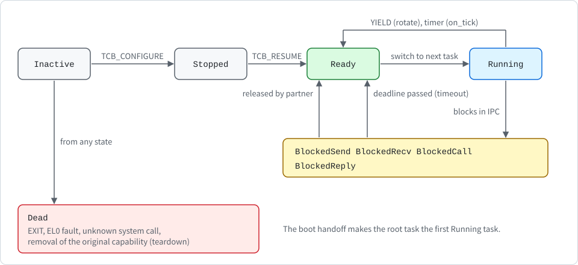

# Tasks and scheduling

English | [한국어](../kr/scheduling_KR.md)

This note describes the following:

- how K0 represents a task
- how user space creates, starts and tears down tasks
- how the round-robin scheduler switches between tasks

The code is in the following places:

- `crates/k0-task/src/lib.rs`
- `crates/k0-sched/src/lib.rs`
- `teardown` in `crates/k0-ipc/src/lib.rs`
- `sys_tcb_configure`, `sys_tcb_resume`, `kill_current` and `finish` in `kernel/src/syscall.rs`

The note describes the current `main` branch (unreleased).

## The task control block

A **task control block** (TCB) holds the following:

- **Saved user context**: 31 general-purpose registers, the stack pointer, the return address, the saved processor state, and the two EL0 thread pointer registers.
- **Top-level page table address** (`ttbr0_pa`): a copy of the address space root that is valid only while the task's embedded slots are bound.
- **State**: the current state of the task.
- **Queue links**: `next` and `prev`, the links to its neighbours in whatever queue the task is in.
- **Reply right**: the single-use reply right (`reply_to`) and its reverse link (`reply_from`), described in [ipc.md](ipc.md).
- **IPC wait information**: `blocked_on`, the endpoint the task is queued at, and `ipc_badge`, the badge of the message it is waiting to send.
- **Timeout fields**: `deadline`, the tick at which the task's IPC wait ends, and `tnext` and `tprev`, the links of the timed waiter list (see [Timeouts](#timeouts)).
- **Three embedded capability slots**: slot 1 holds the task's `CNode` capability and slot 2 its `AddrSpace` capability. Slot 0 is unused.

The **embedded slots** are what bind a task to its capability space and its address space. System calls resolve slot numbers only in the CNode named by slot 1 (see [capabilities.md](capabilities.md)), and the task runs in the address space named by slot 2. Both are copies, that is children in the derivation list, of the capabilities given to `TCB_CONFIGURE`, and they are marked as bound to the task. When either one is removed, the task is torn down (see [Teardown](#teardown)).

Every TCB, including the root task's, is an ordinary object at the start of a granule-sized frame. The root task's TCB lives in the 2 MiB boot frame window and is reached through a `Tcb` capability in the root CNode. Every other TCB is a frame that user space retyped from untyped memory.

The kernel reaches a TCB only through its own alias, and it is never mapped at EL0. Compile-time assertions keep the TCB within a granule, so that the TCB can be found again by rounding an embedded slot's address down to the granule.

## States

The following figure shows the task states and the transitions between them. The meaning of each state is in the table after it.

  

| State | Meaning |
| --- | --- |
| `Inactive` | just retyped, not configured |
| `Stopped` | configured, not yet started |
| `Ready` | in the ready queue |
| `Running` | the current task |
| `BlockedSend`, `BlockedRecv`, `BlockedCall` | waiting in an endpoint queue |
| `BlockedReply` | waiting for the answer to a `CALL` |
| `Dead` | exited, killed, or torn down |

A task in any of the blocked states can also become `Ready` when its deadline passes (see [Timeouts](#timeouts)).

`Inactive` has the value 0. A freshly retyped frame is all zeroes, so it already is a valid `Inactive` TCB with empty queue links, empty embedded slots and no reply right. Retype needs no constructor.

## Creating a task

`TCB_CONFIGURE` takes six arguments: the `Tcb` slot, an entry address, a stack top, an `AddrSpace` slot, a `CNode` slot and one argument value that the new task receives in `x0`. All slots are looked up in the caller's own CNode. The kernel checks that:

- the entry address is 4-byte aligned, above the first granule and inside the 48-bit user range,
- the stack top is 16-byte aligned, above the first granule and inside the user range,
- the capabilities are of the right kinds (`Tcb`, `AddrSpace`, `CNode`), and
- the TCB is in the `Inactive` state, so each TCB can be configured only once and a running task can never be reconfigured. The state is read through a raw pointer before any mutable reference to the TCB is formed.

> [!IMPORTANT]
> The two bindings are written together. Both capabilities are validated first, and then copies are written into slots 1 and 2 in one step, so a TCB that is bound to only one of the two cannot exist.

If any check fails, both embedded slots stay empty and the TCB stays `Inactive`.

The kernel then zeroes the saved context and sets the entry address, the stack pointer, `x0` and `ttbr0_pa`. It sets the saved processor state itself, to EL0 with interrupts unmasked. User space never supplies processor state, so it cannot ask to return to EL1 or to run with interrupts masked. The thread pointer registers start at zero, so the new task does not inherit the creator's values. The TCB moves to `Stopped`.

`TCB_RESUME` accepts only a `Stopped` TCB and puts it in the ready queue. A TCB that is already queued, running, blocked or dead is refused, so the same TCB can never sit in a queue twice.

## The ready queue

The scheduler keeps three values: the current task, and the head and tail of the ready queue. Each is the kernel address of a TCB, with 0 meaning none. The queue is linked through the TCBs' own `next` and `prev` fields, so it needs no memory of its own. Its length is bounded by the number of TCBs, which user space paid for with untyped memory. The scheduler cannot become a way to exhaust kernel memory.

The queue is doubly linked so that a task can be removed from anywhere in it in constant time. That matters because a task can be torn down while it is ready, and the kernel must not walk the queue to find it. Removal checks that the links agree with the queue's head and tail. If they do not, the queue is corrupt and the kernel halts with `k0: FATAL ready queue corrupt`.

The same `next` and `prev` fields also link a blocked task into an endpoint queue, which has the same structure. The state machine keeps these uses apart. A task is either ready, or blocked in one endpoint, or running, never two at once.

## Switching tasks

When an exception arrives from EL0, the vector code saves all user registers into the context of the current TCB before any Rust code runs (see [exceptions.md](exceptions.md)). On the way back, it restores registers from whatever context the global `__current_context` pointer names. A task switch is therefore just two steps:

1. Point `__current_context` at the next task's saved context.
2. If the next task uses a different top-level page table, load it into `TTBR0_EL1` and invalidate the whole TLB. K0 does not use address space identifiers, so every switch between tasks in different address spaces flushes the TLB. Switching between tasks in the same address space does not touch `TTBR0_EL1`.

Tasks can run in different address spaces, so `TTBR0_EL1` really changes between them. If an address space is destroyed while it is installed, the kernel first switches `TTBR0_EL1` to an empty table.

Three operations use this switch, as shown in the following table.

| Operation | Used by | What happens to the current task |
| --- | --- | --- |
| `rotate` | `YIELD`, timer preemption | goes to the tail of the ready queue, unless nothing else is ready, in which case it simply continues |
| `block_and_switch` | IPC, the idle loop, and the system call exit path when the current task died | stays out of the ready queue. The caller has already put it in an endpoint queue or behind a reply right, or it is `Dead`. |
| `handoff` | boot, once | the root task becomes the first `Running` task |

## Preemption

The timer fires once per second. When it fires while EL0 is running, the IRQ path acknowledges it, re-arms the timer, prints `k0: tick N` and calls `k0_preempt`, which calls `rotate`. The `k0: tick N` line goes to the console in an image built with a console driver, and only the first 4 tick lines are logged. A task that never yields therefore **loses the CPU after at most one second**.

> [!IMPORTANT]
> The kernel itself is never preempted. Exception entry masks interrupts, and the kernel keeps them masked while it handles a system call or fault.

A timer interrupt that arrives at EL1 is possible only during boot, before the handoff, and it only counts the tick.

## Timeouts

The tick is the unit of every IPC timeout, as described in [ipc.md](ipc.md). The scheduler keeps the waiters that have a deadline in a timed list (`arm_timeout`, `disarm_timeout`, `expired`, `has_timed` in `k0-sched`). The list is unsorted, and a lower bound of the earliest deadline lets most ticks skip it.

A task leaves a blocked state only through `k0_sched::enqueue` (wake-up) or `k0_ipc::teardown` (death), and both remove it from the timed list. On every timer tick, `k0_ipc::expire_timeouts` wakes the waiters whose deadline has passed. It runs from `k0_preempt` when a task was running, and from the idle loop when none was. A timeout of n ticks ends at the (n+1)-th tick after the call.

> [!NOTE]
> A timeout says when a task becomes ready, not when it runs. The woken task joins the tail of the ready queue like any other.

## Teardown

Teardown makes a task `Dead` and removes every kernel pointer that refers to it. It runs in the following cases:

- the task calls `EXIT`
- the task takes an EL0 fault
- the task makes an unknown system call
- the original capability of its TCB is deleted (by `CAP_DELETE`, or by `CAP_REVOKE` on a capability it descends from, such as the untyped it was retyped from)
- a capability bound to the task is removed, that is its CNode or address space capability was deleted or revoked, or the original object behind it was finalized

> [!IMPORTANT]
> `teardown` decides by the task's state only, never by whether a pointer happens to be set.

The following table shows what teardown does in each state.

| State | What teardown does |
| --- | --- |
| `Dead` | nothing, so it is safe to call twice |
| `Inactive`, `Stopped` | nothing to unlink |
| `Ready` | removes the task from the ready queue |
| `BlockedSend`, `BlockedRecv`, `BlockedCall` | removes the task from the endpoint queue named by `blocked_on`, and from the timed list if it has a deadline |
| `BlockedReply` | clears the reply right in the task that holds it (`reply_from`), and removes the task from the timed list if it has a deadline |
| `Running` | nothing is unlinked. See below. |

For every state it then withdraws any reply right the task itself holds, so that the caller waiting for that reply wakes with `NO_REPLY` and does not stay blocked forever. Finally it sets the state to `Dead`, clears the queue links, `blocked_on`, `reply_from`, `ipc_badge` and `ttbr0_pa`, and, unless the task is `Running`, zeroes its saved registers. A queue or reply link that does not match what the state promises is a kernel invariant violation, and the kernel halts with `k0: FATAL ...` (see [exceptions.md](exceptions.md)).

The running task is the one case teardown does not finish. The system call handler holds a mutable reference to the running task's saved context, so teardown only marks the task `Dead`. The system call exit path, `finish`, runs after the handler and after all capability cleanup, including the finalization of everything that was removed. If the current task is `Dead`, `finish` writes no return value into its context, zeroes the context, and switches to the next ready task. A task can therefore delete its own CNode, its own address space or its own TCB, or revoke the untyped it was carved from, without ever resuming afterwards.

A dead task's frame is not freed by teardown. It stays a `Dead` TCB, and `TCB_CONFIGURE` and `TCB_RESUME` refuse it, so a dead task is never restarted. The memory is reusable once the TCB's original capability is deleted, or the untyped it came from is revoked, and the untyped is then retyped, which zeroes the frame again. A task that merely exited keeps its two bound capabilities until then.

## When there is nothing left to run

The kernel no longer parks the core when no task can run. If the current task blocked or died and no task is ready, `idle_until_ready` in `kernel/src/syscall.rs` takes over:

1. It waits for the next interrupt (`k0_arch::irq::wait_for_interrupt`: `wfi` with IRQs masked, then a short unmask so that the EL1 vector takes the interrupt).
2. It wakes every IPC waiter whose deadline has passed.
3. It switches to a ready task if there is one, and otherwise waits again.

Timer ticks keep being counted and handled while the kernel idles. The idle loop prints one of two lines, each at most once per boot:

- `k0: idle (waiting for a timeout)`: at least one waiter has a deadline.
- `k0: all tasks stopped (none ready, no timeout pending)`: no waiter has a deadline. Nothing can wake a task in that state today, because there are no notification objects and no device interrupts for tasks, so the machine stays idle.

> [!WARNING]
> Availability is still not protected. A task that waits without a timeout can wait forever if its partner never acts, and a confined task that is the last one to block can still leave the system with nothing to run (advisory GHSA-q99x-2wrv-358p in [SECURITY.md](../../SECURITY.md), updated at release time). Isolation protects confidentiality and integrity between tasks, not availability.

An SError taken from EL0 still stops the whole machine, and so does a `k0_arch::fatal` or a kernel panic.

## How it is tested

The scheduler and the system call paths read system registers, so they are tested by booting. The queue and capability logic that does not touch hardware (`k0-cap`, `k0-mm`) is tested on the host, see [capabilities.md](capabilities.md). The root task self-tests:

- create a task that counts to a target and exits, and wait for it,
- refuse to resume an unconfigured task, refuse to resume a task twice, and refuse to resume a dead task,
- start a task that spins forever without yielding, then confirm that the root task still gets the CPU back through timer preemption,
- confirm that thread pointer registers do not leak between tasks,
- build confined tasks that have their own CNode and their own address space, and check that the root task's slot numbers mean nothing there, and
- delete a task in each state (inactive, stopped, ready, blocked in send, receive and call, waiting for a reply, holding a reply right, and at the head, middle and tail of an endpoint queue), delete endpoints with tasks queued, kill a task by revoking its CNode or deleting its address space, and have a task delete its own TCB and revoke the untyped it was carved from.

`tools/qemu-boot-test.sh` requires the markers `root: child exit test pass`, `root: preempt test pass`, `root: isolation tests pass`, `root: violation tests pass`, `root: teardown tests pass`, `root: revocation tests pass` and `root: sched tests pass`, followed by at least one more timer tick. The markers also include `k0: idle (waiting for a timeout)` and `root: timeout tests pass`, which come from the timeout tests (see [ipc.md](ipc.md)). It fails if the log contains a line that starts with `k0: all tasks`, `k0: FATAL` or `k0: PANIC`, so a run in which the kernel ends up with nothing to run and no timeout pending fails. It also counts task fault lines exactly (see [exceptions.md](exceptions.md)), which catches a task that keeps running after its teardown.

## Known gaps

> [!NOTE]
> Priorities and CPU budgets do not exist yet. There is one core only.

- **Scheduling**: plain round robin with a fixed one-second slice. A task that holds untyped memory can create many tasks and dilute everybody's share.
- **Timeouts**: they say when a task becomes ready, not when it runs. They are opt-in per call, so a task that waits without one can wait forever.
- **Idle state**: it exists, but while the root task keeps calling `YIELD` after its self-tests, the CPU does not sleep. When no task is ready and no waiter has a deadline, the machine stays idle and nothing can wake a task.
- **Availability**: a task that blocks without a timeout, including a confined one, can stay blocked for good if its partner never acts (GHSA-q99x-2wrv-358p). The kernel is not preemptible, so a long system call such as `CAP_REVOKE` on an untyped with many objects delays every other task and every timeout. Task isolation does not cover availability.
- **Blocked tasks**: a blocked task wakes when its IPC partner acts, when its deadline passes, or when the endpoint is deleted.
- **Dead TCB**: it is not reclaimed by teardown. Its frame becomes reusable only when its capability is deleted or its untyped is revoked and retyped.
- **Address space identifiers**: there are no hardware address space identifiers, so every switch between address spaces flushes the whole TLB.
- **Dead task**: it cannot be restarted. A new task needs a new TCB.
