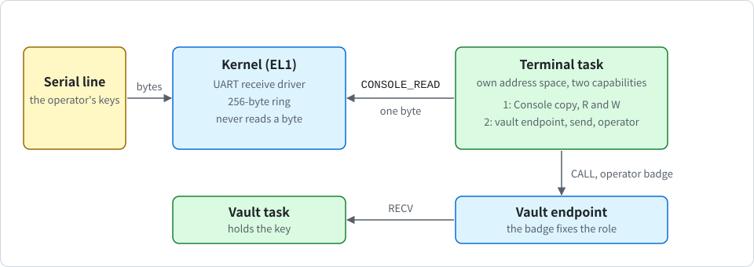

# Serial input and the operator terminal

<div align="center">

English | [한국어](../kr/terminal_KR.md)

</div>

This note describes how a person can talk to K0 over the serial line. The kernel receives bytes from the console UART and hands them to one task, the **terminal**, with the system call `CONSOLE_READ`. The terminal is the operator of the vault (see [vault.md](vault.md)): it shows the vault's state, makes the key and erases it. The code is in `crates/k0-conin` (the receive logic), `kernel/src/syscall.rs` (`CONSOLE_READ`), `userspace/k0-term` (the terminal) and `userspace/root-task/src/service.rs` (wiring and the check).

> [!NOTE]
> Input and the terminal are optional and off by default. An image built without `console-input` has no receive code, no `CONSOLE_READ` and none of the log lines in this note. An image built without `terminal` has no terminal code.

## Purpose and scope

The vault of the previous note makes its key once from the boot seed and then only answers calls. Without an operator nobody can look at its state, and nobody can erase the key on purpose. The terminal closes this gap with a small, fixed text interface on the serial line.

Scope: one console UART, one reader at a time, one byte per call, and four vault operations for the operator (`STATUS`, `PUBLIC_KEY`, `KEYGEN`, `ZEROIZE`). The terminal cannot sign and cannot deliver a seed.

<p align="center">
  
</p>

## Why the kernel receives

A user-space driver would need the UART's registers and its interrupt. K0 cannot delegate a device or an interrupt to a task yet. So the receive code runs in the kernel, at EL1, and the kernel gives the bytes to user space.

The kernel code is kept small and never interprets a byte. It does not know what a line, a command or a control key is. All of that is the terminal's job, in user space.

> [!NOTE]
> The receive code is still kernel code that an outside party drives. A user-space driver does not exist yet, because device and interrupt delegation does not exist yet.

The features are the following, and features only add:

| Feature of `k0-kernel` | Adds |
| --- | --- |
| `console-input` | The kernel's receive path for the console UART and `CONSOLE_READ`. It needs a console driver feature to do anything. Receive exists for PL011 and SBSA UART only. |
| `terminal` | The terminal task in the root task image, started as a service after the self-tests. It turns `console-input` on. With `vault` it is the vault's operator, and with `vault-ed25519` it can make an Ed25519 key. |

You can build and run it as follows:

```sh
$ cargo build -p k0-kernel --features console,terminal,vault-ed25519
$ cargo run -p k0-kernel --features console,terminal,vault-ed25519
```

QEMU shows the serial port on your terminal. Under `cargo run`, QEMU's own escape key is Ctrl-A (Ctrl-A x quits QEMU), so Ctrl-A never reaches K0 there.

## The receive path and its bounds

The kernel's UART driver puts every received byte into a ring of 256 bytes. The receive logic is a separate crate, `crates/k0-conin`, written against a small register trait, so that the host tests can drive it with a fake UART.

- **Receive interrupts stay off** until a task first reads console input with the right. That first read discards what the device holds. It also stops the periodic `k0: tick N` lines after one line `k0: tick lines off (console input in use)`. Ticks, preemption and timeouts keep working.
- **Bound on kernel work**: when the ring is full, the kernel masks the UART's receive interrupt itself. It reopens the interrupt after the reader has taken half of the ring. So the interrupt rate under a flood is bounded by the reader, not by the sender.
- **A drain on every tick**: the same drain also runs once per tick, so input still arrives (up to a tick late) when the interrupt does not.
- **Loss is marked**: a FIFO overrun, a break, a framing error or a parity error is marked on the byte after the hole. `CONSOLE_READ` returns that mark to the reader.
- **The interrupt number** comes from the device tree (the `interrupts` property of the console node: one SPI, level, active high, of the discovered GIC) or, through the UEFI loader, from the ACPI SPCR table. It is printed in the platform line, for example `k0: platform con=pl011@0x9000000,irq33 ...`, and therefore pinned by `K0_PIN`. Pin strings made before this change no longer match and must be made again. A console node without a usable interrupt is not a boot refusal. Input is just off.
- **A wrong interrupt number costs only input**: an out-of-range or unavailable number gives `k0: console input off (...)` at boot. A line that keeps firing without a UART cause is switched off after 8 entries with `k0: console input off (interrupt N fired without a uart cause)`.

At boot the kernel prints `k0: console input on (pl011 irq 33)` or `k0: console input off (<reason>)`. The reasons are `no console`, `no receive driver for this uart`, `no usable interrupt in the device tree`, `register frame too small`, `console not attached`, `interrupt number out of range` and `interrupt not available`.

## CONSOLE_READ and the Console rights

`CONSOLE_READ` is system call number 16. It returns one byte per call.

| Register | In | Out |
| --- | --- | --- |
| x0 | the `Console` capability slot | 0 on success, or an error |
| x1 | flags | the byte |
| x2 | | 1 if input was lost right before this byte |

The flags are `NONBLOCK` (1) and `FLUSH` (2), and a timeout in ticks in bits 63 to 32. Any other bit is refused with `BAD_FLAGS`. `NO_DEVICE` (-24) means that there is no input path or that it was turned off.

The `Console` capability now has rights: **R** reads input and **W** writes output. `CAP_COPY` can only remove them. The root task's capability has W, and R only in images with `console-input`. `DEBUG_PUTC` needs W. `bootinfo::VERSION` is 4.

The output filter is unchanged, except for one thing: a `Console` capability with R (the terminal's) may also emit backspace (0x08). Every other control byte is still printed as `?`.

## Waiting and waking

Only one task can wait for input at a time. A second reader gets `BUSY` (-23). A reader that finds the ring empty and did not ask for `NONBLOCK` goes to sleep, with the timeout from its flags if there is one.

- **Waking on a byte**: a received byte wakes the waiter. It goes to the end of the ready queue. There is no preemption on input.
- **Waking on a capability change**: a waiter whose capability is deleted, revoked or moved wakes at once with `REVOKED`.
- **Waking on a timeout**: a reader that gave a timeout in its flags is woken when it runs out (see [scheduling.md](scheduling.md) for timeouts).
- **Quiet idle**: when the only thing left to wait for is console input, the kernel prints nothing. That is the normal state of a terminal image. `k0: all tasks stopped (none ready, no timeout pending)` is printed only when there is neither a timed waiter nor a console waiter.

## The terminal's wiring and the hostile-task check

A terminal image runs all self-tests first. Then the root task does the following:

1. It starts a new vault (if one is built in) and hands it the boot seed. The log line is `root: vault seeded`, or `root: vault has no seed (boot seed has no entropy)`, or `root: vault has no seed (no algorithm in this image)`.
2. It runs two hostile tasks wired exactly like the terminal. They must be refused and must end in a fault. The lines are `root: terminal console filter [...]`, `root: terminal wiring holds` and two `k0: task fault` lines.
3. It drops its own admin capability, starts the terminal and blocks for ever. The line is `root: service started`, then the banner follows.

On a machine without an input path the root task prints `root: no console input, terminal not started`.

The terminal task has its own address space and two capabilities:

- a `Console` copy with R and W, and
- the vault endpoint with the send right and the operator badge.

The vault's response frame is mapped read-only for it. The vault decides from the badge and the operation alone which frame it reads or writes. The operator has a response frame and no request frame. A request that claims a body it cannot have is refused without touching memory.

The two hostile tasks are the check that the wiring means what it says. They are wired exactly like the terminal, and the root task expects both to be refused and to end in a fault. If one of them is not refused, the check fails.

> [!WARNING]
> There is no authentication on the serial line. Whoever holds the line is the operator and can do exactly the operator's four operations, including erasing the key. The operator cannot sign, cannot deliver a seed and cannot change the policy.

## The screen and command rules

The screen is plain text. The banner is `K0 operator console, type 'help'`, the prompt is `k0> `, values are printed as `name=value`, and every command ends with exactly one line, `ok` or `err <reason>`.

| Command | What it does |
| --- | --- |
| `help` | Lists the commands. |
| `vault status` | Prints the state of the vault. |
| `vault pubkey` | Prints the public key. |
| `vault keygen <alg>` | Makes the key from the held seed. The only algorithm is `ed25519`. |
| `vault zeroize confirm` | Erases the key. `vault zeroize` alone prints `hint=type 'vault zeroize confirm' to erase the key` and `err confirm-required`. |

`vault status` prints `state=fresh|seeded|ready|zeroized|failed`, `alg=none|ed25519`, `selftest=passed|failed`, `seed=none|rng-seed|rndr|rng-seed+rndr` and `validated=no`. The value `seed=rng-seed` means that the bytes were present, not that they were unpredictable. The line `validated=no` is always printed, because the implementation has no validation of any kind.

`vault pubkey` prints `pubkey=` and 32 hex characters, then a second line indented by 7 spaces with the other 32.

The error names are `unknown-command`, `bad-argument`, `line-too-long`, `input-lost`, `confirm-required`, `denied`, `no-vault`, `no-key`, `key-exists`, `no-entropy`, `unsupported-algorithm`, `zeroized`, `vault-failed` and `vault-timeout`. A keygen or zeroize that was delivered but not answered in time adds `hint=run 'vault status' to see whether it took effect`.

The input rules are the following. The state machine is `feed` in `userspace/k0-term/src/lib.rs`.

- A line ends with CR or LF, has at most 64 characters, and contains printable ASCII only.
- Backspace and DEL erase one character. Ctrl-C and Ctrl-U cancel the line and are shown as `^C` and `^U`.
- ESC sequences (arrow keys) are ignored.
- What reached the UART before the prompt is dropped.
- A reported loss discards everything up to the next line end and prints `err input-lost`.
- Without the vault feature, `help` lists only `help` and `vault ...` answers `err no-vault`.

The vault side changed with this feature. There are four roles by endpoint badge, fixed at build time: admin (the root task), operator (the terminal), signer and reader. `INIT` (admin only, once) now only delivers the seed. The vault checks the entropy rule and holds the seed in the state `seeded`. The new operation `KEYGEN` (admin and operator) makes the key from the held seed and wipes the seed (state `ready`). One key per boot: a second `KEYGEN` is refused with `key-exists`, and after `ZEROIZE` a reboot is needed. Every way into `failed` wipes seed and key.

## How it is tested

**Host tests** (`tools/host-test.sh`): `k0-conin` has 15 tests with a fake UART, `k0-term` has 24 with the vault feature and 21 without, and `k0-vault` has 20 with Ed25519 and 11 without. The suite has 354 tests on an ARM host and 268 on other hosts.

**Boot matrix**: the new rows are `input-only`, `input-gicv2`, `input-16550`, `input-bad-irq`, the static row `input-symbols` (an image without `console-input` has no receive code and none of the new log lines), `term`, `term-max`, `term-el2`, `term-gicv2`, `term-16k`, `term-no-vault`, `term-no-alg`, `term-uefi`, `term-uefi-acpi` and `hvf-term`. The matrix has 76 rows on a Mac with HVF and 65 in CI.

**Scripted session**: `tools/term-test.py <image>` boots the image with QEMU's serial port on pipes and runs a session. It covers every command and every error, erase and cancel, CR LF, an ESC sequence, a line that is too long, key generation, the public key format, zeroize, 200 kB without a line end, 2000 lines in a row and a serial break. `tools/qemu-boot-test.sh` reads `K0_BOOT_INPUT=on|off`, `K0_BOOT_SERVICE=vault|plain|none` and a judge-only mode `K0_BOOT_JUDGE`.

**Root task self-test** (images with `console-input`): `root: backspace without the input right [?]` and `root: console input tests pass`. The second line may also read `... pass (no input path)` or `... cut short (the line is busy)` when bytes arrive during the test. A terminal image also shows two more `k0: task fault` lines than the same image without the terminal (8 without the vault, 10 with it).

## Known gaps

> [!NOTE]
> Nothing ran on real hardware. The SBSA UART path, FIFO overruns and the receive timeout interrupt are not exercised by QEMU, and they are covered only by host tests with a fake UART. The cut-off for an interrupt line that fires without a UART cause is covered only by host tests.

- **No authentication**: the serial line is as trusted as whoever can reach it. The operator can erase the key (a denial of service by design) but gets no signature and cannot change policy.
- **Kernel code driven from outside**: the receive code runs at EL1.
- **A timing channel that is not analysed**: an outside party can now cause interrupts while tasks run, bounded by the reader. The reader learns arrival times finer than the tick, and other tasks can notice the stolen time.
- **Latency**: input waits behind running tasks. There are no priorities, so the latency is up to a tick per ready task.
- **No input on a 16550 console**: a 16550 console has output and no input.
- **No measurement under a flood**: no test measures kernel time under a flood on a machine. The bound is argued from the gate and shown in host tests.
- **Dropped before the prompt**: this counts bytes that reached the UART. An emulator or adapter that holds bytes back delivers them later (QEMU does).
- **Split screen line**: if a kernel line appears while the operator is typing, the screen line is split but the buffer is whole. Enter runs the whole buffer.
- **Lines can be imitated**: any task with `Console` output can still print lines that look like kernel or root task lines, because nothing authenticates the prefix. The terminal can additionally erase within its current line.
- **No signing client in service mode**: the key is made and shown, but no other task uses it yet. Client signing is shown by the self-test.
- **No restart**: the terminal and the vault are not restarted if they die. The root task is trusted.
- **Boot log share**: terminal output counts against the user share of the in-memory boot log. Once that share is full, later task output is not recorded there.
- **All earlier limits of the vault stay**: the implementation is unvalidated, there is no side-channel analysis, the key does not come from an approved random bit generator, there is no persistence and there is no post-quantum algorithm. Availability is not protected (see [ipc.md](ipc.md)).
