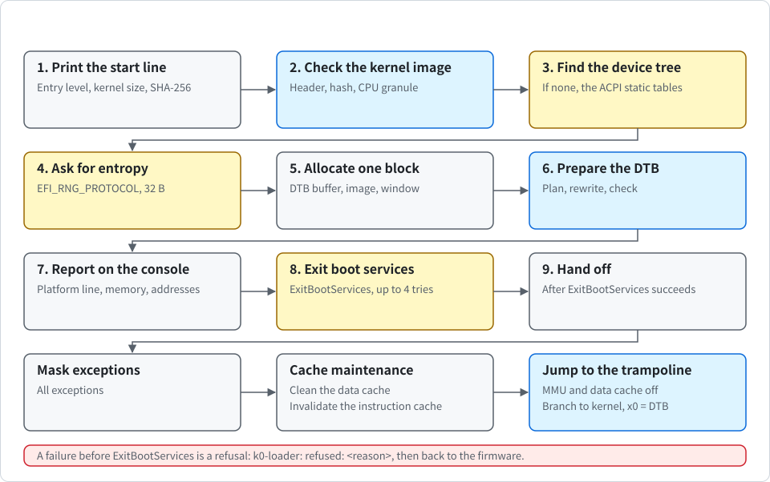
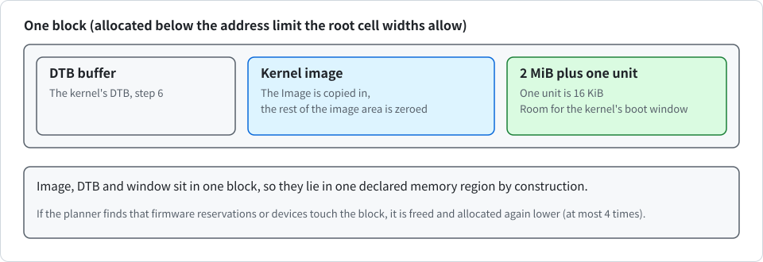

# The UEFI loader

<div align="center">

English | [한국어](../kr/uefi_KR.md)

</div>

This note covers the UEFI loader: why it exists, why it is a separate program and not part of the kernel, what it does between the firmware and the first kernel instruction, which memory it refuses to call RAM, and what has and has not been booted.

The pure logic is in `crates/k0-efi`. The UEFI application is in `loader/`. In the following table, each file has its own role.

| File | Role |
| --- | --- |
| `efi.rs` | Firmware bindings |
| `load.rs` | The flow |
| `handoff.rs` | Cache flush, MMU switch-off and the jump |
| `build.rs` | The embedded kernel |

The kernel itself did not change. The loader reuses the kernel's own parser and checks from `crates/k0-boot`.

## Why a loader, and why outside the kernel

UEFI firmware does not follow the Linux arm64 boot protocol that the kernel expects (see [boot.md](boot.md)). It enters an application with the MMU and caches on and with services still running. It describes memory with a UEFI memory map, not only with a device tree. Someone has to turn that into the kernel's entry contract, which is the following:

- The MMU and the data cache are off.
- There is one CPU.
- `x0` points to a DTB whose **memory description is true**.

That last point is the reason the loader is more than a trampoline. On QEMU with EDK2, the firmware's device tree declares all 512 MiB as RAM, although firmware runtime regions lie inside it. The unmodified kernel would accept that blob and hand about 5.5 MiB of firmware memory to user space as untyped memory. So the memory description must come from the UEFI memory map, which says which ranges are free. Only the loader can read that map, because it exists only while the loader runs.

The loader is a separate program for three reasons.

- **The kernel stays small and the same**: it keeps one entry contract. No UEFI types, no firmware calls and no second boot path enter the kernel. Kernel behaviour did not change in this work.
- **The kernel's judgement is reused, not copied**: the loader embeds no second parser. It links `k0-boot` and runs the kernel's DTB parser, device discovery, `Platform::validate` and boot window search on the DTB it has just written, before it jumps. The boot window search is `boot_window` in `crates/k0-boot/src/window.rs`, moved there from the kernel so both run the same code. A DTB that the kernel would refuse is refused by the loader, while the firmware console still works.
- **The unsafe code is small and separate**: `k0-efi` is pure logic with `#![forbid(unsafe_code)]`. It takes bytes in and gives bytes out, and it is tested on the host. Only `loader/` has `unsafe`, for calling firmware and for the last instructions.

The loader embeds the kernel Image in its own PE file. It does not load a kernel from disk, so **one signed file holds everything that runs**.

## The flow

`efi_main` in `loader/src/load.rs` runs the following steps. Before `ExitBootServices` a failure is a refusal (see "Refusals"). The following figure shows the order of the steps.

<p align="center">
  
</p>

The steps are as follows.

1. **Start line**: print `k0-loader: start ...` with the entry exception level, the size and granule of the embedded kernel, and the first four bytes of its SHA-256.
2. **Check the embedded kernel**: the Image header must be a little-endian Linux arm64 Image that can be loaded at any address, with a 4 KiB or 16 KiB page size, and a size within 64 MiB (`image.rs`). The header must match the values baked in at build time. The SHA-256 of the whole Image must match the hash baked in (a corruption check, see "Known gaps"). The CPU must support the kernel's granule. The check uses the same test as the kernel's `enable_paging`, so that the reason shows on screen.
3. **Find the firmware device tree**: look in the UEFI configuration table. If there is none, read the ACPI static tables instead (see "ACPI without a device tree"). If there is neither a device tree nor an ACPI RSDP, refuse. A firmware device tree is used first when both exist, and ACPI is then not read. Read the header, accept a size from 40 bytes to 2 MiB, and use that many bytes.
4. **Ask for entropy**: if the firmware has `EFI_RNG_PROTOCOL`, ask it for 32 bytes. Output that is empty or one repeated byte counts as no entropy. The loader prints `k0-loader: entropy from the firmware` or `entropy none from the firmware`.
5. **Allocate one block**: allocate it below the address limit that the root cell widths allow, laid out as `[DTB buffer | kernel image | 2 MiB plus one unit]`. The unit is 16 KiB. The tail is room for the kernel's boot window. Because image, DTB and window sit in one block, they lie in one declared memory region by construction. If the planner finds that firmware reservations or devices touch the block, the loader frees it and allocates again lower, at most 4 times. The firmware device tree must not lie in the memory just allocated, or the loader would overwrite what it reads. If it does, refuse.
6. **Prepare the kernel's DTB**: build the DTB and check it (`prepare` in `crates/k0-efi/src/prepare.rs`, see "The rewrite" and "The self-check"). Then copy the kernel Image into its place and zero the rest of the image area.
7. **Report**: print the platform line, the memory summary and the addresses on the firmware console.
8. **Exit boot services**: try up to 4 times. Each attempt reads a fresh memory map and runs the whole preparation again, because the map and its key change when anything is allocated. Between reading the map and calling `ExitBootServices` the loader allocates nothing and prints nothing. If the firmware answers `INVALID_PARAMETER` the map was stale and the loop continues. Any other failure, or a preparation failure after the first attempt, parks.
9. **Hand off**: see "The handoff" below.

The block that step 5 allocates is laid out as follows.

<p align="center">
  
</p>

A run on QEMU 11.1.3 with EDK2 prints, in order:

```
k0-loader: start at el1, kernel image 664 KiB with 4K granule, sha-256 b4554f24
k0-loader: entropy none from the firmware
k0-loader: platform con=pl011@0x9000000 gic=v3@0x8000000 rd=0x80a0000+0xf60000 tmr=27
k0-loader: memory 8 regions, 478 of 478 MiB usable kept, 0 ranges dropped, 27 MiB of boot services memory left unused
k0-loader: image at 0x5c410000, dtb at 0x5c1fc000
k0-loader: exiting boot services
```

Firmware messages come before the first loader line. After the last line, the kernel's own lines follow. If the kernel will have no console, the loader says `k0-loader: the kernel will have no console (...)`. A panic in the loader prints `k0-loader: panic at <file>:<line>` while the firmware console is alive.

## The memory policy

`crates/k0-efi/src/memmap.rs` decides what the kernel may call RAM. The rule is that **losing memory is fine** and calling firmware or device memory "RAM" is not.

A descriptor counts as RAM only if it meets all the conditions in the following table. Everything else never counts, and so do types the loader does not know.

| Condition | Content |
| --- | --- |
| Type | One of `EfiConventionalMemory`, `EfiLoaderCode` or `EfiLoaderData` |
| Required attribute | Write-back |
| Forbidden attributes | Runtime, special-purpose, non-volatile |

The following table lists the rules that the plan follows.

| Item | Rule |
| --- | --- |
| Boot services memory | Not used, although the specification frees it after `ExitBootServices`. On EDK2 this leaves about 23 to 32 MiB unused (27 MiB in the run above). That is deliberate. Firmware keeps tables there, and devices that firmware left running may still write there. |
| Overlapping descriptors | Resolve to "not RAM". A byte is RAM only if a usable descriptor covers it and no denied descriptor does. |
| Reservations and devices | Cut out. The loader runs the kernel's parser on the firmware DTB and takes its memory reservations and the device ranges that the kernel's discovery finds. These are subtracted. |
| Boundaries | Everything is rounded inward to 16 KiB, a multiple of both granules, so one plan serves either kernel image. Holes are rounded outward. |
| `reg` entries | At most 8, the kernel's limit. Beyond that the smallest ranges are dropped, and the range with the block is kept. The loss was 0 on the QEMU maps and about 112 KiB on a published server map with 11 ranges. The loader prints the number of dropped ranges. |
| Address limit | Follows the root cell widths of the firmware DTB (4 GiB for one address cell, 2^47 otherwise). One entry cannot be larger than the size cells allow. |
| Reserved regions in the output | None. The firmware DTB's own `/memory` nodes, `/reserved-memory` and memory reservation block are dropped. What the firmware wanted to keep is already outside the plan. |

A malformed descriptor (a start that is not 4 KiB aligned, an address calculation that overflows, a stride smaller than the structure, a map length that is not a multiple of the stride) makes the loader refuse the whole map.

> [!IMPORTANT]
> Only this loader may start the kernel under UEFI. A generic UEFI boot loader that passes the firmware device tree through would hand firmware memory to user space.

## The rewrite

`crates/k0-efi/src/fdtw.rs` writes the DTB for the kernel. It does not build one from nothing. It reads the firmware DTB with the kernel's own walker and writes it again token by token, so a structure the kernel would refuse is refused here too (more than 8 memory entries, more than 32 reservations, `linux,usable-memory` properties, two `/chosen` nodes, which the kernel's parser reports as `DuplicateChosen` and which the loader's check of the firmware DTB therefore refuses before the rewrite starts). The string block is new. The rewrite **changes only what the following table lists**.

| Target | Action |
| --- | --- |
| The memory nodes (`memory`, `memory@...`) and `reserved-memory` directly under the root | Removed. |
| The memory reservation block | Emptied. |
| `linux,initrd-start`, `linux,initrd-end` and `linux,usable-memory-range` in `/chosen` | Removed. |
| `rng-seed` in `/chosen` | Replaced: the firmware's own seed (at most 32 bytes) followed by the loader's entropy (at most 32 bytes). |
| A memory node | One node with the planned ranges is added as the last child of the root. |

Everything else, including the nodes the kernel reads for the console, the interrupt controller and the timer, passes through unchanged. The copy of the firmware seed is wiped on every return path.

## The self-check

Before the jump (and again before every `ExitBootServices` attempt) the loader runs the kernel's own decisions on the DTB it wrote. `prepare` in `crates/k0-efi/src/prepare.rs` does this in the following order:

1. **Read the source**: the kernel's parser and device discovery read the firmware DTB. Reservations and devices come from this one source.
2. **Plan and rewrite**: the output must fit the 2 MiB the kernel accepts.
3. **Read the output**: the kernel's parser reads the output. Its memory must equal the plan, and it must have no reservations. The kernel's discovery on the output must find the same platform as on the firmware DTB.
4. **Boot window search**: the kernel's `boot_window` must find a window in the output.
5. **Independent verification**: `verify` in `crates/k0-efi/src/verify.rs` rechecks the result without sharing code with the planner. For every output range it walks the raw memory map and classifies each descriptor by its own rule. Every byte must be covered by a usable descriptor, no denied descriptor may overlap it, no hole may overlap it, and image, DTB and boot window must lie in one range. A bug in the planner that lets firmware memory through is caught here, and so is a wrong change to the shared rule on either side.
6. **Platform check**: the kernel's `Platform::validate` checks the platform against the new memory map. Firmware memory that is not usable and not a device register region is passed as reserved here, so a device that lies on it is refused more strictly than the kernel would.

Any failure refuses the boot with the reason, while the firmware console still works.

## The handoff

`crates/k0-efi` is host-tested. The last step is not. `handoff.rs` does the following after `ExitBootServices` succeeds:

1. Mask all exceptions.
2. Clean and invalidate the whole loader block from the data cache with `dc civac`, followed by `dsb sy`. Do the same for the trampoline. Invalidation matters as well as cleaning: the kernel writes with the MMU off, and a stale line left in the cache could later hide what the kernel wrote.
3. Invalidate the instruction cache (`ic ialluis`, `dsb ish`, `isb`), so no stale entry remains for the copied kernel code.
4. Jump to a trampoline in the `.text` of the PE. UEFI runs identity-mapped, so the program counter stays valid when the MMU goes off. The trampoline turns off the MMU and data cache bits of `SCTLR_EL2` or `SCTLR_EL1`, whichever is the current level, and branches to the kernel with `x0` = the DTB address and `x1` to `x3` = 0.

The exception level is passed on unchanged: the kernel handles both EL1 and EL2 entry. The loader does not touch the timers or the interrupt controller. The kernel sets up the interrupt controller itself before it unmasks interrupts, and in an EL1 guest the physical timer registers can trap to the hypervisor.

> [!NOTE]
> QEMU's TCG has no caches, so a missing flush does not change the result. No real board has run it.

HVF did not expose a missing flush either. The sequence rests on the architecture rules, on the sequence Linux used when it entered the kernel with the MMU off, and on `tools/pe-check.py`. That script checks that the instructions and both flush calls are present in the built file, in order. It does not check that they are right on real hardware.

## Refusals

Before boot services end, a refusal does the following. It prints `k0-loader: refused: <reason>` on the firmware console, wipes the seed and the DTB buffer, frees what the loader allocated and returns an error status to the firmware. The firmware normally tries its next boot option.

With the feature `refuse-halt` the loader **parks instead of returning**. This is for a machine that must boot K0 or nothing. You can build it as follows:

```sh
$ K0_LOADER_FEATURES=refuse-halt tools/build-loader.sh
```

After the first `ExitBootServices` attempt every failure parks, because there is nothing to return to. The following table lists the reasons and their causes.

| Reason (start of the line) | Cause |
| --- | --- |
| `embedded kernel image header: ...` | The header is not a Linux arm64 Image the loader can place |
| `embedded kernel image differs from the one checked at build time` | Size or granule changed since the build |
| `embedded kernel image is corrupt (sha-256 mismatch)` | Hash mismatch |
| `this cpu has no 4K translation granule` (or 16K) | The CPU cannot run the embedded kernel |
| `the firmware provides neither a device tree nor ACPI tables` | The configuration table has no device tree and no ACPI 2.0 RSDP |
| `ACPI tables: <reason>` | The RSDP, XSDT, MADT, GTDT or SPCR is damaged, has a bad length or checksum, lies outside memory the map allows, or names a device (other than the console) in RAM or firmware memory |
| `device tree from ACPI tables: <reason>` | The values read from ACPI do not fit the minimal tree |
| `the firmware device tree has a bad header` | Bad magic or size |
| `the firmware device tree lies in memory the firmware gave to the loader` | The firmware's own map is inconsistent |
| `... failed: <status>` | A firmware call failed |
| `device tree for the kernel: ...` | Any failure of the steps above, with the name of the step |
| `no usable memory for the kernel image block` | Allocation or placement failed |

## Secure Boot

The loader has no signature code. Under Secure Boot the firmware verifies the whole PE file, and the PE embeds the kernel, so **one signature covers loader and kernel**. The loader's own SHA-256 check is a second layer against corruption, not against an attacker (see "Known gaps"). The keys are the owner's. The route through Microsoft's third-party signing (shim) is not prepared.

## How it is tested

- **Host unit tests**: `crates/k0-efi/src/tests.rs` holds 32 tests. The vectors are measured firmware memory maps. They cover the descriptor rules, overlap, the entry limit, the writer, the rewrite, the verifier, the ACPI reader and the tree synthesis. A fourth fuzzer, `fuzz_acpi_with_mutated_tables`, mutates table images. Campaigns of 2 to 3 million cases passed on 2026-11-12, and it found one real mismatch earlier (the reader accepted a GIC frame alignment that the kernel's discovery refuses), which is fixed by applying the kernel's placement rules in the reader.
- **Three deterministic fuzzers**: `fuzz_plan_with_random_maps`, `fuzz_rewrite_with_mutated_trees` and `fuzz_prepare_end_to_end` in `k0-efi`. They use the same variables as the other fuzzers: `K0_FUZZ_ITERS`, `K0_FUZZ_SEED`, `K0_FUZZ_CASE`. The defaults are 20,000, 20,000 and 5,000 cases. The weekly workflow runs all three at 5 million cases. Campaigns of 5 million cases each passed on 2026-11-12. The planner fuzzer found one real bug earlier (a block at physical address 0 was accepted). It is fixed.
- **Host test script**: `tools/host-test.sh` now runs 363 tests on an ARM host (`k0-abi` 15, `k0-cap` 44, `k0-boot` 85, `k0-efi` 33, `k0-conin` 15, `k0-slice` 9, `k0-vault` 20 with Ed25519 and 11 without, `k0-term` 24 with the vault feature and 21 without, and `k0-mm` 43 for each of the two granules) and 277 on other hosts, where the `k0-mm` tests are skipped.
- **PE check**: `tools/pe-check.py <loader>.efi` checks the PE form (four sections, none both writable and executable) and the order of the cache and MMU instructions, and prints `pe-check: ok (...)`.
- **Boot tests under EDK2**: `tools/qemu-virt-runner.sh` boots a `.efi` argument through EDK2 firmware. The default machine is `virt,gic-version=3,acpi=off`, so it uses the device tree path. The ACPI rows pass `K0_QEMU_MACHINE=virt,gic-version=3` or `virt,gic-version=2`. `tools/qemu-boot-test.sh` judges a failure from the loader's first line, `k0-loader: start`, so firmware messages do not count. `tools/build-loader.sh <kernel ELF>` embeds an already built kernel and prints the path of the `.efi`, which is `<kernel ELF>.efi`. This way the UEFI rows boot the same kernel binary as the other rows. The usage notes in [USAGE.md](../../USAGE.md) show the commands.

## What has been booted

> [!NOTE]
> Only tiers 1 and 2 may be called supported.

- **Tier 1, run by CI**: the rows are run by `tools/boot-matrix.sh` (Debian bookworm container, QEMU 7.2.22, firmware `qemu-efi-aarch64` 2022.11, networking disabled). The rows also run locally on QEMU 11.1.3 with Homebrew EDK2 stable202408. The device tree rows run on QEMU virt with `acpi=off`. The following table lists the rows and what they cover.

  | Row | Content |
  | --- | --- |
  | `uefi-pe` | The static check of both PE files (4 KiB and 16 KiB kernel) |
  | `uefi-gic3-el1`, `uefi-gic3-el2`, `uefi-gic2-el1`, `uefi-gic2-el2` | GICv3 and GICv2 at EL1 and EL2 |
  | `uefi-max` | CPU `max` with PAC, BTI and PAN |
  | `uefi-smp4` | 4 CPUs |
  | `uefi-16k` | The 16 KiB kernel |
  | `uefi-rng` | A `virtio-rng-pci` device, so the loader gets entropy from the firmware |
  | `uefi-esp` | Boot from a FAT drive at `EFI/BOOT/BOOTAA64.EFI`, not by `-kernel` |
  | `uefi-16k-on-a72` | A refusal read from the serial log ("this cpu has no 16K translation granule") |
  | `uefi-corrupt` | A refusal read from the serial log ("embedded kernel image is corrupt", one flipped byte) |
  | `uefi-acpi-gic3-el1`, `uefi-acpi-gic3-el2`, `uefi-acpi-gic2-el1`, `uefi-acpi-smp4`, `uefi-acpi-16k`, `uefi-acpi-rng` | Run with ACPI on and require the loader line `k0-loader: device tree built from ACPI tables`. `uefi-acpi-rng` also requires `k0: entropy dtb=32B` |

  The refusal row `uefi-no-dtb` no longer exists, because that firmware now boots.
- **Tier 2, by hand on 2026-11-12**
  - With `K0_MATRIX_HVF=1`, the rows `uefi-hvf-el1`, `uefi-hvf-el2` and `uefi-hvf-16k` on an Apple M5 Pro, QEMU 11.1.3 with HVF, same firmware.
  - The row `uefi-hvf-acpi`, run by hand on an Apple M5 Pro, QEMU 11.1.3 with HVF.
  - A Secure Boot test of the real loader. Keys were enrolled with the pip package `virt-firmware` in a throwaway container, with one firmware only (Debian 2022.11 AAVMF, QEMU 7.2 TCG). The signed loader boots, from the FAT drive path and with `-kernel`. An unsigned loader, a loader with one flipped byte in the embedded kernel that was not signed again, and a loader signed with a key that is not enrolled are refused by the firmware before any loader code runs. The `-kernel` path is verified by the firmware too, so it is no bypass. Each boot was cut at 60 seconds.
- **Tier 3, expected by contract and never booted**
  - Every real ACPI machine (servers, cloud VMs, laptops), firmware other than EDK2 ArmVirtQemu, GICv4, redistributors described by CPU entries, the SBSA UART and 16550 consoles.
  - Any real board, U-Boot's EFI implementation, Raspberry Pi UEFI, firmware other than EDK2 ArmVirtQemu, KVM, pinned mode (`K0_PIN`) under UEFI, and the cache flush on real hardware.

## Known gaps

1. **Firmware assumption**: the firmware is trusted to be wrong, not hostile. It runs before the loader at the same or a higher privilege. The loader guards against a firmware that is mistaken, not against one that is an attacker.
2. **Loader-only start**: only this loader may start the kernel under UEFI. A generic UEFI boot loader that passes the firmware device tree through hands firmware memory to user space (see "The memory policy").
3. **SHA-256 of the embedded Image**: it is a corruption check, not a signature. Authenticity comes only from Secure Boot in the firmware, with keys the owner enrols. The Microsoft third-party route (shim) is not prepared.
4. **Default refusal**: it returns to the firmware, which tries the next boot option. For a machine that must boot K0 or nothing, build with `refuse-halt`.
5. **Cache flush and MMU switch-off**: QEMU cannot test them. See "The handoff". `tools/pe-check.py` checks presence, not correctness on hardware.
6. **Pinned mode under UEFI**: it is untested. The pin line contains the RAM range, and under UEFI that range depends on the firmware build and the RAM size. A mismatch stops the kernel with nothing on the screen. The reason is in the kernel's in-memory boot log, and the loader prints the address needed to read it: `k0-loader: image at 0x..., dtb at 0x...`.
7. **Boot services memory and devices**: boot services memory is never used, but a device that firmware left running can still write to other memory after `ExitBootServices`. K0 has no IOMMU support.
8. **Entropy the loader adds**: the kernel zeroes the `rng-seed` bytes in the device tree right before it enters the root task (see [boot.md](boot.md)), and it prints `k0: dtb seeds wiped <n>B`. Copies that the loader or the firmware keep elsewhere are not wiped. With no `EFI_RNG_PROTOCOL` the kernel gets only what the firmware device tree carried, and a tree built from ACPI carries no firmware seed, so it gets nothing then.
9. **UEFI runtime services**: the kernel never calls them. There is no variable access and no reset or power-off through the firmware, and the runtime regions stay unused.
10. **Device registers typed as reserved**: firmware that describes device registers as `EfiReservedMemoryType` (instead of leaving them out of the map or typing them as MMIO) makes the loader refuse. One malformed descriptor makes it refuse the whole map. Both fail closed.
11. **Paths never exercised**: the paths that place the block again and that free memory on a refusal could not be exercised under QEMU.
12. **Build reproducibility**: the `.efi` is not reproducible bit for bit across build directories. The embedded kernel hash that the loader prints is.
13. **ACPI machines**: the only ACPI machine ever booted is QEMU virt. Real ACPI machines, other firmware, GICv4 and redistributors described by CPU entries are untested.
14. **SBSA UART and 16550**: they have no identification check. A 16550 with wider registers gives no console.
15. **GICv2 frame sizes**: they are assumed (4 KiB and 8 KiB, as Linux does), because the tables do not give them.
16. **Table device check**: the check that a table device does not lie in memory exists only in the loader. The kernel receives no firmware-owned ranges.
17. **Tables in reserved-type memory**: they are not read.

Also: firmware that gives a device tree uses it, and ACPI is then not read. Firmware that gives only ACPI boots only through the static tables described above. Anything the tables cannot express means a boot without console, not a refusal. Firmware that gives neither a device tree nor an RSDP is refused.

## ACPI without a device tree

**Why**: QEMU with EDK2 hands over a device tree only with `-machine acpi=off`, and most real ARM firmware describes the machine with ACPI. The loader reads the static tables and builds a minimal device tree. This tree then takes exactly the same path as a firmware tree: memory planned from the UEFI memory map, rewrite, self-check with the kernel's own parser, discovery and validation, handoff. The kernel does not change.

**What is read**: the RSDP (from the ACPI 2.0 GUID in the configuration table), the XSDT, the MADT, the GTDT and the SPCR (`crates/k0-efi/src/acpi.rs`). `crates/k0-efi/src/synth.rs` writes the tree.

> [!IMPORTANT]
> AML is never interpreted. Memory never comes from ACPI.

**The rules**

- **Range that is read**: tables are read only when the whole range lies inside one memory map descriptor that is memory (types 1 to 7, 9 and 10). Address 0 is refused. Lengths and checksums are checked. A table in reserved-type memory is therefore not readable: the boot is refused, or for SPCR it continues without console.
- **GIC from the MADT**: there is one distributor entry. Version 2 is GICv2, 3 or 4 is GICv3, 0 is decided by whether redistributors are described, and anything else is refused. GICv2 frame sizes are not in the table, so the loader uses 4 KiB for the distributor and 8 KiB for the CPU interface (the values Linux uses). GICv3 redistributors come from GICR entries (at most 4) or, without those, from the CPU entries, merged when adjacent at the 128 KiB or 256 KiB stride. The boot CPU's entry must be among them. Frames must be aligned, must not overlap each other, and must not lie in RAM or firmware memory according to the memory map, otherwise the loader refuses.
- **Timer from the GTDT**: the virtual EL1 timer interrupt must be 16 to 31.
- **Console from the SPCR** (optional): PL011 (type 0x03), SBSA UART (0x0D, 0x0E), and a 16550 (0x00, 0x01, 0x12) only with 8-bit registers and byte access, because the SPCR cannot express the register stride.
- **Console interrupt from the SPCR** (optional): the interrupt type must be GIC only (bit 3 and no other) and the global system interrupt must be an SPI (32 to 1019). The loader writes it as the `interrupts` property of the console node (SPI number, level, active high), and the kernel reads it as described in [dtb.md](dtb.md). A table too short to hold the field, or any other form, gives a console without an interrupt, which is not a refusal: input is just off. The number appears in the `k0: platform` line (`irq33`), so a pin string made before this field existed no longer matches.
- **Refused versus booted without console**: a bad table, GIC, timer or a device in memory is refused (`ACPI tables: <reason>`). A console the kernel has no driver for, a wrong SPCR, or a console that lies in memory means a boot without console. The loader prints `k0-loader: device tree built from ACPI tables (MADT, GTDT and SPCR)` or `(MADT and GTDT, no usable SPCR console)`.
- **Entropy**: a tree built from ACPI has no firmware seed. The kernel gets 32 bytes when the firmware has `EFI_RNG_PROTOCOL` and nothing otherwise (it logs `k0: entropy dtb=0B` and continues).
- **Flushing the work area**: the loader also flushes its work area from the data cache before the jump. `tools/pe-check.py` requires three flush calls (block, work area, trampoline).

**The limits**

- The only ACPI machine ever booted is QEMU virt.
- The SBSA UART and the 16550 have no identification check. A 16550 with wider registers gives no console.
- GICv2 frame sizes are assumed.
- The check that a table device does not lie in memory exists only in the loader, because the kernel receives no firmware-owned ranges. The kernel does check the GIC identification registers and the PL011 identification.
- A table kept in reserved-type memory is not read.
- Pinned mode under UEFI remains untested.
- A tree built from ACPI and a firmware tree for the same machine give the same platform line for GICv3 on QEMU.
