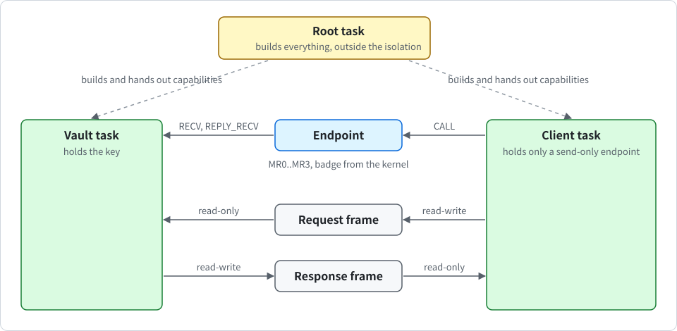

# Signing oracle (key vault)

<div align="center">

English | [한국어](../kr/vault_KR.md)

</div>

This note describes the first service on top of K0's isolation core. A **vault** task holds one Ed25519 key. Client tasks get signatures and the public key over IPC, and they never get the key. The code is in `userspace/k0-vault` (the crate), `userspace/root-task/src/oracle.rs` (wiring and self-test), `userspace/root-task/src/service.rs` (the service that starts after the self-tests) and `crates/k0-boot` (the boot seed). In an image built with `terminal`, the operator of the vault is the serial terminal (see "The service vault and the operator").

> [!NOTE]
> The vault is optional and off by default. The default image has no vault and no crypto code.

## Purpose and scope

The vault shows that the isolation core can keep a secret away from the tasks that use it. It offers a small, fixed service: report status, return the public key, and sign a message of up to 1024 bytes. The key is made in two steps. The root task delivers a seed, and then the admin or the operator asks for a key.

The algorithm is Ed25519 (PureEdDSA with SHA-512, as in FIPS 186-5 and RFC 8032). The implementation is the vendored crate `ed25519-dalek` 2.2.0 and has no validation of any kind. The key does not come from an approved random bit generator. 14 crates were added to `vendor/` for it, and half of them are build-time or other-target code that is not compiled into a K0 image.

## Objects and who can map what

<p align="center">
  
</p>

The root task creates the following objects:

- **one endpoint**: the vault receives on it. A client's CNode holds only a send-only, badged copy of it (and a report endpoint in the self-test). The terminal gets the same kind of copy with the operator badge.
- **the vault task**: it has its own address space and its own stack. The key lives there.
- **per caller, a request frame and a response frame**: the request frame is read-write for the caller and read-only for the vault. The response frame is read-write for the vault and read-only for the caller. This is enforced by reduced-rights copies of the frame capabilities. The operator is the exception: it has a response frame, mapped read-only for it, and no request frame.

> [!WARNING]
> The root task builds all of this, so it is outside the isolation and could read the vault. The statement that holds is "no task other than the root task can map the vault's memory".

## The protocol

A client uses `CALL` (see [ipc.md](ipc.md)). The request registers are the following:

| Register | Content |
| --- | --- |
| MR0 | the operation and the algorithm (`proto::word`) |
| MR1 | the length of the body in the request frame |
| MR2 | a nonce chosen by the caller |

The reply sets all four registers:

| Register | Content |
| --- | --- |
| MR0 | the status |
| MR1 | the length (for `STATUS`, the vault state) |
| MR2 | the indicator bits |
| MR3 | the nonce |

The operations are the following:

| Operation | Meaning |
| --- | --- |
| `STATUS` | the state, the algorithm of the key and the algorithms in the image |
| `PUBLIC_KEY` | the public key, in the response frame |
| `SIGN` | signs a message of up to 1024 bytes in the request frame |
| `INIT` | delivers the seed and the seed info (40 bytes, once, admin only). It makes no key |
| `KEYGEN` | makes the key from the held seed with the algorithm chosen in MR0, and wipes the seed |
| `ZEROIZE` | wipes the key and the held seed |

`STATUS` packs the state, the algorithm of the key and the algorithms built into the image into the one word of MR1 (`proto::status_word`).

**The single fetch**: `server::fetch` fixes the length first, then reads the body once into a private buffer with volatile reads. Only the copy is used, so a caller that changes the frame during the call gains nothing. The response frame starts with the nonce and the length, and `server::publish` writes the nonce last. A client must trust the frame only after an `OK` reply that carries its own nonce.

The vault decides from the badge and the operation alone which frame it reads or writes (`proto::fetch_plan` and `proto::publish_plan`). Only `SIGN` and `INIT` carry a request body, and only `PUBLIC_KEY` and `SIGN` give a response body. A request that claims a body it cannot have is refused with `BAD_REQUEST`, and the vault touches no memory for it. This matters for the operator, which has no request frame: a made-up length cannot make the vault read an address that is not mapped.

The state machine is `Vault::handle` in `userspace/k0-vault/src/server.rs`. The vault is in one of five states:

| State | Meaning |
| --- | --- |
| `fresh` | no seed and no key |
| `seeded` | `INIT` delivered a seed that passed the entropy rule, and the vault holds it |
| `ready` | `KEYGEN` made the key and wiped the seed |
| `zeroized` | `ZEROIZE` wiped the key and the seed. Only a reboot makes a new key |
| `failed` | a self-test or the pairwise test failed. Every way into this state wipes the seed and the key |

There is one key per boot. A second `KEYGEN` is refused with `KEY_EXISTS` (`key-exists` on the terminal).

## The fixed policy and badges

The policy is fixed at build time and keyed by the endpoint badge. The kernel delivers the badge, and a client cannot forge it (see [ipc.md](ipc.md)). There are four roles, fixed at build time:

| Role | Operations |
| --- | --- |
| admin (the root task) | `STATUS`, `INIT`, `KEYGEN`, `ZEROIZE`, not `SIGN` and not `PUBLIC_KEY` |
| operator (the terminal) | `STATUS`, `PUBLIC_KEY`, `KEYGEN`, `ZEROIZE`, not `SIGN` and not `INIT` |
| signer | `STATUS`, `PUBLIC_KEY`, `SIGN` |
| reader | `STATUS`, `PUBLIC_KEY` |

The operator can neither get a signature nor deliver a seed. A call without a badge or with an unknown badge is refused. No operation changes the policy. All signers share the one key, so a signature carries no client identity.

## The provider boundary

`userspace/k0-vault/src/provider.rs` is the only place that touches the crypto crate.

- **Self-test**: at start the vault runs a known-answer test with two RFC 8032 vectors (public key, signature, verification, and rejection of a changed message and of a changed signature).
- **Seed check and the entropy rule**: `INIT` refuses the seed (status `NO_ENTROPY`) unless the boot seed contains at least 32 bytes of `rng-seed` or 256 bits from RNDR, and it refuses an all-zero seed. A vault in an image without an algorithm refuses the seed (`UNSUPPORTED`) and stays `fresh`. QEMU virt provides a 32-byte `rng-seed`.
- **Key generation**: `KEYGEN` makes the key from the held seed with the chosen algorithm and wipes the seed whether or not a key came out.
- **Pairwise test**: after key generation the vault checks that its own signature verifies. A failed self-test or a failed pairwise test puts the vault into the `failed` state that refuses everything but `STATUS`.
- **Strict verification**: verification uses `verify_strict`.
- **No key export**: no operation returns the key.
- **Zeroization**: `ZEROIZE` drops the key (the crate wipes it) and the held seed. The vault then refuses `SIGN`, `PUBLIC_KEY` and `KEYGEN`.
- **Indicator bits**: every reply carries four bits: the algorithm is in FIPS 186-5, the self-tests passed, at least 32 `rng-seed` bytes went into the key seed, and RNDR went into the key seed. `STATUS` reports the last two also for a seed that the vault still holds. A bit means that the bytes were present, not that they were unpredictable.

## The boot seed path

The kernel derives 32 bytes for the root task with SHA-256 under its own domain string from the DTB entropy, the counter and, when the CPU has RNDR, four fresh RNDR words (`k0_boot::derive_root_seed`). It is independent of the PAC keys by domain separation. The seed is as good as its inputs and no better.

The seed is delivered in the root task's entry registers `x0` to `x3`. `x4` holds how many `rng-seed` bytes were used (bits 15 to 0), and bit 16 says that RNDR contributed. It is not in the bootinfo page, and `bootinfo::VERSION` is 4. The root task prints only `root: boot seed from rng-seed bytes 0x... and rndr` or `... without rndr`, never the seed. It then gives the seed to a vault with `INIT`, which only delivers it. The key is made later by `KEYGEN`.

**Seed wipe**: the FDT parser records where the `rng-seed` and `kaslr-seed` values are, and a second `/chosen` node is refused (`DuplicateChosen`, also in the UEFI loader's pre-check, which shares the parser). Right before the kernel enters the root task, it zeroes those bytes. `k0_mm::wipe_ro_alias` switches the read-only alias entry of the page to read-write in place (break-before-make), writes zeros, cleans and invalidates the cache lines, and switches it back. The kernel then reads the bytes back, wipes its own copy in `BootInfo`, prints `k0: dtb seeds wiped <n>B` (40B on QEMU virt) and zeroes the boot stack below the live frames. This is the only write the kernel makes through the DTB mapping, and it happens after the DTB was parsed and validated.

> [!NOTE]
> Copies that the firmware or the UEFI loader keep are not wiped, and neither is anything in the live frames of the boot stack. The scrubs of stack copies (the kernel boot stack, the vault stack after key generation and signing) are best effort.

## The service vault and the operator

The real boot seed is used exactly once. In an image built with `terminal` and `vault`, the root task first runs all self-tests. Then it starts a new vault, the **service vault**, and hands it the boot seed with `INIT`. It prints `root: vault seeded`, or `root: vault has no seed (boot seed has no entropy)`, or `root: vault has no seed (no algorithm in this image)`. In every other image the root task wipes the seed at entry.

The root task then runs two hostile tasks that are wired exactly like the terminal. They must be refused and end in a fault. After that it drops its own admin capability, starts the terminal and blocks for ever. The terminal can ask the service vault for `STATUS`, `PUBLIC_KEY`, `KEYGEN` and `ZEROIZE` through the operator badge, and for nothing else. The commands, the screen and the limits of the terminal are described in [USAGE.md](../../USAGE.md).

> [!WARNING]
> The serial line has no authentication. Whoever holds the line is the operator and can run exactly the four operator operations, including erasing the key. The operator cannot get a signature and cannot change the policy.

The self-test vault is a different vault. It makes its key from the public RFC 8032 test seed, with the real seed info, so the entropy rule is still exercised, and the real seed never reaches it.

## Features and the fixed image

The `k0-kernel` crate has two features, and features only add:

- `vault`: the service, its protocol, policy and self-test, with no signing algorithm. Every signing request answers `UNSUPPORTED`.
- `vault-ed25519`: adds Ed25519.

The feature `terminal` of the same crate adds the operator terminal. With `vault` the terminal is the operator of the vault, and with `vault-ed25519` it can make an Ed25519 key. It is off by default and needs a console driver. A terminal image is built as follows:

```sh
$ cargo build -p k0-kernel --features console,terminal,vault-ed25519
```

You can build an image with the vault as follows:

```sh
$ cargo build -p k0-kernel --features console,vault-ed25519
```

`crates/k0-boot/build.rs` forwards the feature to the nested build of the root task. The vault's code is part of the root task image, which is checked by SHA-256 at boot like before. Nothing is loaded after boot. With Ed25519 the image has 24 frames of 4 KiB (the limit is 78).

## How it is tested

**Host tests** (`tools/host-test.sh` runs `k0-vault` with and without the algorithm feature). The tests are in `userspace/k0-vault/src/tests.rs`: 20 with Ed25519 and 11 without. The test names are the following:

- always: `badges_map_to_fixed_roles_and_frames`, `each_role_may_do_exactly_its_operations`, `no_frame_is_touched_for_a_request_that_cannot_have_a_body`, `a_request_that_claims_a_body_it_cannot_have_is_refused`, `the_status_word_packs_state_algorithm_and_what_is_built`, `a_call_without_a_known_badge_is_denied`, `malformed_requests_are_refused_whole`, `a_seed_without_real_entropy_makes_no_key`, `the_seed_is_taken_once_and_zeroize_is_final`, `fetch_clamps_the_length_and_publish_writes_header_and_body`, and `without_an_algorithm_the_vault_takes_no_seed_and_serves_nothing` (the last one without the algorithm only).
- with Ed25519: `the_self_test_passes_and_is_reported`, `key_generation_follows_the_states`, `the_operator_gets_the_public_key_and_never_a_signature`, `a_vault_that_fails_holds_no_secret`, `signatures_verify_and_the_key_follows_the_seed`, `a_public_key_request_carries_no_body`, `unknown_algorithms_are_unsupported`, `nothing_is_served_after_zeroize`, `a_small_order_public_key_is_refused_even_with_a_matching_signature`, `a_failed_vault_refuses_everything_but_status`.

With the other crates, the host suite has 354 tests on an ARM host and 268 on other hosts (without `k0-mm`).

**Root task self-test** (`test_oracle` in `userspace/root-task/src/oracle.rs`, only in images built with `vault`). It checks the following:

- the self-test is reported, and an unbadged call is refused,
- the self-test vault gets the public RFC 8032 test seed with `INIT` (state `seeded`), the operator cannot seed or sign, and a second `INIT` is refused,
- `KEYGEN` makes the key from that seed, and a second `KEYGEN` is refused (`KEY_EXISTS`),
- the admin cannot sign,
- a signer client gets a signature that verifies, and that does not verify for a changed message or a changed signature,
- a reader is refused `SIGN`,
- a client that writes its read-only response frame and a client that reads where the vault sees another caller's request are killed by a fault (two more `k0: task fault` lines, so 8 instead of 6),
- after `ZEROIZE` signing is refused,
- a call to a deleted vault ends with `TIMEOUT`, and
- memory taken back from the vault reads as zero after retype.

The marker is `root: oracle tests pass`. The client tasks run one after another in one client address space, because root CNode slots are scarce. The test shows isolation between the vault and a client, not between clients.

**Boot matrix rows**: `vault`, `vault-max` (RNDR), `vault-el2`, `vault-16k`, `vault-no-alg`, `hvf-vault`, and the static row `vault-symbols` (the default image has no vault or crypto code, and the vault image has no writable static from them). The matrix has 76 rows on a Mac with HVF and 65 in CI. The rows for the terminal are `term`, `term-max`, `term-el2`, `term-gicv2`, `term-16k`, `term-no-vault`, `term-no-alg`, `term-uefi`, `term-uefi-acpi` and `hvf-term`. `tools/term-test.py <image>` boots a terminal image with QEMU's serial port on pipes and runs a scripted session. Every image now also prints `k0: dtb seeds wiped <n>B` and `root: boot seed from rng-seed bytes ...`.

## Known gaps

> [!NOTE]
> The implementation is unvalidated, there is no side-channel analysis of the crate on this kernel, and the oracle was only run in QEMU (TCG and HVF).

- **One key**: there is no persistence, no key import or export, no DRBG and no post-quantum algorithm yet. A new key needs a reboot.
- **No signing client in service mode**: the service vault's key is made and shown, but no other task uses it yet. Client signing is shown by the self-test.
- **The terminal and the vault are not restarted**: if they die, they stay dead. The root task is trusted.
- **Availability is not protected**: clients share one endpoint and must use timeouts on every call (see [ipc.md](ipc.md)).
- **The root task is trusted**: it builds the vault and could read it.
- **No client identity**: all signers share the one key.
- **Entropy**: the seed is as good as its inputs. The key does not come from an approved random bit generator.
- **Best-effort wipes**: see the note in the boot seed section.
