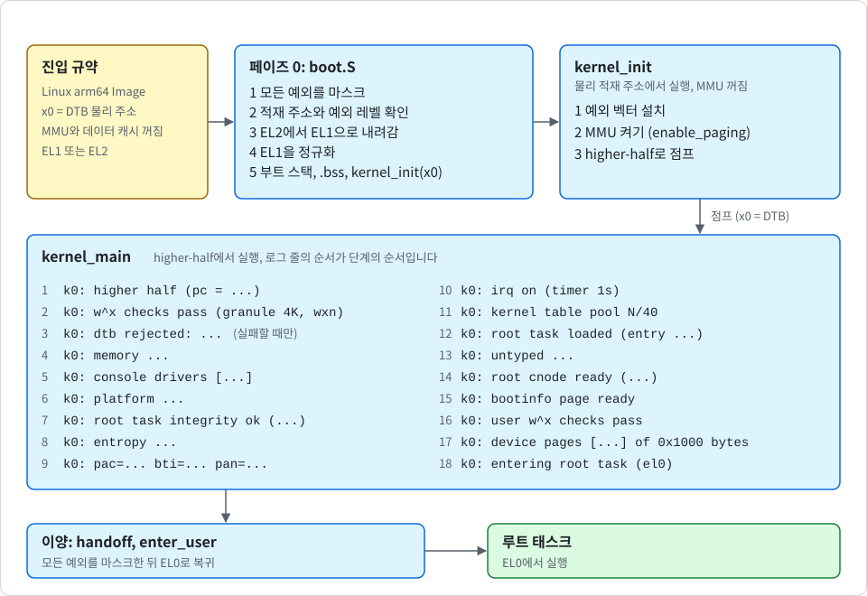
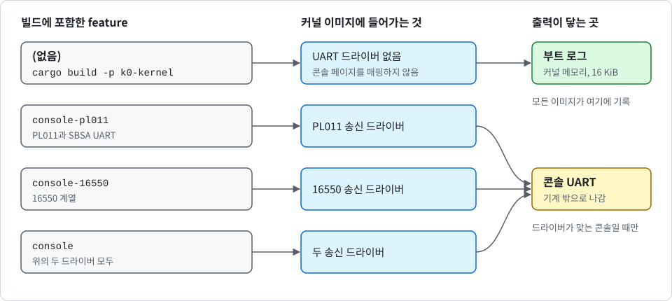

# 부팅과 higher-half로의 점프

[English](../en/boot.md)

이 노트는 첫 명령에서 루트 태스크가 EL0에서 실행되는 순간까지 K0를 따라갑니다. `kernel/src/arch/aarch64/boot.S`, `kernel/src/main.rs`의 `kernel_init`과 `kernel_main`, 링커 스크립트 템플릿 `kernel/kernel.ld`, 그리고 이 템플릿을 선택한 그래뉼에 맞는 스크립트로 바꾸는 `kernel/build.rs`를 다룹니다.

다음 그림은 진입부터 루트 태스크까지의 단계를 순서대로 보여 줍니다.

<p align="center">
  
</p>

## 진입 규약

K0는 범용 이미지 하나입니다. Linux arm64 Image로 적재됩니다. 이미지의 처음 64바이트는 Image 헤더입니다. 헤더는 실제 진입점으로의 분기, 적재 오프셋, 이미지 크기, 플래그, `ARM\x64` 매직으로 이루어지며, 오프셋, 크기, 플래그는 링커 스크립트가 채웁니다. **Linux arm64 부트 프로토콜을 따르는 부트로더**라면 어느 것이든 커널에 진입시킬 수 있습니다.

UEFI 펌웨어는 이 프로토콜을 따르지 않습니다. 그래서 별도의 UEFI 로더(`loader/`, [uefi_KR.md](uefi_KR.md) 참고)가 커널 Image를 내장하고, UEFI 메모리 맵으로 디바이스 트리를 다시 작성한 뒤 이 규약대로 커널에 진입시킵니다. 커널은 그 로더가 진입시켰는지 다른 부트로더가 진입시켰는지 알지 못합니다. 이미지는 다음 조건을 모두 갖춘 머신에서 부팅합니다.

- **아키텍처**: ARMv8-A 또는 ARMv9-A이며, 리틀 엔디언입니다.
- **x0 레지스터**: 디바이스 트리 블롭(DTB)의 물리 주소가 들어 있습니다.
- **MMU와 데이터 캐시**: 꺼져 있습니다.
- **예외 레벨**: CPU는 EL1 또는 EL2에 있습니다.
- **CPU 수**: 정확히 하나만 진입시킵니다. 커널은 싱글 코어로 실행됩니다.
- **인터럽트 컨트롤러와 타이머**: 인터럽트 컨트롤러는 GICv2 또는 GICv3이고, CPU에 ARM generic timer가 있습니다.
- **RAM**: 2^47(128 TiB) 아래에 있습니다.

> [!IMPORTANT]
> 부트로더는 CPU를 정확히 하나만 진입시켜야 합니다. 커널은 더 이상 어느 CPU인지 확인하지 않으므로, 나머지 CPU는 부트로더가 들어오지 못하게 해야 합니다.

이미지는 그래뉼 격자(4 KiB, 16 KiB 빌드에서는 16 KiB) 위의 어떤 물리 주소에든 적재할 수 있습니다. 링크는 고정된 가상 주소 하나(`0xFFFF_8000_0000_0000`)로 되어 있고, 실행은 실제 적재된 물리 주소에서 시작합니다. 이 노트의 모든 내용은 **이 간격**에서 비롯됩니다. `boot.S`는 PC 상대 주소만으로 자기 위치를 찾습니다.

결정에 따라 지원하지 않는 것은 다음과 같습니다.

- EL3 진입
- 정적 테이블 MADT, GTDT, SPCR을 넘어서는 ACPI 사용(AML은 읽지 않습니다)
- K0 로더가 아닌 프로그램을 통한 UEFI 진입(범용 UEFI 부트로더는 펌웨어 메모리를 사용자 공간에 넘기는 메모리 설명을 그대로 전달하게 됩니다. [uefi_KR.md](uefi_KR.md) 참고)
- Apple Silicon 베어메탈
- GICv2와 GICv3 외의 인터럽트 컨트롤러
- 기밀 VM
- 64 KiB 그래뉼
- 빅 엔디언
- DTB가 타이머 정오표를 선언하는 보드
- 2^47을 넘는 RAM

### 그래뉼

기본 그래뉼은 4 KiB입니다. 빌드 옵션 `--no-default-features --features granule-16k`로 16 KiB 이미지를 만들 수 있습니다. 다음은 그 예입니다.

```sh
$ cargo build -p k0-kernel --offline --no-default-features --features granule-16k,console --target-dir target/g16
```

> [!IMPORTANT]
> 이 빌드는 `--no-default-features`를 사용하므로 콘솔 feature는 `default`에 추가하지 않으며, 모든 명령이 feature를 명시해야 합니다("선택적 콘솔 출력" 참고).

그래뉼은 **이미지를 빌드할 때 정하며** 실행 중에는 선택할 수 없습니다. `kernel/build.rs`가 그래뉼, Image 플래그, 고정 가상 주소를 `kernel/kernel.ld` 앞에 붙여 링커에 넘기므로 섹션과 가드 페이지의 정렬이 그래뉼을 따릅니다. 선택한 그래뉼을 지원하지 않는 CPU에서는 `k0_mm::enable_paging`이 실패하고 커널이 부팅을 거부합니다(`k0: mmu enable failed`). 그래뉼 격자에 맞지 않는 적재 주소도 같은 방식으로 거부합니다. 16 KiB 이미지는 QEMU `-cpu max`에서, 그리고 직접 HVF 위의 Apple 코어에서 부팅해 보았습니다("부팅해 본 환경" 참고).

## 페이즈 0: `boot.S`

어셈블리 진입부는 Rust에 안전하게 도달하는 데 필요한 최소한의 일만 하고, 예상 밖의 상황이면 코어를 `wfe` 루프에 파킹합니다.

1. **모든 예외를 마스크합니다**. 아직 벡터 테이블이 설치되지 않았으므로, 예외가 발생하면 동작이 정의되지 않습니다.
2. **적재 주소와 예외 레벨을 확인합니다**. 4 KiB 정렬이 아닌 주소에 적재되면 PC 상대 주소가 전부 어긋나므로, 다른 일은 하지 않고 코어를 파킹합니다(실제 그래뉼 검사는 나중에 Rust 쪽이 하고 이유를 로그에 남깁니다). EL1이면 계속 진행합니다. EL2이면 EL1으로 내려갑니다. EL0과 EL3이면 파킹합니다. 어느 CPU인지는 확인하지 않습니다. 진입 예외 레벨은 `x19`에 두었다가 `.bss`를 지운 뒤 `K0_ENTRY_EL`에 기록합니다.
3. **EL2에서 EL1으로 내려갑니다**. 커널은 펌웨어가 EL2 레지스터에 남긴 값을, 리셋 값이 UNKNOWN인 레지스터까지 포함해 **신뢰하지 않습니다**. EL2 벡터를 설치한 뒤 필요한 EL2 상태를 직접 설정하고, 나머지 트랩과 라우팅 비트는 모두 0으로 둡니다. 대상은 `HCR_EL2`(`RW`는 EL1을 AArch64로 만들고, `HCD`는 EL1에서 `hvc`를 정의되지 않은 명령으로 만들며, `APK`와 `API`는 포인터 인증 사용이 트랩되는 것을 막습니다), `SCTLR_EL2`, `CNTHCTL_EL2`, `CNTVOFF_EL2`(가상 카운터 오프셋 0), `VPIDR_EL2`와 `VMPIDR_EL2`(실제 `MIDR_EL1`과 `MPIDR_EL1`의 사본), `CPTR_EL2`, `MDCR_EL2`, `HSTR_EL2`, `VTTBR_EL2`입니다. GIC 시스템 레지스터 인터페이스가 있으면 EL1이 사용할 수 있도록 `ICC_SRE_EL2`를 켭니다. CPU가 `HCRX_EL2`나 세부 트랩(fine-grained trap) 레지스터를 구현하면, 커널이 사용하는 것이 EL2로 트랩되지 않도록 그 레지스터에 값을 기록합니다. `SCTLR_EL1`도 기지 상태로 만든 뒤 모든 예외를 마스크한 채 EL1h로 복귀합니다. 커널은 EL2로 다시 돌아오지 않습니다.
   - **EL2 벡터**: 내려간 뒤 무언가 EL2로 트랩되면, 벡터 코드가 `ESR_EL2`, `ELR_EL2`, `FAR_EL2`를 `K0_EL2_TRAP`에 기록하고 머신 전체를 파킹합니다. 설계 의도입니다. 예상하지 못한 사건 뒤에 계속 실행할 근거가 커널에는 없습니다.
   - **E2H 고정 CPU**: `HCR_EL2.E2H`가 1로 고정된 CPU에서는 코드가 `ID_AA64MMFR4_EL1.E2H0`을 읽습니다. 그것으로 판단되지 않으면 EL1 이름의 레지스터 접근이 EL2 레지스터로 돌려지는지 시험합니다. 이 경우 Linux가 사용하는 레지스터 배치(예: `CNTHCTL_EL2`, `CPTR_EL2`, `SCTLR_EL12`)를 따릅니다.
   - **펌웨어 계약**: Linux와 마찬가지로, 해당 기능이 있으면 EL3가 세부 트랩과 `HCRX` 제어를 켜 두어야 합니다. 커널은 EL2에서 이를 할 수 없습니다.
4. **EL1을 정규화합니다**. 부트로더가 무엇을 남겼든 `SCTLR_EL1`을 알려진 값으로 설정합니다. MMU와 캐시는 꺼지고, 리틀 엔디언이며, EL0와 EL1에서 스택 정렬 검사를 하고, EL0의 `WFI`와 `WFE`는 트랩되며, EL0의 인터럽트 마스크 비트 접근은 거부됩니다. `CPACR_EL1`은 0으로 설정되어 FP/SIMD, SVE, SME 명령이 EL0와 EL1 모두에서 트랩됩니다. 커널은 소프트 float 타겟으로 빌드되며 태스크용 벡터 레지스터 상태를 보관하지 않습니다.
5. **부트 스택을 설정합니다**. `__boot_stack_top`으로 설정하고, `.bss`를 0으로 채우고, 진입 레벨을 기록한 뒤 `kernel_init(x0)`을 호출합니다. 그 과정에서 `x0`을 건드리지 않으므로 DTB 주소가 첫 번째 인자로 전달됩니다.

> [!NOTE]
> E2H가 1로 고정된 CPU의 경로는 Linux를 따르지만 어떤 CPU에서도 실행해 보지 않았습니다.

## `kernel_init`: 점프 이전

`kernel_init`은 MMU가 꺼진 채 물리 적재 주소에서 실행됩니다. 프로그램 카운터 기준으로 주소를 만드는 코드(`adr`, `adrp`)는 올바른 물리 주소를 얻습니다. 그러나 절대 포인터를 담은 데이터는 링커가 higher-half 주소로 재배치해 두었습니다. static에 저장된 문자열 슬라이스, vtable, `core::fmt` 기계장치가 여기에 해당합니다.

> [!IMPORTANT]
> 이런 포인터를 역참조하면 지금은 폴트가 납니다. 그래서 이 단계는 **리터럴 문자열과 16진 정수만** 출력하고, `writeln!`이 필요한 일은 하지 않습니다.

이 단계는 세 가지 일을 합니다.

1. **예외 벡터를 설치합니다**. 물리 주소로 설치하므로, 이후에 폴트가 나면 멈추지 않고 진단을 출력합니다.
2. **MMU를 켭니다**. `k0_mm::enable_paging`을 사용합니다. 레이아웃은 링커 심볼에서 가져오며 커널 이미지만 대상입니다. text, 읽기 전용 데이터, 데이터와 `.bss`, 부트 스택입니다. 이미지는 두 번 매핑합니다. 한 번은 물리 주소(identity, `TTBR0`를 통해), 한 번은 고정 가상 주소(`TTBR1`을 통해)입니다. DTB도 디바이스도 아직 매핑하지 않으며, `kernel_init`은 DTB를 읽지 않습니다. 부트로더가 DTB를 데이터 캐시에만 써 두었을 수 있으므로, MMU를 켠 뒤 매핑을 통해서만 읽습니다. 테이블과 권한은 [memory_KR.md](memory_KR.md)에서 설명합니다.
3. **점프합니다**. 인라인 어셈블리가 스택 포인터에 고정 가상 주소와 적재 주소의 차이를 더하고, `movz`와 `movk`로 `kernel_main`의 절대 주소를 만든 뒤, `x0`에 DTB 주소를 그대로 둔 채 그곳으로 분기합니다.

콘솔을 알기 전의 출력은 모두 커널 부트 로그에만 쌓입니다(뒤의 "부트 로그" 절 참고).

## `kernel_main`: 점프 이후

프로그램 카운터와 스택 포인터는 이제 higher-half에 있고, 재배치된 데이터가 유효하며, 일반적인 Rust가 동작합니다. 점프 이전에는 `Mmu`와 `Vectors` 같은 typestate 토큰이 한 단계가 다른 단계보다 먼저 일어났음을 증명합니다. 실패하면 모두 이유를 출력하고 코어를 파킹합니다. 처음에는 콘솔을 아직 알지 못합니다. 그 콘솔의 드라이버를 포함해 빌드한 이미지에서는 콘솔이 붙을 때 앞쪽 줄이 재생됩니다.

> [!IMPORTANT]
> 다음 단계의 순서가 곧 보안 논거이므로 `kernel_main`은 하나의 직선 시퀀스입니다. typestate 토큰은 점프를 넘을 수 없으므로, 점프 이후에는 코드의 순서가 그 보장을 대신합니다.

다음 표는 로그 줄과 그 줄이 나타내는 단계를 순서대로 보여 줍니다.

| 로그 줄 | 단계 |
| --- | --- |
| `k0: higher half (pc = ...)` | 벡터를 가상 주소로 다시 설치합니다. |
| `k0: w^x checks pass (granule 4K, wxn)` | 주소 변환 명령으로 text는 읽을 수 있고 쓸 수 없으며, 읽기 전용 데이터는 쓸 수 없고, 스택 가드 페이지는 매핑되지 않았으며, 스택은 쓸 수 있고, 이미지에 선형 별칭이 없음을 확인합니다. 16 KiB 빌드에서는 그래뉼이 16K로 표시됩니다. |
| `k0: dtb rejected: ...` (실패할 때만) | `map_dtb`가 별칭을 통해 DTB를 읽기 전용으로 매핑합니다. 포인터(null이 아니고 8바이트 정렬)와, 매직과 전체 크기만 읽는 `dtb_span`을 검사합니다. |
| `k0: memory ...` | 별칭을 통해 DTB를 파싱합니다. 파서는 [dtb_KR.md](dtb_KR.md)에서 다룹니다. |
| `k0: console drivers [...]` | 플랫폼 기동의 첫 줄이며, 나중에 플랫폼이 거부되더라도 출력됩니다. 이 이미지에 들어 있는 콘솔 드라이버를 알려 줍니다("선택적 콘솔 출력" 참고). |
| `k0: platform ...` | `bring_up_platform`이 DTB에서 콘솔, 인터럽트 컨트롤러, 타이머 인터럽트를 찾아 불변인 플랫폼 기술서 하나를 만듭니다. 디바이스 페이지를 매핑하기 전에 기술서를 메모리 맵과 대조합니다. RAM은 2^47 아래여야 하고, 커널 이미지와 DTB는 선언된 메모리 안에 있어야 하며, 그래뉼 단위로 넓힌 디바이스 구간은 메모리나 예약 구간과 겹치거나 CPU의 물리 주소 폭(`k0_mm::pa_bits`)을 넘으면 안 됩니다. 고정 모드에서는 이어서 이 줄을 기대값과 비교합니다. 그 뒤에야 콘솔을 연결합니다. 이 종류의 콘솔 드라이버가 있는 이미지는 콘솔을 매핑하고 연결하며, 이때 버퍼에 쌓인 로그가 재생됩니다. 드라이버가 없는 이미지는 아무것도 매핑하지 않고 `k0: no console (driver not built in)`을 출력합니다. 플랫폼이 거부되더라도 콘솔만으로 대조를 통과하면(그리고 이미지가 고정 모드가 아니고 드라이버가 있으면) 사유가 보이도록 콘솔을 먼저 연결합니다. 콘솔이 없으면 `k0: no console (...)`이 이유를 알려 줍니다. [dtb_KR.md](dtb_KR.md)를 참고하세요. |
| `k0: root task integrity ok (...)` | 내장 루트 태스크 이미지를 다시 해시하고 빌드 시점에 고정된 해시와 비교합니다. |
| `k0: entropy ...`, `k0: pac=... bti=... pan=...` | PAC 키를 파생해 적재하고 키 워드를 부트 스택에서 지웁니다. 루트 태스크에 넘길 32바이트 시드도 여기서 PAC 키와 독립적으로 파생하여 이양까지 보관합니다. PAN을 켜고, 카운터·디버그·PMU에 대한 EL0 접근을 끕니다. [hardening_KR.md](hardening_KR.md)를 참고하세요. |
| `k0: irq on (timer 1s)` | `setup_irq`가 필요한 인터럽트 컨트롤러 페이지만 매핑합니다. GICv3는 리디스트리뷰터 프레임을 하나씩 들여다보며 부트 CPU의 프레임을 찾은 뒤, 그 프레임과 SGI 프레임만 매핑합니다. 드라이버는 GIC 식별 레지스터가 DTB의 설명과 맞는지 확인합니다. EL1 가상 타이머는 플랫폼 기술서의 인터럽트 번호로 설정합니다. IRQ와 SError의 마스크를 해제합니다. |
| `k0: kernel table pool N/40` | 2 MiB 부트 프레임 윈도우를 고르고 매핑한 뒤, 사용 중인 커널 페이지 테이블 수를 출력합니다(예: QEMU virt에서 `16/40`). 40개짜리 정적 풀은 부트 중에만 사용합니다. |
| `k0: root task loaded (entry ...)` | 루트 태스크를 윈도우의 프레임에 복사하고, 윈도우에 루트 TCB를 만들고, 주소 공간을 만듭니다. 커널은 사용자 루트 테이블의 물리 주소를 출력하지 않습니다. 이후 이 주소 공간을 주소 공간 등록부에 올립니다. [user-address-space_KR.md](user-address-space_KR.md)를 참고하세요. |
| `k0: memory <base> + <size> not handed out (<reason>)`(일어날 때만), `k0: kernel reserve <T> tables + <E> address space entries = <B> bytes in <N> ranges` | `reserve_kernel_share`가 untyped 케이퍼빌리티가 만들어지기 전에 비어 있는 물리 범위마다 커널 몫을 떼어 냅니다("untyped 메모리에서 커널 몫 떼어 내기" 참고). 자기 몫을 담지 못하는 범위는 넘기지 않으며, 이때 커널은 첫 번째 종류의 줄에 이유를 출력합니다. 두 번째 줄은 한 번 출력됩니다. 예를 들어 512 MiB, 4 KiB 그래뉼의 QEMU virt에서는 `k0: kernel reserve 262 tables + 130130 address space entries = 0x206000 bytes in 3 ranges`입니다. |
| `k0: untyped ...`, `k0: root cnode ready (N caps, N untyped, N image frames, N slots)` | 루트 CNode(윈도우 안의 오브젝트이며 슬롯은 `ROOT_CNODE_SLOTS` = 512개, 로그에도 그렇게 나옵니다)를 채웁니다. 슬롯 1은 루트 TCB, 2는 루트 주소 공간, 3은 콘솔, 4는 루트 CNode 자신이고, 이어서 넘기기로 한 비어 있는 물리 범위마다 untyped 케이퍼빌리티, 루트 태스크 이미지의 매핑된 그래뉼마다 Frame 케이퍼빌리티 하나(text는 R과 X, 읽기 전용 데이터는 R, 데이터는 R과 W)가 들어갑니다. 마지막으로 루트 태스크를 다른 태스크와 똑같이 자신의 CNode와 주소 공간에 묶습니다. 두 케이퍼빌리티의 복사본이 TCB에 들어갑니다. [capabilities_KR.md](capabilities_KR.md)를 참고하세요. |
| `k0: bootinfo page ready` | 케이퍼빌리티 목록을 읽기 전용 bootinfo 페이지(레이아웃 버전 3)에 기록합니다. 헤더와 슬롯마다 하나의 디스크립터이며, 이미지 Frame마다 VA, 크기, 권한이 들어갑니다. 이 페이지에는 부트 시드가 들어 있지 않습니다. |
| `k0: user w^x checks pass` | `TTBR0`가 사용자 테이블을 가리키고, identity 매핑은 사라졌으며, 사용자 매핑을 EL0와 EL1 양쪽에서 검사합니다. |
| `k0: dtb seeds wiped <n>B` | 이제 DTB는 필요 없으므로 커널이 그 안의 `rng-seed`와 `kaslr-seed` 바이트를 0으로 지웁니다(읽기 전용 별칭을 쓰는 동안만 읽기·쓰기로 바꿈). 지운 바이트를 다시 읽어 확인하고, 커널이 가진 자기 사본도 지웁니다. QEMU virt에서는 `40B`입니다. 다시 읽은 값이 0이 아니면 줄은 `k0: WARNING dtb seeds not wiped`가 됩니다. [hardening_KR.md](hardening_KR.md)를 참고하세요. |
| `k0: device pages [...] of 0x1000 bytes` | 커널이 매핑한 채로 두는 모든 디바이스 페이지입니다. 이 줄 뒤에 커널은 더 이상 디바이스를 매핑하지 않습니다. |
| `k0: entering root task (el0)` | `k0_sched::handoff`가 EL0로 진입합니다. 부트 시드는 루트 태스크의 진입 레지스터 `x0`부터 `x3`으로 전달되고, `x4`는 `rng-seed` 바이트가 몇 개 들어갔는지와 `RNDR`이 들어갔는지를 알립니다. 이 줄 직후에 커널은 살아 있는 프레임 아래의 부트 스택을 0으로 채웁니다. |
| `root: boot seed from rng-seed bytes 0x... and rndr` 또는 `... without rndr` | 커널이 아니라 루트 태스크가 초기에 출력하는 줄입니다. bootinfo 버전을 확인한 뒤 시드 재료가 어디서 왔는지를 출력하며, 시드 자체는 출력하지 않습니다. |

### 부트 프레임 윈도우 고르기

`boot_window`는 `crates/k0-boot/src/window.rs`에 있으며 UEFI 로더와 공유합니다. 로더는 점프 전에 이 함수를 돌려 커널이 윈도우를 찾을 수 있음을 확인합니다. 윈도우는 다음 규칙으로 찾습니다.

- **탐색**: 커널 이미지 바로 뒤에서 2 MiB의 RAM을 찾습니다.
- **겹침**: 후보가 DTB, 커널 이미지, 펌웨어 예약 영역과 겹치면 장애물을 지나친 위치로 옮겨 다시 시도하며, 최대 64라운드까지 반복합니다.
- **반환 조건**: 윈도우 전체가 DTB의 메모리 영역 하나 안에 들어갈 때만 범위를 반환합니다.
- **이미지 위쪽에 자리가 없을 때**: 이미지가 RAM 끝 가까이 적재된 경우이며, 가장 낮은 메모리 주소부터 다시 찾습니다.
- **물리 주소 0**: 첫 그래뉼은 커널 안에서 0이 "없음"을 뜻하므로 오브젝트로 내주지 않습니다.
- **윈도우의 내용**: 루트 태스크 이미지, 스택, 페이지 테이블, bootinfo 페이지, 루트 TCB, 루트 CNode가 들어갑니다.
- **untyped 제외**: 윈도우는 untyped 케이퍼빌리티에서 제외되므로, 커널이 아직 사용하는 메모리를 루트 태스크가 retype하는 일은 없습니다.

### untyped 메모리에서 커널 몫 떼어 내기

`kernel/src/main.rs`의 `reserve_kernel_share`는 루트 태스크를 적재한 뒤, untyped 케이퍼빌리티를 만들기 전에 실행됩니다. 비어 있는 물리 범위마다 다음과 같이 동작합니다.

- **몫**: 범위의 모든 그래뉼을 매핑하는 데 필요할 수 있는 페이지 테이블의 최대 개수(`k0_mm::alias_tables_for`)와, 범위의 그래뉼마다 8바이트 주소 공간 항목 하나를 담는 데 필요한 그래뉼 수를 계산합니다.
- **배치**: 그 몫을 범위의 윗부분에서 가져옵니다. 테이블은 테이블 예비분이 되고(`k0_mm::reserve_tables`), 항목은 그 범위의 주소 공간 등록부가 됩니다(`add_range`). 항목 영역은 커널 별칭 윈도우에 매핑하고 0으로 지웁니다. 예비분의 테이블은 부팅 때가 아니라 넘겨줄 때 0으로 지웁니다.
- **결과**: 몫을 뺀 나머지 범위가 `Untyped` 케이퍼빌리티 하나로 넘어갑니다. 부팅 후 `alias_object`는 이 예비분에서 테이블을 가져오므로 태스크가 이를 소진할 수 없습니다.
- **몫을 담지 못하는 범위**: 너무 작거나 몫을 매핑할 수 없는 범위는 `Untyped`로 넘기지 않습니다. 커널은 `k0: memory <base> + <size> not handed out (<reason>)`을 출력하고 계속합니다. 범위 버퍼에 들어가지 않는 범위도 같은 방식으로 건너뜁니다(`too many ranges`).
- **온전한 그래뉼이 없는 틈**: 오브젝트를 만들 수 없고 몫도 필요 없으므로 그대로 넘깁니다.

이 단계는 **부팅을 거부하지 않습니다**. 최악의 경우 메모리가 넘겨지지 않고 로그 한 줄이 그 사실을 알립니다. 오버헤드는 4 KiB 그래뉼에서 RAM의 약 0.2 %, 16 KiB 그래뉼에서 약 0.05 %입니다. 루트 태스크의 주소 공간은 루트 테이블이 부트 윈도우에 있으며 전용 등록부 항목 하나를 사용합니다.

### 이양 이후

루트 태스크는 레지스터 `x0`부터 `x3`에 부트 시드를, `x4`에 시드 정보 워드를 담고 시작합니다. 이 값은 저장된 컨텍스트에 있으며, 루트 태스크가 처음 커널에 들어올 때 그 시점의 자기 레지스터로 덮입니다. 스택에 있던 커널의 시드 사본은 그 전에 0으로 지웠고, 위 표에서 설명한 스택 지우기는 최선의 노력입니다. `kernel_main`의 살아 있는 프레임은 지울 수 없기 때문입니다. [hardening_KR.md](hardening_KR.md)를 참고하세요.

`handoff`는 루트 태스크를 실행 중인 태스크로 기록하고, 벡터 코드가 루트 태스크의 저장된 컨텍스트를 가리키게 합니다. 이어서 `enter_user`가 모든 예외를 마스크(`DAIFSet`)하고, 커널 스택을 꼭대기로 되감은 뒤, 이후의 모든 복귀가 사용하는 것과 같은 경로로 EL0에 복귀합니다. **마스크를 먼저 하는 이유**는 이 경로가 `eret` 전에 `ELR_EL1`과 `SPSR_EL1`을 기록하기 때문입니다. 부트 경로는 이미 타이머를 언마스크했으므로, 그 사이에 인터럽트가 들어오면 두 레지스터가 EL1 값으로 덮입니다. 이때부터 커널 코드는 예외에 대한 응답으로만 실행됩니다. 시스템 콜, 폴트, 타이머 인터럽트가 그 예외입니다. 이 경로는 [exceptions_KR.md](exceptions_KR.md)에서 설명합니다.

## 부트 로그

커널이 출력하는 모든 줄은 커널 메모리의 **16 KiB 버퍼**(`K0_BOOT_LOG`)에도 들어갑니다. 콘솔을 알기 전의 출력은 콘솔이 붙을 때 재생되므로, 범용 이미지에서도 부팅 순서대로의 기록이 남습니다. 콘솔이 없으면 **이 로그가 유일한 기록**이며, 콘솔 드라이버 없이 빌드한 이미지에는 콘솔이 없습니다. 16 KiB 중 사용자 태스크 출력이 사용할 수 있는 것은 6 KiB입니다. 타이머 tick 줄은 처음 4개만 기록합니다. `tools/boot-log.py <커널 ELF> <적재 주소> <QEMU 모니터 소켓>`이 게스트 메모리에서 이 로그를 읽습니다. 로그는 앞에서부터 채우고 넘치는 것은 버립니다. 사용자 태스크가 Console 케이퍼빌리티로 내는 출력은 정해진 몫까지만 기록하므로 커널 진단을 밀어내지 못합니다. 콘솔과 로그 어느 쪽에도 태스크가 쓴 줄이라는 표시는 없습니다([hardening_KR.md](hardening_KR.md) 참고).

## 선택적 콘솔 출력

K0에서 입력 및 출력은 선택 사항입니다. 커널 크레이트(`k0-kernel`)의 Cargo features로 선택할 수 있습니다.

> [!NOTE]
> 입력 또는 터미널용 feature는 아직 없습니다. 지금 선택할 수 있는 것은 콘솔 출력뿐입니다.

콘솔 출력은 콘솔 feature를 포함해 빌드한 이미지에만 있습니다(옵트인). 입력은 어떤 이미지에도 없습니다. 다음 그림은 빌드에 포함한 feature에 따라 출력이 닿는 곳을 보여 줍니다.

<p align="center">
  
</p>

다음 표는 `k0-kernel`의 콘솔 feature와 각 feature가 추가하는 것을 정리한 것입니다.

| Feature | 추가하는 것 |
| --- | --- |
| `console-pl011` | PL011과 SBSA UART(같은 레지스터를 사용합니다)의 송신 드라이버 |
| `console-16550` | 16550 계열의 송신 드라이버 |
| `console` | 둘 다 |

`default`는 `["granule-4k"]` 그대로입니다. feature는 콘솔 출력만 더하며 `default`에 추가하지 않습니다. 16 KiB 이미지는 `--no-default-features`로 빌드하므로, `default`에 추가해 두면 조용히 빠지기 때문입니다. 그래서 스크립트, `cargo virt` 별칭(`run -p k0-kernel --features console`), CI가 **feature를 명시**합니다.

그냥 `cargo run -p k0-kernel`은 콘솔 없는 이미지를 부팅합니다. `tools/qemu-virt-runner.sh`는 이때 `runner: this kernel has no console driver and prints nothing here (build with --features console to see output)`을 출력합니다. 고정 빌드도 필요한 feature를 명시합니다. 다음은 그 예입니다.

```sh
$ K0_PIN='...' cargo build -p k0-kernel --features console --offline --target-dir target/pin
```

모든 feature 조합이 같은 ELF 경로에 기록하므로, `target/quiet` 같은 별도의 `--target-dir`을 사용하면 콘솔 없는 이미지가 콘솔 있는 이미지를 덮어쓰지 않습니다.

**컴파일에서 빠지는 것**: 콘솔 feature 없이 빌드한 이미지에는 UART 드라이버 코드(`crates/k0-arch/src/earlycon/uart.rs`)가 없고, 콘솔 디바이스 페이지를 매핑하지 않으며, UART에 아무것도 쓰지 않습니다. 모든 커널 줄과 EL0의 모든 줄은 커널 메모리의 부트 로그로만 갑니다. 커널은 `k0: no console (driver not built in)`을 출력합니다. 드라이버 하나만 포함한 이미지는 다른 종류의 콘솔을 똑같이 취급합니다.

**남는 것**: 모든 이미지에서 커널은 여전히 디바이스 트리의 콘솔 노드를 찾아 검증합니다. 디바이스 트리에 대한 판단, `K0_PIN` 줄, UEFI 로더의 자가 검사가 모두 같습니다. 따라서 콘솔을 사용하지 않을 이미지도 콘솔 검증에 실패하는 디바이스 트리는 거부합니다. `DEBUG_PUTC` 시스템 콜과 `Console` 케이퍼빌리티도 남고, EL0 출력은 여전히 부트 로그에 닿습니다. 부트 로그는 모든 이미지에 있습니다. UEFI 로더는 내장한 커널을 어떻게 빌드했든, 부트 서비스를 종료하기 전에는 자기 줄을 펌웨어 콘솔로 출력합니다.

**매핑 전의 드라이버 결정**: 드라이버 결정은 디바이스 페이지를 매핑하기 전에 합니다. `kernel/src/main.rs`의 `attach_console`은 디바이스 페이지를 매핑하는 함수를 부르기 전에 콘솔의 종류와 이미지에 들어 있는 드라이버를 살펴봅니다. 드라이버가 없는 종류는 여기서 버려지며 그 페이지는 매핑되지 않습니다.

**프로브 매핑을 거치는 식별 확인**: 디바이스 트리 노드가 `arm,pl011`이라고 하고 4 KiB 프레임 전체를 선언하면, 식별 레지스터를 임시 프로브 매핑으로 읽고, 프로브 매핑을 지운 뒤에야 영구 매핑을 만듭니다. 확인에 실패한 디바이스(`k0: console is not a pl011, ignored`)는 매핑된 채로 남지 않습니다. SBSA UART와 16550은 여전히 확인할 수 없습니다.

**I/O를 눈에 보이게 하는 두 줄**: 다음 두 줄이 I/O를 눈에 보이게 합니다.

- `k0: console drivers [pl011 16550]`(또는 `[pl011]`, `[16550]`, `[none]`)은 플랫폼 기동의 첫 줄입니다. 줄 전체가 이미지 안의 하나의 문자열이므로, `grep -a 'k0: console drivers' <이미지 파일>`로 부팅하지 않고도 이미지가 어떤 I/O로 빌드되었는지 알 수 있습니다. `tools/build-loader.sh`는 이를 `build-loader: embedding a kernel with: k0: console drivers [...]`로 출력해, 아무도 모르는 사이에 조용한 커널을 내장하는 일이 없게 합니다. 이 줄은 증거가 아니라 표지입니다.
- `k0: device pages [0x8000000 0x800f000 ...] of 0x1000 bytes`는 커널이 사용자 공간에 진입하기 직전에 출력됩니다. 디바이스 페이지를 매핑하는 단 하나의 함수에서 나오며, 커널이 매핑한 채로 두는 모든 디바이스 페이지를 나열합니다. 이 줄 뒤에 커널은 더 이상 디바이스를 매핑하지 않습니다.

**증거**: 다음 표의 행은 `tools/boot-matrix.sh`에 있습니다. 콘솔 이미지는 모두 feature를 명시해 빌드합니다.

| 행 | 하는 일 |
| --- | --- |
| `console-symbols` | 정적 행입니다. 디버그 이미지에서 `llvm-nm`이 보여 주는 드라이버 심볼이 feature의 설명과 정확히 같아야 하고, 각 이미지 파일에는 자기 `k0: console drivers` 줄만 정확히 하나 있어야 합니다. |
| `quiet`, `quiet-16k` | 콘솔 없는 이미지를 부팅합니다. 자가 테스트 전체를 게스트 메모리의 부트 로그에서 판정하고(`K0_BOOT_MEMLOG=0x40080000`, QEMU virt의 적재 주소), `K0_BOOT_SERIAL=empty`로 직렬 포트에서 단 한 바이트도 나오지 않았음을 요구하며, `K0_BOOT_CONSOLE_PAGE=unmapped`로 `k0: platform` 줄의 콘솔 주소가 `k0: device pages` 목록에 없음을 요구합니다. |
| `console-pl011-only` | PL011 드라이버만 포함한 이미지를 부팅합니다. |
| `console-16550-only` | 16550 드라이버만 포함한 이미지를 부팅합니다. QEMU virt에는 PL011이 있으므로 이 이미지에는 그 드라이버가 없어 조용합니다. |
| `pl011-identity` | 콘솔 노드가 RTC를 가리키도록 디바이스 트리를 고칩니다. 커널은 `k0: console is not a pl011, ignored`를 출력하고, 아무것도 쓰지 않으며, 그 페이지를 매핑한 채로 두지 않아야 합니다. |
| `serial-check` | 판정 자체를 시험합니다. 콘솔 이미지를 조용한 이미지로 판정하면 직렬 출력 때문에 실패해야 합니다. |
| `hvf-quiet` | `K0_MATRIX_HVF=1`이 필요한 행에 들어 있습니다. |

`tools/qemu-boot-test.sh`는 직렬 로그에 커널 줄이 하나도 없으면 콘솔 feature 없이 빌드한 커널에 대한 힌트도 출력합니다. 적재 주소가 고정되어 있지 않으므로 메모리 판정은 UEFI 로더와 함께 사용할 수 없습니다.

**한계**: 이 증거에는 다음 한계가 있습니다.

- 비어 있는 직렬 로그는 QEMU virt(PL011)의 직렬 포트로 한 바이트도 나오지 않았다는 것만 보여 줍니다. 레지스터 읽기에 대해서는 아무것도 말하지 않습니다. 그것은 심볼 검사와, 커널 자신의 보고인 디바이스 페이지 목록이 다룹니다.
- 심볼 검사는 디버그 이미지에서 실행합니다. 콘솔 없는 feature 조합의 릴리즈(LTO) 이미지는 매트릭스가 빌드하거나 부팅하지 않으며, 콘솔 없는 이미지를 UEFI로 부팅해 본 적도 없습니다.
- 16550 드라이버는 어떤 테스트로도 **실행된 적이 없습니다**. QEMU virt에 그런 UART가 없기 때문입니다. 코드는 이번에 자기 feature로 옮겼고 리뷰로만 확인했습니다. SBSA UART는 식별 확인 없이 PL011 드라이버를 사용합니다. 실제 하드웨어에서 실행한 것은 없습니다.
- 콘솔 없는 이미지가 줄이는 것은 출력 경로이지 커널이 메모리에 가진 내용이 아닙니다. 부트 로그는 평범한 커널 메모리이며, RAM을 읽거나 디버거를 붙일 수 있는 사람은 누구나 봅니다.
- `k0: console drivers` 줄은 모든 `k0:` 줄처럼 EL0 출력이 흉내 낼 수 있습니다([hardening_KR.md](hardening_KR.md) 참고). 그 줄의 첫 번째 등장 또는 이미지 파일만이 빌드를 식별합니다.

**기여자 규칙**: 다음 규칙을 지켜야 합니다.

- 새로운 입력 또는 출력 경로는 처음부터 Cargo feature 뒤에 둡니다(지금 있는 것은 콘솔 출력뿐입니다).
- feature는 더하기만 하며 `default`에 추가하지 않습니다.
- 지원하는 조합마다 부팅 매트릭스에 행을 둡니다.
- 스크립트, `virt` 별칭, CI는 feature를 명시합니다.

## 신뢰 문제

이제 DTB가 디바이스 주소를 제공하므로, 잘못되었거나 적대적인 DTB는 콘솔을 다른 디바이스로 향하게 할 수 있습니다. 커널은 다음 다섯 가지로 이를 제한합니다.

1. **대조**: 기술서를 메모리 맵과 대조합니다.
2. **식별 확인**: 식별 레지스터가 있는 곳(GIC, PL011)에서는 이를 확인합니다(16550과 SBSA UART에는 없습니다).
3. **매핑 시점**: 대조를 통과한 뒤에만 디바이스를 매핑합니다.
4. **시간 상한**: 콘솔의 송신 대기에 시간 상한을 둡니다.
5. **고정 모드**: 기대 플랫폼을 못 박을 수 있습니다.

콘솔 드라이버 없이 빌드한 이미지는 콘솔 경로 자체를 없앱니다("선택적 콘솔 출력" 참고). 내려간 뒤 EL2로 들어오는 트랩은 설계상 머신 전체를 파킹합니다.

> [!NOTE]
> 격리는 여전히 기밀성과 무결성을 다루고 가용성은 다루지 않습니다. DTB 포인터 자체는 처음 읽기 전에 검증할 수 없습니다([dtb_KR.md](dtb_KR.md)의 "알려진 공백" 참고).

### 고정 모드

빌드할 때 환경 변수 `K0_PIN`에 타겟 머신의 부트 로그에서 `k0: platform ` 뒤에 나오는 문자열을 설정하면, 발견한 플랫폼, 진입 예외 레벨, RAM 범위가 다를 때 이미지가 부팅을 거부합니다. 잘못된 보드나 바뀐 DTB를 잡아냅니다. 비교하는 값이 DTB에서 나온 값이므로, **적대적인 부트 체인에 대한 방어는 아닙니다**.

## 부팅해 본 환경

> [!NOTE]
> 지원한다고 부를 수 있는 것은 1단계와 2단계뿐입니다.

다음 목록은 단계별로 부팅해 본 환경입니다.

- **1단계, Linux arm64 Image 진입**: `tools/boot-matrix.sh`가 실행합니다. CI가 QEMU 7.2로 실행하며, 로컬에서는 QEMU 11.1.3으로도 실행합니다. 시험하는 항목은 다음과 같습니다.
  - GICv3와 GICv2의 QEMU virt를 각각 EL1과 EL2로 진입시킵니다.
  - CPU 모델은 `cortex-a72`, `cortex-a53`, `max`입니다.
  - 두 GIC 버전 모두 `secure=on`입니다.
  - CPU는 4개입니다.
  - `max`에서는 16 KiB 이미지가 부팅하고, `cortex-a72`에서는 거부됩니다.
  - 하나의 이미지를 다른 세 물리 주소에 적재하고(헤더의 `text_offset`을 고쳐서), 16 KiB 격자에 맞지 않는 주소는 거부합니다.
  - RAM이 주소 0에 있고 GICv3와 PL011이 다른 곳에 있는 `xlnx-versal-virt`를 EL2로 진입시킵니다.
  - 고정 이미지가 자기 플랫폼에서는 부팅하고 다른 플랫폼에서는 거부합니다.
  - 이미지가 물리 타이머 레지스터에 접근하지 않음을 정적 검사로 확인합니다(커널은 하이퍼바이저 게스트에서도 동작하는 EL1 가상 타이머를 사용합니다).
  - `console-symbols`, `quiet`, `quiet-16k`, `console-pl011-only`, `console-16550-only`, `pl011-identity`, `serial-check` 행은 "선택적 콘솔 출력"에서 설명합니다.
- **2단계, 2026-11-11에 직접 실행**: Apple M5 Pro, HVF를 사용하는 QEMU 11.1.3(`K0_MATRIX_HVF=1 tools/boot-matrix.sh`)입니다. 4 KiB 이미지의 EL1 진입, 게스트 EL2 진입, 16 KiB 이미지, CPU 4개를 시험했습니다.
- **1단계, UEFI 행**: 같은 스크립트의 UEFI 행입니다(2026-11-12). 같은 커널 바이너리를 UEFI 로더에 내장해 `acpi=off`인 QEMU virt에서 EDK2로 부팅합니다. 시험하는 항목은 다음과 같습니다.
  - GICv3와 GICv2를 EL1과 EL2에서 부팅합니다.
  - `max`, CPU 4개, 16 KiB 이미지, 펌웨어 RNG, FAT 드라이브 부팅을 시험합니다.
  - 직렬 로그에서 읽는 거부 둘(`cortex-a72`에서의 16 KiB, 내장 커널의 한 바이트 변조)을 확인합니다.
  - `uefi-acpi-gic3-el1`, `uefi-acpi-gic3-el2`, `uefi-acpi-gic2-el1`, `uefi-acpi-smp4`, `uefi-acpi-16k`, `uefi-acpi-rng` 행은 같은 머신을 ACPI를 켠 채 디바이스 트리 없이 부팅합니다.
  - PE 파일의 정적 검사도 있습니다.
  - CI는 이 행들을 Debian의 `qemu-efi-aarch64` 2022.11이 있는 QEMU 7.2.22에서 실행합니다. 행의 목록은 [uefi_KR.md](uefi_KR.md)에 있습니다.
- **2단계, UEFI, 2026-11-12에 직접 실행**: Apple M5 Pro의 HVF에서(`K0_MATRIX_HVF=1`) 로더를 거친 4 KiB 이미지의 EL1과 EL2 진입, 16 KiB 이미지를 시험했습니다. 실제 로더의 Secure Boot 시험도 했습니다. 서명한 로더는 부팅하고, 서명하지 않은 로더, 변조된 로더, 다른 키로 서명한 로더는 펌웨어가 거부합니다.
- **3단계, 계약상 기대하지만 부팅해 본 적 없음**: 모든 실제 보드, KVM, Firecracker, Cloud Hypervisor, crosvm, 16550 드라이버(실행해 본 적 없음), SBSA UART, 콘솔 없는 feature 조합의 릴리즈(LTO) 이미지와 UEFI 부팅, 하드웨어의 실제 보안 확장이 있는 GIC, `E2H`가 1로 고정된 CPU가 해당합니다. UEFI 로더에 대해서는 U-Boot의 EFI 구현, Raspberry Pi UEFI, EDK2 ArmVirtQemu 외의 펌웨어, UEFI에서의 고정 모드, 실제 하드웨어에서의 캐시 비우기도 해당합니다.

## 테스트 방법

`tools/qemu-boot-test.sh`는 디버그 커널을 QEMU에서 부팅하고 위의 로그 줄을 순서대로 확인한 뒤 루트 태스크 자가 테스트를 확인합니다. 이 줄들을 직렬 포트에서 읽으므로 이미지는 콘솔 feature로 빌드해야 합니다. 다음 명령으로 빌드할 수 있습니다.

```sh
$ cargo build -p k0-kernel --features console --offline
```

직렬 로그에 커널 줄이 없으면 콘솔 feature 없이 빌드한 커널에 대한 힌트를 출력합니다. 어느 단계든 실패 줄이 나오면 테스트가 실패합니다. 스크립트는 머신을 환경 변수에서 받습니다. 다음 표는 환경 변수를 정리한 것입니다.

| 환경 변수 | 의미 |
| --- | --- |
| `K0_QEMU_MACHINE`, `K0_QEMU_CPU`, `K0_QEMU_SMP`, `K0_QEMU_MEM`, `K0_QEMU_ACCEL`, `K0_IMAGE_TEXT_OFFSET` | 머신과 이미지 적재 설정 |
| `K0_BOOT_REUSE=skip` | 루트 태스크가 untyped 재사용 시험을 건너뛰는 메모리 배치를 허용합니다. |
| `K0_BOOT_MEMLOG=<이미지의 물리 적재 주소>` | 커널 줄을 직렬 포트 대신 QEMU 모니터로 게스트 메모리의 부트 로그에서 읽습니다. QEMU virt에서는 `0x40080000`입니다. |
| `K0_BOOT_SERIAL=empty` | `K0_BOOT_MEMLOG`와 함께 사용하면 직렬 포트에서 단 한 바이트도 나오지 않았음을 추가로 요구합니다. |
| `K0_BOOT_CONSOLE_PAGE=mapped\|unmapped` | `k0: platform` 줄의 콘솔 주소를 `k0: device pages` 목록과 비교합니다. |

`tools/boot-matrix.sh`는 위에 나열한 행을 실행합니다. 거부해야 하는 행은 메모리에 남은 부트 로그에서 사유를 읽어 확인합니다. UEFI 행은 같은 스크립트로 `.efi`를 EDK2에서 부팅합니다. `tools/build-loader.sh`가 다른 행이 사용하는 그 커널을 내장하고, `tools/qemu-boot-test.sh`는 UEFI 실패를 로더의 첫 줄부터 판정합니다. UEFI 거부 둘은 로더가 커널이 실행되기 전에 거부하므로 직렬 로그에서 읽습니다. `tools/pe-check.py`는 로더의 PE 형태와 캐시 및 MMU 명령의 순서를 검사합니다. [uefi_KR.md](uefi_KR.md)를 참고하세요.

`kernel_main` 안의 자가 검사도 그 자체로 테스트입니다. 매핑이 잘못되면 실패한 검사의 이름과 함께 부팅이 멈춥니다.

## 알려진 공백

> [!NOTE]
> 위의 증거는 QEMU와 HVF뿐입니다. K0가 실제 보드에서 부팅한 적은 없습니다.

- 코어 하나만 실행되며, 부트로더가 CPU를 정확히 하나만 진입시켜야 합니다. K0에는 다른 CPU를 시작하거나 파킹하는 코드가 없습니다.
- 커널은 항상 같은 가상 주소에 놓입니다. 주소 무작위화가 없습니다.
- 릴리즈 빌드는 패닉 때 아무것도 출력하지 않습니다. 의도한 동작이지만, 릴리즈 빌드에서는 패닉이 나도 진단을 얻을 수 없다는 뜻이기도 합니다.
- 입력은 어떤 이미지에도 없습니다. 콘솔 출력은 콘솔 feature를 포함해 빌드한 이미지에만 있으며, 그 증거의 한계는 "선택적 콘솔 출력"에 있습니다.
- UEFI에서는 로더의 캐시 비우기와 MMU 끄기를 QEMU로 테스트할 수 없고(캐시가 없습니다), ACPI만 있는 펌웨어는 세 정적 테이블만으로 부팅합니다(부팅해 본 것은 QEMU virt뿐입니다). 로더의 한계는 [uefi_KR.md](uefi_KR.md)에 모두 있습니다.
