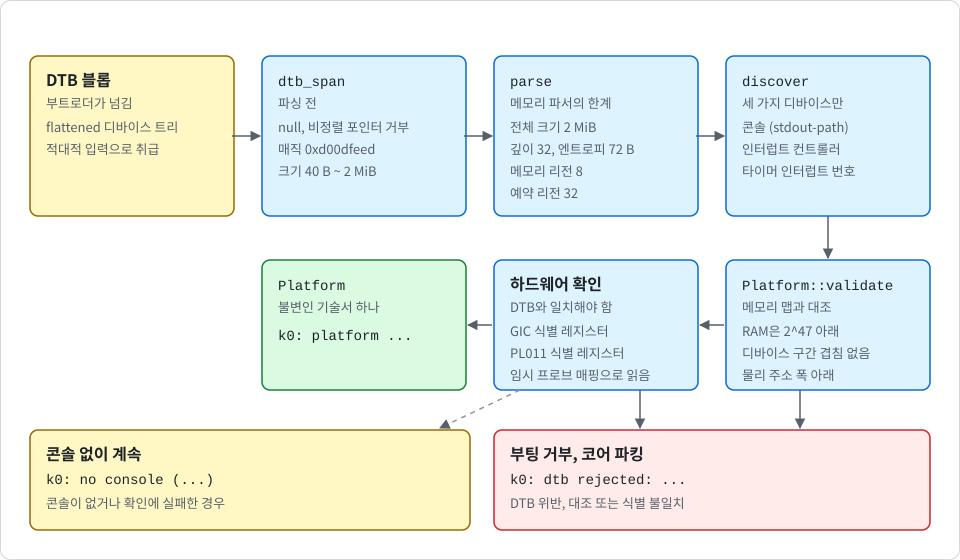

# 신뢰하지 않는 입력으로서의 디바이스 트리

[English](../en/dtb.md) | 한국어

부트로더는 K0에 머신을 설명하는 flattened 디바이스 트리(DTB)를 넘깁니다. DTB에는 RAM이 얼마나 어디에 있는지, 펌웨어가 어떤 구간을 예약했는지, 부팅 엔트로피 일부가 들어 있습니다. 이제는 콘솔, 인터럽트 컨트롤러, 타이머 인터럽트가 어디에 있는지도 들어 있습니다. K0는 이 블롭을 **적대적 입력**으로 취급합니다. 이 문서는 그 이유, 파서가 읽는 내용, 테스트 방법을 설명합니다.

다음 표는 각 구성 요소가 있는 파일입니다.

| 구성 요소 | 파일 |
| --- | --- |
| 메모리 파서 | `crates/k0-boot/src/fdt.rs` |
| 공용 구조 순회기 | `crates/k0-boot/src/fdt/walk.rs` |
| 디바이스 발견 | `crates/k0-boot/src/platform.rs` |

UEFI에서는 DTB가 펌웨어가 준 그대로가 아닙니다. UEFI 로더가 펌웨어 DTB와 UEFI 메모리 맵으로 DTB를 새로 작성하고, 점프 전에 이 파서들을 그 결과에 똑같이 돌립니다([uefi_KR.md](uefi_KR.md) 참고).

다음 그림은 DTB가 검증된 플랫폼이 되기까지의 흐름을 보여 줍니다.

  

## DTB를 신뢰하지 않는 이유

많은 플랫폼에서 DTB는 커널 이미지와 같은 곳에서 오지 않습니다. 서명된 커널 옆의 별도 파일일 수도 있고, 펌웨어가 적용한 오버레이일 수도 있으며, 부트로더가 점프 직전에 수정하는 블롭일 수도 있습니다. 따라서 정상적인 커널도 잘못되었거나 적대적인 DTB를 받을 수 있습니다. **K0는 그럴 수 있다고 가정합니다**.

UEFI에는 구체적인 사례가 있습니다. EDK2를 사용하는 QEMU에서 펌웨어의 DTB는 512 MiB 전체를 RAM이라고 선언하는데, 그 안에 펌웨어 런타임 영역이 들어 있습니다. 커널의 검사만으로는 이 DTB를 받아들입니다. 커널은 메모리를 같은 DTB 안의 디바이스와 비교하는데, 메모리 맵의 출처가 DTB뿐이기 때문입니다. 어느 범위가 비어 있는지 알려 주는 것은 UEFI 메모리 맵뿐이므로 커널은 더 잘 알 수 없습니다.

그래서 UEFI에서는 메모리 설명을 펌웨어 DTB에서 가져오지 않습니다. 로더가 UEFI 메모리 맵으로 계획한 것으로 바꿔 넣으며, 이 맵이 커널에는 없는 독립된 출처입니다. 디바이스, 예약, 엔트로피는 여전히 펌웨어 DTB에서 오고, 로더는 그 결과에 뒤에서 설명하는 파서, 발견, 검사를 돌립니다.

파서들은 하나의 원칙을 따릅니다.

> [!IMPORTANT]
> DTB의 값은 커널이 부팅을 거부하게 하거나 더 적은 자원을 갖게 할 수는 있지만, 하드웨어가 실제로 제공하는 것보다 더 많은 권한을 부여해서는 안 됩니다.

다음 항목은 이 원칙을 적용한 결과입니다.

- **예약 구간**: 메모리를 제거할 뿐입니다. 적대적인 예약이 할 수 있는 일은 사용자 공간에 넘기는 메모리를 줄이는 것이 최대입니다.
- **엔트로피**: 여러 입력 중 하나일 뿐입니다. `/chosen`의 바이트는 SHA-256을 통해 다른 소스와 섞이므로, 적대적인 엔트로피로 PAC 키를 약화할 수 없습니다. 시드가 없으면 키의 품질이 낮아지며, 커널은 부팅 로그에 이를 알립니다([hardening_KR.md](hardening_KR.md) 참고).
- **메모리 노드**: 메모리를 부여하므로 가장 엄격하게 검사합니다. 모든 메모리 리전은 사용자 공간이 매핑할 수 있는 untyped 메모리가 됩니다. RAM이라고 주장하지만 실제로는 디바이스를 덮는 리전은 EL0에 그 디바이스 직접 접근을 넘기게 됩니다. 파싱 후 커널은 모든 메모리 리전을 같은 DTB에서 찾은 디바이스 구간(뒤의 "플랫폼 기술서" 절 참고)과 비교하고, 겹치면 부팅을 중단합니다. RAM 리전이 2^47에 닿거나 디바이스 구간이 CPU의 물리 주소 폭(`k0_mm::pa_bits`)을 넘어서도 부팅을 중단합니다. 그런 구간은 매핑할 수 없기 때문입니다. CNode bootstrap도 서로 겹치는 메모리 리전을 거부하므로 어떤 프레임도 두 번 retype될 수 없습니다.
- **디바이스 주소**: DTB에서 오므로 가장 엄격하게 검사합니다. 잘못된 DTB는 콘솔을 다른 디바이스로 향하게 할 수 있습니다. 커널은 기술서가 메모리 맵 대조를 통과하기 전에는 디바이스 페이지를 매핑하지 않고, 하드웨어 식별 레지스터가 있는 곳에서는 이를 확인하며, 콘솔 대기에 시간 상한을 두고, 고정 빌드로 기대 플랫폼을 못 박을 수 있습니다("플랫폼 기술서" 참고).

## 두 단계

MMU가 켜진 상태에서 커널이 블롭을 읽으려면 먼저 매핑해야 하고, 전체 파싱에는 higher-half로 점프한 뒤에야 동작하는 재배치된 데이터가 필요합니다([boot_KR.md](boot_KR.md) 참고). 그래서 `kernel_init`은 DTB를 전혀 건드리지 않고, 모든 파싱은 `kernel_main`에서 일어납니다.

**파싱 전**(`dtb_span`): `kernel/src/main.rs`의 `map_dtb`가 먼저 null이거나 8바이트로 정렬되지 않은 포인터를 거부하고, 커널 별칭을 통해 헤더 하나만큼의 DTB를 읽기 전용으로 매핑합니다. `dtb_span`은 첫 8바이트만 읽습니다. 매직은 `0xd00dfeed`여야 합니다. 전체 크기는 40바이트(헤더 하나)에서 2 MiB 사이여야 합니다. 상한은 DTB 매핑이 소비할 수 있는 페이지 테이블 수를 제한합니다. 이어서 커널은 블롭 전체를 읽기 전용으로 매핑합니다.

**매핑 후**(`parse`와 `discover`): 둘 다 커널 별칭을 통해 읽지만 물리 주소를 보고합니다. `parse`는 별칭 주소에서 `dtb_span`을 다시 실행하고, 물리 구간이 커널 이미지와 겹치면 블롭을 거부합니다. 그다음 정확히 전체 크기만큼의 바이트 슬라이스를 만들어 `parse_blob`에 넘깁니다. 이 시점부터 **모든 접근은 safe Rust의 경계 검사된 슬라이스 접근**이고, 모든 오프셋 계산은 checked 산술을 사용합니다. 잘못된 블롭은 파서가 에러를 반환하게 만들 수는 있지만, 슬라이스 밖을 읽게 만들 수는 없습니다. `discover`도 같은 블롭을 같은 방식으로 읽습니다("플랫폼 기술서" 참고).

## 메모리 파서가 읽는 내용

헤더는 버전 17 이상을 알려야 하고 버전 17과 하위 호환이어야 합니다. 구조 블록은 4바이트 경계에서 시작해야 하며 크기가 4의 배수여야 합니다. 구조 블록과 문자열 블록은 모두 블롭 안에서 끝나야 합니다. 순회기는 커널이 해석하는 프로퍼티가 한 노드에 두 번 나오는 것도 거부합니다.

`parse`는 정확히 다음 항목만 읽고 그 외는 건너뜁니다. 다음 표는 소스별로 읽는 항목을 정리한 것입니다.

| 소스 | 항목 |
| --- | --- |
| memory reservation block | 종결 `(0, 0)` 쌍까지의 `(address, size)` 쌍. 크기가 0인 쌍은 건너뜁니다. 블록은 8바이트로 정렬되어야 합니다. |
| 루트 노드 | `#address-cells`와 `#size-cells`. 기본값은 2와 1입니다. 1과 2만 지원합니다. |
| 최상위 `memory` 또는 `memory@...` 노드 | `reg`. 루트의 셀 크기로 디코딩합니다. 노드에 `device_type = "memory"`가 있고 `status`가 사용 가능이어야 합니다. `linux,usable-memory` 프로퍼티가 있으면 커널은 부팅을 거부합니다. |
| `/reserved-memory`의 자식 노드 | `reg`. `/reserved-memory` 자체의 셀 크기로 디코딩합니다. `/reserved-memory`에 비어 있지 않은 `ranges`가 있으면 거부합니다. |
| `/chosen` | `rng-seed`와 `kaslr-seed`. 이어 붙여 72바이트로 제한합니다. `linux,initrd-start`와 `linux,initrd-end`가 둘 다 있으면 그 구간을 예약 구간에 더합니다(커널은 initrd를 사용하지 않습니다). `linux,usable-memory-range` 프로퍼티가 있으면 커널은 부팅을 거부합니다. |

다른 깊이에 있는 같은 이름의 노드는 무시합니다. `/soc` 안의 `memory`라는 노드는 RAM이 아닙니다. 크기만 주고 `reg`가 없는 reserved-memory 자식 노드는 펌웨어가 주소에 고정하지 않은 동적 할당이므로 역시 무시합니다.

고정된 제한이 파서 자체의 상태를 작고 정적으로 유지합니다. 다음 표는 그 제한을 정리한 것입니다.

| 제한 | 값 |
| --- | --- |
| 전체 크기 | 2 MiB |
| 중첩 깊이 | 32 |
| 메모리 리전 | 8 |
| 예약 리전, 모든 소스 합산 | 32 |
| 엔트로피 바이트 | 72 |

## 무엇이 에러인가

모든 위반은 `BootError`를 반환하고, 커널은 `k0: dtb rejected: ...`를 출력한 뒤 파킹합니다. 에러에는 다음이 포함됩니다.

- 잘못된 매직, 정렬, 크기, 버전, 헤더 오프셋
- 알 수 없는 토큰, 깊이 0에서의 end-node 토큰, 노드 밖의 프로퍼티, 이름이 있는 루트 노드, 종결 0 바이트가 없는 노드 이름, end 토큰 전에 끝나는 구조 블록
- 문자열 블록 밖을 가리키는 프로퍼티 이름 오프셋, 종결 0 바이트가 없는 이름
- 구조 블록을 넘어가는 프로퍼티 값
- 지원하지 않는 셀 크기, 또는 정확히 4바이트가 아닌 셀 크기 프로퍼티
- 비어 있거나 엔트리의 정수 배가 아닌 `reg` 값
- 베이스에 크기를 더하면 64비트를 넘는 모든 리전
- 제한보다 많은 리전
- 메모리가 전혀 없는 경우
- 메모리를 제한하는 프로퍼티(`linux,usable-memory`, `linux,usable-memory-range`), `/reserved-memory`의 비어 있지 않은 `ranges`, 한쪽만 있거나 뒤집힌 initrd 구간, 커널이 읽는 프로퍼티의 중복

## 플랫폼 기술서

메모리 외에 커널이 DTB에서 찾는 디바이스는 정확히 세 가지이며 그 밖에는 없습니다(`crates/k0-boot/src/platform.rs`의 `discover`).

- **콘솔**: `/chosen/stdout-path`가 가리키는 노드뿐입니다(절대 경로, 또는 절대 경로로 풀리는 별칭). 노드는 사용 가능해야 하고, `compatible`이 PL011(`arm,pl011`), SBSA UART(`arm,sbsa-uart`), 16550 계열(`ns16550a`, `ns16550`, `snps,dw-apb-uart`, `brcm,bcm2835-aux-uart`) 중 하나여야 합니다. 그 밖의 UART, 없거나 풀리지 않는 `stdout-path`, CPU 물리 주소로 변환할 수 없는 노드는 콘솔 없이 부팅합니다. 에러가 아닙니다. 커널은 이유와 함께 `k0: no console (...)`을 출력하고, 부트 로그 버퍼가 유일한 기록이 됩니다([boot_KR.md](boot_KR.md) 참고). 이 발견과 검증은 모든 이미지가 수행하며, 콘솔 드라이버 없이 빌드한 이미지도 마찬가지입니다. 그런 이미지는 아무것도 매핑하지 않고 `k0: no console (driver not built in)`을 출력하며, 콘솔이 검사를 통과하지 못하는 디바이스 트리는 다른 경우와 똑같이 거부합니다. 드라이버가 건드리는 레지스터 범위는 선언된 `reg` 안, 그리고 한 그래뉼 안에 있어야 합니다.
- **인터럽트 컨트롤러**: 타이머 노드(`arm,armv8-timer` 또는 `arm,armv7-timer`, 사용 가능한 노드는 정확히 하나)의 인터럽트 부모가 가리키는 노드입니다. 기대하는 셀 수와 프레임 정렬을 갖춘 GICv3(`arm,gic-v3`) 또는 GICv2(`arm,gic-400`, `arm,cortex-a15-gic`, `arm,cortex-a7-gic`)여야 합니다. GICv3 리디스트리뷰터 구간은 최대 4개까지 받습니다. 중복된 phandle, 비활성 노드, `interrupt-map`, CPU별 뱅크가 없는 GICv2(`cpu-offset`)는 거부합니다.
- **EL1 가상 타이머의 인터럽트 번호**: 타이머 노드의 `interrupts`에서 가져오며(`interrupt-names`가 있으면 `virt` 항목, 없으면 세 번째 항목) PPI 번호에 16을 더한 값입니다. 타이머 정오표를 선언한 타이머 노드(`fsl,erratum-a008585`, `hisilicon,erratum-161010101`, `allwinner,erratum-unknown1`)는 우회 코드가 없으므로 거부합니다.

> [!IMPORTANT]
> 커널은 "첫 번째 UART"를 추측하지 않습니다. 콘솔은 `/chosen/stdout-path`가 가리키는 노드뿐입니다.

레지스터 주소는 부모 버스의 `ranges`를 따라 CPU 물리 주소로 변환합니다. `ranges`가 없는 버스는 변환할 수 없습니다.

결과는 불변인 `Platform` 값 하나입니다. 커널은 이를 정해진 형식의 한 줄 `k0: platform con=... gic=... tmr=...`로 출력합니다. 디바이스 페이지를 매핑하기 전에 `Platform::validate`가 기술서를 메모리 맵과 대조합니다. 대조 항목은 다음과 같습니다.

- RAM은 2^47 아래여야 합니다.
- 커널 이미지와 DTB는 선언된 메모리 안에 있어야 합니다.
- 그래뉼 단위로 넓힌 디바이스 구간은 메모리나 예약 구간과 겹치면 안 됩니다.
- 디바이스 구간끼리도 겹치면 안 됩니다.
- 모든 디바이스는 CPU의 물리 주소 폭 아래에 있어야 합니다.
- 콘솔 레지스터가 그래뉼 경계를 넘으면 안 됩니다.

그다음 하드웨어가 DTB와 일치해야 합니다. 확인은 다음과 같이 이루어집니다.

- **GIC**: GIC 드라이버가 GIC 식별 레지스터를 확인합니다.
- **PL011**: DTB가 `arm,pl011`이라고 하고 4 KiB 레지스터 프레임 전체를 선언했을 때, 첫 쓰기 전에 PL011 식별 레지스터를 확인합니다. 이 확인은 영구 매핑을 만들기 전에 임시 프로브 매핑으로 읽으므로, 확인에 실패한 디바이스는 매핑된 채로 남지 않습니다.
- **확인하지 않는 콘솔**: 더 짧게 선언된 구간, SBSA UART, 16550은 확인하지 않습니다. 앞의 둘은 그 레지스터가 있다는 보장이 없고 16550에는 아예 없기 때문입니다. 16550 드라이버는 어떤 머신에서도 실행해 본 적이 없습니다.
- **PL011 드라이버가 없는 이미지**: 디바이스를 건드리지 않으므로 이 확인을 아예 하지 않습니다.

불일치하면 커널은 부팅을 거부하며, 콘솔의 경우에는 콘솔 없이 계속합니다.

### 고정 모드

플랫폼 줄, 진입 예외 레벨, RAM 범위는 `<플랫폼 줄> el=<n> ram=<lo>-<hi>` 문자열이 됩니다. 빌드할 때 `K0_PIN`에 타겟의 부트 로그에서 `k0: platform ` 뒤의 문자열을 설정했다면, 이 문자열이 다를 때 이미지가 부팅을 거부합니다. 잘못된 보드나 바뀐 DTB를 잡아냅니다. 비교하는 값이 DTB에서 나온 값이므로, **적대적인 부트 체인에 대한 방어는 아닙니다**.

## 테스트 방법

파서는 바이트 슬라이스에 대한 순수 로직이므로 호스트에서 테스트합니다. 테스트는 다음과 같이 구성됩니다.

- **단위 테스트**(`crates/k0-boot/src/fdt/tests.rs`, 디바이스 발견은 `crates/k0-boot/src/platform/tests.rs`): 위의 각 규칙을 다룹니다. 원시 포인터를 통해 제자리에서 실행하는 헤더 검사, 커널 이미지와의 겹침 검사, 별칭을 통해 읽는 경로를 포함합니다.
- **모델**: 테스트 전용 빌더(`fdt/builder.rs`)가 보드의 간단한 설명으로 DTB를 작성하고 파서가 반환해야 할 값을 계산합니다. 많은 단위 테스트가 손으로 작성한 값이 아니라 이 모델과 메모리 파서의 출력을 비교합니다.
- **결정적 변이 퍼저**(`fdt/fuzz.rs`): 각 케이스는 무작위 보드를 생성하고, 무작위의 무관한 노드, 프로퍼티, `NOP` 토큰으로 감싼 뒤, 파싱 결과를 모델과 대조합니다. 그다음 비트 플립, 헤더 필드 재작성, 잘라내기, 이어 붙이기, 토큰 삽입 같은 변이를 최대 네 번 적용하고, 결과를 두 번 파싱합니다. 한 번은 슬라이스로, 한 번은 0으로 채운 2 MiB 버퍼가 받치는 원시 포인터 진입점을 통해서입니다. 패닉이 발생하면 테스트가 실패합니다. 수락된 결과는 위 표의 모든 제한을 지켜야 합니다. 이 퍼저는 추가 크레이트가 필요 없고 완전히 오프라인으로 실행되지만, 커버리지 피드백은 없습니다.
- **발견을 위한 두 번째 변이 퍼저**(`platform/tests.rs`의 `fuzz_discover_with_mutated_trees`): 트리 네 개(GICv3와 GICv2의 QEMU virt, Raspberry Pi 4와 RK3399 보드 모양의 트리)에서 시작해 같은 변이를 적용하고 그 결과에 `discover`를 실행합니다. 패닉이 발생하면 테스트가 실패합니다. 수락된 기술서는 불변식을 지켜야 합니다. 빈 구간이나 넘치는 구간이 없어야 하고, 타이머 인터럽트 번호는 16에서 31 사이여야 하고, 콘솔 레지스터는 선언된 구간 안에 있어야 하고, 플랫폼 줄이 형식화되어야 합니다.

기본 테스트 실행은 위의 두 퍼저마다 20,000개의 케이스를 실행합니다. CI는 매주 퍼저마다 500만 개의 케이스를 실행하며 기준 시드는 실행 번호에서 가져옵니다. 기준 시드는 사용하기 전에 해시하므로, 기준 시드가 다르면 케이스 열이 서로 무관합니다. 2026-11-11에 워커를 다시 작성하고 발견을 추가한 뒤, 기준 시드 여덟 개로 각 500만 케이스씩 여덟 번의 캠페인을 돌렸고 두 퍼저 모두 실패가 없었습니다. **지금까지 파서 실패를 찾은 캠페인은 없습니다**. 캠페인이 보고한 실패 하나는 테스트 모델 자체에 있었고, 모델은 `(0, 0)` 쌍이 memory reservation block을 끝낸다는 사실을 알지 못했습니다. 파서가 더 엄격해질 때 생성기도 함께 고쳐서, 이제 파서가 거부하는 트리는 생성기가 만들지 않습니다.

로더 자체의 로직(`crates/k0-efi`)에는 같은 종류의 퍼저가 셋 더 있습니다. `fuzz_plan_with_random_maps`, `fuzz_rewrite_with_mutated_trees`, `fuzz_prepare_end_to_end`입니다([uefi_KR.md](uefi_KR.md) 참고). 마지막 것은 펌웨어 DTB와 메모리 맵을 만들어 로더의 준비 전체를 돌리고, 결과를 커널의 파서와 발견으로 검사합니다. 같은 `K0_FUZZ_ITERS`, `K0_FUZZ_SEED`, `K0_FUZZ_CASE`를 사용합니다. 기본값은 각각 20,000, 20,000, 5,000개이고 CI의 주간 실행은 각각 500만 개이며, 2026-11-12에 각각 500만 케이스의 캠페인이 통과했습니다.

## 알려진 공백

> [!NOTE]
> 발견은 QEMU virt, `xlnx-versal-virt`, 호스트 테스트에서만 실행해 보았습니다. 실제 보드의 DTB로 실행한 적은 없습니다.

- UEFI에서는 메모리 맵이 더 이상 DTB 자신의 주장이 아닙니다. 로더가 UEFI 메모리 맵으로 계획하고 펌웨어 자신의 메모리 노드는 버립니다. 다음 공백 중 DTB 자신의 메모리 맵을 말하는 것은 로더가 없는 경우를 설명합니다. UEFI 메모리 맵을 주는 펌웨어는 잘못될 수는 있어도 적대적이지는 않다고 가정합니다([uefi_KR.md](uefi_KR.md) 참고).
- 메모리 파서 자체는 CPU의 물리 주소 폭을 모릅니다. 그에 대한 검사는 `Platform::validate`에 있고 한계값은 `kernel/src/main.rs`에서 넘겨줍니다. 이전 메모리 맵 발견 사항의 상태는 [SECURITY_KR.md](../../SECURITY_KR.md)의 어드바이저리 GHSA-hj3f-38h9-hrpj를 참고하세요. 공격자가 제어하는 DTB는 여전히 부팅을 멈출 수 있으며, 이것이 의도한 fail-secure 결과입니다.
- DTB 포인터는 무엇으로도 검증할 수 없는 시점에 쓰입니다. `kernel/src/main.rs`의 `map_dtb`는 널이거나 정렬이 맞지 않는 포인터, 2^47 이상인 주소, 커널 이미지와 겹치는 구간만 거부합니다. 메모리 맵이 바로 그 블롭에서 나오기 때문입니다. 부트로더가 디바이스의 주소를 넘기면 커널은 그 페이지를 읽기 전용 일반 메모리로 매핑하고 처음 8바이트를 읽습니다. 디바이스 레지스터는 읽기만 해도 부작용이 있을 수 있고, 매핑이 캐시 가능하므로 프로세서가 그 8바이트보다 페이지를 더 많이 가져올 수 있습니다. 커널은 그 바이트에 DTB 매직과 올바른 크기가 있을 때만 더 읽으며, 이 매핑으로 쓰기는 하지 않습니다. 나중에 `Platform::validate`가 DTB가 선언된 메모리 안에 있는지 검사하지만, 그 메모리 맵은 DTB 자신의 주장입니다. 고정 빌드라면 처음 읽기 전에 고정된 RAM 범위 밖의 포인터를 거부할 수 있습니다. 이 검사는 아직 없습니다.
- 겹침 검사는 커널이 스스로 찾은 디바이스만 압니다. 다른 디바이스 구간을 RAM으로 기술하는 DTB는 잡아내지 못합니다. 커널에 독립적인 디바이스 목록이 없기 때문입니다.
- 잘못된 DTB가 검사를 통과하는 다른 디바이스로 콘솔을 향하게 할 수 있습니다. 16550 계열과 SBSA UART는 식별 확인이 없어 하드웨어가 그것들인지 확인하는 것이 없습니다. 콘솔 드라이버 없이 빌드한 이미지는 그 디바이스에 쓰지 않지만 정체를 읽지도 않습니다. 고정 모드는 이를 좁히지만 DTB에서 나온 값을 비교합니다.
- 격리는 기밀성과 무결성을 다루며 가용성은 다루지 않습니다. 적대적인 DTB는 언제나 부팅을 멈출 수 있습니다.
