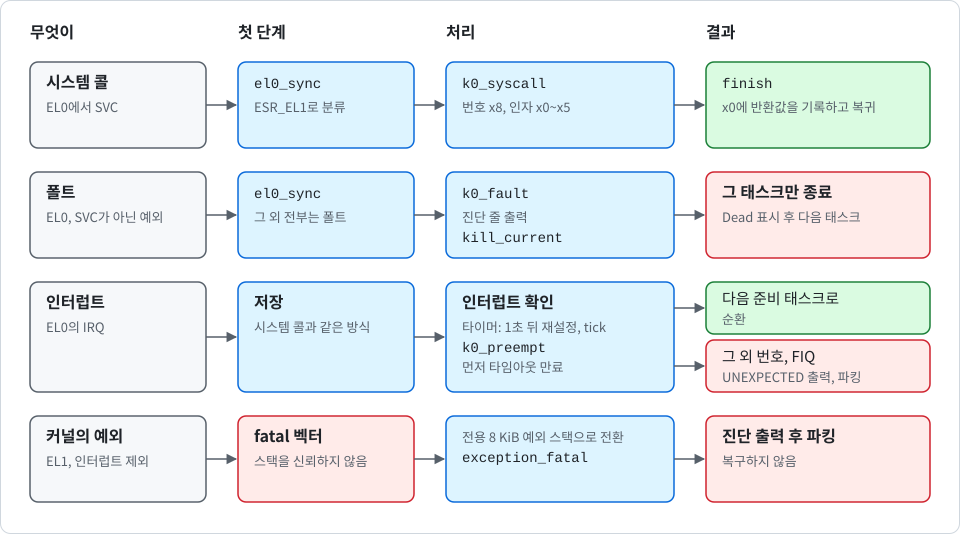

# 예외, 시스템 콜, 폴트 격리

<div align="center">

[English](../en/exceptions.md) | 한국어

</div>

이양 이후 **커널 코드는 예외에 응답할 때만 실행됩니다**. 이 문서는 벡터 테이블, 사용자 상태를 저장하고 복원하는 방법, 시스템 콜을 디스패치하는 방법, 폴트를 일으킨 태스크를 격리하는 방법을 설명합니다. 코드는 `crates/k0-arch/src/vectors.S`, `vectors.rs`, `usermode.rs`, `irq.rs`, 그리고 `kernel/src/syscall.rs`의 `k0_syscall`, `k0_fault`, `k0_preempt`, `finish`에 있습니다. 이 문서는 현재 `main` 브랜치(미배포)를 기준으로 합니다.

다음 그림은 예외 종류별로 커널이 어떤 경로를 따르는지 보여 줍니다.

<p align="center">
  
</p>

## 메커니즘과 정책

`k0-arch`는 **메커니즘**을 담당합니다. 레지스터 저장, 예외 디코딩, 인터럽트 확인이 여기에 해당합니다. 결정은 **커널 바이너리**에 있습니다. `k0-arch`는 외부 함수 `k0_syscall`, `k0_fault`, `k0_preempt` 세 개를 선언하고, 커널 바이너리가 이를 정의합니다. 따라서 태스크에 영향을 주는 모든 정책은 `kernel/src/syscall.rs` 한 파일에 있습니다. 케이퍼빌리티가 제거된 뒤의 오브젝트 종료 처리(`Reaper` 콜백)는 `kernel/src/object.rs`에 있습니다.

## 벡터 테이블

AArch64는 벡터 엔트리를 16개 가집니다. 4가지 발생 위치마다 예외 종류(동기, IRQ, FIQ, SError)가 4개씩입니다. K0는 각 엔트리에 네 가지 동작 중 하나를 부여합니다. 커널은 IRQ만 받고 FIQ는 받지 않으므로 FIQ는 일어나서는 안 되는 상태입니다. FIQ 엔트리는 디스패처를 호출해 `k0: UNEXPECTED fiq intid=0`을 출력하고 파킹합니다. 다음 표는 엔트리별 동작입니다.

| 발생 위치 | 동기 | IRQ | FIQ | SError |
| --- | --- | --- | --- | --- |
| `SP_EL0`을 사용하는 EL1 | fatal | fatal | fatal | fatal |
| `SP_EL1`을 사용하는 EL1 | fatal | 처리 후 복귀 | 예상 밖, 파킹 | fatal |
| EL0, AArch64 | 저장, 처리 후 복귀 | 저장, 처리 후 복귀 | 저장, 예상 밖, 파킹 | fatal |
| EL0, AArch32 | fatal | fatal | fatal | fatal |

커널은 항상 `SP_EL1`에서만 실행되므로 `SP_EL0` 행은 발생하지 않아야 합니다. K0는 32비트 코드를 실행하지 않습니다. SError는 하드웨어가 비동기 오류를 보고했다는 뜻입니다. 커널은 이를 복구하려고 하지 않습니다.

### 치명적 경로

fatal 엔트리는 **스택 포인터를 신뢰하지 않습니다**. 폴트가 스택 오버플로일 수 있기 때문입니다. 전용 8 KiB 예외 스택으로 전환한 뒤 `exception_fatal`을 호출합니다. 이 함수는 벡터 종류, 예외 클래스를 디코딩한 `ESR_EL1`, `ELR_EL1`, `FAR_EL1`, `SPSR_EL1`을 출력하고 코어를 파킹합니다. 출력은 raw 문자열과 16진수 출력만 사용하므로 higher-half로 점프하기 전의 폴트에서도 동작합니다.

### 불변식 위반: `k0_arch::fatal`

위의 fatal 벡터 경로는 CPU가 일으킨 예외를 위한 것입니다. `k0_arch::fatal`은 커널 자신의 검사를 위한 것입니다. 커널 전용 데이터가 있을 수 없는 상태일 때(디코딩되지 않는 케이퍼빌리티 슬롯, 끊어진 파생 리스트 링크, 손상된 사용자 페이지 테이블, 손상된 준비 큐·엔드포인트 큐·응답 링크) 계속 실행하면 손상된 상태를 근거로 접근을 판단하게 됩니다.

`fatal`은 모든 예외를 마스크하고 `k0: FATAL <원인>`을 출력한 뒤 `wfe` 루프로 코어를 파킹합니다. 일반 커널 코드의 유효한 스택에서 호출되므로 스택을 바꾸지 않고 레지스터도 출력하지 않습니다. 부트 테스트는 `k0: FATAL`이 나오면 실패합니다.

### 커널 안에서 발생한 인터럽트

EL1에서 받은 IRQ는 caller-saved 레지스터를 커널 스택에 저장하고, 핸들러를 호출한 뒤 복귀합니다. 커널은 예외를 처리하는 동안 인터럽트를 마스크한 채로 둡니다. 예외는 `idle_until_ready`의 대기([종료 경로](#종료-경로) 참고) 하나뿐입니다. 커널 자체는 선점되지 않습니다.

대기 중에는 `k0_arch::irq::wait_for_interrupt`가 대기 중인 인터럽트 하나를 위해 I 비트만 엽니다(IRQ를 마스크한 채 `wfi`를 실행하고, 이어서 짧게 마스크를 해제함). 이것이 안전한 이유는 세 가지입니다. 첫째, ELR_EL1과 SPSR_EL1을 포함한 EL0 컨텍스트 전체가 이미 TCB에 저장되어 있으므로, 중첩된 EL1 IRQ가 두 레지스터를 덮어써도 잃는 것이 없습니다. 둘째, 핸들러는 커널 스택에서 실행되며, 예외 진입이 스택 최상단에서 시작하므로 여유가 충분합니다. 셋째, 인터럽트를 받은 직후 마스크를 다시 설정하므로 다른 커널 코드는 인터럽트가 열린 채 실행되지 않습니다.

### EL2의 벡터

커널이 EL2에서 진입하면 부트 코드가 EL2 상태를 직접 설정하고, EL1로 한 번 내려간 뒤 EL2로 돌아가지 않습니다. 내려가기 전에 EL2 벡터 테이블을 설치합니다. 어떤 이유로든 EL2에 들어오면 원인을 기록하고 코어를 파킹합니다. 내려간 뒤 EL2로의 트랩은 설계에 없는 일이므로 **기계 전체가 파킹되는 것이 설계된 동작**입니다. 커널은 이를 처리하거나 복구하려 하지 않습니다. 커널이 EL1에서 곧바로 진입하면 EL2 코드는 없습니다.

## 사용자 상태 저장과 복원

예외가 EL0에서 도착하면 진입 스텁은 `x0`과 `x1`을 커널 스택에 저장하고, 핸들러의 주소와 함께 `__lower_common`으로 점프합니다. `__lower_common`은 전역 포인터 `__current_context`를 로드합니다. 이 포인터는 항상 현재 태스크의 TCB 안에 있는 저장 컨텍스트를 가리키며, 사용자 상태 전체가 여기에 저장됩니다. 저장 컨텍스트의 배치는 다음 표와 같습니다.

| 오프셋 | 내용 |
| --- | --- |
| 0부터 240 | `x0`부터 `x30` |
| 248 | `SP_EL0`, 사용자 스택 포인터 |
| 256 | `ELR_EL1`, 사용자 프로그램 카운터 |
| 264 | `SPSR_EL1`, 사용자 프로세서 상태 |
| 272 | `TPIDR_EL0` |
| 280 | `TPIDRRO_EL0` |

스레드 포인터 레지스터도 함께 저장하므로, 한 태스크의 스레드 포인터가 다른 태스크에 나타나는 일은 없습니다. Rust `Context` 구조체는 이 오프셋과 정확히 일치해야 합니다. `usermode.rs`의 컴파일 타임 assertion이 모든 필드 오프셋과 전체 크기 288바이트를 검사하므로, 불일치하면 빌드가 실패합니다.

핸들러는 이 컨텍스트에 대한 가변 참조를 받으며 컨텍스트를 바꿀 수 있습니다. 반환값을 기록하거나, 프로그램 카운터를 진행시키거나, `__current_context`가 다른 태스크를 가리키게 할 수 있습니다. 핸들러가 반환하면 실행은 `__user_restore`로 이어집니다. 여기서 `__current_context`를 다시 로드해 그 포인터가 가리키는 컨텍스트로 사용자 상태를 복원합니다. 그래서 **태스크 전환은 포인터 변경일 뿐**입니다([scheduling_KR.md](scheduling_KR.md) 참고).

이양 때 EL0로 처음 진입하는 경로도 같은 복원 경로를 사용합니다. 이 진입 함수 `enter_user`는 `ELR_EL1`과 `SPSR_EL1`을 로드하기 전에 DAIF를 전부 마스크합니다. 부트 시점에는 타이머가 이미 동작 중이라, 이 레지스터들을 기록한 뒤 `eret` 전에 인터럽트가 들어오면 두 레지스터가 EL1 값으로 덮입니다. 예외 진입을 거치는 평소 경로에서는 마스크가 이미 걸려 있습니다.

FP/SIMD 레지스터는 컨텍스트에 포함되지 않습니다. EL0의 모든 FP/SIMD 명령이 트랩되므로 포함할 필요가 없습니다([hardening_KR.md](hardening_KR.md) 참고).

## EL0의 동기 예외

`el0_sync`는 `ESR_EL1`을 읽고 예외 클래스에 따라 다음과 같이 처리합니다.

- **시스템 콜**: AArch64의 `SVC`는 `k0_syscall`로 이어집니다. CPU가 이미 반환 주소를 `svc` 다음 명령으로 설정해 두었습니다.
- **건너뛰는 명령**: 트랩된 `WFI` 또는 `WFE`는 건너뜁니다. 반환 주소를 그 명령 뒤로 옮기고 태스크는 계속 실행됩니다.
- **폴트**: 그 외 전부는 폴트입니다. abort, 정의되지 않은 명령, 트랩된 시스템 레지스터 접근, FP/SIMD 사용, 정렬 폴트, `brk` 등이 여기에 속합니다. 이들은 `FAR_EL1`과 함께 `k0_fault`로 이어집니다.

## 시스템 콜

시스템 콜 번호는 `x8`에 있습니다. 인자는 `x0`부터 `x5`까지이고, 결과는 `x0`으로 돌아옵니다. IPC 수신 호출은 `x1`부터 `x5`로도 데이터를 반환합니다. 오류는 음수 값입니다(`k0_abi::err` 참고). 슬롯 인자는 모두 호출한 태스크 자신의 CNode 안의 슬롯 번호입니다. 다른 태스크의 CNode에서는 아무 의미가 없습니다([capabilities_KR.md](capabilities_KR.md) 참고). 번호와 인자의 기준은 `crates/k0-abi/src/lib.rs`입니다. 시스템 콜은 다음 표와 같습니다.

| 번호 | 호출 | 설명 |
| --- | --- | --- |
| 0 | `DEBUG_PUTC` | 필터를 거친 바이트 하나를 부트 로그에 기록하고, 콘솔 드라이버를 포함해 빌드한 이미지에서는 콘솔에도 출력. 쓰기 권리가 있는 `Console` 케이퍼빌리티가 필요 |
| 1 | `YIELD` | 준비 큐의 맨 뒤로 이동 |
| 2 | `EXIT` | 호출한 태스크 종료 |
| 3 | `RETYPE` | untyped 메모리에서 커널 오브젝트를 만들어 호출자가 지정한 목적지 슬롯에 추가함 |
| 4 | `MAP` | `AddrSpace` 케이퍼빌리티가 가리키는 주소 공간에 프레임 매핑 또는 페이지 테이블 설치 |
| 5 | `TCB_CONFIGURE` | 새 태스크의 진입점, 스택, 주소 공간, 케이퍼빌리티 공간, `x0` 인자 설정 |
| 6 | `TCB_RESUME` | 구성을 마친 태스크 시작 |
| 7 | `SEND` | 메시지 송신 |
| 8 | `RECV` | 메시지 수신 |
| 9 | `CALL` | 송신 후 응답 대기 |
| 10 | `REPLY_RECV` | 응답한 뒤 다음 메시지 수신 |
| 11 | `UNMAP` | 프레임의 매핑을 제거하거나 페이지 테이블을 떼어 내고 0으로 지움 |
| 12 | `CAP_COPY` | 케이퍼빌리티를 다른 슬롯으로 복사. 권한을 줄이거나 배지를 붙일 수 있음 |
| 13 | `CAP_MOVE` | 케이퍼빌리티를 다른 슬롯으로 이동 |
| 14 | `CAP_DELETE` | 케이퍼빌리티와 거기서 파생된 모든 것을 삭제 |
| 15 | `CAP_REVOKE` | 케이퍼빌리티에서 파생된 모든 것을 삭제하고 케이퍼빌리티 자신은 남김 |
| 16 | `CONSOLE_READ` | 콘솔 입력 바이트 하나를 읽음(`console-input`으로 빌드한 이미지에만 있음, 아래 참고). 읽기 권리가 있는 `Console` 케이퍼빌리티가 필요 |

> [!IMPORTANT]
> 알 수 없는 번호는 단순한 오류 코드로 끝나지 않습니다. K0는 이를 태스크가 손상되었거나 악의적이라는 신호로 보고, `k0: unknown syscall N, killing task`를 출력한 뒤 호출자를 종료합니다.

부트 테스트는 이런 줄이 정확히 하나만 나오기를 요구합니다.

## 폴트 격리

EL0의 폴트는 시스템이 아니라 **폴트를 일으킨 태스크의 문제**입니다. `k0_fault`는 다음과 같은 진단 라인 하나를 출력합니다.

```
k0: task fault dabort-lower (esr 0x92000046 elr 0x400398 far 0x0), killing task
```

그런 다음 `kill_current`를 호출합니다. 이 함수는 [scheduling_KR.md](scheduling_KR.md#정리)에서 설명하는 정리를 실행합니다. 태스크를 속해 있던 큐에서 제거하고, 응답 링크를 양쪽 모두 끊고, 태스크를 `Dead`로 표시합니다. 응답 링크를 끊으므로 이 태스크의 응답을 기다리던 태스크는 `NO_REPLY`와 함께 깨어납니다([ipc_KR.md](ipc_KR.md) 참고). `EXIT`와 알 수 없는 시스템 콜도 같은 경로를 사용합니다.

### 종료 경로

모든 시스템 콜과 모든 폴트는 `finish`로 끝납니다. `finish`는 핸들러가 끝나고 케이퍼빌리티 정리가 전부 끝난 뒤에 실행됩니다. 핸들러는 폴트 없이도 호출한 태스크를 죽일 수 있습니다. `EXIT`, 자신의 CNode·주소 공간·TCB 삭제, 자신이 잘려 나온 untyped의 회수가 그렇습니다. 그래서 `finish`는 다른 모든 일이 끝난 뒤에야 컨텍스트를 어떻게 할지 정합니다.

1. **현재 태스크가 Dead인 경우**: 그 컨텍스트에 반환값을 기록하지 않습니다. 컨텍스트를 0으로 지우므로 죽은 태스크의 레지스터는 하나도 남지 않고, 커널은 다음 준비 태스크로 전환합니다. 준비된 태스크가 없으면 `idle_until_ready`를 호출합니다(아래 참고).
2. **그 밖의 경우**: 반환값을 `x0`에 기록합니다. 블록하는 IPC 호출은 상대가 동작할 때 나중에 결과를 기록합니다.

정리가 전환보다 먼저인 이유는, revoke가 태스크가 사용하던 주소 공간이나 CNode 자체를 파괴할 수 있기 때문입니다. 다음 태스크가 끝나지 않은 정리 위에서 실행되어서는 안 됩니다.

준비된 태스크가 없으면(마지막 실행 가능 태스크가 죽었거나 모든 태스크가 블록된 경우) `idle_until_ready`가 **커널을 멈추지 않고 대기 상태로 둡니다**. 루프에서 `k0_arch::irq::wait_for_interrupt`로 다음 인터럽트를 기다리고, `k0_ipc::expire_timeouts`를 호출해 기한이 지난 IPC 대기자를 모두 깨우고, 준비된 태스크가 있으면 그쪽으로 전환합니다. 커널이 대기하는 동안에도 타이머 tick은 계속 세어지고 처리됩니다. 중첩된 EL1 IRQ는 [커널 안에서 발생한 인터럽트](#커널-안에서-발생한-인터럽트)에서 설명합니다. 이 함수는 다음 두 줄을 부팅당 최대 한 번씩 출력합니다.

| 줄 | 시점 |
| --- | --- |
| `k0: idle (waiting for a timeout)` | 기한을 가진 대기자가 하나 이상 있는 채로 커널이 처음 대기할 때 |
| `k0: all tasks stopped (none ready, no timeout pending)` | 기한을 가진 대기자가 없는 채로 커널이 처음 대기할 때 |

두 번째 상태에서는 지금으로서는 태스크를 깨울 수단이 없습니다. 알림 오브젝트도, 콘솔 입력을 제외하면 태스크용 장치 인터럽트도 없기 때문입니다. 기계는 대기 상태로 남습니다. `console-input` 이미지에서는 콘솔 입력을 기다리는 태스크도 대기자로 셉니다. 기다릴 것이 콘솔 입력뿐이면 커널은 아무것도 출력하지 않으며, 이것이 터미널 이미지의 정상 상태입니다. 두 번째 줄은 기한이 있는 대기자도 콘솔 대기자도 없을 때만 출력됩니다. `tools/qemu-boot-test.sh`는 `k0: all tasks`로 시작하는 줄이 나오면 실패로 판정합니다.

## EL0의 타이머 인터럽트

커널이 항상 켜는 인터럽트는 **EL1 가상 타이머**입니다. `console-input`으로 빌드한 이미지는 콘솔 UART의 수신 인터럽트를 하나 더 받습니다(아래 참고). 인터럽트 번호는 DTB에서 가져오며, 커널은 물리 타이머를 사용하지 않습니다. 인터럽트 컨트롤러는 DTB가 타이머의 인터럽트 부모로 가리키는 GICv2 또는 GICv3입니다. 드라이버는 레지스터에 기록하기 전에 식별 레지스터를 그 기술과 대조하고, 다르면 부팅을 거부합니다. [dtb_KR.md](dtb_KR.md)를 참고하세요.

EL0에서 받은 IRQ는 시스템 콜과 같은 방식으로 저장됩니다. 핸들러는 인터럽트를 확인합니다. 타이머였다면 타이머를 1초 뒤로 다시 설정하고 `k0: tick N`을 출력합니다. 콘솔 드라이버를 포함해 빌드한 이미지에서는 콘솔에 출력하며, 로그에는 처음 4개의 tick 줄만 남깁니다. 그다음 `k0_preempt`를 호출합니다. 이 함수는 먼저 기한이 된 IPC 타임아웃을 만료시키고(`k0_ipc::expire_timeouts`), 그래서 기한이 지난 대기자는 라운드 로빈 전환 전에 준비 상태가 됩니다. 그런 다음 `k0_sched::on_tick`을 호출합니다. 슬라이스 규칙이 이번 틱이 현재 태스크를 끊는다고 할 때만 현재 태스크를 준비 큐의 맨 뒤로 보내고 다음 준비 태스크를 실행합니다. 규칙은 [scheduling_KR.md](scheduling_KR.md#슬라이스-규칙)를 참고하세요. 1020부터 1023까지의 가짜 인터럽트 번호는 무시합니다. 그 외의 인터럽트 번호와 모든 FIQ는 설계상 발생할 수 없으므로 커널은 `k0: UNEXPECTED ...`를 출력하고 파킹합니다.

틱을 센 뒤 핸들러는 콘솔 수신 링도 비우며(`console-input` 이미지), 태스크가 콘솔 입력을 읽기 시작한 뒤에는 주기적인 틱 줄을 출력하지 않습니다([boot_KR.md](boot_KR.md) 참고). 틱, 선점, 타임아웃은 그대로입니다.

## 콘솔 인터럽트

`console-input`으로 빌드한 이미지는 인터럽트를 하나 더 받습니다. 콘솔 UART의 수신 인터럽트입니다. 디스패처는 인터럽트 번호로 둘을 구분합니다(타이머, 그다음 콘솔). EL0와 EL1에서 받은 IRQ가 같은 함수를 지납니다. 그 밖의 번호는 여전히 `k0: UNEXPECTED ...`입니다. 콘솔 가지는 UART를 256바이트 링으로 비우며, 바이트를 해석하지 않습니다. 커널 바이너리의 정책 함수 `k0_console_event`(`k0_preempt`와 같은 종류)를 불러 대기 중인 `CONSOLE_READ` 호출자를 깨웁니다. 깨어난 태스크는 준비 큐의 맨 뒤로 가므로 입력은 실행 중인 태스크를 선점하지 않습니다.

인터럽트는 읽는 쪽이 한도를 정합니다. 링이 차면 커널이 UART의 수신 인터럽트를 스스로 가리고, 읽는 쪽이 링의 절반을 가져가면 다시 엽니다. 같은 비우기가 틱마다 한 번 더 실행되므로, 인터럽트가 오지 않아도 입력은 (최대 한 틱 늦게) 도착합니다. UART 원인 없이 발생하는 선은 8번 진입 뒤 `k0: console input off (interrupt N fired without a uart cause)`와 함께 꺼집니다. 이 차단은 호스트 테스트로만 확인했습니다. 수신 인터럽트는 태스크가 읽기 권리로 콘솔 입력을 처음 읽을 때까지 꺼져 있습니다.

`CONSOLE_READ`는 `x0`에 `Console` 슬롯, `x1`에 플래그를 받습니다(`NONBLOCK` = 1, `FLUSH` = 2, 비트 63..32는 틱 단위 타임아웃, 나머지 비트는 `BAD_FLAGS`로 거부). 바이트는 `x1`로 돌아오고, 이 바이트 직전에 입력이 유실됐으면 `x2`가 1입니다. 한 번에 한 태스크만 기다릴 수 있으며 두 번째 읽는 쪽은 `BUSY`를 받습니다. `NO_DEVICE`는 입력 경로가 없거나 꺼졌다는 뜻입니다. 케이퍼빌리티가 삭제·회수·이동된 대기자는 `REVOKED`로 즉시 깨어납니다.

## 테스트 방법

루트 태스크 자가 테스트는 의미 있는 방식으로 각각 폴트를 일으키는 태스크들을 시작합니다. 그리고 폴트를 일으킨 태스크만 죽는지, 폴트를 일으킨 명령 뒤의 코드가 실행되지 않는지, 루트 태스크와 다른 태스크가 계속 실행되는지 검사합니다. 폴트는 널 포인터에 쓰기, FP/SIMD 명령, 루트 태스크에만 매핑된 주소 읽기, 읽기 전용 페이지에 쓰기, 스택 페이지로 분기, 커널 주소 읽기입니다. 또 알 수 없는 시스템 콜 하나로 태스크를 죽이고, 스레드 포인터 레지스터가 태스크별로 분리되어 있는지도 검사합니다.

`tools/qemu-boot-test.sh`는 줄 수를 **정확히** 셉니다. `k0: task fault ` 줄이 정확히 6개(`K0_BOOT_FAULTS`로 바꿀 수 있음, 터미널이 있는 이미지는 터미널이 없는 같은 이미지보다 2개 더 많아 vault 없이 8개, vault와 함께 10개), `k0: unknown syscall ` 줄이 정확히 1개여야 하고, 루트 전용 주소에 대한 폴트 줄은 `far`에 그 주소가 찍혀야 합니다. 파괴된 뒤에 다시 실행되는 태스크나 엉뚱한 이유로 죽은 태스크는 줄을 늘리거나 줄여서 테스트를 실패시킵니다.

순서가 있는 마커도 요구합니다. `k0: task fault dabort-lower`, `k0: task fault fp-simd`, `k0: task fault iabort-lower`, `k0: unknown syscall 65535, killing task`, `root: fault isolation tests pass` 등이 그렇습니다. `k0: FATAL`, `k0: EXCEPTION`, `k0: PANIC`, `k0: UNEXPECTED`가 나오면 실패합니다.

## 알려진 공백

> [!NOTE]
> 폴트를 일으킨 태스크는 항상 종료됩니다. 페이저나 감독자가 대응할 수 있도록 폴트를 IPC로 핸들러 태스크에 전달하는 기능은 계획되어 있지만 아직 없습니다.

- 인터럽트를 제외한 **EL1의 모든 예외는 치명적**입니다. 커널은 자신의 폴트를 복구하지 않습니다. fatal 벡터 경로가 진단을 출력하고 시스템 전체를 정지시킵니다. 커널 자신의 검사가 찾아낸 불변식 위반도 `k0_arch::fatal`을 거쳐 같은 방식으로 정지합니다.
- 폴트를 일으키거나 알 수 없는 시스템 콜을 호출한 태스크는 자기만 죽습니다. 그 뒤 준비된 태스크가 없으면 커널은 멈추지 않고 대기합니다([종료 경로](#종료-경로) 참고). 타임아웃 없이 기다리는 태스크는 상대가 동작하지 않으면 계속 기다릴 수 있고, 스케줄러에는 우선순위도 CPU 예산도 없습니다(GHSA-q99x-2wrv-358p는 여전히 0.1.0 이하에 영향을 주는 것으로 게시되어 있음). 격리는 가용성을 다루지 않습니다.
- 다음 경우에는 시스템 전체가 여전히 정지합니다. `k0_arch::fatal`과 fatal 벡터 경로, 커널 패닉, EL0에서 받은 SError, EL2로의 트랩입니다.
- 폴트 메시지에는 **사용자 주소가 포함**됩니다. 디버깅에는 유용하지만, 부트 로그와 (콘솔 드라이버를 포함해 빌드한 이미지에서는) 콘솔로 출력됩니다. `Console` 케이퍼빌리티를 가진 모든 태스크가 그 둘에 기록할 수 있습니다.
