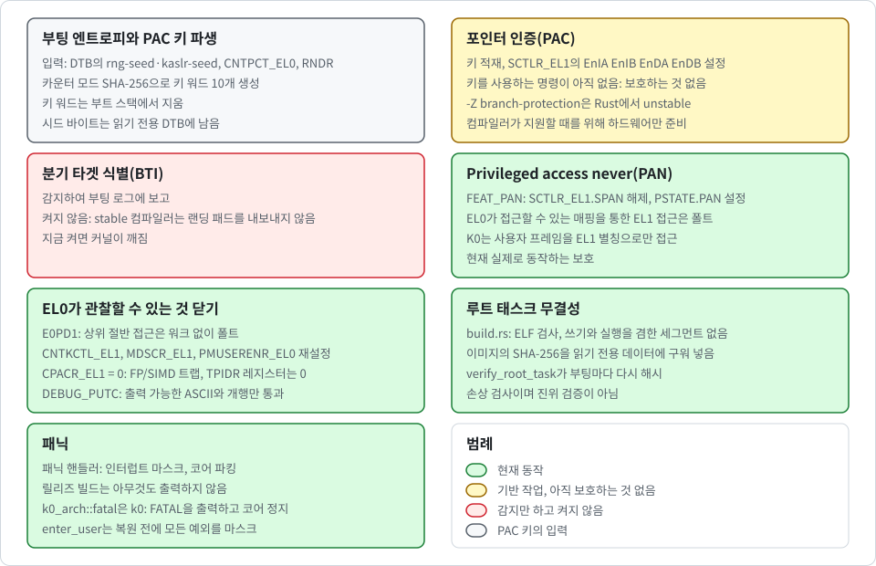

# 부트 하드닝: PAC, PAN, EL0 노출, 루트 태스크 무결성

[English](../en/hardening.md) | 한국어

이 문서는 K0가 부팅 시 켜는 CPU 보안 기능, 각 기능이 현재 무엇을 보호하고 무엇을 아직 보호하지 못하는지, 내장된 루트 태스크 이미지를 어떻게 검사하는지를 다룹니다. 코드는 `crates/k0-arch/src/hardening.rs`, `crates/k0-boot/src/entropy.rs`, `crates/k0-boot/src/roottask.rs`, `crates/k0-boot/build.rs`, 그리고 `kernel/src/main.rs`의 부팅 경로에 있습니다.

다음 그림은 이 문서가 다루는 보호를 문서의 절 구분대로 묶어서 나타냅니다.

  

> [!NOTE]
> 이 기능 중 일부는 아직 실제 보호가 아니라 기반 작업입니다. 각 절에서 어느 쪽인지 밝힙니다.

## 부팅 엔트로피와 PAC 키 파생

`derive_pac_keys`는 PAC 키를 이루는 10개의 64비트 워드를 만듭니다. 명령어 키 쌍 A와 B, 데이터 키 쌍 A와 B, 제네릭 키이며, 각각 두 워드입니다. 다음 세 가지 입력을 섞습니다.

- **DTB 시드**: DTB의 `/chosen` 노드에 있는 `rng-seed`와 `kaslr-seed`의 바이트입니다(최대 72바이트, 없을 수도 있음). UEFI에서는 펌웨어에 `EFI_RNG_PROTOCOL`이 있으면 UEFI 로더가 거기서 받은 32바이트를 `rng-seed`에 더하며, 커널은 루트 태스크에 진입하기 직전에 메모리의 DTB에서 이 바이트를 지웁니다(아래의 "DTB에서 시드 지우기"와 [uefi_KR.md](uefi_KR.md) 참고).
- **시스템 카운터**: `CNTPCT_EL0`입니다.
- **난수 명령**: CPU가 FEAT_RNG를 구현하고 명령이 성공하면 `RNDR` 난수 명령의 값 하나입니다.

키 파생 방식은 카운터 모드의 SHA-256입니다. 32바이트 블록마다 다음을 순서대로 해시합니다.

1. 고정된 도메인 문자열(`k0-pac-boot-key-v1`)
2. 1바이트 블록 카운터
3. 리틀 엔디언 64비트 값으로 된 DTB 엔트로피의 길이
4. DTB 엔트로피 자체
5. 리틀 엔디언 워드로 된 다른 입력

길이 접두사는 DTB 바이트가 그 뒤에 오는 워드와 혼동되지 않게 합니다. 블록 세 개로 10개의 워드가 나옵니다.

`hardening::enable`이 키를 시스템 레지스터에 적재하고 나면, `kernel_main`은 부트 스택에 있는 10개의 워드를 volatile 쓰기와 컴파일러 펜스로 덮어씁니다. 부트 스택은 나중에 시스템 콜 스택이 되므로 키의 사본이 남지 않게 하려는 것입니다.

입력을 함께 해시하므로 적대적이거나 예측 가능한 입력이 다른 입력의 엔트로피를 상쇄할 수 없습니다.

> [!WARNING]
> 그래도 결과는 가장 좋은 입력보다 나을 수 없습니다. DTB가 시드를 제공하지 않고 CPU에 `RNDR`도 없으면 입력은 카운터뿐이며, 부팅 로그에 `k0: WARNING pac key entropy low (cntpct only)`가 출력됩니다.

### 루트 태스크용 루트 시드

커널은 루트 태스크에 넘길 32바이트 시드도 파생합니다(`k0_boot::derive_root_seed`). 자체 도메인 문자열(`k0-root-task-seed-v1`), DTB 엔트로피의 길이, DTB 엔트로피 자체, 카운터를 SHA-256으로 해시하고, CPU에 `RNDR`이 있으면 새로 뽑은 `RNDR` 워드 네 개를 더합니다. 도메인 문자열이 PAC 키의 것과 다르므로 두 출력은 도메인 분리로 서로 독립입니다. 하나를 안다고 다른 하나를 알 수는 없습니다. 다만 DTB 엔트로피와 카운터는 공유하므로, 시드는 입력만큼만 좋고 그보다 낫지 않습니다.

시드는 bootinfo 페이지에 없습니다. 커널이 루트 태스크의 저장된 컨텍스트에 넣으므로 진입 레지스터 `x0`부터 `x3`으로 도착합니다. `x4`는 시드 정보 워드입니다. 비트 15..0은 시드에 들어간 `rng-seed` 바이트 수이고, 비트 16은 `RNDR`이 기여했을 때 설정됩니다. bootinfo 페이지의 레이아웃은 이제 버전 3(`bootinfo::VERSION`)이며, 다른 버전을 본 루트 태스크는 멈춥니다. 커널은 부트 스택에 있던 시드 사본을 직접 지웁니다. 루트 태스크는 시드가 아니라 재료만 출력합니다. `root: boot seed from rng-seed bytes 0x... and rndr` 또는 `... without rndr`입니다.

### DTB에서 시드 지우기

시드를 해시해 키로 만든 뒤에도 원본 바이트가 메모리에 남아 있으면, 나중에 그 메모리를 읽을 수 있는 쪽이 키를 다시 계산할 수 있습니다. 그래서 커널이 그 바이트를 지웁니다. FDT 파서는 블롭 안에서 `rng-seed`와 `kaslr-seed`의 값이 놓인 위치를 기록하고(`seed_spans`), 두 번째 `/chosen` 노드는 거부하므로(`DuplicateChosen`) 기록된 위치가 전부입니다.

커널이 DTB 읽기를 모두 마치고 루트 태스크에 진입하기 직전에, `wipe_dtb_seeds`가 기록된 구간마다 다음을 수행합니다.

1. `k0_mm::wipe_ro_alias`가 그 페이지의 읽기 전용 별칭 항목을 break-before-make로 그 자리에서 읽기·쓰기로 바꿉니다.
2. 0을 씁니다.
3. 캐시 라인을 clean하고 invalidate하여 다시 읽을 때 값이 메모리에서 오게 합니다.
4. 항목을 다시 읽기 전용으로 되돌립니다.

그다음 커널은 읽기 전용 별칭으로 그 바이트를 다시 읽어 0인지 확인합니다. 확인된 뒤에야 `BootInfo`에 있는 자기 사본을 지우고 `k0: dtb seeds wiped <n>B`를 출력합니다(QEMU virt에서는 `40B`). 구간을 지우지 못했거나 다시 읽은 값이 0이 아니면 `k0: WARNING dtb seeds not wiped`를 출력합니다. 마지막으로 커널은 살아 있는 프레임 아래의 부트 스택을 0으로 채워, 해시 계산이 남긴 찌꺼기를 지웁니다.

> [!NOTE]
> 이 삭제는 완전하지 않습니다. 펌웨어나 UEFI 로더가 자기 메모리에 가진 사본에는 닿을 수 없고, 부트 스택의 살아 있는 프레임에 있는 것도 지우지 못합니다. 스택 사본을 지우는 일은 최선의 노력입니다.

## 포인터 인증(PAC)

CPU가 주소 인증을 구현하면 `hardening::enable`이 네 개의 주소 키를 기록하고, 제네릭 인증이 있으면 제네릭 키도 기록합니다. 그다음 `SCTLR_EL1`에서 `EnIA`, `EnIB`, `EnDA`, `EnDB`를 설정합니다. 커널이 EL2에서 진입했다면 `boot.S`가 이미 `HCR_EL2.APK`와 `HCR_EL2.API`를 설정했으므로, EL1의 키 접근과 PAC 명령이 EL2로 트랩되지 않습니다.

> [!NOTE]
> 현재 이것이 보호하는 것은 아직 없습니다. PAC은 코드가 포인터를 서명하고 검사할 때만 도움이 되는데, 커널과 루트 태스크의 어떤 명령도 이 키를 사용하지 않습니다.

Rust 컴파일러가 복귀 주소를 서명하게 하는 `-Z branch-protection` 옵션은 unstable이고, K0는 stable 1.89 툴체인으로 빌드합니다. 컴파일러가 해당 명령을 내보낼 수 있게 되는 날을 위해 하드웨어를 준비해 둔 상태입니다.

## 분기 타겟 식별(BTI)

BTI는 감지하여 부팅 로그에 보고하지만, 활성화하지는 않습니다. guarded page 비트를 켜면 모든 간접 분기가 `BTI` 명령에 도착하지 않는 한 폴트를 일으키는데, stable 컴파일러는 그런 랜딩 패드를 내보내지 않습니다.

> [!NOTE]
> BTI는 아직 활성화되어 있지 않습니다. 지금 BTI를 켜면 커널이 깨집니다.

## Privileged access never(PAN)

CPU가 FEAT_PAN을 구현하면 커널은 `SCTLR_EL1.SPAN`을 지워서 EL1로의 모든 예외 진입에서 CPU가 `PSTATE.PAN`을 설정하게 하고, 원시 명령 인코딩으로 `PSTATE.PAN`을 즉시 설정합니다. PAN이 설정되어 있으면 EL0가 접근할 수 있는 매핑을 통한 EL1의 모든 로드와 스토어가 폴트를 일으킵니다.

이것은 **현재 실제로 동작하는 보호**입니다. 사용자 공간이 제공한 포인터를 역참조하는 커널 버그 전체를 조용한 읽기나 쓰기가 아닌 폴트로 바꿉니다. K0는 그런 접근이 필요하지 않습니다. 사용자 프레임에는 자체 EL1 전용 별칭으로만 접근합니다([user-address-space_KR.md](user-address-space_KR.md) 참고). FEAT_PAN2가 있으면 부팅 자가 검사가 `AT S1E1RP`를 사용해 PAN이 사용자 텍스트에 대한 EL1 읽기를 실제로 막는지 확인합니다.

## EL0가 관찰할 수 있는 것 닫기

CPU가 FEAT_E0PD를 구현하면 `TCR_EL1.E0PD1`을 설정합니다. 그러면 EL0가 상위(커널) 절반에 접근할 때 변환 워크 없이 곧바로 폴트가 나서, EL0가 타이밍으로 커널 배치를 탐색할 수 없습니다([memory_KR.md](memory_KR.md) 참고). 기본 QEMU CPU는 이를 구현하지 않습니다.

부트로더는 사용자 공간이 필요 이상으로 관찰하거나 제어할 수 있는 상태로 레지스터를 남겨 둘 수 있습니다. K0는 이를 신뢰하지 않고 알려진 값으로 재설정합니다. 다음 표는 설정과 EL0에 대한 효과를 나타냅니다.

| 설정 | EL0에 대한 효과 |
| --- | --- |
| `CNTKCTL_EL1 = 0` | 카운터나 타이머 레지스터를 읽으면 트랩 |
| `MDSCR_EL1 = 0` | 브레이크포인트, 워치포인트, 싱글 스텝 이벤트가 설정되지 않음 |
| `PMUSERENR_EL0 = 0`, 표준 PMUv3가 있을 때만 | 성능 카운터를 읽거나 프로그래밍하면 트랩 |
| `boot.S`의 `SCTLR_EL1` | `WFI`와 `WFE`가 트랩, 인터럽트 마스크 비트에 접근 불가, 스택 정렬 검사 |
| `boot.S`의 `CPACR_EL1 = 0` | 모든 FP/SIMD, SVE, SME 명령이 트랩 |

EL0의 트랩은 폴트로 처리되고 태스크는 종료됩니다([exceptions_KR.md](exceptions_KR.md) 참고). 유일한 예외는 `WFI`와 `WFE`로, 커널이 건너뜁니다. FP/SIMD를 트랩하면 커널이 벡터 레지스터를 저장할 필요가 전혀 없으므로, 태스크는 다른 태스크가 남긴 벡터 상태를 읽을 수 없습니다.

EL0는 여전히 어떤 하드웨어 카운터나 타이머도 읽을 수 없습니다. 다만 IPC 타임아웃은 EL0에 **스케줄러 tick만큼 거친 시계**(1초)와 타이머 인터럽트에 맞춰 정렬된 깨어남을 제공합니다([ipc_KR.md](ipc_KR.md) 참고). 따라서 **tick 주기는 사이드 채널에 관한 결정**입니다. 이 시계가 캐시나 추측 실행 공격에 쓸 만한 시간 원천으로 증폭될 수 있는지는 분석하지 않았습니다.

EL0 스레드 포인터 레지스터 `TPIDR_EL0`와 `TPIDRRO_EL0`는 각 태스크의 저장된 컨텍스트에 포함됩니다. `TCB_CONFIGURE`가 이를 0으로 만들기 때문에 새 태스크는 생성자의 값 없이 시작합니다.

`DEBUG_PUTC`는 `Console` 케이퍼빌리티를 요구하며, 출력 가능한 ASCII도 개행도 아닌 모든 바이트를 `?`로 바꿉니다. 태스크는 콘솔을 읽는 쪽에 터미널 이스케이프 시퀀스를 보낼 수 없습니다(콘솔 드라이버를 포함해 빌드한 이미지의 콘솔, 또는 부트 로그).

이 필터는 줄을 누가 썼는지 표시하지 않습니다. 커널 출력과 태스크 출력이 부트 로그를 함께 사용하고 (콘솔 드라이버를 포함해 빌드한 이미지에서는) 콘솔도 함께 사용합니다.

> [!WARNING]
> `Console` 케이퍼빌리티를 가진 태스크는 개행 뒤에 `k0:`로 시작하는 글을 출력할 수 있습니다. 콘솔이나 로그를 읽는 쪽은 `tools/qemu-boot-test.sh`를 포함해 누구도 `k0: entering root task (el0)` 뒤에 나온 `k0:` 줄을 커널이 쓴 것으로 믿을 수 없습니다.

여기에는 `k0: console drivers [...]` 줄도 포함되므로, 로그에서 그 줄의 첫 번째 등장 또는 이미지 파일만이 빌드를 식별합니다. 태스크 출력은 부트 로그에 정해진 몫까지만 기록되므로 커널 줄을 로그에서 밀어낼 수는 없지만, 로그에서도 표시는 없습니다. `Console` 케이퍼빌리티는 **출력이 커널 출력과 섞여도 되는 태스크에만** 부여하는 것이 좋습니다.

## 루트 태스크 무결성

커널에는 ELF 로더가 없습니다. `crates/k0-boot/build.rs`가 빌드 호스트에서 루트 태스크를 빌드하고, 그곳에서 ELF 파일을 파싱해 플랫 이미지와 짧은 세그먼트 목록으로 변환합니다. 변환 중에 다음을 강제합니다.

- 헤더와 세그먼트가 범위 안에 있는 리틀 엔디언 AArch64 ELF64 실행 파일
- 쓰기 가능하면서 동시에 실행 가능한 세그먼트가 없을 것
- 모든 세그먼트가 두 그래뉼 모두에 맞는 16 KiB로 정렬되고, 세그먼트가 정렬되어 있으며 겹치지 않을 것
- 엔트리 포인트가 실행 가능한 세그먼트 안에 있을 것
- 세그먼트는 최대 4개, 플랫 이미지는 최대 1 MiB

위반이 있으면 빌드가 실패합니다. 빌드 스크립트는 무엇이든 해시하기 전에 vendoring한 `sha2` 크레이트를 FIPS 180-4 테스트 벡터 두 개로 검사하기도 합니다. 그런 다음 이미지, 세그먼트 목록, 이미지의 SHA-256 해시를 커널의 읽기 전용 데이터에 구워 넣습니다.

부팅할 때마다 `verify_root_task`가 내장된 이미지를 다시 해시하고 결과를 구워 넣은 해시와 비교합니다. 일치하지 않으면 부팅이 중단됩니다. 해시의 앞부분 바이트는 빌드 출력과 비교할 수 있도록 부팅 로그에 나타납니다.

> [!NOTE]
> 이것은 손상 검사이지 진위 검증이 아닙니다. 이미지, 기준 해시, 둘을 비교하는 코드가 모두 같은 커널 이미지 안에 있습니다.

커널 이미지를 수정할 수 있는 사람은 셋 모두를 바꿀 수 있습니다. 공개 키도 커널 이미지 안에 있는 한, 루트 태스크를 비대칭 키로 서명해도 이 점은 달라지지 않습니다. 수정된 커널 이미지에 대한 보호는 이미지 전체를 검증해야 하는 부트 체인의 몫입니다. 이 검사는 빌드 파이프라인의 실수와 로딩 경로의 손상을 잡아내고, 커널의 다른 부분은 그대로인 채 이미지 블롭만 변조된 경우도 잡아냅니다. 루트 태스크를 커널과 따로 배포할 때 Ed25519 검증을 추가해서 공개 키만 커널에 남기는 것이 계획입니다.

## 패닉

패닉 핸들러는 모든 인터럽트를 마스크하고 코어를 파킹합니다. 디버그 빌드는 먼저 패닉 메시지를 출력합니다. 릴리즈 빌드는 아무것도 출력하지 않으므로 현장에서 발생한 패닉이 내부 상태를 누설하지 않습니다.

`k0_arch::fatal`은 커널 불변식 위반에 대한 fail-secure 정지입니다. 해독할 수 없는 케이퍼빌리티 슬롯, 끊어진 파생 리스트 링크, 손상된 사용자 페이지 테이블, 손상된 준비·엔드포인트·응답 큐 같은 경우입니다. 모든 예외를 마스크하고 `k0: FATAL <what>`을 출력한 뒤 코어를 정지합니다. 위반된 불변식의 이름만 출력하므로 릴리즈 빌드에서도 출력합니다. 손상된 구조로 계속 실행하면 그것을 근거로 권한을 판단하게 되기 때문입니다. `enter_user`도 사용자 컨텍스트를 복원하기 전에 모든 예외를 마스크하므로, 부트 중의 인터럽트가 `ELR_EL1`/`SPSR_EL1` 복원과 `eret` 사이에 끼어들 수 없습니다.

## 테스트 방법

- `crates/k0-boot/src/entropy/tests.rs`는 Python의 `hashlib`로 독립적으로 계산한 기지 답으로 키 파생을 고정하고, 입력 비트를 하나라도 뒤집으면 키가 바뀌는지, 길이 접두사가 입력을 구분하는지 검사합니다. 같은 파일이 루트 시드도 검사하며, 그것이 PAC 키와 다르다는 점도 포함합니다.
- `crates/k0-boot/src/roottask/tests.rs`는 내장된 이미지를 자체 해시와 대조하고, 소비하는 쪽에서 본 레이아웃 규칙을 검사합니다.
- 기본 QEMU CPU(`cortex-a72`)에는 PAC, PAN, RNDR이 모두 없습니다. 그래서 CI는 QEMU의 `max` CPU로 한 번 더 부팅하고, 로그에 `rndr=on`과 `k0: pac=on bti=present pan=on`이 있어야 하며, PAN을 인식하는 사용자 검사를 포함한 다른 모든 부팅 검사와 자가 테스트도 통과해야 합니다.
- 루트 태스크 자가 테스트는 새 태스크가 0으로 채워진 스레드 포인터 레지스터로 시작하는지, 루트 태스크의 값이 다른 태스크의 변경에도 유지되는지, FP/SIMD 명령이 그것을 실행한 태스크만 종료시키는지 확인합니다.

## 알려진 공백

- **PAC 미사용**: PAC 키는 로드되지만 아직 이를 사용하는 코드가 없으므로 복귀 주소는 보호되지 않습니다. 키 워드는 부트 스택에서 지우고, DTB의 시드 바이트는 루트 태스크가 시작되기 전에 지웁니다. 펌웨어나 UEFI 로더가 가진 사본과 부트 스택의 살아 있는 프레임은 지우지 못하며, 스택 사본을 지우는 일은 최선의 노력입니다.
- **코어 전체 정지**: `k0_arch::fatal`과 패닉 핸들러는 코어 전체를 정지시킵니다. 손상된 커널 구조에 대한 의도한 대응이지만, 그런 버그 하나가 모든 태스크에 대한 서비스 거부가 된다는 뜻이기도 합니다.
- **공용 PAC 키**: 같은 PAC 키가 EL0와 EL1, 그리고 모든 태스크에 쓰입니다. 코드가 포인터를 서명하기 시작하면 태스크가 커널이 받아들이는 포인터를 위조할 수 있습니다. 태스크별 또는 레벨별 키는 구현되어 있지 않습니다.
- **BTI**: BTI는 활성화되어 있지 않습니다.
- **루트 태스크 검사**: 루트 태스크 검사는 사고와 제한적인 변조에 대한 무결성을 증명할 뿐 진위를 증명하지 않습니다.
- **실제 보드**: 실제 보드에서는 시도해 본 적이 없습니다. CI는 QEMU만 사용합니다. 2026-11-11과 2026-11-12에 ARM Mac에서 QEMU와 HVF로 손으로 실행했습니다.
