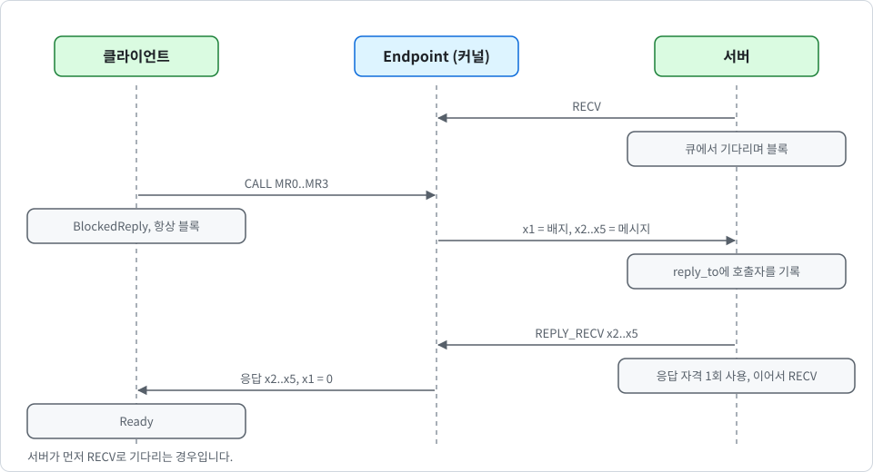

# 동기 IPC

[English](../en/ipc.md) | 한국어

이 문서는 K0의 프로세스 간 통신을 설명합니다. 다음 내용을 다룹니다.

- 엔드포인트
- IPC 시스템 콜 네 개
- 서버가 클라이언트를 구분하게 해 주는 배지
- `CALL`을 안전하게 만드는 1회성 응답 자격

코드는 `crates/k0-ipc/src/lib.rs`에 있고, 엔드포인트 큐는 `crates/k0-task/src/lib.rs`에 있습니다. 시스템 콜 `CONSOLE_READ`는 IPC 호출처럼 기다리며 타임아웃, 해체, `REVOKED`로 깨어나는 방식을 IPC와 공유합니다. "콘솔 입력 대기" 절에서 설명합니다. `console-input`으로 빌드한 이미지에만 있습니다.

## 설계 요약

K0의 IPC는 seL4 방식의 **동기 랑데부**입니다. 메시지는 레지스터 `x2`부터 `x5`에 실리는 64비트 워드 4개이며, MR0부터 MR3이라고 부릅니다. 양쪽이 준비되면 커널은 송신자의 저장된 컨텍스트에서 수신자의 저장된 컨텍스트로 워드 4개를 복사합니다. 한쪽이 준비되지 않았다면 상대방은 엔드포인트 큐에서 기다립니다.

> [!IMPORTANT]
> 커널은 메시지를 버퍼링하지 않고, IPC를 위해 메모리를 할당하지 않으며, 사용자 메모리를 읽지 않습니다. 따라서 사용자 공간이 채울 수 있는 버퍼도 없고, 커널이 검사한 뒤 사용하기 전에 바뀔 수 있는 사용자 버퍼도 없습니다.

## 엔드포인트

**엔드포인트**는 `RETYPE`으로 만드는 커널 오브젝트입니다([capabilities_KR.md](capabilities_KR.md) 참고). 블록된 TCB의 큐 하나에 대한 head와 tail을 담고 있으며, 큐는 TCB 자신의 `next`와 `prev` 필드로 연결됩니다. 0으로 채워진 엔드포인트는 빈 엔드포인트입니다.

큐는 이중 연결 리스트입니다. TCB는 자신이 어느 엔드포인트에서 기다리는지(`blocked_on`)도 기록합니다. 그래서 태스크가 파괴될 때 큐 중간에서도 상수 시간에 빼낼 수 있습니다. 제거할 때 링크가 일관된지 검사하고, 어긋나 있으면 `k0: FATAL`을 출력하고 커널을 정지합니다.

큐에는 언제나 대기 중인 송신자나 대기 중인 수신자 중 한쪽만 있고, 양쪽이 함께 있는 일은 없습니다. 수신자가 기다리는 것을 발견한 송신자는 즉시 전달하고, 송신자가 기다리는 것을 발견한 수신자는 즉시 메시지를 가져옵니다. 따라서 한 종류만 쌓일 수 있습니다. 커널은 큐의 head에 있는 TCB의 상태로 두 종류를 구분합니다. 큐는 선입선출입니다.

### 엔드포인트 찾기와 권한

`x0`의 슬롯 번호는 호출한 태스크 자신의 CNode에서만 찾습니다([capabilities_KR.md](capabilities_KR.md) 참고). 슬롯 번호는 그것을 사용하는 태스크의 CNode 밖에서는 아무 의미가 없습니다. 따라서 태스크는 자신이 케이퍼빌리티를 가진 엔드포인트에만 닿을 수 있습니다.

케이퍼빌리티에는 호출이 요구하는 권한이 있어야 합니다. 해당 권한이 없으면 `NO_RIGHTS`로 거부됩니다.

| 호출 | 필요한 권한 |
| --- | --- |
| `SEND`, `CALL` | `W` |
| `RECV`, `REPLY_RECV` | `R` |

권한은 `CAP_COPY`로만, 그리고 제거하는 방향으로만 바꿀 수 있습니다. 그래서 서버는 클라이언트에게 송신 전용 케이퍼빌리티를 나눠 주고 수신 쪽은 자신이 쥘 수 있습니다.

### 배지

엔드포인트 케이퍼빌리티는 64비트 값인 **배지**를 가질 수 있으며, 0은 배지 없음을 뜻합니다. 배지는 아직 배지가 없는 엔드포인트 케이퍼빌리티에 `CAP_COPY`로 한 번만 붙일 수 있습니다. 다른 케이퍼빌리티에 붙이거나 이미 배지가 있는 케이퍼빌리티에 다른 배지를 붙이면 `BAD_BADGE`로 실패합니다. 배지가 있는 케이퍼빌리티의 복사본은 그 배지를 유지합니다.

메시지를 수신하면 커널은 송신자가 사용한 케이퍼빌리티의 배지를 수신자의 `x1`에 넣습니다. 송신자가 배지를 직접 넘기는 일은 없습니다. 커널이 송신자가 사용한 케이퍼빌리티에서 읽으므로, **클라이언트는 다른 클라이언트의 배지를 위조할 수 없습니다**.

큐에서 기다려야 하는 송신자는 그 송신의 배지를 자신의 TCB(`ipc_badge`)에 보관합니다. 따라서 전달되는 배지는 그 송신을 큐에 세운 호출의 배지입니다. 응답 경로에서 `x1`은 항상 0입니다.

## 네 가지 호출

네 호출 모두 `x0`에 `Endpoint` 케이퍼빌리티를, `x1`에 플래그를 받습니다. 플래그 레지스터의 구성은 다음과 같습니다.

| 비트 | 이름 | 의미 |
| --- | --- | --- |
| 0 | `NONBLOCK` | 상대방이 준비되지 않았을 때 기다리지 않고 `WOULD_BLOCK`을 반환 |
| 31부터 1 | 예약(`k0_abi::ipc::RESERVED`) | 반드시 0 |
| 63부터 32 | 타임아웃 | 스케줄러 틱 단위의 최대 대기 시간, 0은 영원히 기다림([타임아웃](#타임아웃) 참고) |

`k0_abi::ipc::timeout(ticks)`가 타임아웃 값을 만들고, `k0_abi::ipc::TIMEOUT_SHIFT`는 32입니다. `NONBLOCK`이 타임아웃보다 우선합니다. 예약 비트가 하나라도 서 있는 호출은 다른 어떤 것도 보기 전에 `BAD_FLAGS`로 실패합니다. `REPLY_RECV`의 경우에는 대기 중인 응답을 소모하기 전에 실패합니다. 다음 그림은 서버가 먼저 `RECV`로 기다리는 경우에 `CALL`과 `REPLY_RECV`가 오가는 순서를 보여 줍니다.

  

네 호출은 각각 다음과 같이 동작합니다.

**SEND**는 MR0부터 MR3을 전달합니다. 수신자가 기다리고 있다면 커널은 메시지를 수신자의 컨텍스트로 복사하고, 수신자를 준비 상태로 만들며, 송신자는 계속 실행됩니다. 그렇지 않으면 송신자는 수신자가 올 때까지 `BlockedSend`로 큐에서 기다립니다.

**RECV**는 메시지를 기다립니다. 송신자가 기다리고 있다면 커널은 그 메시지를 즉시 수신자의 컨텍스트로 복사합니다. 수신자는 `x0 = 0`, `x1 = ` 송신자 케이퍼빌리티의 배지를 받고, 메시지는 `x2`부터 `x5`에서 받습니다. 일반 송신자는 해제되어 준비 상태가 됩니다. `CALL`을 사용한 송신자는 해제되지 않으며, 다음 항목에서 설명하듯 응답을 기다리는 상태로 넘어갑니다.

**CALL**은 메시지 송신과 응답 대기를 트랩 한 번에 수행합니다. 수신자가 기다리고 있다면 메시지가 전달되고 호출자는 곧바로 `BlockedReply`로 넘어갑니다. 그렇지 않으면 호출자는 `BlockedCall`로 큐에서 기다립니다. 어느 쪽이든 **호출자는 항상 블록됩니다**. 송신과 대기가 한 단계에서 일어나므로, 둘 사이의 틈에 응답이 도착하는 일은 있을 수 없습니다.

**REPLY_RECV**는 서버 루프를 트랩 한 번으로 수행합니다. 호출한 태스크가 응답 자격을 가지고 있으면 커널은 `x2`부터 `x5`를 대기 중인 호출자에 대한 응답으로 전달하고, 호출자를 준비 상태로 만들고, 응답 자격을 버립니다. 그다음에는 `RECV`와 똑같이 이어서 진행하며, 타임아웃도 마찬가지로 이 수신 단계에만 적용됩니다.

엔드포인트를 먼저 검사합니다. 엔드포인트 케이퍼빌리티가 유효하지 않거나 `R`이 없으면 응답 자격을 소모하지 않고 호출이 실패합니다. 응답은 `x1 = 0`으로 전달됩니다.

## 응답 자격

수신자가 `CALL`의 메시지를 가져가면, 커널은 호출자를 수신자 TCB의 `reply_to` 필드에 기록합니다. 이 필드가 **응답 자격**입니다. 케이퍼빌리티가 아니며 슬롯을 차지하지 않으므로, 사용자 공간은 이를 위조하거나 복사하거나 전달할 수 없습니다. 다음 세 가지 규칙이 이를 안전하게 지킵니다.

1. **1회성**: `REPLY_RECV`는 응답을 전달하는 즉시 필드를 지웁니다.
2. **태스크당 최대 하나**: 이미 응답 자격을 가진 태스크가 새 `CALL`을 받으면, 새 자격을 기록하기 전에 이전 호출자를 `NO_REPLY`로 깨웁니다.
3. **버려진 호출자 없음**: 응답 자격을 가진 태스크가 종료되거나 폴트를 일으키거나 파괴되면 커널이 먼저 호출자를 `NO_REPLY`로 깨웁니다.

응답 자격은 양방향으로 연결됩니다. 서버의 `reply_to`는 호출자를, 호출자의 `reply_from`은 서버를 가리킵니다. 덕분에 어느 쪽이 파괴되어도 남은 포인터가 생기지 않습니다. 따라서 시스템이 계속 실행되는 한, 호출자는 응답과 함께든 `NO_REPLY`와 함께든 항상 깨어납니다.

## 태스크와 엔드포인트의 파괴

태스크는 다음 경우에 해체됩니다.

- 종료하거나, 폴트를 일으키거나, 알 수 없는 시스템 콜을 하는 경우
- TCB의 원본 케이퍼빌리티가 제거되는 경우
- 태스크에 묶인 CNode나 주소 공간이 회수 또는 삭제되는 경우

해체는 태스크의 상태만 보고 그 태스크를 가리키는 모든 커널 포인터를 끊습니다.

- **Ready**: 준비 큐에서 제거합니다.
- **SEND, RECV, CALL에서 블록**: 기다리던 엔드포인트의 큐에서, 머리든 중간이든 꼬리든 제거합니다.
- **콘솔 입력 대기**(`BlockedConsole`): 콘솔의 하나뿐인 대기자 자리에서 제거합니다.
- **응답 대기**(`BlockedReply`): 응답 자격을 양방향으로 끊습니다. 그래서 서버는 응답할 자격을 잃고, 뒤늦은 응답이 죽은 태스크를 깨우는 일도 없습니다.
- **응답 자격 보유**: 그 자격을 기다리던 호출자를 `NO_REPLY`로 깨웁니다.
- **Inactive, Stopped, Running**: 풀 것이 없습니다.

기한을 걸고 기다리던 태스크는 스케줄러의 기한 목록에서도 제거됩니다. 그 뒤 상태는 `Dead`가 되고 저장된 레지스터는 소거됩니다. 시스템 콜을 호출한 태스크 자신이 죽었다면 커널은 그 태스크에 반환 값을 기록하지 않고 다음 준비 태스크로 전환합니다.

엔드포인트의 원본 케이퍼빌리티가 삭제되면 그 엔드포인트에 줄 서 있던 태스크가 모두 `REVOKED`로 깨어나고, 이후 어떤 TCB도 그 엔드포인트를 가리키지 않습니다. 케이퍼빌리티의 복사본만 삭제하면 큐는 건드리지 않습니다.

## 타임아웃

모든 대기에 상한을 걸 수 있습니다. 타임아웃은 플래그 레지스터 `x1`의 상위 32비트이며 스케줄러 틱 단위입니다. 틱 주기는 1초(커널 상수)이므로 모든 타임아웃의 단위는 틱입니다. 다음 규칙이 적용됩니다.

- **기한 규칙**: n 틱의 타임아웃은 호출 뒤 (n+1)번째 타이머 틱에서 끝납니다. 틱이 제때 처리되는 한 대기는 틱 주기의 n배에서 n+1배 사이입니다.
- **하한이지 벽시계 시간이 아님**: 커널은 모든 시스템 콜을 인터럽트를 마스크한 채 실행하고, 큰 `CAP_REVOKE`처럼 긴 호출은 틱을 늦춥니다. 그러면 대기도 그만큼 길어집니다.
- **0은 기한 없음**: 이전처럼 상대방이 동작할 때까지 기다립니다.
- **호출의 기한은 하나**: `CALL`의 기한은 수신자를 기다리는 단계와 응답을 기다리는 단계를 모두 덮습니다.
- **응답 후 수신**: `REPLY_RECV`의 타임아웃은 수신 단계에만 적용됩니다.

다음 표는 타임아웃으로 대기가 끝났을 때 호출자가 받는 결과입니다.

| 호출 | 기다린 곳 | 결과 | 메시지는 |
| --- | --- | --- | --- |
| `SEND` | 엔드포인트 큐 | `TIMEOUT` | 전달되지 않음 |
| `RECV`, `REPLY_RECV` | 엔드포인트 큐 | `TIMEOUT` | 받은 것 없음(`REPLY_RECV`가 준 응답은 이미 전달됨) |
| `CALL` | 엔드포인트 큐 | `TIMEOUT` | 전달되지 않음 |
| `CALL` | `BlockedReply` | `REPLY_TIMEOUT` | 전달됨, 서버가 동작했는지는 알 수 없음 |
| `CONSOLE_READ` | 콘솔 대기자 자리 | `TIMEOUT` | 읽은 바이트 없음 |

`CALL`이 `REPLY_TIMEOUT`으로 끝나면 커널은 그 응답 자격을 쥔 서버의 자격을 지웁니다. 서버가 나중에 응답해도 그 `REPLY_RECV`에는 사용할 응답 자격이 없으므로 뒤늦은 응답은 버려집니다. 다음 호출자는 자기 응답을 받습니다.

### 기한 목록

TCB에는 `deadline`, `tnext`, `tprev` 필드가 있습니다. `k0-sched`는 기한이 있는 대기자의 정렬되지 않은 intrusive 리스트(`arm_timeout`, `disarm_timeout`, `expired`, `has_timed`)와 가장 이른 기한의 하한을 유지하므로, 대부분의 틱은 리스트를 훑지 않습니다. 태스크가 블록 상태를 벗어나는 길은 두 가지뿐이며, 둘 다 태스크를 리스트에서 제거합니다.

- `k0_sched::enqueue`(깨우기). 메시지로 깨어난 대기자는 기한을 남기지 않습니다.
- `k0_ipc::teardown`(죽음)

기한이 지난 대기자는 `k0_ipc::expire_timeouts`가 처리합니다. 대기자를 엔드포인트 큐에서 빼고 `TIMEOUT`으로 깨우거나, 그 응답을 쥔 태스크의 응답 링크를 지우고 `REPLY_TIMEOUT`으로 깨웁니다. 링크가 상태와 맞지 않으면 해체와 마찬가지로 커널은 `k0: FATAL`을 출력하고 정지합니다. 이 함수는 타이머 틱마다 실행됩니다.

- 태스크가 실행 중이었다면 `k0_preempt`에서
- 실행 중인 태스크가 없었다면 idle 루프에서

순회 비용은 인터럽트를 마스크한 상태에서 O(기한이 있는 대기자 수)이며 틱당 최대 한 번입니다.

> [!NOTE]
> EL0는 여전히 어떤 하드웨어 카운터나 타이머도 읽을 수 없습니다. 타임아웃은 EL0에 스케줄러 틱만큼 거친 시계와 타이머 인터럽트에 맞춰진 깨어남을 줍니다. 이것이 캐시 또는 투기 실행 공격에 쓸 만한 시간 소스로 증폭될 수 있는지는 분석하지 않았습니다.

## 블록과 교착

기다려야 하는 태스크는 블록 상태로 표시되어 엔드포인트 큐에 연결되거나 응답 자격에 붙잡힙니다. 호출에 타임아웃이 있으면 태스크는 기한 목록에도 들어갑니다. 그 뒤 스케줄러가 다음 준비 태스크로 전환합니다([scheduling_KR.md](scheduling_KR.md) 참고). 이 태스크의 반환 레지스터는 나중에 해제하는 태스크가 기록합니다.

그 시점에 준비된 태스크가 없어도 커널은 멈추지 않습니다. 커널은 `idle_until_ready`(`kernel/src/syscall.rs`)에서 idle 상태로 기다립니다. 다음 인터럽트까지 기다렸다가 기한이 지난 대기자를 모두 깨우고, 준비된 태스크가 있으면 그 태스크로 전환합니다. 그동안에도 타이머 틱은 계속 세고 처리합니다. idle 루프는 다음 두 줄 가운데 하나를 부팅당 최대 한 번씩 출력합니다.

- `k0: idle (waiting for a timeout)`: 기한이 있는 대기자가 하나 이상 있으므로 태스크를 깨울 것이 있습니다.
- `k0: all tasks stopped (none ready, no timeout pending)`: 기한이 있는 대기자도 콘솔 입력을 기다리는 태스크도 없습니다. 지금은 Notification 오브젝트가 없고 태스크를 깨우는 장치 인터럽트는 콘솔 입력뿐이므로 이 상태에서는 어떤 것도 태스크를 깨울 수 없고, 머신은 idle 상태로 남습니다. `tools/qemu-boot-test.sh`는 `k0: all tasks`로 시작하는 줄을 모두 실패로 처리합니다.

기다릴 것이 콘솔 입력뿐이면 커널은 어느 줄도 출력하지 않습니다. 터미널 이미지에서는 이것이 정상 상태입니다.

> [!WARNING]
> 모든 태스크가 블록되어도 커널은 더 이상 정지하지 않으며, 태스크는 타임아웃으로 자신의 대기에 상한을 걸 수 있습니다. 그래도 가용성은 보호되지 않습니다. 타임아웃 없이 기다리는 태스크는 상대방이 동작하지 않으면 영원히 기다릴 수 있고, 엔드포인트 케이퍼빌리티를 가진 격리 태스크는 여전히 다른 태스크를 기다리게 만들 수 있습니다. 이것이 [SECURITY_KR.md](../../SECURITY_KR.md)의 어드바이저리 GHSA-q99x-2wrv-358p의 주제입니다. 어드바이저리는 릴리즈 시점에 갱신합니다.

응답을 유지해야 하는 서버나 루트 태스크는 모든 대기에 타임아웃을 지정해야 합니다. 태스크 격리로도 이 점은 달라지지 않습니다.

## 콘솔 입력 대기

`CONSOLE_READ`(번호 16)는 콘솔 입력을 한 바이트 읽습니다. `console-input`으로 빌드하고 수신이 가능한 콘솔 드라이버(PL011과 SBSA UART, 16550은 아님)가 있는 이미지에만 있습니다. 인자와 결과는 다음과 같습니다.

| 레지스터 | 의미 |
| --- | --- |
| `x0`(입력) | `R`이 있는 `Console` 케이퍼빌리티의 슬롯 |
| `x1`(입력) | 플래그. `NONBLOCK` = 1, `FLUSH` = 2, 63부터 32비트에 틱 단위 타임아웃. 다른 비트는 `BAD_FLAGS`로 실패 |
| `x0`(출력) | 0 또는 오류 코드 |
| `x1`(출력) | 바이트 |
| `x2`(출력) | 이 바이트 바로 앞에서 입력이 유실되었으면 1, 아니면 0 |

호출 한 번에 한 바이트를 돌려줍니다. 커널은 바이트를 해석하지 않습니다. `FLUSH`는 읽기 전에 커널과 장치가 쥔 입력을 버려서, 프롬프트 전에 들어온 입력이 명령으로 읽히지 않게 합니다. `NONBLOCK`은 준비된 바이트가 없으면 `WOULD_BLOCK`을 돌려줍니다.

준비된 바이트가 없으면 태스크는 `BlockedConsole` 상태로 기다립니다. 이 대기는 위의 대기들과 같은 방식으로 동작합니다.

- **대기자는 하나**: 한 번에 한 태스크만 기다릴 수 있습니다. 두 번째 읽기는 `BUSY`를 받습니다.
- **타임아웃**: 타임아웃은 IPC와 같은 기한 목록을 쓰며, 기한이 지나면 `TIMEOUT`을 돌려줍니다.
- **회수**: `Console` 케이퍼빌리티가 삭제, 회수, 이동된 대기자는 즉시 `REVOKED`로 깨어나며 바이트를 받지 못합니다.
- **입력 경로 없음**: `NO_DEVICE`는 이미지에 이 콘솔용 수신 드라이버가 없거나 입력 경로가 꺼졌다는 뜻입니다. 기다리는 동안 경로가 꺼지면 대기자가 이 값으로 깨어납니다.
- **해체**: 기다리는 동안 죽은 태스크는 대기자 자리에서 제거됩니다.
- **깨우는 순서**: 깨어난 읽기 태스크는 준비 큐의 끝에 섭니다. 입력이 실행 중인 태스크를 선점하지 않습니다.

수신 인터럽트는 태스크가 권한을 가지고 처음 콘솔 입력을 읽을 때까지 꺼져 있습니다. 그 첫 읽기는 장치가 쥔 입력을 버리고, `k0: tick lines off (console input in use)` 한 줄을 출력한 뒤 주기적인 `k0: tick N` 줄을 멈춥니다. 틱, 선점, 타임아웃은 계속 동작합니다. 수신 경로와 그 한계는 [USAGE_KR.md](../../USAGE_KR.md)와 [exceptions_KR.md](exceptions_KR.md)에 있습니다.

> [!NOTE]
> 입력은 실행 중인 태스크 뒤에서 기다립니다. 우선순위가 없으므로 바이트의 지연은 준비된 태스크마다 최대 한 틱입니다.

## 오류

다음 표는 오류 코드와 그 원인입니다.

| 코드 | 원인 |
| --- | --- |
| `BAD_SLOT` | 슬롯 번호가 0이거나, 호출 태스크의 CNode 범위를 벗어나거나, 그 슬롯이 비어 있음 |
| `BAD_CAP` | 슬롯에 엔드포인트가 아닌 것이 들어 있음 |
| `NO_RIGHTS` | 엔드포인트 케이퍼빌리티에 `W`(`SEND`, `CALL`) 또는 `R`(`RECV`, `REPLY_RECV`)이 없음 |
| `WOULD_BLOCK` | `NONBLOCK`이 지정됐고 상대가 준비되지 않음 |
| `NO_REPLY` | `CALL`의 수신자가 응답하지 않고 종료했거나, 폴트를 냈거나, 더 새로운 `CALL`을 받았거나, 파괴됨 |
| `REVOKED` | 호출자가 줄 서 있는 동안 엔드포인트의 원본 케이퍼빌리티가 삭제됨. `CONSOLE_READ`에서는 호출자가 기다리는 동안 `Console` 케이퍼빌리티가 삭제, 회수, 이동됨 |
| `TIMEOUT` | 상대가 오기 전에 대기가 끝났고, 메시지는 전달되지 않음 |
| `REPLY_TIMEOUT` | `CALL`은 전달됐지만 제때 응답이 오지 않았고, 서버가 동작했는지는 알 수 없음 |
| `BAD_FLAGS` | 플래그 레지스터의 예약 비트(31부터 1)가 설정됨. `CONSOLE_READ`에서는 `NONBLOCK`, `FLUSH`, 타임아웃 외의 비트 |
| `BUSY`(-23) | `CONSOLE_READ`가 이미 콘솔 입력을 기다리는 다른 태스크를 만남 |
| `NO_DEVICE`(-24) | `CONSOLE_READ`가 입력 경로를 찾지 못함. 이미지에 콘솔용 수신 드라이버가 없거나 경로가 꺼짐 |

## 테스트 방법

IPC와 해체는 부팅으로 테스트합니다. 루트 태스크는 서버 태스크와 클라이언트 태스크를 시작하고 다음을 검사합니다.

- 빈 엔드포인트에서 각 호출에 `NONBLOCK`이 `WOULD_BLOCK`을 반환하는지, 엔드포인트가 아닌 슬롯이 거부되는지
- 대기 중인 수신자에게 하는 `SEND`와 수신자를 기다려야 하는 `SEND`, 그리고 도착한 데이터
- 응답이 있는 `CALL`, 서버가 준비되기 전에 큐에 들어간 `CALL`, 각 응답의 내용, 그리고 응답의 `x1 = 0`
- 송신자 두 개가 큐에 있을 때의 선입선출 순서
- 응답 자격을 아직 가진 채 새 `CALL`을 받는 서버, 그래서 첫 번째 호출자가 `NO_REPLY`를 받는 경우
- 호출자가 기다리는 동안 종료되는 서버, 그래서 호출자가 `NO_REPLY`를 받는 경우

타임아웃 테스트(`userspace/root-task/src/main.rs`의 `test_timeouts`)는 실제 틱을 기다리며 다음을 검사합니다.

- 예약된 플래그 비트가 거부되는지, `NONBLOCK`이 타임아웃보다 우선하는지
- 서버가 끝내 응답하지 않는 `CALL`이, 다른 모든 태스크도 블록된 상태에서 `REPLY_TIMEOUT`을 반환하는지
- `RECV`, `SEND`, `CALL`에서 기다리는 대기자 세 개가 `TIMEOUT`을 반환하는지
- 서버의 뒤늦은 응답이 버려지고 다음 호출이 자기 응답을 받는지
- 기한이 있는 대기자를 삭제할 수 있는지
- 메시지로 깨어난 대기자가 기한을 남기지 않는지

타임아웃 테스트는 가장 큰 untyped에서 오브젝트를 가져옵니다. 실제 틱을 기다리므로 부팅 테스트는 약 4초 더 걸립니다.

입력 테스트는 `console-input`으로 빌드한 이미지의 루트 태스크 자가 테스트에 포함됩니다. `root: backspace without the input right [?]`와 `root: console input tests pass`를 출력하며, 입력 경로가 없으면 `root: console input tests pass (no input path)`, 테스트 중에 바이트가 도착하면 `... cut short (the line is busy)`를 출력합니다. 수신 로직은 별도 크레이트 `crates/k0-conin`에 있으며 가짜 UART로 호스트에서 테스트합니다. `tools/term-test.py`는 터미널 이미지에 대해 스크립트로 짠 세션을 실행합니다.

케이퍼빌리티 테스트는 배지를 한 번만 붙일 수 있고 두 번째는 거부되는지, 복사본이 배지를 유지하는지, 송신 전용 케이퍼빌리티로는 수신할 수 없고 수신 전용으로는 송신할 수 없는지(`NO_RIGHTS`), 엔드포인트를 회수하면 복사본이 모두 사라지고 원본은 남는지를 검사합니다.

격리 테스트는 송신 전용이고 배지가 붙은 엔드포인트 케이퍼빌리티 하나만 CNode에 든 격리 태스크를 시작합니다. 루트 태스크는 그 태스크가 `x1`로 자신에게 주어진 배지를 받는지, 그리고 루트 태스크의 슬롯 번호가 격리 CNode에서 아무 의미가 없는지(`BAD_SLOT`)를 검사합니다.

해체 테스트는 태스크를 상태별로 삭제하고 그 뒤의 큐를 검사합니다.

- 큐에 혼자 블록된 태스크, 그리고 네 태스크 큐의 중간, 꼬리, 머리. 남은 태스크의 메시지는 그대로 도착해야 함
- 준비 상태의 태스크, Inactive TCB, 그리고 CNode가 회수된 Stopped TCB
- `RECV`에서 블록된 태스크와 `CALL`로 줄 선 태스크
- 응답을 기다리는 호출자, 그래서 서버의 응답 자격이 회수되는 경우
- 응답 자격을 쥔 서버, 그래서 호출자가 `NO_REPLY`를 받는 경우
- 수신자가 줄 선 엔드포인트의 삭제, 그리고 송신자와 호출자가 줄 선 엔드포인트의 삭제. 기다리던 태스크가 모두 `REVOKED`를 받아야 함

부팅 테스트 스크립트는 `k0: task fault` 줄의 개수가 정확히 맞고 `k0: unknown syscall` 줄이 정확히 하나일 것도 요구하므로, 파괴된 뒤에도 계속 실행되는 태스크가 있으면 테스트가 실패합니다.

`tools/qemu-boot-test.sh`는 `root: ipc tests pass`, `k0: idle (waiting for a timeout)`, `root: timeout tests pass`를 요구합니다. 시리얼 포트로 판정할 때는 `root: teardown tests pass`와 `root: timeout tests pass` 사이의 타이머 틱 줄도 셉니다. 적어도 4개가 있어야 하며, EL0에는 시계가 없으므로 이것이 타임아웃의 하한을 확인하는 방법입니다.

## 알려진 공백

> [!NOTE]
> IPC를 통한 케이퍼빌리티 전송과 Notification 오브젝트는 아직 없습니다. 타임아웃은 호출마다 선택하는 것이므로, 타임아웃 없이 기다리는 태스크는 여전히 상대방이 동작할 때까지 기다립니다.

- **타임아웃은 태스크가 준비되는 시점이지 실행되는 시점이 아님**: 우선순위도 CPU 예산도 없으며, 스케줄러는 1틱 슬라이스의 라운드 로빈입니다([scheduling_KR.md](scheduling_KR.md) 참고).
- **긴 시스템 콜**: 커널은 선점되지 않으므로, 객체가 많은 untyped에 대한 `CAP_REVOKE` 같은 긴 호출은 다른 모든 태스크와 모든 타임아웃을 지연시킵니다.
- **치명적 정지**: `k0_arch::fatal`이나 커널 패닉은 여전히 머신을 정지시킵니다.
- **EL0의 시간 소스**: 틱에 맞춰 깨어나는 성질을 타이밍 공격에 쓸 수 있는지는 분석하지 않았습니다. 콘솔 입력이 있는 이미지에서는 외부의 누군가가 태스크가 실행되는 동안 인터럽트를 일으킬 수 있고(읽는 쪽이 속도를 정함), 읽는 태스크는 틱보다 세밀한 도착 시각을 압니다. 다른 태스크도 빼앗긴 시간을 알아챌 수 있습니다. 이 타이밍 채널도 분석하지 않았습니다.
- **입력 지연**: `CONSOLE_READ` 대기자는 실행 중인 태스크 뒤에서 깨어나므로 바이트는 준비된 태스크마다 최대 한 틱을 기다릴 수 있습니다.
- **큐에 있던 송신자**: 회수 뒤에도 메시지를 한 번 전달합니다. 엔드포인트에서 이미 기다리는 송신자는 자신을 큐에 세운 송신의 배지를 유지합니다. 기다리는 동안 그 케이퍼빌리티가 회수되어도 메시지는 다음 수신자에게 한 번 전달됩니다.
- **메시지당 워드 네 개**: 더 큰 데이터는 공유 메모리가 필요합니다. 태스크가 서로 다른 주소 공간에서 실행될 수 있으므로, 공유 메모리는 그 태스크의 `AddrSpace` 케이퍼빌리티를 가진 쪽이 해당 주소 공간에 매핑해 주어야 합니다.
