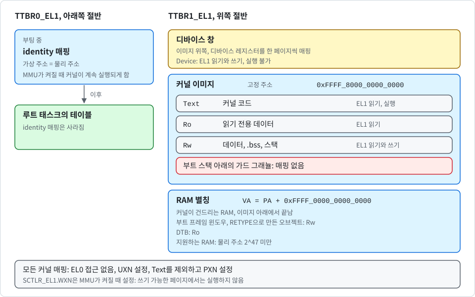

# 커널 페이지 테이블과 W^X

[English](../en/memory.md) | 한국어

이 노트는 커널이 자기 자신을 매핑하는 방법을 설명합니다. 변환 설정, 정적 테이블 풀과 테이블 예약 구간, 권한 체계, 그리고 부팅 때 결과를 확인하는 검사를 다룹니다. 코드는 `crates/k0-mm/src/paging.rs`에 있습니다. 사용자 주소 공간은 [user-address-space_KR.md](user-address-space_KR.md)에서 다룹니다.

## 두 개의 절반

AArch64는 가상 주소 공간을 두 개의 테이블 루트로 나눕니다. 다음 그림은 두 절반과 각 영역의 권한을 나타냅니다.

  

- `TTBR0_EL1`은 **아래쪽 절반**을 담당합니다. 부팅 중에는 각 가상 주소가 물리 주소와 같은 identity 매핑을 담고 있습니다. MMU가 켜지는 순간 커널이 계속 실행되려면 이 매핑이 필요합니다. 이후 `TTBR0_EL1`은 루트 태스크의 테이블로 전환되고 identity 매핑은 사라집니다.
- `TTBR1_EL1`은 **위쪽 절반**을 담당합니다. 이 절반은 다음 세 영역으로 이루어집니다.
  - **커널 이미지**: 부트로더가 어느 물리 주소에 올렸든 항상 고정 가상 주소 `0xFFFF_8000_0000_0000`에 매핑됩니다.
  - **RAM 별칭**: 커널이 건드리는 RAM(부트 프레임 윈도우, `RETYPE`으로 만든 오브젝트, DTB)을 고정된 오프셋으로 가리킵니다. 가상 주소 = 물리 주소 + `0xFFFF_0000_0000_0000`입니다.
  - **디바이스 창**: 이미지 위쪽에 있으며, 디바이스 레지스터를 한 페이지씩 매핑합니다.

higher-half로 점프한 뒤 커널은 이 매핑들만 사용합니다.

> [!NOTE]
> 별칭은 이미지 아래에서 끝나야 하므로 커널은 물리 주소 2^47 미만의 RAM만 지원합니다. 그보다 높은 RAM은 거부합니다.

두 절반 모두 48비트 가상 주소(`T0SZ = T1SZ = 16`)와 4단계 테이블을 사용합니다. **그래뉼**은 빌드 옵션입니다. 기본은 4 KiB(`granule-4k`)이고, `--no-default-features --features granule-16k`로 16 KiB를 선택할 수 있습니다. 실행 중에는 선택할 수 없으며, 두 feature 중 정확히 하나만 켜야 합니다. 그렇지 않으면 빌드가 실패합니다. 64 KiB는 지원하지 않습니다. 부팅은 `ID_AA64MMFR0_EL1`을 확인해, 선택한 그래뉼을 지원하지 않는 CPU에서는 부팅을 거부합니다. `TG0`와 `TG1`은 같은 그래뉼을 서로 다른 값으로 인코딩하는데, 코드는 이를 명시적으로 처리합니다. 물리 주소 크기(`IPS`)는 CPU가 보고하는 범위에서 가져오되 48비트로 제한합니다.

이미지는 그래뉼 경계에 맞는 어떤 물리 주소에든 적재할 수 있습니다. 진입 코드는 프로그램 카운터 기준으로 자기 위치를 구해 고정 가상 주소에 자신을 매핑합니다. `TTBR0_EL1`의 identity 매핑은 전환하는 순간에만 있습니다.

커널은 **페이지만** 매핑하고 블록은 매핑하지 않습니다. 모든 매핑이 마지막 레벨까지 같은 워크를 거치므로, 따져 봐야 할 코드 경로가 하나뿐입니다.

## 정적 테이블 풀

커널에는 heap이 없습니다. 부팅 중 페이지 테이블은 `.bss`에 있는 **40개 테이블 풀**에서 나오며, 증가만 하는 카운터로 하나씩 내줍니다. MMU를 설정할 때 다음 테이블 세 개를 가져갑니다.

- 두 절반의 루트 테이블 두 개
- 매핑이 하나도 없는 빈 `TTBR0_EL1` 루트(`null_user_root`)

현재 설치된 주소 공간이 파괴되면 커널은 `TTBR0_EL1`을 이 빈 루트로 옮겨, 하드웨어가 이미 사라진 테이블을 워크하는 일이 없게 합니다. 그 밖의 테이블은 매핑이 추가되면서 중간 테이블이 됩니다. 기본 빌드를 QEMU virt에서 돌리면 부트 프레임 윈도우를 매핑한 뒤 출력되는 부팅 로그 줄 `k0: kernel table pool N/40`이 `16/40`을 보여 줍니다. 이 풀은 부팅 중에만 쓰입니다. 부팅 뒤 `RETYPE`에 드는 테이블은 테이블 예약 구간에서 나옵니다("테이블 예약 구간" 참고).

워크가 기존 테이블 엔트리를 따라갈 때, `index_of`는 그 엔트리에 든 주소를 풀 인덱스로 되돌립니다. 풀 안에서 할당된 테이블에 정확히 맞지 않는 주소는 거부합니다. 따라서 손상되었거나 위조된 테이블 주소는 `BadTable`로 워크를 멈추게 하며, 임의의 메모리로 따라 들어가는 일은 없습니다.

### 실패한 매핑은 롤백됩니다

`map_page`는 내려가는 길에 만든 모든 링크를 기억합니다. 풀이 바닥나거나 리프 엔트리가 이미 사용 중인 경우 등으로 워크가 실패하면, 그 링크를 지우고 카운터를 되돌립니다. 풀은 호출 전과 정확히 같은 상태로 돌아갑니다.

부팅 이후에 이것이 중요합니다. `RETYPE` 시스템 콜마다 새 오브젝트를 커널 별칭에 매핑하는데, 롤백은 정적 배열의 테이블뿐 아니라 예약 구간에서 가져온 테이블도 되돌립니다. 롤백이 없다면 사용자 태스크가 도중에 실패하는 retype을 반복해서 테이블을 몇 개씩 고갈시킬 수 있고, 결국 커널 자신이 아무것도 매핑하지 못하게 됩니다. 롤백이 있으면 실패한 retype은 비용이 들지 않습니다. 호스트 테스트 두 개가 이를 보여 줍니다.

- 하나는 워크를 중간에 실패시키고 풀이 그대로인지 확인합니다.
- 다른 하나는 거의 가득 찬 풀에서 천 번 연속으로 실패시킵니다.

## 테이블 예약 구간

retype된 오브젝트의 커널 별칭에 드는 테이블은 정적 풀에서 나오지 않습니다. 부팅 때 `Untyped` 케이퍼빌리티가 될 메모리 구간마다, 커널은 그 구간의 모든 그래뉼을 매핑하는 데 들 수 있는 최대 테이블 수를 계산해 그만큼의 그래뉼을 구간 안에 따로 떼어 둡니다.

- `alias_tables_for`는 구간에 대한 상한을 줍니다. 루트 아래 세 레벨마다 구간이 걸치는 블록의 수를 세므로, 실제로 드는 수가 이 값을 넘는 일은 없습니다.
- 커널은 이 몫을 구간의 맨 위에서 떼어 `reserve_tables`로 등록합니다. 몫 아래의 나머지 구간이 `Untyped`으로 넘어갑니다. 몫에는 주소 공간 등록부 항목도 함께 있습니다([user-address-space_KR.md](user-address-space_KR.md) 참고).
- 예약 구간은 최하위 테이블 하나가 덮는 크기의 조각 단위로 스스로를 매핑하며, 조각이 매핑되는 즉시 등록합니다. 첫 조각만 그 시점에 있는 것(정적 풀 또는 앞서 등록한 예약 구간)에서 치르고, 나머지는 구간이 스스로 댑니다.
- 테이블 번호는 정적 배열에서 이어서 예약 구간들로 계속되며, 예약 구간이 등록된 순서를 따릅니다. `index_of`는 배열이나 예약 구간에서 이미 내준 테이블의 주소만 받아들입니다.
- 예약 구간의 테이블은 부팅 때가 아니라 **내줄 때 소거**합니다.
- 워크가 실패하면 롤백이 두 곳의 테이블을 모두 돌려줍니다.

부팅 뒤 `alias_object`는 예약 구간에서 테이블을 가져옵니다. 커널이 `Untyped`으로 넘긴 구간 안의 어떤 주소에 대해서도 테이블이 모자라 실패하는 일은 없습니다. 자기 몫을 둘 수 없거나 몫을 매핑할 수 없는 구간은 `Untyped`으로 **넘기지 않습니다**. 커널은 `k0: memory <base> + <size> not handed out (<reason>)`를 출력하고 부팅을 계속합니다. 온전한 그래뉼이 하나도 없는 틈은 오브젝트를 만들 수 없으므로 그대로 넘깁니다.

> [!NOTE]
> 예약 구간의 비용은 4 KiB 그래뉼에서 메모리 2 MiB당 테이블 하나(RAM의 약 0.2 %), 16 KiB 그래뉼에서 32 MiB당 하나(약 0.05 %)입니다.

## 권한

> [!IMPORTANT]
> 모든 커널 매핑은 하나의 규칙을 따릅니다. 쓰기 가능하면서 실행 가능한 것은 없고, 커널이 자기 용도로 매핑한 것은 EL0에서 접근할 수 없습니다.

다음 표는 커널 매핑의 종류와 권한을 나타냅니다.

| 종류 | 용도 | EL1 접근 | EL1 실행 | EL0 접근 |
| --- | --- | --- | --- | --- |
| `Text` | 커널 코드 | 읽기 | 가능 | 없음 |
| `Ro` | 읽기 전용 데이터, DTB | 읽기 | 불가 | 없음 |
| `Rw` | 데이터, `.bss`, 스택, 프레임 윈도우 | 읽기와 쓰기 | 불가 | 없음 |
| `Device` | 콘솔 UART(그 드라이버를 포함해 빌드한 이미지에서만), 인터럽트 컨트롤러 | 읽기와 쓰기 | 불가 | 없음 |

모든 커널 매핑은 `UXN`을 설정하고, `Text`를 제외한 모든 매핑은 `PXN`을 설정합니다. 메모리 속성 인덱스 0은 일반 write-back 메모리이고 인덱스 1은 Device-nGnRE입니다.

`SCTLR_EL1.WXN`은 MMU가 켜질 때 설정됩니다. `WXN`이 있으면 하드웨어는 실행 비트가 무엇이든 **쓰기 가능한 페이지에서의 실행을 거부**합니다. 버그 때문에 쓰기 가능하면서 실행 가능한 엔트리가 만들어지더라도, 실행 가능한 쓰기 가능 페이지는 생기지 않습니다.

링커 스크립트가 이 구분을 뒷받침합니다. `kernel/build.rs`가 템플릿 하나(`kernel/kernel.ld`)에 그래뉼 크기를 앞에 붙여 스크립트를 생성하므로 정렬이 그래뉼 feature를 따릅니다. text, 읽기 전용 데이터, 데이터를 그래뉼 경계에 정렬하고, ELF 프로그램 헤더에도 같은 R+X, R, R+W 플래그를 담습니다.

## 디바이스와 DTB 매핑

DTB는 헤더를 검사한 뒤에야 별칭으로 읽기 전용 매핑되고, 커널은 거기서 플랫폼 기술을 읽습니다. 디바이스 페이지는 플랫폼 기술자를 메모리 맵과 대조한 뒤에만 매핑합니다. 다음은 거부합니다.

- RAM, 커널 이미지 또는 DTB와 겹치는 디바이스 범위
- CPU의 주소 폭을 넘는 물리 주소

디바이스 페이지는 디바이스 창에 한 페이지씩 들어가므로, 큰 레지스터 범위(예를 들어 GICv3 리디스트리뷰터)를 통째로 매핑하는 일은 없습니다. 인터럽트 컨트롤러는 [exceptions_KR.md](exceptions_KR.md)를 참고하세요.

**부트 프레임 윈도우**는 커널이 메모리 맵 안에서 고르는 2 MiB의 RAM입니다. 이를 고르는 함수는 `crates/k0-boot/src/window.rs`의 `boot_window`이며, UEFI 로더도 점프 전에 같은 함수를 돌립니다. 먼저 커널 이미지 바로 뒤(DTB와 겹치면 DTB 뒤)를 보고, 위쪽에 자리가 없으면 가장 낮은 메모리부터 위로 찾습니다.

## 가드 페이지

부트 스택은 64 KiB이며 `.bss` 뒤에 있습니다. 그 바로 아래 그래뉼은 두 절반 모두에서 제외되어, 스택 오버플로가 `.bss`를 덮어쓰지 않고 **즉시 폴트**를 냅니다. 예외 벡터는 `.bss`에 자기만의 8 KiB 스택을 가집니다. 치명적 경로는 이 스택으로 전환하므로, 폴트 자체가 스택 오버플로였더라도 커널은 진단을 출력할 수 있습니다.

## MMU 켜기

`switch_on`은 다음 순서로 동작합니다.

1. `MAIR_EL1`, `TCR_EL1`, 두 테이블 루트를 기록합니다.
2. 배리어를 실행합니다.
3. TLB를 무효화합니다.
4. 명령 캐시 전체를 무효화합니다.
5. `SCTLR_EL1.M`, `C`, `I`, `WXN`을 설정합니다.

부트로더가 캐시에 무엇을 남겼는지 커널은 신뢰하지 않으므로 명령 캐시 무효화를 수행합니다.

`ID_AA64MMFR2_EL1`이 FEAT_E0PD를 보고하면 `enable_paging`은 `TCR_EL1.E0PD1`도 설정합니다. 이 비트가 있으면 EL0가 상위 절반(`TTBR1_EL1` 범위)에 접근할 때 변환 워크 없이 곧바로 폴트가 나므로, EL0는 어떤 커널 별칭 주소가 매핑되어 있는지 타이밍으로 구별할 수 없습니다. 기본 QEMU `cortex-a72`처럼 FEAT_E0PD가 없는 코어에서는 비트를 설정하지 않으며, 접근은 권한 부재로 여전히 폴트가 납니다.

`enable_paging`은 한 번만 실행할 수 있습니다. 두 번째 호출은 `AlreadyEnabled`를 반환합니다. 성공하면 페이징이 켜졌음을 증명하는 용도의 `Mmu` 토큰을 반환합니다.

> [!NOTE]
> `Mmu` 토큰을 소비하는 단계는 아직 없습니다. 토큰은 higher-half로의 점프를 넘어 가져갈 수 없기 때문에, 대신 `kernel_main`의 순서가 그 시퀀스를 보장합니다.

## 이후의 매핑 추가

함수 두 개가 부팅 이후 higher-half에 읽기·쓰기 범위를 추가합니다. 둘은 워커를 공유하고 플래그 하나만 다릅니다. 세 번째 함수 `wipe_ro_alias`는 기존 엔트리를 바꾸며, 두 함수 다음에 설명합니다.

- `map_kernel_window`는 루트 태스크를 적재하기 전에 2 MiB 부트 프레임 윈도우를 매핑합니다. 범위 안에 기존 변환이 있으면 같든 다르든 오류(`Overlap`)입니다.
- `alias_object`는 `RETYPE`으로 만든 오브젝트의 그래뉼 하나를 매핑합니다. 커널이 별칭을 통해 이를 0으로 채우고 사용할 수 있게 하기 위해서입니다. 리프에 이미 완전히 같은 매핑(같은 물리 주소, 같은 속성)이 있으면 성공합니다. 다른 매핑이 있으면 여전히 `Overlap`입니다.

같은 매핑을 받아 주는 이유는 별칭을 제거하지 않기 때문입니다. `CAP_REVOKE`나 `CAP_DELETE`가 untyped 메모리를 돌려주고 그것을 다시 retype하면, 같은 물리 프레임의 별칭이 이미 있습니다. **완전히 같은 엔트리만** 받으면 다른 곳을 가리키는 매핑을 retype이 덮어쓰게 하지 않으면서 재사용이 동작합니다. 윈도우 매핑에는 이 관대함을 주지 않습니다. 부트 윈도우가 기존 매핑과 겹치면 실수이기 때문입니다.

이 두 호출은 유효하지 않은 엔트리를 유효하게 바꾸기만 합니다. 기존 변환은 바뀌지 않으므로 break-before-make 시퀀스가 필요 없습니다. 스토어 배리어와 명령 배리어가 메모리를 사용하기 전에 새 엔트리를 테이블 워커에게 보이게 합니다.

`wipe_ro_alias`는 읽기 전용 별칭 엔트리를 읽기·쓰기로 바꾸는 유일한 곳입니다. 커널은 루트 태스크에 진입하기 직전에 이 함수를 호출해 DTB의 `rng-seed`와 `kaslr-seed` 바이트를 0으로 채웁니다(자세한 내용은 [boot_KR.md](boot_KR.md) 참고). 해당 페이지의 엔트리를 break-before-make로 제자리에서 읽기·쓰기로 바꾸고, 0을 쓰고, 읽어 올 값이 메모리에서 오도록 캐시 라인을 정리 및 무효화한 다음, 엔트리를 다시 읽기 전용으로 되돌립니다.

## 부팅 시 자가 검사

점프 직후 `kernel/src/main.rs`의 `check_wx`가 주소 변환 명령(`AT S1E1R`, `AT S1E1W`)으로 각 경우가 의도대로 동작하는지 하드웨어에 묻습니다. 다음 표는 검사 항목과 기대 결과를 나타냅니다.

| 검사 | 기대 결과 |
| --- | --- |
| 커널 text를 읽을 수 있음 | 예 |
| 커널 text에 쓸 수 있음 | 아니오 |
| 읽기 전용 데이터에 쓸 수 있음 | 아니오 |
| 부트 스택 가드 페이지를 읽을 수 있음 | 아니오 |
| 부트 스택에 쓸 수 있음 | 예 |
| 커널 text의 identity 매핑을 읽을 수 있음 | 예, 사용자 테이블이 대체하기 전까지 |

하나라도 어긋나면 검사의 이름과 함께 **부팅이 멈춥니다**. 이 검사는 테이블을 만든 코드가 아니라 하드웨어가 실제로 워크하는 테이블을 시험합니다.

## 테스트 방법

- `tools/boot-matrix.sh`는 기본 빌드와 16 KiB 빌드를 여러 QEMU 구성에서 부팅하고, 지원하지 않는 구성이 부팅 로그에 사유를 남기며 거부되는지 확인합니다.
- `crates/k0-mm/src/paging/tests.rs`의 호스트 단위 테스트는 두 그래뉼의 인덱스 산술, 모든 커널 권한의 W^X 속성, 실패한 워크 이후의 롤백(예약 구간의 테이블 포함), 위조되었거나 블록인 엔트리의 거부, 예약 구간 테이블을 내줄 때의 소거, 여러 예약 구간에 걸친 번호 매김, 첫 조각을 매핑하지 못하는 예약 구간(등록되지 않음), 완전히 같은 리프가 호출자가 요청할 때만 받아들여지는지(`an_identical_leaf_is_accepted_only_when_asked`)를 확인합니다. AArch64 호스트에서 실행됩니다.
- 호스트 속성 테스트(`aliasing_every_granule_of_any_ranges_stays_within_the_bound`)는 블록 경계 근처의 무작위 구간을 뽑아 정적 배열을 닫고, 모든 구간의 모든 그래뉼을 매핑한 뒤 `alias_tables_for`가 준 수보다 많은 테이블이 쓰이지 않았는지 확인합니다.
- 루트 태스크 자체 테스트 `test_reserve`는 최대 40개 테이블 블록에 걸쳐 프레임을 retype하고 어떤 `RETYPE`도 `KERNEL_RESOURCE`로 실패하지 않을 것을 요구합니다. 마커 `root: kernel reserve tests pass`와 부팅 줄 `k0: kernel reserve `가 필요합니다.
- `tools/qemu-boot-test.sh`는 `k0: w^x checks pass` 줄을 요구합니다.

## 알려진 공백

- **별칭 잔존**: 커널 별칭 매핑은 제거되지 않습니다. retype된 오브젝트는 케이퍼빌리티가 revoke되고 그 메모리가 다시 retype된 뒤에도 커널 별칭에 매핑된 채 남습니다. 완전히 같은 별칭은 받아 주므로 재사용은 실패하지 않지만, 별칭과 그것을 담은 테이블은 그대로 남습니다. 예약 구간은 이를 감안해 넘겨진 모든 구간의 모든 그래뉼을 한 번씩 덮도록 잡습니다.
- **가용성**: retype으로 커널 테이블을 소진시킬 수는 없게 되었지만, 가용성 전반은 여전히 보호되지 않습니다. 스케줄러에는 우선순위와 CPU 예산이 없고, 긴 시스템 콜은 다른 모든 태스크를 지연시킵니다. 태스크 간 격리는 가용성을 다루지 않습니다.
- **ASID 없음**: 주소 공간 식별자(ASID)는 사용하지 않습니다. 다른 사용자 주소 공간으로 전환할 때마다 TLB 전체를 무효화합니다.
