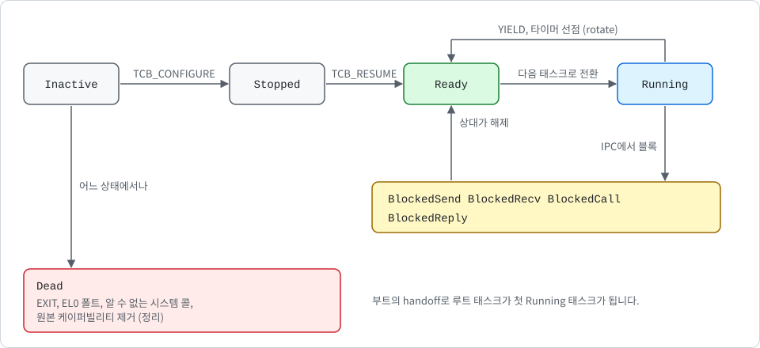
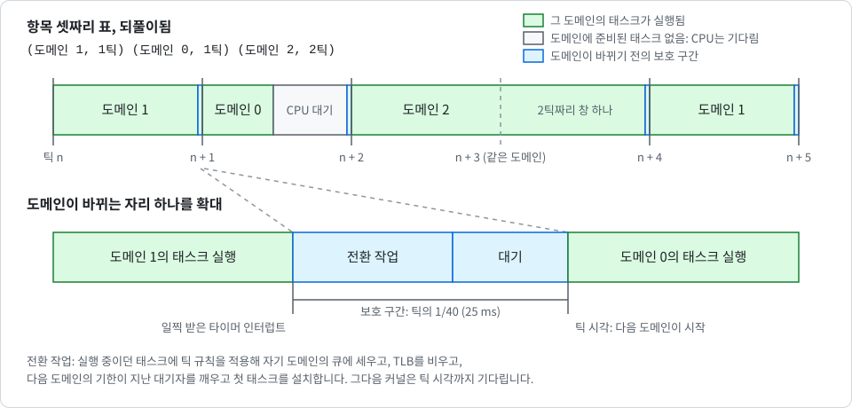

# 태스크와 스케줄링

[English](../en/scheduling.md) | 한국어

이 문서는 다음 내용을 설명합니다.

- K0가 태스크를 표현하는 방법
- 사용자 공간이 태스크를 만들고 시작하고 정리하는 방법
- 라운드 로빈 스케줄러가 태스크 사이를 전환하고, 타이머 틱이 태스크를 끊을지 정하는 방법
- 고정 시간 분할이 태스크의 도메인마다 자기 틱 창을 주는 방법, 그리고 그것이 주장하는 것과 주장하지 않는 것

코드는 다음 위치에 있습니다.

- `crates/k0-task/src/lib.rs`
- `crates/k0-part/src/lib.rs`(모든 스케줄링 판정, 타입 `Core`)와 `crates/k0-part/src/clock.rs`(틱 시각의 산술)
- `crates/k0-slice/src/lib.rs`(틱 하나에 대한 규칙, `Core`가 사용)
- `crates/k0-sched/src/lib.rs`(`Core`를 둘러싼 큐와 설치된 태스크)
- `crates/k0-arch/src/irq.rs`의 타이머
- `crates/k0-ipc/src/lib.rs`의 `teardown`
- `kernel/src/syscall.rs`의 `sys_tcb_configure`, `sys_tcb_resume`, `sys_part_set_table`, `sys_part_set_domain`, `k0_preempt`, `k0_leave`, `wait_for_work`, `kill_current`, `finish`

이 문서는 현재 `main` 브랜치(미배포)를 기준으로 합니다.

## 태스크 제어 블록

**태스크 제어 블록**(TCB)은 다음을 담고 있습니다.

- **저장된 사용자 컨텍스트**: 범용 레지스터 31개, 스택 포인터, 반환 주소, 저장된 프로세서 상태, EL0 스레드 포인터 레지스터 2개입니다.
- **최상위 페이지 테이블의 물리 주소**(`ttbr0_pa`): 주소 공간 루트의 사본이며 내장 슬롯이 묶여 있는 동안에만 유효합니다.
- **상태**: 태스크의 현재 상태입니다.
- **도메인**: 태스크가 속한 시간 분할 도메인의 번호이며 0부터 7까지입니다([시간 분할](#시간-분할) 참고). 도메인 0이 루트 도메인입니다. 이 바이트는 상태 뒤의 채움 자리에 들어가므로 TCB는 커지지 않았습니다.
- **큐 링크**: 태스크가 속한 큐에서 이웃 TCB로 가는 `next`와 `prev`입니다.
- **응답 자격**: 1회성 응답 자격(`reply_to`)과 그 역방향 링크(`reply_from`)입니다. [ipc_KR.md](ipc_KR.md)에서 설명합니다.
- **IPC 대기 정보**: 태스크가 줄 서 있는 엔드포인트 `blocked_on`, 그리고 보내려는 메시지에 붙을 배지 `ipc_badge`입니다.
- **타임아웃 필드**: 태스크의 IPC 대기가 끝나는 틱 `deadline`, 그리고 기한 목록의 링크 `tnext`와 `tprev`입니다([타임아웃](#타임아웃) 참고).
- **내장 케이퍼빌리티 슬롯 3개**: 1번 슬롯은 태스크의 `CNode` 케이퍼빌리티, 2번 슬롯은 `AddrSpace` 케이퍼빌리티를 담습니다. 0번 슬롯은 사용하지 않습니다.

**내장 슬롯**이 태스크를 케이퍼빌리티 공간과 주소 공간에 묶습니다. 시스템 콜은 슬롯 번호를 1번 슬롯의 CNode 안에서만 해석하고([capabilities_KR.md](capabilities_KR.md) 참고), 태스크는 2번 슬롯이 가리키는 주소 공간에서 실행됩니다. 둘 다 `TCB_CONFIGURE`에 넘긴 케이퍼빌리티의 복사본, 즉 파생 리스트에서 그 자식이며, 태스크에 묶인 것으로 표시됩니다. 둘 중 하나라도 제거되면 태스크는 정리됩니다([정리](#정리) 참고).

루트 태스크를 포함한 모든 TCB는 그래뉼 크기 프레임의 시작 부분에 있는 평범한 오브젝트입니다. 루트 태스크의 TCB는 2 MiB 부트 프레임 윈도우 안에 있고, 루트 CNode의 `Tcb` 케이퍼빌리티로 접근합니다. 그 외 TCB는 사용자 공간이 untyped 메모리에서 retype한 프레임입니다.

커널은 자신의 별칭을 통해서만 TCB에 접근하며, EL0에는 매핑되지 않습니다. 컴파일 타임 assertion이 TCB를 한 그래뉼 안에 유지하므로, 내장 슬롯의 주소를 그래뉼 단위로 내림하면 TCB를 되찾을 수 있습니다.

## 상태

다음 그림은 태스크 상태와 전환을 보여 줍니다. 각 상태의 의미는 그다음 표에 있습니다.

  

| 상태 | 의미 |
| --- | --- |
| `Inactive` | retype 직후, 구성 전 |
| `Stopped` | 구성 완료, 아직 시작 전 |
| `Ready` | 자기 도메인의 준비 큐에 있음 |
| `Running` | 현재 태스크 |
| `BlockedSend`, `BlockedRecv`, `BlockedCall` | 엔드포인트 큐에서 대기 중 |
| `BlockedReply` | `CALL`의 응답을 기다리는 중 |
| `BlockedConsole` | `CONSOLE_READ`에서 콘솔 입력을 기다리는 중(`console-input`으로 빌드한 이미지에만 있음). 태스크는 어떤 큐에도 없으며 커널의 대기자 자리 하나가 가리킵니다. 한 번에 한 태스크만 기다릴 수 있습니다. |
| `Dead` | 종료, 강제 종료, 또는 정리됨 |

블록 상태의 태스크는 기한이 지나도 `Ready`가 될 수 있습니다([타임아웃](#타임아웃) 참고). `BlockedConsole` 태스크는 바이트가 도착하거나 케이퍼빌리티가 삭제·회수·이동될 때도 `Ready`가 됩니다.

`Inactive`의 값은 0입니다. 방금 retype한 프레임은 전부 0이므로, 큐 링크가 비어 있고 내장 슬롯이 비어 있으며 응답 자격이 없는, 루트 도메인의 유효한 `Inactive` TCB입니다. retype에 생성자가 필요 없습니다.

## 태스크 생성

`TCB_CONFIGURE`는 인자 6개를 받습니다. `Tcb` 슬롯, 진입 주소, 스택 최상단, `AddrSpace` 슬롯, `CNode` 슬롯, 그리고 새 태스크가 `x0`으로 받을 인자 값입니다. 슬롯은 모두 호출자 자신의 CNode에서 찾습니다. 커널은 다음을 검사합니다.

- 진입 주소가 4바이트 정렬이고, 첫 그래뉼보다 위이며, 48비트 사용자 범위 안에 있는지
- 스택 최상단이 16바이트 정렬이고, 첫 그래뉼보다 위이며, 사용자 범위 안에 있는지
- 케이퍼빌리티의 종류가 맞는지(`Tcb`, `AddrSpace`, `CNode`)
- TCB가 `Inactive` 상태인지. 따라서 각 TCB는 한 번만 구성할 수 있고, 실행 중인 태스크를 다시 구성할 수 없습니다. 상태는 TCB에 대한 가변 참조를 만들기 전에 raw 포인터로 먼저 읽습니다.

> [!IMPORTANT]
> 두 바인딩은 함께 기록됩니다. 두 케이퍼빌리티를 먼저 모두 검증한 뒤 1번과 2번 슬롯에 복사본을 한 번에 기록하므로, 둘 중 하나에만 묶인 TCB는 존재할 수 없습니다.

검사 중 하나라도 실패하면 두 내장 슬롯은 모두 빈 채로 남고 TCB는 `Inactive`를 유지합니다.

그다음 커널은 저장 컨텍스트를 0으로 지우고 진입 주소, 스택 포인터, `x0`, `ttbr0_pa`를 설정합니다. 저장되는 프로세서 상태도 커널이 직접 정해서, 인터럽트가 마스크 해제된 EL0로 설정합니다. 사용자 공간은 프로세서 상태를 절대 지정할 수 없으므로 EL1로 복귀하거나 인터럽트를 마스크한 채 실행하도록 요청할 수 없습니다. 스레드 포인터 레지스터는 0에서 시작하므로 새 태스크가 생성자의 값을 물려받지 않습니다. 새 태스크는 **자신을 구성한 태스크의 도메인**을 받습니다. TCB는 `Stopped`가 됩니다.

`TCB_RESUME`은 `Stopped` TCB만 받아 그 태스크가 속한 도메인의 준비 큐에 넣습니다. 이미 큐에 있거나, 실행 중이거나, 블록됐거나, 종료된 TCB는 거부되므로 같은 TCB가 큐에 두 번 들어갈 수 없습니다.

제어 케이퍼빌리티를 가진 쪽은 이 두 호출 사이에서만 `PART_SET_DOMAIN`으로 태스크를 다른 도메인에 넣을 수 있습니다([제어 케이퍼빌리티와 두 시스템 콜](#제어-케이퍼빌리티와-두-시스템-콜) 참고). 태스크의 도메인은 첫 `TCB_RESUME` 뒤에는 바뀌지 않습니다.

## 준비 큐

스케줄러는 설치된 태스크를 유지하고, **8개 도메인마다** 준비 큐의 머리와 꼬리, 기한 목록의 머리를 유지합니다. 각 값은 TCB의 커널 주소이고 0은 없음을 뜻합니다. 큐는 TCB 자체의 `next`와 `prev` 필드로 연결되므로 별도 메모리가 필요 없습니다. 큐의 길이는 TCB 수로 제한되고, TCB는 사용자 공간이 untyped 메모리로 비용을 치른 것입니다. 따라서 스케줄러가 커널 메모리를 고갈시키는 수단이 될 수 없습니다.

태스크는 자기 도메인의 큐에만 들어갑니다. 모든 깨우기가 사용하는 `k0_sched::enqueue`는 TCB에서 도메인을 읽으며, 호출자는 큐를 고를 수 없습니다. 스케줄러가 직접 태스크를 큐에 넣을 때(순환할 때 또는 창이 끝날 때)는 그 큐가 태스크 자신의 것인지 검사하고, 아니면 `k0: FATAL task queued outside its domain`을 출력하고 정지합니다. 표를 정하지 않았으면 모든 태스크가 도메인 0에 있고, 이전처럼 큐 하나만 사용합니다.

큐는 이중 연결이므로 큐 어디에 있는 태스크든 상수 시간에 뺄 수 있습니다. 태스크가 준비 상태에서 정리될 수 있고, 그때 커널이 큐를 훑어 찾아서는 안 되기 때문입니다. 제거할 때 링크가 큐의 머리와 꼬리와 일치하는지 검사합니다. 일치하지 않으면 큐가 손상된 것이므로 커널은 `k0: FATAL ready queue corrupt`를 출력하고 정지합니다.

같은 `next`와 `prev` 필드는 블록된 태스크를 엔드포인트 큐에 연결하는 데도 사용하며, 엔드포인트 큐도 같은 구조입니다. 태스크는 준비 상태이거나, 한 엔드포인트에서 블록됐거나, 실행 중이거나 셋 중 하나입니다. 둘이 겹치는 일은 상태 머신이 막습니다.

## 태스크 전환

예외가 EL0에서 도착하면 벡터 코드는 Rust 코드가 실행되기 전에 모든 사용자 레지스터를 현재 TCB의 컨텍스트에 저장합니다([exceptions_KR.md](exceptions_KR.md) 참고). 복귀할 때는 전역 `__current_context` 포인터가 가리키는 컨텍스트에서 레지스터를 복원합니다. 따라서 태스크 전환은 두 단계입니다.

1. `__current_context`를 다음 태스크의 저장 컨텍스트로 돌립니다.
2. 다음 태스크가 다른 최상위 페이지 테이블을 사용하면 `TTBR0_EL1`에 로드하고 TLB 전체를 무효화합니다. K0는 주소 공간 식별자(ASID)를 사용하지 않으므로, 서로 다른 주소 공간의 태스크 사이를 전환할 때마다 TLB를 전부 비웁니다. 같은 주소 공간의 태스크 사이 전환은 `TTBR0_EL1`을 건드리지 않습니다. 도메인이 바뀔 때는 주소 공간이 그대로여도 TLB를 비웁니다.

태스크마다 다른 주소 공간에서 실행될 수 있으므로 `TTBR0_EL1`은 태스크 사이에서 실제로 바뀝니다. 설치돼 있는 주소 공간이 파괴될 때는 커널이 먼저 `TTBR0_EL1`을 빈 테이블로 바꿉니다.

다음에 누가 실행될지에 대한 판정은 모두 한 곳, 크레이트 `k0-part`의 타입 `Core`에서 내립니다. `Core`는 표, 도는 도메인(지금 실행 차례인 도메인), 실행 중인 태스크, 슬라이스 규칙의 표시를 가지며, 큐에는 작은 트레이트(`Env`)를 통해서만 접근합니다. 그래서 호스트 테스트가 같은 코드를 가짜 환경 위에서 실행합니다. `k0-sched`는 그 트레이트를 실제 큐 위에 구현합니다. 커널은 다음 표의 함수 가운데 하나를 호출해 **어떤 사건이 일어났는지**만 스케줄러에 알립니다. 진입 종류나 "틱이 지나갔다"는 플래그를 넘기는 일이 없으므로 틀린 값을 넘길 수도 없습니다.

진입 종류는 다음 태스크가 CPU를 어떻게 받았는지를 말합니다. 틱의 판정으로 받았으면 `Tick`, 틱과 틱 사이에 받았으면 `Between`입니다. `Core`가 이를 유지하는 까닭은 다음 절들에서 설명합니다.

| `k0-sched`의 함수 | 호출되는 경우 | 현재 태스크에 일어나는 일 | 다음 태스크의 진입 종류 |
| --- | --- | --- | --- |
| `rotate` | `YIELD` | 자기 도메인 준비 큐의 꼬리로 가고, 그 도메인에 준비된 다른 태스크가 없으면 그대로 계속 실행 | `Between` |
| `on_tick` | EL0에서 받은 타이머 틱 | 창 안에서는 틱과 틱 사이에 CPU를 받았고 아직 틱을 맞은 적이 없으면 계속 실행하며 면제를 소모합니다. 그렇지 않으면 큐의 꼬리로 가고, 준비된 다른 태스크가 없으면 그대로 계속 실행합니다. 창이 끝날 때는 자기 도메인의 큐에 세워 둡니다([창](#창) 참고) | `Tick` |
| `block_and_switch` | IPC, `CONSOLE_READ`, 그리고 현재 태스크가 죽었을 때의 시스템 콜 종료 경로 | 준비 큐 밖에 머뭅니다. 호출자가 이미 엔드포인트 큐, 응답 자격 뒤, 콘솔 대기자 슬롯 중 하나에 걸어 두었거나, 태스크가 `Dead`입니다. | `Between` |
| `poll` | 대기 루프, 인터럽트마다 | (실행 중인 태스크 없음) | 커널이 기다리는 동안 틱 번호가 올라갔으면 `Tick`, 아니면 `Between` |
| `handoff` | 부트, 한 번 | 루트 태스크가 첫 `Running` 태스크가 됨 | `Between` |
| `set_table` | `PART_SET_TABLE` | 계속 실행 | (전환 없음) |

이 함수들은 어느 것도 다른 도메인의 큐에서 태스크를 꺼내지 않습니다. 도는 도메인에 준비된 태스크가 없으면 `block_and_switch`, `on_tick`, `poll`이 그 사실을 알리고, 커널은 기다립니다([실행할 태스크가 없을 때](#실행할-태스크가-없을-때) 참고).

## 선점

틱은 1초입니다. n번 틱은 정해진 시각에 옵니다. 타이머를 설정할 때 읽은 카운터 값에 주기 n개를 더한 시각입니다. 타이머는 언제나 이런 절대 시각에 맞춰 설정하므로, 핸들러가 늦게 실행되어도 뒤의 틱이 밀리지 않습니다([틱 시계와 건너뛴 틱](#틱-시계와-건너뛴-틱) 참고).

EL0가 실행 중일 때 타이머가 발생하면 IRQ 경로가 인터럽트를 확인하고, 틱 번호를 계산하고, 다음 틱을 설정한 뒤 `k0: tick N`을 출력하고 `k0_preempt`를 호출합니다. `k0_preempt`는 `k0_sched::on_tick`을 호출합니다. 창 안에서는 스케줄러가 먼저 도는 도메인에서 기한이 된 콘솔 읽는 쪽과 타임아웃 대기자를 깨운 다음, 이번 틱이 현재 태스크를 끊을지 정합니다([슬라이스 규칙](#슬라이스-규칙) 참고). 창이 끝날 때는 현재 태스크를 세워 두고 다음 도메인으로 들어갑니다([창](#창) 참고).

표를 정하지 않았으면 양보하지도 블록하지도 않는 태스크는 **최대 2초 뒤에는 CPU를 잃고**, 틱에서 CPU를 받았다면 1초 뒤에 잃습니다. 표가 있으면 태스크 자신의 창 안에서 같은 것이 성립하고, 창이 끝나면 태스크가 무엇을 했든 CPU를 내놓습니다.

`k0: tick N` 줄은 콘솔 드라이버를 포함해 빌드한 이미지에서는 콘솔에 출력합니다. 로그에는 처음 4개의 tick 줄만 남기며, 번호를 건너뛰었거나 표가 정해져 있어도 이 줄들은 남깁니다. 콘솔에만 나가는 그 뒤의 줄은 루트 도메인이 아닌 도메인이 적힌 표가 정해져 있거나 보류 중인 동안에는 출력하지 않습니다. 태스크가 콘솔 입력을 읽은 뒤에는 줄 하나 `k0: tick lines off (console input in use)`를 남기고 틱 줄이 멈추지만, 틱과 선점과 타임아웃은 계속됩니다.

> [!IMPORTANT]
> 커널 자체는 선점되지 않습니다. 예외 진입이 인터럽트를 마스크하고, 커널은 시스템 콜이나 폴트를 처리하는 동안 마스크를 유지합니다.

창 안에서 틱은 여전히 같은 도메인에 준비된 다른 태스크가 있을 때만 태스크를 끊습니다. EL1에서 타이머 인터럽트가 도착하는 것은 이양 전 부트 중이나, 실행할 것이 없어 커널이 기다리는 동안에만 가능합니다. 그때는 틱을 세기만 하고, 대기 루프가 곧바로 새 번호를 스케줄러에 넘깁니다(`poll`). `on_tick`은 EL0에서 받은 틱 사건마다 정확히 한 번 호출되며, 설정해 둔 시각보다 일찍 도착한 타이머 인터럽트는 틱이 아닙니다. `console-input` 이미지에서 입력 바이트가 도착해도 선점하지 않습니다. 깨어난 읽는 쪽은 다른 깨어난 태스크처럼 자기 도메인 준비 큐의 맨 뒤로 갑니다. 우선순위가 없으므로 입력 지연은 준비된 태스크마다 최대 한 틱이고, 실행 중인 태스크가 틱과 틱 사이에 CPU를 받았다면 한 틱이 더해집니다.

## 슬라이스 규칙

틱은 정해진 시각에 오고, 태스크 전환은 그 시각을 옮기지 않습니다. 그래서 틱과 틱 사이에 CPU를 받은 태스크는 주기의 남은 조각만 받습니다. 이 규칙이 생기기 전에는 얼마나 짧게 실행했든 다음 틱이 그 태스크를 큐의 끝으로 보냈습니다. 태스크가 매 틱 직전에 `YIELD`를 호출할 수 있었고, `YIELD`에는 케이퍼빌리티가 필요 없습니다. 그러면 뒤에 선 태스크는 양보 뒤의 조각만 받고, 양보한 태스크는 다음 온전한 주기를 위해 큐의 맨 앞으로 돌아옵니다. CPU를 계속 쓰는 태스크 둘을 QEMU에서 돌린 실행에서, 공격 태스크가 주기의 90 %에서 양보하면 다른 태스크의 몫이 약 52 %에서 7.9 %부터 11.1 % 사이로 떨어졌습니다. 이 실행의 양보 지점은 루트 태스크가 공격 태스크를 위해 측정한 반복 횟수로 정했습니다. 틱의 위상을 스스로 찾아내는 공격 태스크는 만들지 않았습니다.

규칙은 크레이트 `k0-slice`에 있으며, 이 크레이트는 "이번 틱이 현재 태스크를 끊는가"라는 물음에만 답합니다. `Core`는 실행 중인 태스크 옆에 표시를 하나 두고, 실행 중인 태스크를 바꾸는 단 하나의 함수에서만 그 표시를 기록합니다.

- 틱과 틱 사이에 CPU를 받은 태스크(`Entry::Between`)는 처음 맞는 틱에 끊기지 않습니다. 그 틱이 면제를 소모하고, 태스크는 그다음 틱까지 실행합니다. 앞선 태스크가 `YIELD`를 호출했거나, 블록됐거나(IPC 또는 `CONSOLE_READ`), 종료됐거나 죽은 경우, 그리고 커널이 기다리다가 콘솔 입력처럼 틱이 아닌 일로 깨어난 경우가 여기에 해당합니다.
- 틱의 판정으로 CPU를 받은 태스크(`Entry::Tick`)는 주기의 처음에 들어온 것이므로 이전처럼 다음 틱에서 끊깁니다. 틱이 깨운 뒤(예를 들어 기한이 지난 타임아웃) 기다리던 커널이 전환해 준 태스크, 그리고 창이 열리는 도메인의 첫 태스크도 여기에 속합니다. 틱과 콘솔 입력이 같은 깨어남에 함께 오면 틱으로 셉니다. `Core::poll`이 틱 번호만 보고 판정하기 때문입니다.
- 부트 때의 루트 태스크는 틱과 틱 사이에 들어온 것으로 셉니다. 타이머가 부트 중에 이미 돌고 있기 때문입니다.
- 태스크를 깨우는 것은 면제를 주지 않습니다. 깨어난 태스크는 이전처럼 자기 도메인의 준비 큐 맨 뒤로 가고, 콘솔 입력은 여전히 선점하지 않습니다.
- 준비된 다른 태스크가 없을 때의 `YIELD`는 아무것도 바꾸지 않습니다.

`Slice::entered`는 진입 종류만으로 표시를 대입하고 이전 값을 읽지 않으므로, 앞 태스크가 남긴 표시가 전환을 넘어 살아남지 않습니다. 다른 도메인의 태스크가 남긴 표시도 마찬가지입니다. 면제는 `YIELD`뿐 아니라 블록과 종료에도 줍니다. `YIELD`만 주면, 틱 직전마다 타임아웃 대기를 시작하는 두 태스크가 그 사이의 태스크를 굶길 수 있습니다(모델이 이 경우를 보여 줍니다).

도메인이 하나일 때 규칙에서 따라 나오는 것은 다음과 같습니다.

- 전환돼 들어온 태스크는 스스로 CPU를 내놓지 않는 한 온전한 한 틱 주기를 채우기 전에는 타이머에 끊기지 않습니다. 강제로 선점되기 전에 적어도 한 주기, 많아야 두 주기를 실행합니다.
- 준비된 태스크가 N개일 때 양보하지도 블록하지도 않는 태스크는 다른 태스크가 `YIELD`, 블록, 타임아웃 대기를 어떻게 하든 오래 보면 CPU의 1/N 이상을 유지합니다. 이는 모델에서 탐색으로 확인했고, Lean 정리 하나가 도메인 하나의 모델에 대해 이를 진술합니다([테스트 방법](#테스트-방법) 참고). **Rust 코드에 대한 증명이 아니며**, 도메인이 여럿인 표에 대해서는 그런 진술이 없고, **예산도 아닙니다**. 태스크가 쓸 수 있는 양에 상한이 없고, 태스크를 만들 때마다 N이 늘어납니다.
- 대가는 지연입니다. 앞에 실행할 태스크가 k개(실행 중인 것 포함)인 채로 준비된 태스크는 예전에는 k 틱 주기 안에 시작했고, 지금은 k + 1 주기 안에 시작합니다. 모델에서는 CPU를 계속 쓰는 태스크 하나 뒤에서 호출과 응답을 주고받는 호출자와 서버가 왕복마다 2틱 대신 4틱이 필요합니다. CPU를 계속 쓰는 태스크가 없으면 달라지는 것이 없습니다.

표가 있을 때는 이 내용을 도메인 자신의 시간, 즉 그 도메인의 창을 이어 붙인 시간 위에서 읽어야 합니다. 창을 끝내는 틱은 실행 중인 태스크에 같은 규칙을 적용한 다음 그 태스크를 세워 둡니다([창](#창) 참고). 그래서 태스크는 온전한 한 주기를 실행하기 전에 창의 끝에서 CPU를 내놓을 수 있습니다. 그 태스크는 자기 도메인의 다음 창에서 이어집니다. 도메인이 바뀌면서 끝나는 창은 보호 구간만큼 더 짧습니다([보호 구간과 틱 시각까지의 대기](#보호-구간과-틱-시각까지의-대기) 참고).

> [!NOTE]
> 이 절의 수치(실행당 한 주기부터 두 주기, 대기 k + 1 주기)는 이 버전 스케줄러의 동작을 설명할 뿐 인터페이스가 아닙니다. 틱은 여전히 1초이고 타임아웃은 여전히 틱 단위로 셉니다.

## 타임아웃

틱은 [ipc_KR.md](ipc_KR.md)에서 설명하는 모든 IPC 타임아웃의 단위입니다. 스케줄러는 기한이 있는 대기자를 기한 목록에 유지하며, 목록은 **도메인마다 하나**입니다(`k0-sched`의 `arm_timeout`, `disarm_timeout`, `expired`, `has_timed`). 목록은 정렬되어 있지 않고, 가장 이른 기한의 하한 덕분에 대부분의 틱은 목록을 건너뜁니다. 새 대기자는 목록의 머리에 연결됩니다.

태스크가 블록 상태를 벗어나는 길은 `k0_sched::enqueue`(깨우기)와 `k0_ipc::teardown`(죽음)뿐이며, 둘 다 태스크를 자기 도메인의 기한 목록에서 제거합니다. 기한은 전역 틱 번호입니다. n 틱의 타임아웃은 그 사이에 어느 도메인이 돌든 호출 뒤 (n+1)번째 틱에서 끝납니다.

`k0_ipc::expire_timeouts`는 **도메인 하나**에서 기한이 지난 대기자를 깨웁니다. 스케줄러는 도는 도메인에 대해서만 이 함수를 호출합니다. 그 도메인의 창 안에 있는 틱마다, 그 창을 여는 틱에서, 그리고 그 도메인이 도는 동안 대기 루프에서 호출합니다. 다른 도메인의 목록은 들여다보지 않습니다. 그래서 표가 있을 때 타임아웃은 **늦게 끝날 수는 있어도 일찍 끝나지는 않습니다**. 다른 도메인이 도는 동안 기한이 지난 대기자는 자기 도메인의 다음 창의 첫 틱에서 깨어납니다. 목록은 머리부터 훑으므로, 여러 대기자의 기한이 함께 지나 있으면 가장 나중에 기한을 건 대기자가 먼저 큐에 들어갑니다.

> [!NOTE]
> 타임아웃은 태스크가 준비되는 시점이지 실행되는 시점이 아닙니다. 깨어난 태스크는 다른 태스크와 마찬가지로 자기 도메인 준비 큐의 꼬리에 들어갑니다.

## 시간 분할

K0에는 항상 컴파일되어 들어가는 도메인 스케줄러가 있습니다. 모든 태스크는 0부터 7까지 번호가 붙은 8개 **도메인** 가운데 하나에 속하고, **표**가 어느 틱에 어느 도메인이 CPU를 사용할 수 있는지 정합니다. 도메인은 표에 있는 자기 창에서만 실행됩니다. 이 메커니즘이 겨냥하는 채널은 하나뿐이며, **도메인 사이에서 스케줄러를 거치는 채널**입니다. 주장과 그 한계는 [시간 분할이 주장하는 것과 주장하지 않는 것](#시간-분할이-주장하는-것과-주장하지-않는-것)에 함께 적었습니다.

> [!NOTE]
> 도메인을 둘 이상 사용하는 이미지는 아직 없습니다. 루트 태스크가 부팅할 때마다 이 메커니즘을 시험해 본 뒤 제어 케이퍼빌리티를 삭제하므로, 지금 빌드하는 모든 이미지는 도메인 하나로, 표가 봉인된 채 실행됩니다. 키 볼트를 자기만의 도메인에 두는 것은 앞으로 할 일입니다.

다음 그림은 항목 셋짜리 표와, 도메인이 바뀌는 자리에서 일어나는 일을 보여 줍니다.

  

### 도메인과 표

표의 항목은 1개부터 16개까지입니다. 항목마다 도메인(0부터 7) 하나와 틱 수(1부터 255)를 적습니다. 표는 0번 항목부터 마지막 항목까지 돈 뒤 처음으로 돌아갑니다. 틱은 1초이므로 표 한 바퀴는 1초에서 68분 사이입니다.

- **표를 정하지 않은 경우**: 커널은 기본 표로 시작합니다. 항목 하나가 모든 틱을 도메인 0에 주는 표입니다. 도메인 0은 **루트 도메인**이며 루트 태스크가 속한 도메인입니다. 이 표에서는 틱을 건너뛰지 않는 한 스케줄러가 같은 사건 순서에 대해 이전 스케줄러와 같은 판정을 내립니다(틱을 건너뛸 때 달라진 점은 [틱 시계와 건너뛴 틱](#틱-시계와-건너뛴-틱) 참고).
- **루트 도메인만 적힌 표**: 창의 길이가 어떻든 기본 표처럼 동작하며, 커널은 시스템이 분할된 것으로 다루지 않습니다.
- **어떤 표에도 없는 도메인**: 그 도메인의 태스크는 실행되지 않습니다. 준비 상태로 남으며, 삭제는 여전히 할 수 있습니다.
- **태스크의 도메인이 정해지는 곳**: 태스크는 자신을 구성한 태스크(`TCB_CONFIGURE`)의 도메인을 받습니다. 제어 케이퍼빌리티를 가진 쪽만 태스크를 다른 도메인에 넣을 수 있고, 태스크가 처음 실행되기 전에만 가능합니다.

### 창

**창**은 표가 한 도메인에 주는 연속된 틱의 묶음입니다. 같은 도메인이 이어지는 항목들은 표의 끝을 넘어 이어지는 경우까지 포함해 창 하나이며, 그 사이의 틱은 보통의 틱입니다.

- **n번 틱에 어느 도메인이 도는지**는 표, 표가 시작된 틱, n의 함수입니다. 태스크가 하는 어떤 일도 여기에 들어가지 않습니다.
- **창 안의 틱**은 이전처럼 처리합니다. 도는 도메인에서 기한이 된 대기자를 깨운 다음, 슬라이스 규칙이 실행 중인 태스크를 자기 도메인 큐의 꼬리로 보낼지 정합니다.
- **창을 끝내는 틱**은 실행 중인 태스크에 슬라이스 규칙을 한 번 적용한 다음 그 태스크를 자기 도메인의 큐에 세워 둡니다. 규칙이 태스크를 그대로 두면 태스크는 큐의 맨 앞에 섭니다. 규칙이 태스크를 순환시키고 그 도메인에 준비된 다른 태스크가 있으면 태스크는 꼬리로 가고, 그 다른 태스크가 맨 앞에 섭니다. 그다음 커널은 TLB를 비우고, 들어오는 도메인에서 기한이 된 대기자를 깨우고, 그 도메인 큐의 맨 앞에 있는 태스크로 들어갑니다. 이 진입은 틱의 판정에 따른 것으로 셉니다. 세워 둔 태스크는 `Ready`이며, 자기 도메인의 다음 창이 열릴 때 이어집니다.
- **남는 시간은 넘겨주지 않습니다**: 들어오는 도메인이 비어 있거나, 마지막 태스크가 창 중간에 블록되거나 종료해서 도는 도메인에 준비된 태스크가 없으면 CPU는 기다립니다. 그 도메인의 태스크가 준비되거나 창이 끝날 때까지 기다립니다. 다른 도메인의 준비된 태스크를 대신 실행하지 않습니다.
- **깨어난 태스크는 자기 도메인의 큐로 갑니다**. 깨어날 때 어느 도메인이 돌고 있든 그렇고, 그 태스크는 자기 창에서 실행됩니다.

### 틱 시계와 건너뛴 틱

n번 틱은 `T0 + n * P`에 옵니다. `T0`는 부팅 때 타이머를 설정하면서 읽은 카운터 값이고, `P`는 카운터 단위로 나타낸 1초입니다. 이 산술은 `k0_part::clock`에 있고 하드웨어를 건드리지 않으므로 호스트에서 테스트합니다. `crates/k0-arch/src/irq.rs`는 레지스터를 읽고 쓰기만 합니다.

- 타이머 비교 값은 언제나 이 격자 위의 절대 시각입니다. 핸들러가 얼마나 오래 걸렸는지는 다음 틱이 오는 시각에 영향을 주지 않습니다.
- 틱 번호는 카운터의 함수입니다. 타이머 인터럽트를 처리할 때 틱 번호는 "마지막 번호에 1을 더한 값"과 "`T0` 뒤로 지난 온전한 주기의 수" 가운데 큰 쪽이 됩니다.
- **늦은 핸들러는 번호를 건너뜁니다**: 커널이 한 주기보다 오래 인터럽트를 마스크했거나 호스트가 가상 머신을 멈춰 세웠으면 그 사이의 번호는 건너뜁니다. 건너뛴 틱을 다시 재생하지 않습니다. 스케줄러는 도착한 번호를 가진 틱 사건 하나만 보고, 표의 위치는 그 번호로 계산합니다. 그래서 **한 틱보다 긴 멈춤은 창을 건너뛰며**, 도메인이 창 하나를 통째로 잃을 수 있습니다.
- 설정해 둔 시각보다 일찍 도착한 타이머 인터럽트는 틱으로 세지 않습니다. 같은 시각을 다시 설정합니다.

> [!NOTE]
> 이 변경 전에는 커널이 자신이 처리한 틱을 세었고, 핸들러가 끝날 때마다 한 주기 뒤로 타이머를 설정했습니다. 그때는 멈춤이 뒤의 모든 틱을 밀었고 번호는 건너뛰지 않았습니다. 지금은 멈춤이 번호를 건너뛰고 틱은 옮기지 않습니다. 도메인이 하나일 때 틱에서 내리는 판정은 어느 쪽이든 같습니다. 달라지는 것은 틱이 받는 번호이고, 그에 따라 타임아웃이 끝나는 틱입니다.

### 보호 구간과 틱 시각까지의 대기

다음 도메인이 시작하는 시각을 옮길 수 있는 도메인에는 여전히 채널이 남습니다. 틱이 올 때 진행 중이던 시스템 콜은 틱 핸들러를 늦추고, 얼마나 늦추는지는 나가는 도메인이 무엇을 하기로 했는지에 달려 있습니다. 다음 두 가지가 이를 제한합니다.

- **보호 구간**: 다음 틱에서 도메인이 바뀔 예정이면 스케줄러는 타이머를 틱 시각보다 틱의 40분의 1(25 ms)만큼 앞당겨 설정합니다. 인터럽트를 그만큼 일찍 받고, 이 보호 구간 안에서 틱을 처리하고 전환 작업을 합니다. 이 결정은 틱이 끝날 때마다, 그리고 `PART_SET_TABLE`이 끝날 때마다 다시 내립니다. 곧 시작하려던 표를 바꾸는 호출은 다음 틱의 도메인을 바꿀 수 있기 때문입니다. 그런 호출이 보호 구간 안에 들어오면 그 틱 하나의 보호 구간은 더 짧습니다.
- **틱 시각까지의 대기**: 예외에서 EL0로 돌아가는 모든 길은 복귀 함수 하나, `k0_leave`를 지납니다. 이 함수는 먼저 돌아갈 태스크가 `Running`이고 도는 도메인에 속하는지 검사하고, 아니면 `k0: FATAL returning to a task outside its window`를 출력하고 정지합니다. 그다음 마지막으로 처리한 틱의 시각까지 스핀하며 기다립니다. 틱을 일찍 받은 뒤라면 그 시각이 틱 시각입니다. 그 밖의 경우에는 그 시각이 이미 지났으므로 함수는 곧바로 돌아옵니다.

결과는 다음과 같고 그 이상은 아닙니다. **진행 중이던 커널 경로와 전환 작업이 보호 구간 안에 들어가는 한, 다음 도메인은 스핀과 복귀 경로만큼의 오차 안에서 틱 시각에 시작합니다**. 보호 구간보다 길고 보호 구간이 시작될 때 진행 중이던 커널 경로는 여전히 다음 창의 시작을 늦춥니다.

보호 구간은 나가는 도메인에게서 마지막 25 ms를 가져갑니다. 도메인이 바뀌면서 끝나는 창마다 그렇습니다. 창 안의 틱, 그리고 도메인이 하나일 때의 모든 틱은 틱 시각에 맞춰 설정하며 보호 구간이 없습니다.

개발용 Mac에서 한 번 측정했을 때, 틱 핸들러에 진입한 시점은 QEMU TCG에서 보호 구간이 시작되고 2~5 ms 뒤, HVF에서 5~31마이크로초 뒤였습니다. 이는 한 기계에서 한 번 측정한 값이며 상한이 아닙니다.

### 제어 케이퍼빌리티와 두 시스템 콜

표와 도메인에 대한 권한은 케이퍼빌리티 하나, `PartCtl`(종류 9)입니다. 커널은 부팅 때 정확히 하나를 만들어 루트 CNode의 슬롯 5에 넣습니다([capabilities_KR.md](capabilities_KR.md) 참고). 권한 비트가 없고, 뒤에 오브젝트도 없습니다.

- **복사할 수 없습니다**: `CAP_COPY`는 권한 마스크와 배지가 무엇이든 `BAD_CAP`을 돌려줍니다. `CAP_MOVE`로 옮길 수는 있으며, 권한은 슬롯을 따라갑니다.
- **삭제하면 표와 도메인이 영구히 봉인됩니다**: 어떤 것도 이 케이퍼빌리티를 새로 만들 수 없으므로, `CAP_DELETE` 뒤에는 다음 부팅까지 어떤 태스크도 표나 태스크의 도메인을 바꿀 수 없습니다. 케이퍼빌리티를 삭제할 때 아직 보류 중이던 표는 효력이 생깁니다.

두 시스템 콜은 `x0`에 이 케이퍼빌리티의 슬롯을 받습니다. 둘 다 레지스터만 읽습니다. 번호의 기준은 `crates/k0-abi/src/lib.rs`입니다.

| 호출 | 인자 | 하는 일 |
| --- | --- | --- |
| `PART_SET_TABLE`(17) | `x0` = `PartCtl` 슬롯, `x1` = 항목 수(1부터 16), `x2`부터 `x5` = 항목 | 새 표를 정함 |
| `PART_SET_DOMAIN`(18) | `x0` = `PartCtl` 슬롯, `x1` = `Tcb` 슬롯, `x2` = 도메인(0부터 7) | 아직 실행된 적 없는 태스크를 도메인에 넣음 |

표의 항목은 16비트이며 `(ticks << 8) | domain`입니다. i번 항목은 레지스터 `x(2 + i / 4)`의 비트 `16 * (i % 4)`부터 들어가므로, 네 레지스터가 각각 항목 넷을 담습니다. 사용하지 않는 비트는 전부 0이어야 하며, 마지막 항목 뒤의 항목 자리도 모두 여기에 포함됩니다.

`PART_SET_TABLE`은 다음과 같이 동작합니다.

- **효력이 생기는 때**: 새 표는 **마지막으로 처리한 틱의 두 틱 뒤에, 0번 항목부터** 시작합니다. 그 사이의 틱은 호출 시점에 효력이 있는 표가 정합니다.
- **그 전에 한 번 더 호출하면** 첫 표는 버려지고, 그 표는 어떤 틱도 정하지 못합니다. 호출이 바로 다음 틱의 도메인을 바꾸는 경우는 이것 하나뿐입니다. 버려진 표가 그 틱에서 시작할 예정이었다면 그 틱은 효력이 있는 표로 돌아갑니다. 이미 효력이 있는 표는 새 표가 시작할 때까지 유지됩니다.
- **표에는 호출자 자신의 도메인이 있어야 합니다**: 케이퍼빌리티를 가진 쪽이 실수로 자신이 다시는 실행되지 않는 표를 정하는 일을 막습니다.
- **에러**: `x0`이 `PartCtl`을 가리키지 않으면 `BAD_SLOT` 또는 `BAD_CAP`입니다. 항목 수가 0이거나 16을 넘거나, 도메인이 7을 넘거나, 창이 0틱이거나, 사용하지 않는 비트가 서 있거나, 호출자의 도메인이 없으면 `BAD_TABLE`(-25)입니다. 거부된 호출은 아무것도 바꾸지 않습니다.

`PART_SET_DOMAIN`은 다음과 같이 동작합니다.

- **멈춰 있는 TCB만 받습니다**: 태스크는 `Stopped`, 즉 구성은 됐고 아직 재개되지 않은 상태여야 합니다. 이 상태의 태스크는 어떤 큐에도, 어떤 기한 목록에도 없습니다. 큐와 기한 목록은 도메인마다 따로 있으므로, 이 조건 덕분에 태스크가 자신이 떠난 도메인의 목록에 남는 일이 없습니다.
- **도메인이 표에 없어도 됩니다**: 어떤 표에도 없는 도메인에 넣은 태스크는 실행되지 않을 뿐입니다.
- **에러**: `x0`이 `PartCtl`을 가리키지 않으면 `BAD_SLOT` 또는 `BAD_CAP`, `x2`가 7을 넘으면 `BAD_DOMAIN`(-26), `x1`이 `Tcb`를 가리키지 않으면 `BAD_SLOT` 또는 `BAD_CAP`, TCB가 `Stopped`가 아니면 `BAD_STATE`입니다. 지금은 검사가 이 순서로 실행됩니다.

### 표가 있을 때의 콘솔 입력

`console-input` 이미지에서 도착한 바이트는 **읽는 쪽의 도메인이 도는 동안에만** 기다리는 읽는 쪽에 전달됩니다. 다른 도메인이 돌고 있으면 바이트는 커널의 링에 남고, 읽는 쪽은 자기 도메인이 돌거나 자기 도메인으로 들어가는 다음 틱에서 그 바이트를 받습니다. 그래서 입력이 도착한 시각은 다른 도메인의 창 안에서 읽는 쪽의 큐를 바꾸지 않습니다.

읽는 쪽을 깨우는 일 가운데 둘은 바이트가 아니며, 어느 도메인이 돌든 전달됩니다. 읽는 쪽이 케이퍼빌리티를 잃었을 때의 `REVOKED`와, 입력 경로가 꺼졌을 때의 `NO_DEVICE`입니다. 깨어난 읽는 쪽은 그래도 자기 창에서만 실행됩니다. 도메인이 하나일 때는 달라지는 것이 없습니다.

> [!WARNING]
> 인터럽트 자체는 도메인에 묶여 있지 않습니다. 모든 콘솔 인터럽트의 시간, 그리고 틱 핸들러가 하는 UART 작업의 시간은 그때 돌고 있는 도메인의 시간에서 나갑니다.

### 시간 분할이 주장하는 것과 주장하지 않는 것

주장은 다음과 같고 그 이상은 아닙니다. **고정 시간 분할은 도메인 사이에서 스케줄러를 거치는 채널을 닫습니다**. 표가 정해져 있으면 한 도메인의 어느 태스크가 어떤 순서로 어느 틱에 실행되는지는 다른 도메인의 태스크가 무엇을 하는지에 달려 있지 않습니다. 단, 도메인들이 커널 오브젝트를 공유하지 않고 다음 한계 가운데 어느 것도 해당하지 않을 때에 한합니다. 타이밍 채널 전반에 대한 주장이 아닙니다.

> [!WARNING]
> 다음 한계는 주장의 일부입니다. 비밀을 한 도메인에, 관찰자를 다른 도메인에 두는 설계는 이 한계 하나하나에 비추어 확인해야 합니다.

1. **긴 커널 경로**: 보호 구간보다 길고 보호 구간이 시작될 때 진행 중이던 커널 경로는 다음 창의 시작을 늦춥니다. `CAP_REVOKE`와 자손이 많은 케이퍼빌리티의 삭제가 그런 경로이고, 태스크가 끝날 때 커널이 느린 시리얼 줄에 출력하는 줄도 그렇습니다. 커널은 선점되지 않습니다.
2. **캐시와 분기 예측기**는 도메인이 바뀔 때 비우지 않습니다. TLB만 비웁니다.
3. **인터럽트 시간**: 콘솔 입력 인터럽트의 시간, 그리고 틱 핸들러가 하는 UART 작업의 시간은 그때 돌고 있는 도메인에 떨어집니다. 그 작업이 얼마나 되는지는 시리얼 입력과 수신 링이 얼마나 찼는지에 달려 있습니다.
4. **스케줄러 이외의 공유 커널 상태**: UART, 할당량이 있는 부트 로그, 하나뿐인 콘솔 대기자 슬롯(어느 도메인에서든 두 번째 읽는 쪽은 `BUSY`를 받음), 커널 메모리 풀입니다.
5. **건너뛴 틱**: 한 틱보다 긴 멈춤은 창을 건너뜁니다.
6. **공유 오브젝트는 설계상 채널입니다**: 두 도메인의 태스크가 함께 가진 엔드포인트는 그 둘 사이의 채널입니다. 다른 도메인과 공유한 오브젝트에 대한 그 밖의 케이퍼빌리티 연산도 모두 마찬가지입니다. 그 도메인의 태스크가 기다리는 엔드포인트의 삭제나 회수, 그 도메인의 태스크에게 돌려줄 응답 자격을 쥔 태스크의 종료, 그 도메인의 태스크에 대한 `TCB_RESUME`, 그 도메인의 TCB 삭제가 그렇습니다. 어느 것이든 케이퍼빌리티가 필요하며, 깨어난 태스크는 그래도 자기 창에서만 실행됩니다.
7. **보호 구간 안에서 깨어난 읽는 쪽**: 들어오는 도메인이 비어 있고 콘솔 입력이 보호 구간 안에서 그 도메인의 읽는 쪽을 깨우면, 읽는 쪽은 틱 시각에 시작하면서도 틱과 틱 사이에 들어온 것으로 다뤄져 처음 맞는 틱에 끊기지 않습니다. 이 영향은 읽는 쪽 자신의 도메인 안에 머뭅니다.
8. **어떤 테스트도 보지 못하는 것**: EL0에는 시계가 없으므로 부팅 테스트는 사건의 순서만으로 판정합니다. 보호 구간, 틱 시각까지의 대기, 도메인이 바뀔 때의 TLB 비우기는 어떤 테스트도 보지 못합니다. 이것들이 없는 커널도 모든 테스트를 통과합니다. 표가 있을 때의 콘솔 입력 규칙에도 테스트가 없습니다. 이 부분은 리뷰에 기대고 있습니다.
9. **증명은 모델에 대한 것**이며 Rust 코드에 대한 것이 아닙니다([테스트 방법](#테스트-방법) 참고).
10. **실제 하드웨어에서는 테스트하지 않았습니다**: 모든 실행은 QEMU의 TCG와 HVF에서 했습니다.

도메인 하나 안에서는 달라진 것이 없습니다. 태스크는 양보하거나 블록할 시점을 골라 같은 도메인의 다른 태스크가 언제, 얼마나 오래 실행되는지를 여전히 바꿀 수 있습니다.

## 정리

정리(teardown)는 태스크를 `Dead`로 만들고 그 태스크를 가리키는 모든 커널 포인터를 제거합니다. 다음 경우에 실행됩니다.

- 태스크가 `EXIT`를 호출할 때
- 태스크가 EL0 폴트를 일으킬 때
- 태스크가 알 수 없는 시스템 콜을 호출할 때
- TCB의 원본 케이퍼빌리티가 삭제될 때(`CAP_DELETE`, 또는 그 케이퍼빌리티의 조상, 예를 들어 retype에 쓴 untyped에 대한 `CAP_REVOKE`)
- 태스크에 묶인 케이퍼빌리티가 제거될 때. 즉 CNode나 주소 공간 케이퍼빌리티가 삭제 또는 회수되었거나 그 뒤의 원본 오브젝트가 종료될 때

> [!IMPORTANT]
> `teardown`은 포인터가 설정돼 있는지가 아니라 태스크의 상태만 보고 분기합니다.

다음 표는 상태별로 정리가 하는 일입니다.

| 상태 | 정리가 하는 일 |
| --- | --- |
| `Dead` | 아무것도 안 함. 두 번 불러도 안전 |
| `Inactive`, `Stopped` | 뺄 링크 없음 |
| `Ready` | 준비 큐에서 태스크를 뺌 |
| `BlockedSend`, `BlockedRecv`, `BlockedCall` | `blocked_on`이 가리키는 엔드포인트 큐에서 태스크를 빼고, 기한이 있으면 기한 목록에서도 뺌 |
| `BlockedReply` | 응답 자격을 쥔 태스크(`reply_from`)에서 그 자격을 지우고, 기한이 있으면 기한 목록에서도 뺌 |
| `BlockedConsole` | 커널의 콘솔 대기자 자리를 비우고, 기한이 있으면 기한 목록에서도 뺌 |
| `Running` | 뺄 링크 없음. 뒤의 설명 참고 |

모든 상태에서 이어서 태스크 자신이 쥔 응답 자격을 철회하므로, 그 응답을 기다리던 호출자는 `NO_REPLY`로 깨어나 영원히 블록되지 않습니다. 마지막으로 상태를 `Dead`로 바꾸고, 큐 링크, `blocked_on`, `reply_from`, `ipc_badge`, `ttbr0_pa`를 지우며, `Running`이 아니면 저장된 레지스터를 0으로 지웁니다. 상태가 약속하는 것과 큐나 응답 링크가 맞지 않으면 커널 불변식 위반이므로 커널은 `k0: FATAL ...`을 출력하고 정지합니다([exceptions_KR.md](exceptions_KR.md) 참고).

실행 중인 태스크는 정리가 끝까지 처리하지 않는 유일한 경우입니다. 시스템 콜 핸들러가 실행 중인 태스크의 저장 컨텍스트에 대한 가변 참조를 쥐고 있으므로, 정리는 그 태스크를 `Dead`로 표시하기만 합니다. 시스템 콜 종료 경로 `finish`는 핸들러가 끝나고, 제거된 모든 것의 종료 처리를 포함한 케이퍼빌리티 정리가 전부 끝난 뒤에 실행됩니다. 현재 태스크가 `Dead`이면 `finish`는 그 컨텍스트에 반환값을 기록하지 않고, 컨텍스트를 0으로 지운 뒤 같은 도메인의 다음 준비 태스크로 전환합니다. 그래서 태스크는 자신의 CNode, 주소 공간, TCB를 삭제하거나 자신이 잘려 나온 untyped를 회수하고도 이후에 다시 실행되는 일이 없습니다.

죽은 태스크의 프레임은 정리가 해제하지 않습니다. 프레임은 `Dead` TCB로 남고, `TCB_CONFIGURE`와 `TCB_RESUME`이 이를 거부하므로 죽은 태스크는 다시 시작되지 않습니다. 그 메모리는 TCB의 원본 케이퍼빌리티를 삭제하거나 그것이 나온 untyped를 회수한 뒤, untyped를 다시 retype할 때 재사용되며 그때 프레임은 다시 0으로 지워집니다. 단순히 종료만 한 태스크는 그때까지 묶인 케이퍼빌리티 두 개를 유지합니다.

## 실행할 태스크가 없을 때

실행할 태스크가 없어도 커널은 더 이상 코어를 파킹하지 않습니다. `kernel/src/syscall.rs`의 `wait_for_work`가 다음 세 경우에 넘겨받습니다.

- 현재 태스크가 블록됐는데 그 도메인에 준비된 태스크가 없는 경우
- 현재 태스크가 죽었는데 그 도메인에 준비된 태스크가 없는 경우
- 틱이 창의 끝에서 실행 중이던 태스크를 끊었는데 들어오는 도메인에 준비된 태스크가 없는 경우

세 번째 경우에 끊긴 태스크는 `Ready`로 자기 큐에 서 있고, 스케줄러가 태스크를 설치할 때까지 어떤 것도 EL0로 돌아가지 않습니다. 루프는 다음과 같이 동작합니다.

1. 다음 인터럽트를 기다립니다(`k0_arch::irq::wait_for_interrupt`: IRQ를 마스크한 `wfi`, 그다음 EL1 벡터가 인터럽트를 받도록 잠깐 마스크 해제).
2. 스케줄러에 묻습니다(`k0_sched::poll`). 틱 번호가 올라갔으면 틱 사건입니다. 이때 표가 다른 도메인으로 넘어갈 수 있고, 도는 도메인에서 기한이 된 대기자를 깨웁니다. 올라가지 않았으면 인터럽트는 콘솔 입력이었고, 도는 도메인의 읽는 쪽을 깨웁니다.
3. 스케줄러가 태스크를 설치했으면 돌아가고, 아니면 다시 기다립니다. 다른 도메인의 준비된 태스크는 실행하지 않습니다. 그 태스크는 자기 도메인의 창을 기다려야 합니다.

커널이 기다리는 동안에도 타이머 틱은 계속 세고 처리합니다. 표를 정하지 않았으면 루프는 다음 두 줄 가운데 하나를 부팅당 최대 한 번씩 출력합니다.

- `k0: idle (waiting for a timeout)`: 기한이 있는 대기자가 하나 이상 있습니다.
- `k0: all tasks stopped (none ready, no timeout pending)`: 기한이 있는 대기자도 콘솔 입력을 기다리는 태스크도 없습니다. 지금은 Notification 오브젝트도, 콘솔 입력을 제외한 태스크용 장치 인터럽트도 없으므로 이 상태에서는 어떤 것도 태스크를 깨울 수 없고, 머신은 idle 상태로 남습니다.

기다릴 것이 콘솔 입력뿐이면(`console-input` 이미지) 커널은 아무것도 출력하지 않으며, 이것이 터미널 이미지의 정상 상태입니다.

루트 도메인이 아닌 도메인이 적힌 표가 정해져 있거나 보류 중인 동안에는 빈 창에서 기다리는 것이 정상이므로 첫째 줄은 출력하지 않습니다. 둘째 줄은 그때도 한 번 출력합니다. 어느 도메인에도 준비된 태스크가 없고, 어느 도메인에도 기한이 있는 대기자가 없고, 콘솔 입력을 기다리는 태스크도 없을 때입니다. 어떤 표에도 없는 도메인의 준비된 태스크는 끝내 실행되지 않지만, 이 검사에서는 준비된 것으로 셉니다.

> [!WARNING]
> 가용성은 여전히 보호되지 않습니다. 타임아웃 없이 기다리는 태스크는 상대방이 동작하지 않으면 영원히 기다릴 수 있고, 마지막으로 블록하는 격리 태스크는 여전히 시스템에 실행할 태스크가 없게 만들 수 있습니다([SECURITY_KR.md](../../SECURITY_KR.md)의 어드바이저리 GHSA-q99x-2wrv-358p, 릴리즈 시점에 갱신). 격리는 태스크 사이의 기밀성과 무결성을 지키는 것이지 가용성을 지키지 않습니다.

EL0에서 받은 SError는 여전히 머신 전체를 정지시키며, `k0_arch::fatal`이나 커널 패닉도 마찬가지입니다.

## 테스트 방법

시스템 콜 경로와 스케줄러의 커널 쪽(`k0-sched`, `k0-ipc`, `kernel/src/syscall.rs`)은 시스템 레지스터를 읽으므로 부팅으로 테스트합니다. 스케줄링 판정(`k0-part`)과 틱 규칙(`k0-slice`)은 하드웨어를 건드리지 않으므로 호스트에서 테스트합니다. `k0-cap`과 `k0-mm`의 큐와 케이퍼빌리티 로직도 마찬가지이며, [capabilities_KR.md](capabilities_KR.md)를 참고하세요. 루트 태스크 자가 테스트는 다음을 수행합니다.

- 목표값까지 세고 종료하는 태스크를 만들고 기다림
- 구성되지 않은 태스크, 이미 재개한 태스크, 죽은 태스크의 재개를 거부
- 슬라이스 테스트(`userspace/root-task/src/timeslice.rs`) 실행: 양보하지 않는 태스크가 여전히 타이머에 선점되는지, 그리고 양보나 블록으로 CPU를 받은 태스크가 처음 맞는 틱에 끊기지 않는지 확인
- 시간 분할 테스트(`userspace/root-task/src/partition.rs`) 실행([부팅 때의 시간 분할 테스트](#부팅-때의-시간-분할-테스트) 참고)
- 스레드 포인터 레지스터가 태스크 사이에 새지 않는지 확인
- 자기 CNode와 자기 주소 공간을 가진 격리 태스크를 만들고, 루트 태스크의 슬롯 번호가 거기서 아무 의미가 없는지 확인
- 모든 상태(inactive, stopped, ready, send·receive·call에서 블록, 응답 대기, 응답 자격 보유, 엔드포인트 큐의 머리·중간·꼬리)의 태스크 삭제, 태스크가 줄 서 있는 엔드포인트 삭제, CNode 회수 또는 주소 공간 삭제로 태스크 종료, 태스크가 자기 TCB를 삭제하고 자신이 잘려 나온 untyped를 회수하는 경우

`tools/qemu-boot-test.sh`는 마커 `root: child exit test pass`, `root: slice test yield pass`, `root: slice test block pass`, `root: preempt test pass`, `root: partition refusal pass`, `root: partition window pass`, `root: isolation tests pass`, `root: violation tests pass`, `root: teardown tests pass`, `root: revocation tests pass`, `root: partition sealed`, `root: sched tests pass`를 요구하고, 그 뒤에 타이머 틱이 적어도 하나 더 나와야 합니다. 마커에는 타임아웃 테스트가 출력하는 `k0: idle (waiting for a timeout)`와 `root: timeout tests pass`도 포함됩니다([ipc_KR.md](ipc_KR.md) 참고). 로그에 `k0: all tasks`로 시작하는 줄, `k0: FATAL`, `k0: PANIC`이 있으면 실패하므로 실행할 태스크도 대기 중인 타임아웃도 없는 상태에 이른 실행은 실패로 처리됩니다. 태스크 폴트 줄도 정확한 개수로 세므로([exceptions_KR.md](exceptions_KR.md) 참고), 정리된 뒤에도 계속 실행되는 태스크를 잡아냅니다.

슬라이스 테스트는 바쁜 자식과 카운터를 쓰던 예전 테스트를 대신합니다. EL0에는 시계가 없으므로 시간이 아니라 실행 순서로 판정합니다. 태스크 넷을 시작합니다. CPU를 넘기는 태스크(첫 실행에서는 `YIELD`로, 두 번째 실행에서는 블록으로), 그 뒤에 영원히 도는 태스크, 처음 실행될 때 표시를 남기는 태스크, 도우미입니다. 루트 태스크는 한 틱짜리 타임아웃 대기에 들어갑니다. 도는 태스크가 처음 맞는 틱에 끊기면 표시 태스크가 실행되어, 루트 태스크가 깨기 전에 도는 태스크가 표시를 봅니다. 끊기지 않으면 루트 태스크가 먼저 깹니다. 테스트는 `root: slice test yield pass`, `root: slice test block pass`, 그다음 `root: preempt test pass`를 출력하고, 실패하면 `root: FAIL slice: a task that got the cpu by a yield was cut at its first tick`(또는 `by a block`)을 출력합니다. 한 번 실행에 약 2틱이 들므로, 예전 테스트가 약 1초였던 자리에 두 번의 실행이 부팅 테스트마다 약 4초를 더합니다.

규칙 자체는 크레이트 `k0-slice`의 호스트 테스트(9개, `tools/host-test.sh`가 실행)로 확인합니다. 테스트는 선입선출 준비 큐, 틱, 타임아웃 대기, 임의의 시각에 오는 입력 깨우기, 종료, idle 경우를 갖춘 스케줄러 모델 위에서 규칙을 돌립니다.

- 규칙과 따로 작성한 검사가 무작위 일정 4,000개에서 모든 틱 판정과 일치합니다. 시스템 콜과 틱이 같은 순간에 놓일 수 있는 두 순서 모두에서 그렇고, 선점된 실행 가운데 한 주기보다 짧은 것은 없었습니다.
- 예전 규칙과, 규칙을 스케줄러에 잘못 연결하는 아홉 가지 방법이 각각 그 검사에 걸립니다.
- CPU를 계속 쓰는 태스크의 몫은 주기의 모든 퍼센트에서 양보하는 태스크 하나를 상대로, 양보와 타임아웃 대기의 격자에서 협력하는 태스크 최대 셋을 상대로, 그리고 무작위 태스크 집합 3,000개를 상대로 유지됩니다.
- 측정한 두 경우를 재현합니다(90 % 양보에서 10 %와 55 %, 태스크 셋일 때 예전 규칙에서 양보하는 태스크 뒤의 태스크가 5 %).

이는 한정된 모델(태스크 최대 6개)에서의 탐색이며 **증명이 아닙니다**. 규칙을 일부러 망가뜨린 아홉 가지는 각각 호스트 테스트를 적어도 하나 실패시킵니다. 커널 연결을 일부러 망가뜨리면 부팅 테스트는 예전 규칙, `YIELD`가 잘못된 진입 종류를 넘기는 경우, 블록이 잘못된 진입 종류를 넘기는 경우에서 실패합니다. 틱 자신의 전환이 `Between`을 넘기는 경우, 대기 루프가 틱을 틱이 아닌 것으로 다루는 경우, `handoff`의 잘못된 진입 종류는 부팅 테스트가 잡지 못합니다. 이런 실수는 태스크의 몫이 아니라 끊기기 전까지 실행하는 시간을 바꿉니다. 시간 분할 변경 뒤로는 커널이 이런 실수를 할 수 없습니다. 커널은 사건의 이름만 알리고, 진입 종류는 `Core`가 고르기 때문입니다. 이 실수들은 이제 일어날 수 있는 곳인 `k0-part`의 호스트 테스트에서 다룹니다.

슬라이스 규칙을 넣은 상태로 QEMU에서 측정하니, 주기의 90 %에서 양보하는 공격 태스크 곁에서 다른 태스크가 CPU의 53.8 %부터 54.9 %를 가졌습니다(세 번 실행). 태스크 셋일 때는 어느 태스크도 29.7 % 아래로 내려가지 않았습니다. 양보 대신 틱 직전에 타임아웃 대기를 시작하는 공격 태스크 곁에서는 다른 태스크가 56.5 %를 가졌습니다. 모든 실행은 QEMU(TCG와 HVF)에서 했고 하드웨어에서는 실행하지 않았으며, 양보 지점은 공격 태스크를 위해 정했으므로 공격 태스크가 스스로 그 지점을 찾는 데 무엇이 필요한지는 측정하지 않았습니다.

### 시간 분할 스케줄러의 호스트 테스트

크레이트 `k0-part`에는 호스트 테스트가 36개 있고, `tools/host-test.sh`가 실행합니다.

- **커널 모델 위의 스케줄링 코어**(24개): 실제 `Core`를 이산 사건 모델 위에서 실행합니다. 모델에는 틱, 타임아웃 대기, 임의의 시각에 오는 입력, 종료, 공유 오브젝트, 표 변경, 건너뛴 틱이 있습니다. 비교 대상인 기준 구현은 `Core`와 따로 작성했습니다. 확인하는 성질은 다음과 같습니다.
  - 도메인은 자기 창의 틱에서 실행되고 다른 틱에서는 실행되지 않으며, 남는 시간이 다른 도메인에 넘어가는 일이 없습니다.
  - **두 실행의 동등성**: 한 도메인의 기록(그 도메인의 어느 태스크가 어느 틱에 실행됐고 무엇이 깨웠는지)은 다른 도메인의 태스크가 무엇을 하든 같습니다. 두 번째 테스트는 이 성질이 공허하지 않음을 보입니다. 도메인 사이에 공유한 오브젝트가 있으면 기록이 실제로 달라집니다.
  - 기본 표에서 `Core`는 자신이 대체한 스케줄러의 동결된 사본과 같은 판정을 내립니다.
  - 슬라이스 규칙의 몫 한계는 도메인 안에서, 그 도메인의 창을 이어 붙인 시간 위에서 성립하고, 틱 규칙은 창의 끝에서도 성립합니다.
  - 표는 호출의 두 틱 뒤에 효력이 생기고, 보류 중인 표는 바꿀 수 있고, 건너뛴 틱은 맞는 항목에 떨어지고, 같은 도메인이 이어지는 항목은 경계를 만들지 않고, 루트 도메인만 적힌 표는 분할이 아닙니다.
  - 보호 구간을 거는 근거인 `next_tick_switches`의 답은 모든 사건 뒤에 계획과 같습니다.
  - 표 디코더는 형식이 맞는 레지스터 값을 받아들이고 그 밖의 값은 받아들이지 않습니다.
  - 로직의 사본을 틀리게 고친 25가지가 각각 적어도 하나의 성질에 걸리고, 고치지 않은 사본이 실제 `Core`와 같은지도 확인합니다.
- **시계 산술**(9개): 따로 작성한 기준과 비교한 틱 번호, 설정한 시각의 직전과 바로 그 시각, 카운터 범위의 끝 근처 값, 주기 0, 그리고 틱 번호가 뒤로 가거나 되풀이되지 않는다는 것을 확인합니다.
- **Lean 모델의 기록된 결과**(3개): [증명한 것](#증명한-것)을 참고하세요.

`k0-cap`에는 호스트 테스트가 54개 있습니다. 그 가운데 둘이 `PartCtl`에 관한 것입니다. 마스크와 배지가 무엇이든 복사본을 만들 수 없다는 것, 그리고 다른 값이 함께 든 `PartCtl` 워드는 디코드되지 않는다는 것입니다.

`k0-sched`, `k0-ipc`, 커널 바이너리에는 호스트 테스트가 없습니다. 이들이 `Core`에 더하는 것(큐, 기한 목록, 타이머 호출)은 부팅 테스트와 리뷰로 확인합니다.

### 부팅 때의 시간 분할 테스트

루트 태스크는 부팅할 때마다 세 가지 검사를 실행합니다.

- **거부**(`root: partition refusal pass`): 비어 있거나, 범위 밖이거나, 다른 종류의 케이퍼빌리티가 든 슬롯을 통한 두 호출, 형식이 틀린 표, 호출자의 도메인이 없는 표, 범위 밖의 도메인, `Stopped`가 아닌 TCB(구성 전, 실행 중, 준비, 블록, 종료)에 대한 `PART_SET_DOMAIN`, 그리고 제어 케이퍼빌리티의 복사를 시도합니다. 각각 정해진 에러를 돌려줘야 하고, 그 뒤에도 시스템은 기본 표로 계속 돌아야 합니다.
- **창**(`root: partition window pass`): 항목 8개에 9틱짜리 표를 한 바퀴 돌립니다. 도메인 0, 1, 2에 태스크가 있고, 도메인 3은 표에 있지만 태스크가 없으며, 어떤 표에도 없는 도메인 4에 태스크가 하나 있습니다. EL0에는 시계가 없으므로 테스트는 **사건의 순서만으로 판정합니다**. 모든 태스크가 한 로그에 글자를 덧붙이고, 루트 태스크 자신의 타임아웃 대기가 유일한 시계이며, 끝났을 때 로그는 `XkwRhabryvx`여야 합니다. 이 순서는 무엇보다 다음을 보여 줍니다.
  - 자식은 자신을 만든 쪽의 도메인을 물려받습니다.
  - 창에서 남는 시간은 다른 도메인에 넘어가지 않습니다.
  - 창의 끝에서 끊긴 태스크는 다음 창에서 자기 큐의 맨 앞에서 이어집니다.
  - 다른 도메인의 창에서 지난 도메인 1의 두 기한은 도메인 1에 들어갈 때에야 처리되고, 나중에 기한을 건 대기자가 먼저 깨어납니다.
  - 어떤 표에도 없는 도메인의 태스크는 한 번도 실행되지 않습니다.

  서로에게 양보만 하는 도메인 1의 두 태스크는 상대가 실행되지 않은 채 돌아온 양보를 모두 세며, 그 수는 0이어야 합니다. 테스트는 이 방법으로 창이 닫힌 뒤에도 계속 실행된 태스크를 봅니다.
- **봉인**(`root: partition sealed`): 루트 태스크가 제어 케이퍼빌리티를 삭제하고, 그 뒤 두 호출은 `BAD_SLOT`을 돌려줘야 합니다. 이 검사는 자가 테스트의 끝에서, 콘솔 입력 테스트보다 먼저, 그리고 터미널 이미지가 서비스를 시작하기 전에 실행됩니다.

호스트가 가상 머신을 한 틱보다 오래 멈춰 세우면 틱 하나를 건너뛰고, 창 테스트의 로그가 달라집니다. 틀린 실행은 자기 로그를 `root: partition window log <letters>`로 출력합니다. 그다음 테스트는 정리하고 `root: partition window retry`를 출력한 뒤 한 번 더 실행합니다. 두 실행이 모두 틀렸을 때만 `root: FAIL partition: window order wrong twice`로 실패합니다. `tools/qemu-boot-test.sh`는 재시도 횟수를 출력하고(`boot-test: partition window retries: N`) 그 수로 판정하지는 않습니다. `tools/boot-matrix.sh`는 그 수로 판정합니다. 창 테스트가 재시도한 부팅 행을 다시 실행하고, 두 번째 실행도 재시도했으면 그 행을 실패로 처리합니다. 멈춤은 좀처럼 되풀이되지 않지만, 부팅 뒤 첫 표에서만 드러나는 결함은 언제나 되풀이되기 때문입니다. 터미널 행은 이런 식으로 다시 실행하지 않습니다.

시간 분할 테스트는 부팅마다 약 15초를 더합니다.

### 증명한 것

`proofs/lean`에는 스케줄러의 추상 모델에 대한 Lean 4 증명이 증명 파일 다섯 개로 들어 있습니다. [proofs/lean/README.md](../../proofs/lean/README.md)(영문)가 각 정리가 무엇을 어떤 가정 아래 진술하는지, 모델이 무엇을 빼놓았는지 설명합니다.

> [!IMPORTANT]
> 이것은 모델에 대한 증명이지 Rust 코드에 대한 증명이 아닙니다. CI에서 실행하지 않으며, 인증이나 규정 준수를 주장하는 것도 아닙니다.

모델 안에서, 각 정리의 가정 아래 다음이 성립합니다.

- 도는 도메인은 틱 번호와 `PART_SET_TABLE` 호출의 함수입니다. 큐, 대기, 태스크의 행동은 여기에 들어가지 않습니다.
- 어느 도메인 D에 대해서든, 틱 번호와 표 호출과 D의 태스크가 하는 일이 같고 D 밖의 어떤 태스크도 D의 태스크를 깨우지 않는 두 실행은 매 단계 뒤에 D에게 같은 모습을 줍니다. D의 큐, D의 대기 목록, D의 어느 태스크가 실행되는지가 같습니다.
- 창을 다른 도메인이 사용하는 일이 없고, 타임아웃 대기는 자기 도메인이 돌 때에만 처리되며 기한보다 일찍 처리되지 않고, 태스크가 사라지거나 중복되는 일이 없습니다.
- n번 틱 뒤에 정한 표는 n + 2번 틱부터의 틱을 정합니다. n + 1번 틱은 계획대로 두며, 바로 그 틱에서 시작할 예정이던 표를 바꾸는 경우만 예외입니다. 커널이 `PART_SET_TABLE`마다 보호 구간을 다시 결정하는 까닭이 이것입니다.
- 도메인 하나 안에서, 많아야 N개의 태스크 가운데 CPU를 내놓지 않는 태스크는 덧셈 상수 하나만큼의 오차 안에서 자기 몫을 유지합니다. 도메인이 여럿인 표에 대해서는 그런 정리가 없습니다.

모델과 코드를 잇는 것은 증명이 아니라 테스트입니다. `crates/k0-part/src/model_tests.rs`의 호스트 테스트 `core_gives_the_lines_of_the_lean_model_on_every_recorded_script`는 기록해 둔 사건 스크립트 1600개(`model_vectors.txt`)를 실제 `Core`에 넣어 실행하고, 사건마다 그 뒤의 상태를 모델이 낸 상태와 비교합니다. 비교에는 Lean 쪽이 계산한 해시를 사용합니다. 이 테스트는 CI에서 실행됩니다. 모델에는 틱 안의 시간이 없으므로 보호 구간, 틱 시각까지의 대기, 캐시, 커널 경로의 길이에 대해서는 아무것도 말하지 않습니다.

## 알려진 공백

> [!NOTE]
> 우선순위와 CPU 예산은 아직 없습니다. 코어는 하나뿐입니다. 도메인을 둘 이상 사용하는 이미지는 아직 없습니다. 루트 태스크가 자가 테스트의 끝에서 표를 봉인하기 때문입니다.

- **스케줄링**: 도메인 안에서는 틱 1초와 슬라이스 규칙을 쓰는 라운드 로빈이고, 도메인 사이에서는 고정된 창입니다. 도메인 안에는 우선순위도 CPU 예산도 없으므로 CPU를 계속 쓰는 태스크는 자기 차례를 전부 쓰며 이를 막는 것이 없습니다. untyped 메모리를 가진 태스크는 여전히 태스크를 많이 만들어 자기 도메인에 있는 모두의 몫을 희석시킬 수 있습니다. 예산이라고 할 것은 창뿐이며, 창은 도메인 단위입니다.
- **타이밍 채널**: 고정 시간 분할은 도메인 사이에서 스케줄러를 거치는 채널을 닫으며, 그 한계는 [시간 분할이 주장하는 것과 주장하지 않는 것](#시간-분할이-주장하는-것과-주장하지-않는-것)에 나열했습니다. 그 밖의 타이밍 채널은 모두 열려 있고 분석하지 않았습니다. 도메인 안에서는 태스크가 양보하거나 블록할 시점을 골라 다른 태스크가 언제, 얼마나 오래 실행되는지를 여전히 바꿀 수 있습니다. 캐시와 분기 예측기는 도메인 사이에서 비우지 않습니다.
- **타이밍 쪽에는 테스트가 없습니다**: 보호 구간, 틱 시각까지의 대기, 도메인이 바뀔 때의 TLB 비우기는 EL0에 시계가 없어서 어떤 테스트도 보지 못합니다. 콘솔 입력을 읽는 쪽의 창에서만 전달한다는 규칙에도 테스트가 없습니다.
- **증명**: 모델에 대한 것이지 Rust 코드에 대한 것이 아니고, CI에서 실행하지 않으며, 도메인이 여럿인 표에 대한 몫 한계는 없습니다.
- **보호 구간의 길이는 고정입니다**: 25 ms보다 길고 보호 구간이 시작될 때 진행 중이던 커널 경로는 다음 창을 늦춥니다. 커널 경로의 길이에 대한 상한이 이 숫자를 뒷받침하고 있지 않으며, 측정은 한 기계의 QEMU에서 한 번 실행한 것뿐입니다.
- **건너뛴 틱**: 한 틱보다 긴 멈춤은 창을 건너뛰고, 잃은 창을 도메인에 돌려주는 것은 없습니다.
- **표의 한도**: 도메인 8개, 항목 16개, 창은 초 단위로 255까지입니다. 표는 다시 읽어 올 수 없고, 제어 케이퍼빌리티를 삭제하면 다음 부팅까지 어떤 것도 표를 바꿀 수 없습니다.
- **지연**: 실시간이나 지연에 대한 약속은 없습니다. 틱은 1초이고 커널은 선점되지 않습니다. 표가 있으면 태스크는 자기 도메인의 창도 기다리며, 타임아웃은 그 창이 시작할 때까지 늦어질 수 있습니다.
- **슬라이스 규칙 검증**: 측정은 양보 지점을 공격 태스크를 위해 정한 QEMU에서만 했습니다([테스트 방법](#테스트-방법) 참고).
- **타임아웃**: 태스크가 준비되는 시점을 정할 뿐 실행되는 시점을 정하지 않습니다. 호출마다 선택하는 것이므로 타임아웃 없이 기다리는 태스크는 영원히 기다릴 수 있습니다.
- **idle 상태**: 있지만, 루트 태스크가 자가 테스트 뒤에 `YIELD`를 계속 호출하는 동안에는 CPU가 잠들지 않습니다. 준비된 태스크도 기한이 있는 대기자도 없으면 머신은 idle 상태로 남고 어떤 것도 태스크를 깨울 수 없습니다.
- **실제 하드웨어**: 여기 적은 어떤 것도 실제 보드에서 실행하지 않았습니다. 모든 실행은 QEMU의 TCG와 HVF에서 했습니다.
- **가용성**: 타임아웃 없이 블록하는 태스크는 격리 태스크를 포함해 상대방이 동작하지 않으면 계속 블록된 채로 남을 수 있습니다(GHSA-q99x-2wrv-358p). 커널은 선점되지 않으므로 객체가 많은 untyped에 대한 `CAP_REVOKE` 같은 긴 시스템 콜은 다른 모든 태스크와 모든 타임아웃을 지연시킵니다. 태스크 격리는 가용성을 다루지 않습니다.
- **블록된 태스크**: IPC 상대가 동작하거나, 기한이 지나거나, 엔드포인트가 삭제되면 깨어납니다.
- **죽은 TCB**: 정리가 회수하지 않습니다. 프레임은 케이퍼빌리티를 삭제하거나 untyped를 회수한 뒤 다시 retype할 때만 재사용됩니다.
- **주소 공간 식별자**: 하드웨어 주소 공간 식별자를 사용하지 않으므로 주소 공간 사이의 전환마다 TLB 전체를 비웁니다.
- **죽은 태스크**: 다시 시작할 수 없습니다. 새 태스크에는 새 TCB가 필요합니다.
