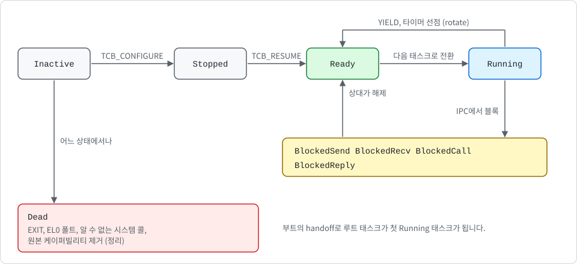

# 태스크와 스케줄링

[English](../en/scheduling.md) | 한국어

이 문서는 다음 내용을 설명합니다.

- K0가 태스크를 표현하는 방법
- 사용자 공간이 태스크를 만들고 시작하고 정리하는 방법
- 라운드 로빈 스케줄러가 태스크 사이를 전환하고, 타이머 틱이 태스크를 끊을지 정하는 방법

코드는 다음 위치에 있습니다.

- `crates/k0-task/src/lib.rs`
- `crates/k0-sched/src/lib.rs`
- `crates/k0-ipc/src/lib.rs`의 `teardown`
- `kernel/src/syscall.rs`의 `sys_tcb_configure`, `sys_tcb_resume`, `kill_current`, `finish`

이 문서는 현재 `main` 브랜치(미배포)를 기준으로 합니다.

## 태스크 제어 블록

**태스크 제어 블록**(TCB)은 다음을 담고 있습니다.

- **저장된 사용자 컨텍스트**: 범용 레지스터 31개, 스택 포인터, 반환 주소, 저장된 프로세서 상태, EL0 스레드 포인터 레지스터 2개입니다.
- **최상위 페이지 테이블의 물리 주소**(`ttbr0_pa`): 주소 공간 루트의 사본이며 내장 슬롯이 묶여 있는 동안에만 유효합니다.
- **상태**: 태스크의 현재 상태입니다.
- **큐 링크**: 태스크가 속한 큐에서 이웃 TCB로 가는 `next`와 `prev`입니다.
- **응답 자격**: 1회성 응답 자격(`reply_to`)과 그 역방향 링크(`reply_from`)입니다. [ipc_KR.md](ipc_KR.md)에서 설명합니다.
- **IPC 대기 정보**: 태스크가 줄 서 있는 엔드포인트 `blocked_on`, 그리고 보내려는 메시지에 붙을 배지 `ipc_badge`입니다.
- **타임아웃 필드**: 태스크의 IPC 대기가 끝나는 틱 `deadline`, 그리고 기한 목록의 링크 `tnext`와 `tprev`입니다([타임아웃](#타임아웃) 참고).
- **내장 케이퍼빌리티 슬롯 3개**: 1번 슬롯은 태스크의 `CNode` 케이퍼빌리티, 2번 슬롯은 `AddrSpace` 케이퍼빌리티를 담습니다. 0번 슬롯은 사용하지 않습니다.

**내장 슬롯**이 태스크를 케이퍼빌리티 공간과 주소 공간에 묶습니다. 시스템 콜은 슬롯 번호를 1번 슬롯의 CNode 안에서만 해석하고([capabilities_KR.md](capabilities_KR.md) 참고), 태스크는 2번 슬롯이 가리키는 주소 공간에서 실행됩니다. 둘 다 `TCB_CONFIGURE`에 넘긴 케이퍼빌리티의 복사본, 즉 파생 리스트에서 그 자식이며, 태스크에 묶인 것으로 표시됩니다. 둘 중 하나라도 제거되면 태스크는 정리됩니다([정리](#정리) 참고).

루트 태스크를 포함한 모든 TCB는 그래뉼 크기 프레임의 시작 부분에 있는 평범한 오브젝트입니다. 루트 태스크의 TCB는 2 MiB 부트 프레임 윈도우 안에 있고, 루트 CNode의 `Tcb` 케이퍼빌리티로 접근합니다. 그 외 TCB는 사용자 공간이 untyped 메모리에서 retype한 프레임입니다.

커널은 자신의 별칭을 통해서만 TCB에 접근하며, EL0에는 매핑되지 않습니다. 컴파일 타임 assertion이 TCB를 한 그래뉼 안에 유지하므로, 내장 슬롯의 주소를 그래뉼 단위로 내림하면 TCB를 되찾을 수 있습니다.

## 상태

다음 그림은 태스크 상태와 전환을 보여 줍니다. 각 상태의 의미는 그다음 표에 있습니다.

  

| 상태 | 의미 |
| --- | --- |
| `Inactive` | retype 직후, 구성 전 |
| `Stopped` | 구성 완료, 아직 시작 전 |
| `Ready` | 준비 큐에 있음 |
| `Running` | 현재 태스크 |
| `BlockedSend`, `BlockedRecv`, `BlockedCall` | 엔드포인트 큐에서 대기 중 |
| `BlockedReply` | `CALL`의 응답을 기다리는 중 |
| `BlockedConsole` | `CONSOLE_READ`에서 콘솔 입력을 기다리는 중(`console-input`으로 빌드한 이미지에만 있음). 태스크는 어떤 큐에도 없으며 커널의 대기자 자리 하나가 가리킵니다. 한 번에 한 태스크만 기다릴 수 있습니다. |
| `Dead` | 종료, 강제 종료, 또는 정리됨 |

블록 상태의 태스크는 기한이 지나도 `Ready`가 될 수 있습니다([타임아웃](#타임아웃) 참고). `BlockedConsole` 태스크는 바이트가 도착하거나 케이퍼빌리티가 삭제·회수·이동될 때도 `Ready`가 됩니다.

`Inactive`의 값은 0입니다. 방금 retype한 프레임은 전부 0이므로, 큐 링크가 비어 있고 내장 슬롯이 비어 있으며 응답 자격이 없는 유효한 `Inactive` TCB입니다. retype에 생성자가 필요 없습니다.

## 태스크 생성

`TCB_CONFIGURE`는 인자 6개를 받습니다. `Tcb` 슬롯, 진입 주소, 스택 최상단, `AddrSpace` 슬롯, `CNode` 슬롯, 그리고 새 태스크가 `x0`으로 받을 인자 값입니다. 슬롯은 모두 호출자 자신의 CNode에서 찾습니다. 커널은 다음을 검사합니다.

- 진입 주소가 4바이트 정렬이고, 첫 그래뉼보다 위이며, 48비트 사용자 범위 안에 있는지
- 스택 최상단이 16바이트 정렬이고, 첫 그래뉼보다 위이며, 사용자 범위 안에 있는지
- 케이퍼빌리티의 종류가 맞는지(`Tcb`, `AddrSpace`, `CNode`)
- TCB가 `Inactive` 상태인지. 따라서 각 TCB는 한 번만 구성할 수 있고, 실행 중인 태스크를 다시 구성할 수 없습니다. 상태는 TCB에 대한 가변 참조를 만들기 전에 raw 포인터로 먼저 읽습니다.

> [!IMPORTANT]
> 두 바인딩은 함께 기록됩니다. 두 케이퍼빌리티를 먼저 모두 검증한 뒤 1번과 2번 슬롯에 복사본을 한 번에 기록하므로, 둘 중 하나에만 묶인 TCB는 존재할 수 없습니다.

검사 중 하나라도 실패하면 두 내장 슬롯은 모두 빈 채로 남고 TCB는 `Inactive`를 유지합니다.

그다음 커널은 저장 컨텍스트를 0으로 지우고 진입 주소, 스택 포인터, `x0`, `ttbr0_pa`를 설정합니다. 저장되는 프로세서 상태도 커널이 직접 정해서, 인터럽트가 마스크 해제된 EL0로 설정합니다. 사용자 공간은 프로세서 상태를 절대 지정할 수 없으므로 EL1로 복귀하거나 인터럽트를 마스크한 채 실행하도록 요청할 수 없습니다. 스레드 포인터 레지스터는 0에서 시작하므로 새 태스크가 생성자의 값을 물려받지 않습니다. TCB는 `Stopped`가 됩니다.

`TCB_RESUME`은 `Stopped` TCB만 받아 준비 큐에 넣습니다. 이미 큐에 있거나, 실행 중이거나, 블록됐거나, 종료된 TCB는 거부되므로 같은 TCB가 큐에 두 번 들어갈 수 없습니다.

## 준비 큐

스케줄러는 세 값을 유지합니다. 현재 태스크, 그리고 준비 큐의 머리와 꼬리입니다. 각각 TCB의 커널 주소이고 0은 없음을 뜻합니다. 큐는 TCB 자체의 `next`와 `prev` 필드로 연결되므로 별도 메모리가 필요 없습니다. 큐의 길이는 TCB 수로 제한되고, TCB는 사용자 공간이 untyped 메모리로 비용을 치른 것입니다. 따라서 스케줄러가 커널 메모리를 고갈시키는 수단이 될 수 없습니다.

큐는 이중 연결이므로 큐 어디에 있는 태스크든 상수 시간에 뺄 수 있습니다. 태스크가 준비 상태에서 정리될 수 있고, 그때 커널이 큐를 훑어 찾아서는 안 되기 때문입니다. 제거할 때 링크가 큐의 머리와 꼬리와 일치하는지 검사합니다. 일치하지 않으면 큐가 손상된 것이므로 커널은 `k0: FATAL ready queue corrupt`를 출력하고 정지합니다.

같은 `next`와 `prev` 필드는 블록된 태스크를 엔드포인트 큐에 연결하는 데도 사용하며, 엔드포인트 큐도 같은 구조입니다. 태스크는 준비 상태이거나, 한 엔드포인트에서 블록됐거나, 실행 중이거나 셋 중 하나입니다. 둘이 겹치는 일은 상태 머신이 막습니다.

## 태스크 전환

예외가 EL0에서 도착하면 벡터 코드는 Rust 코드가 실행되기 전에 모든 사용자 레지스터를 현재 TCB의 컨텍스트에 저장합니다([exceptions_KR.md](exceptions_KR.md) 참고). 복귀할 때는 전역 `__current_context` 포인터가 가리키는 컨텍스트에서 레지스터를 복원합니다. 따라서 태스크 전환은 두 단계입니다.

1. `__current_context`를 다음 태스크의 저장 컨텍스트로 돌립니다.
2. 다음 태스크가 다른 최상위 페이지 테이블을 사용하면 `TTBR0_EL1`에 로드하고 TLB 전체를 무효화합니다. K0는 주소 공간 식별자(ASID)를 사용하지 않으므로, 서로 다른 주소 공간의 태스크 사이를 전환할 때마다 TLB를 전부 비웁니다. 같은 주소 공간의 태스크 사이 전환은 `TTBR0_EL1`을 건드리지 않습니다.

태스크마다 다른 주소 공간에서 실행될 수 있으므로 `TTBR0_EL1`은 태스크 사이에서 실제로 바뀝니다. 설치돼 있는 주소 공간이 파괴될 때는 커널이 먼저 `TTBR0_EL1`을 빈 테이블로 바꿉니다.

이 전환을 사용하는 동작은 다음 표와 같이 다섯 가지입니다. 각 동작은 다음 태스크의 진입 종류를 함께 넘깁니다. 틱의 판정으로 CPU를 받았으면 `Tick`, 틱과 틱 사이에 받았으면 `Between`입니다. 커널이 이를 유지하는 까닭은 다음 절에서 설명합니다.

| 동작 | 사용처 | 현재 태스크에 일어나는 일 | 다음 태스크의 진입 종류 |
| --- | --- | --- | --- |
| `rotate` | `YIELD` | 준비 큐의 꼬리로 가고, 준비된 다른 태스크가 없으면 그대로 계속 실행 | `Between` |
| `on_tick` | 타이머 선점 | 틱과 틱 사이에 CPU를 받았고 아직 틱을 맞은 적이 없으면 계속 실행하며 면제를 소모합니다. 그렇지 않으면 준비 큐의 꼬리로 가고, 준비된 다른 태스크가 없으면 그대로 계속 실행 | `Tick` |
| `block_and_switch` | IPC, `CONSOLE_READ`, 그리고 현재 태스크가 죽었을 때의 시스템 콜 종료 경로 | 준비 큐 밖에 머뭅니다. 호출자가 이미 엔드포인트 큐, 응답 자격 뒤, 콘솔 대기자 슬롯 중 하나에 걸어 두었거나, 태스크가 `Dead`입니다. | `Between` |
| `resume_from_idle` | idle 루프 | (현재 태스크는 블록됐거나 죽음) | 대기 중 틱이 지나갔으면 `Tick`, 아니면 `Between` |
| `handoff` | 부트, 한 번 | 루트 태스크가 첫 `Running` 태스크가 됨 | `Between` |

## 선점

타이머는 1초에 한 번 발생합니다. EL0가 실행 중일 때 발생하면 IRQ 경로가 인터럽트를 확인하고 타이머를 다시 설정한 뒤 `k0: tick N`을 출력하고 `k0_preempt`를 호출합니다. `k0_preempt`는 기한이 된 콘솔 대기자와 타임아웃 대기자를 깨운 다음 `k0_sched::on_tick`을 호출하고, `on_tick`이 이번 틱이 현재 태스크를 끊을지 정합니다([슬라이스 규칙](#슬라이스-규칙) 참고). `k0: tick N`은 콘솔 드라이버를 포함해 빌드한 이미지에서는 콘솔에 출력하며, 로그에는 처음 4개의 tick 줄만 남깁니다. 양보하지도 블록하지도 않는 태스크는 **최대 2초 뒤에는 CPU를 잃고**, 틱에서 CPU를 받았다면 1초 뒤에 잃습니다. 태스크가 콘솔 입력을 읽은 뒤에는 줄 하나 `k0: tick lines off (console input in use)`를 남기고 틱 줄이 멈추지만, 틱과 선점과 타임아웃은 계속됩니다.

> [!IMPORTANT]
> 커널 자체는 선점되지 않습니다. 예외 진입이 인터럽트를 마스크하고, 커널은 시스템 콜이나 폴트를 처리하는 동안 마스크를 유지합니다.

틱은 여전히 준비된 다른 태스크가 있을 때만 태스크를 끊습니다. EL1에서 타이머 인터럽트가 도착하는 것은 이양 전 부트 중이나 커널이 대기하는 동안에만 가능하며, 그때는 틱을 세기만 합니다. `on_tick`은 EL0에서 받은 틱마다 정확히 한 번 호출됩니다. `console-input` 이미지에서 입력 바이트가 도착해도 선점하지 않습니다. 깨어난 읽는 쪽은 다른 깨어난 태스크처럼 준비 큐의 맨 뒤로 갑니다. 우선순위가 없으므로 입력 지연은 준비된 태스크마다 최대 한 틱이고, 실행 중인 태스크가 틱과 틱 사이에 CPU를 받았다면 한 틱이 더해집니다.

## 슬라이스 규칙

타이머는 틱 핸들러에서만 다시 설정하며, 커널이 태스크를 전환할 때는 건드리지 않습니다. 그래서 틱과 틱 사이에 CPU를 받은 태스크는 주기의 남은 조각만 받습니다. 이 규칙이 생기기 전에는 얼마나 짧게 실행했든 다음 틱이 그 태스크를 큐의 끝으로 보냈습니다. 태스크가 매 틱 직전에 `YIELD`를 호출할 수 있었고, `YIELD`에는 케이퍼빌리티가 필요 없습니다. 그러면 뒤에 선 태스크는 양보 뒤의 조각만 받고, 양보한 태스크는 다음 온전한 주기를 위해 큐의 맨 앞으로 돌아옵니다. CPU를 계속 쓰는 태스크 둘을 QEMU에서 돌린 실행에서, 공격 태스크가 주기의 90 %에서 양보하면 다른 태스크의 몫이 약 52 %에서 7.9 %부터 11.1 % 사이로 떨어졌습니다. 이 실행의 양보 지점은 루트 태스크가 공격 태스크를 위해 측정한 반복 횟수로 정했습니다. 틱의 위상을 스스로 찾아내는 공격 태스크는 만들지 않았습니다.

규칙은 크레이트 `k0-slice`에 있으며, 이 크레이트는 "이번 틱이 현재 태스크를 끊는가"라는 물음에만 답합니다. 스케줄러는 현재 태스크 옆에 표시를 하나 두고, 현재 태스크가 바뀌는 곳에서만 그 표시를 기록합니다.

- 틱과 틱 사이에 CPU를 받은 태스크(`Entry::Between`)는 처음 맞는 틱에 끊기지 않습니다. 그 틱이 면제를 소모하고, 태스크는 그다음 틱까지 실행합니다. 앞선 태스크가 `YIELD`를 호출했거나, 블록됐거나(IPC 또는 `CONSOLE_READ`), 종료됐거나 죽은 경우, 그리고 커널이 대기하다가 콘솔 입력처럼 틱이 아닌 일로 깨어난 경우가 여기에 해당합니다.
- 틱의 판정으로 CPU를 받은 태스크(`Entry::Tick`)는 주기의 처음에 들어온 것이므로 이전처럼 다음 틱에서 끊깁니다. 틱이 깨운 뒤(예를 들어 기한이 지난 타임아웃) 대기 중이던 커널이 전환해 준 태스크도 여기에 속합니다. 틱과 콘솔 입력이 같은 깨어남에 함께 오면 `Entry::after_idle`이 틱으로 셉니다.
- 부트 때의 루트 태스크는 틱과 틱 사이에 들어온 것으로 셉니다. 타이머가 부트 중에 이미 돌고 있기 때문입니다.
- 태스크를 깨우는 것은 면제를 주지 않습니다. 깨어난 태스크는 이전처럼 준비 큐의 맨 뒤로 가고, 콘솔 입력은 여전히 선점하지 않습니다.
- 준비된 다른 태스크가 없을 때의 `YIELD`는 아무것도 바꾸지 않습니다.

`Slice::entered`는 진입 종류만으로 표시를 대입하고 이전 값을 읽지 않으므로, 앞 태스크가 남긴 표시가 전환을 넘어 살아남지 않습니다. 면제는 `YIELD`뿐 아니라 블록과 종료에도 줍니다. `YIELD`만 주면, 틱 직전마다 타임아웃 대기를 시작하는 두 태스크가 그 사이의 태스크를 굶길 수 있습니다(모델이 이 경우를 보여 줍니다).

규칙에서 따라 나오는 것은 다음과 같습니다.

- 전환돼 들어온 태스크는 스스로 CPU를 내놓지 않는 한 온전한 한 틱 주기를 채우기 전에는 타이머에 끊기지 않습니다. 강제로 선점되기 전에 적어도 한 주기, 많아야 두 주기를 실행합니다.
- 준비된 태스크가 N개일 때 양보하지도 블록하지도 않는 태스크는 다른 태스크가 `YIELD`, 블록, 타임아웃 대기를 어떻게 하든 오래 보면 CPU의 1/N 이상을 유지합니다. 이는 모델에서 탐색으로 확인했습니다([테스트 방법](#테스트-방법) 참고). **증명이 아니며**, **예산도 아닙니다**. 태스크가 쓸 수 있는 양에 상한이 없고, 태스크를 만들 때마다 N이 늘어납니다.
- 대가는 지연입니다. 앞에 실행할 태스크가 k개(실행 중인 것 포함)인 채로 준비된 태스크는 예전에는 k 틱 주기 안에 시작했고, 지금은 k + 1 주기 안에 시작합니다. 모델에서는 CPU를 계속 쓰는 태스크 하나 뒤에서 호출과 응답을 주고받는 호출자와 서버가 왕복마다 2틱 대신 4틱이 필요합니다. CPU를 계속 쓰는 태스크가 없으면 달라지는 것이 없습니다.

> [!NOTE]
> 이 절의 수치(실행당 한 주기부터 두 주기, 대기 k + 1 주기)는 이 버전 스케줄러의 동작을 설명할 뿐 인터페이스가 아닙니다. 틱은 여전히 1초이고 타임아웃은 여전히 틱 단위로 셉니다.

## 타임아웃

틱은 [ipc_KR.md](ipc_KR.md)에서 설명하는 모든 IPC 타임아웃의 단위입니다. 스케줄러는 기한이 있는 대기자를 기한 목록(`k0-sched`의 `arm_timeout`, `disarm_timeout`, `expired`, `has_timed`)에 유지합니다. 이 리스트는 정렬되어 있지 않고, 가장 이른 기한의 하한 덕분에 대부분의 틱은 리스트를 건너뜁니다.

태스크가 블록 상태를 벗어나는 길은 `k0_sched::enqueue`(깨우기)와 `k0_ipc::teardown`(죽음)뿐이며, 둘 다 태스크를 기한 목록에서 제거합니다. 타이머 틱마다 `k0_ipc::expire_timeouts`가 기한이 지난 대기자를 깨웁니다. 태스크가 실행 중이었다면 `k0_preempt`에서, 없었다면 idle 루프에서 실행됩니다. n 틱의 타임아웃은 호출 뒤 (n+1)번째 틱에서 끝납니다.

> [!NOTE]
> 타임아웃은 태스크가 준비되는 시점이지 실행되는 시점이 아닙니다. 깨어난 태스크는 다른 태스크와 마찬가지로 준비 큐의 꼬리에 들어갑니다.

## 정리

정리(teardown)는 태스크를 `Dead`로 만들고 그 태스크를 가리키는 모든 커널 포인터를 제거합니다. 다음 경우에 실행됩니다.

- 태스크가 `EXIT`를 호출할 때
- 태스크가 EL0 폴트를 일으킬 때
- 태스크가 알 수 없는 시스템 콜을 호출할 때
- TCB의 원본 케이퍼빌리티가 삭제될 때(`CAP_DELETE`, 또는 그 케이퍼빌리티의 조상, 예를 들어 retype에 쓴 untyped에 대한 `CAP_REVOKE`)
- 태스크에 묶인 케이퍼빌리티가 제거될 때. 즉 CNode나 주소 공간 케이퍼빌리티가 삭제 또는 회수되었거나 그 뒤의 원본 오브젝트가 종료될 때

> [!IMPORTANT]
> `teardown`은 포인터가 설정돼 있는지가 아니라 태스크의 상태만 보고 분기합니다.

다음 표는 상태별로 정리가 하는 일입니다.

| 상태 | 정리가 하는 일 |
| --- | --- |
| `Dead` | 아무것도 안 함. 두 번 불러도 안전 |
| `Inactive`, `Stopped` | 뺄 링크 없음 |
| `Ready` | 준비 큐에서 태스크를 뺌 |
| `BlockedSend`, `BlockedRecv`, `BlockedCall` | `blocked_on`이 가리키는 엔드포인트 큐에서 태스크를 빼고, 기한이 있으면 기한 목록에서도 뺌 |
| `BlockedReply` | 응답 자격을 쥔 태스크(`reply_from`)에서 그 자격을 지우고, 기한이 있으면 기한 목록에서도 뺌 |
| `BlockedConsole` | 커널의 콘솔 대기자 자리를 비우고, 기한이 있으면 기한 목록에서도 뺌 |
| `Running` | 뺄 링크 없음. 뒤의 설명 참고 |

모든 상태에서 이어서 태스크 자신이 쥔 응답 자격을 철회하므로, 그 응답을 기다리던 호출자는 `NO_REPLY`로 깨어나 영원히 블록되지 않습니다. 마지막으로 상태를 `Dead`로 바꾸고, 큐 링크, `blocked_on`, `reply_from`, `ipc_badge`, `ttbr0_pa`를 지우며, `Running`이 아니면 저장된 레지스터를 0으로 지웁니다. 상태가 약속하는 것과 큐나 응답 링크가 맞지 않으면 커널 불변식 위반이므로 커널은 `k0: FATAL ...`을 출력하고 정지합니다([exceptions_KR.md](exceptions_KR.md) 참고).

실행 중인 태스크는 정리가 끝까지 처리하지 않는 유일한 경우입니다. 시스템 콜 핸들러가 실행 중인 태스크의 저장 컨텍스트에 대한 가변 참조를 쥐고 있으므로, 정리는 그 태스크를 `Dead`로 표시하기만 합니다. 시스템 콜 종료 경로 `finish`는 핸들러가 끝나고, 제거된 모든 것의 종료 처리를 포함한 케이퍼빌리티 정리가 전부 끝난 뒤에 실행됩니다. 현재 태스크가 `Dead`이면 `finish`는 그 컨텍스트에 반환값을 기록하지 않고, 컨텍스트를 0으로 지운 뒤 다음 준비 태스크로 전환합니다. 그래서 태스크는 자신의 CNode, 주소 공간, TCB를 삭제하거나 자신이 잘려 나온 untyped를 회수하고도 이후에 다시 실행되는 일이 없습니다.

죽은 태스크의 프레임은 정리가 해제하지 않습니다. 프레임은 `Dead` TCB로 남고, `TCB_CONFIGURE`와 `TCB_RESUME`이 이를 거부하므로 죽은 태스크는 다시 시작되지 않습니다. 그 메모리는 TCB의 원본 케이퍼빌리티를 삭제하거나 그것이 나온 untyped를 회수한 뒤, untyped를 다시 retype할 때 재사용되며 그때 프레임은 다시 0으로 지워집니다. 단순히 종료만 한 태스크는 그때까지 묶인 케이퍼빌리티 두 개를 유지합니다.

## 실행할 태스크가 없을 때

실행할 태스크가 없어도 커널은 더 이상 코어를 파킹하지 않습니다. 현재 태스크가 블록됐거나 죽었는데 준비된 태스크가 없으면 `kernel/src/syscall.rs`의 `idle_until_ready`가 다음 순서로 처리합니다.

1. 다음 인터럽트를 기다립니다(`k0_arch::irq::wait_for_interrupt`: IRQ를 마스크한 `wfi`, 그다음 EL1 벡터가 인터럽트를 받도록 잠깐 마스크 해제).
2. 기한이 지난 IPC 대기자를 모두 깨웁니다.
3. 준비된 태스크가 있으면 그 태스크로 전환하고(`resume_from_idle`, 대기 중 틱이 지나갔는지를 슬라이스 규칙에 알려 줍니다), 없으면 다시 기다립니다.

커널이 idle 상태인 동안에도 타이머 틱은 계속 세고 처리합니다. idle 루프는 다음 두 줄 가운데 하나를 부팅당 최대 한 번씩 출력합니다.

- `k0: idle (waiting for a timeout)`: 기한이 있는 대기자가 하나 이상 있습니다.
- `k0: all tasks stopped (none ready, no timeout pending)`: 기한이 있는 대기자도 콘솔 입력을 기다리는 태스크도 없습니다. 지금은 Notification 오브젝트도, 콘솔 입력을 제외한 태스크용 장치 인터럽트도 없으므로 이 상태에서는 어떤 것도 태스크를 깨울 수 없고, 머신은 idle 상태로 남습니다.

기다릴 것이 콘솔 입력뿐이면(`console-input` 이미지) 커널은 아무것도 출력하지 않으며, 이것이 터미널 이미지의 정상 상태입니다. idle 루프는 인터럽트마다 도착한 입력을 확인해 읽는 쪽을 깨웁니다.

> [!WARNING]
> 가용성은 여전히 보호되지 않습니다. 타임아웃 없이 기다리는 태스크는 상대방이 동작하지 않으면 영원히 기다릴 수 있고, 마지막으로 블록하는 격리 태스크는 여전히 시스템에 실행할 태스크가 없게 만들 수 있습니다([SECURITY_KR.md](../../SECURITY_KR.md)의 어드바이저리 GHSA-q99x-2wrv-358p, 릴리즈 시점에 갱신). 격리는 태스크 사이의 기밀성과 무결성을 지키는 것이지 가용성을 지키지 않습니다.

EL0에서 받은 SError는 여전히 머신 전체를 정지시키며, `k0_arch::fatal`이나 커널 패닉도 마찬가지입니다.

## 테스트 방법

스케줄러와 시스템 콜 경로는 시스템 레지스터를 읽으므로 부팅으로 테스트합니다. 하드웨어를 건드리지 않는 큐와 케이퍼빌리티 로직(`k0-cap`, `k0-mm`)은 호스트에서 테스트하며, [capabilities_KR.md](capabilities_KR.md)를 참고하세요. 루트 태스크 자가 테스트는 다음을 수행합니다.

- 목표값까지 세고 종료하는 태스크를 만들고 기다림
- 구성되지 않은 태스크, 이미 재개한 태스크, 죽은 태스크의 재개를 거부
- 슬라이스 테스트(`userspace/root-task/src/timeslice.rs`) 실행: 양보하지 않는 태스크가 여전히 타이머에 선점되는지, 그리고 양보나 블록으로 CPU를 받은 태스크가 처음 맞는 틱에 끊기지 않는지 확인
- 스레드 포인터 레지스터가 태스크 사이에 새지 않는지 확인
- 자기 CNode와 자기 주소 공간을 가진 격리 태스크를 만들고, 루트 태스크의 슬롯 번호가 거기서 아무 의미가 없는지 확인
- 모든 상태(inactive, stopped, ready, send·receive·call에서 블록, 응답 대기, 응답 자격 보유, 엔드포인트 큐의 머리·중간·꼬리)의 태스크 삭제, 태스크가 줄 서 있는 엔드포인트 삭제, CNode 회수 또는 주소 공간 삭제로 태스크 종료, 태스크가 자기 TCB를 삭제하고 자신이 잘려 나온 untyped를 회수하는 경우

`tools/qemu-boot-test.sh`는 마커 `root: child exit test pass`, `root: slice test yield pass`, `root: slice test block pass`, `root: preempt test pass`, `root: isolation tests pass`, `root: violation tests pass`, `root: teardown tests pass`, `root: revocation tests pass`, `root: sched tests pass`를 요구하고, 그 뒤에 타이머 틱이 적어도 하나 더 나와야 합니다. 마커에는 타임아웃 테스트가 출력하는 `k0: idle (waiting for a timeout)`와 `root: timeout tests pass`도 포함됩니다([ipc_KR.md](ipc_KR.md) 참고). 로그에 `k0: all tasks`로 시작하는 줄, `k0: FATAL`, `k0: PANIC`이 있으면 실패하므로 실행할 태스크도 대기 중인 타임아웃도 없는 상태에 이른 실행은 실패로 처리됩니다. 태스크 폴트 줄도 정확한 개수로 세므로([exceptions_KR.md](exceptions_KR.md) 참고), 정리된 뒤에도 계속 실행되는 태스크를 잡아냅니다.

슬라이스 테스트는 바쁜 자식과 카운터를 쓰던 예전 테스트를 대신합니다. EL0에는 시계가 없으므로 시간이 아니라 실행 순서로 판정합니다. 태스크 넷을 시작합니다. CPU를 넘기는 태스크(첫 실행에서는 `YIELD`로, 두 번째 실행에서는 블록으로), 그 뒤에 영원히 도는 태스크, 처음 실행될 때 표시를 남기는 태스크, 도우미입니다. 루트 태스크는 한 틱짜리 타임아웃 대기에 들어갑니다. 도는 태스크가 처음 맞는 틱에 끊기면 표시 태스크가 실행되어, 루트 태스크가 깨기 전에 도는 태스크가 표시를 봅니다. 끊기지 않으면 루트 태스크가 먼저 깹니다. 테스트는 `root: slice test yield pass`, `root: slice test block pass`, 그다음 `root: preempt test pass`를 출력하고, 실패하면 `root: FAIL slice: a task that got the cpu by a yield was cut at its first tick`(또는 `by a block`)을 출력합니다. 한 번 실행에 약 2틱이 들므로, 예전 테스트가 약 1초였던 자리에 두 번의 실행이 부팅 테스트마다 약 4초를 더합니다.

규칙 자체는 크레이트 `k0-slice`의 호스트 테스트(9개, `tools/host-test.sh`가 실행)로 확인합니다. 테스트는 선입선출 준비 큐, 틱, 타임아웃 대기, 임의의 시각에 오는 입력 깨우기, 종료, idle 경우를 갖춘 스케줄러 모델 위에서 규칙을 돌립니다.

- 규칙과 따로 작성한 검사가 무작위 일정 4,000개에서 모든 틱 판정과 일치합니다. 시스템 콜과 틱이 같은 순간에 놓일 수 있는 두 순서 모두에서 그렇고, 선점된 실행 가운데 한 주기보다 짧은 것은 없었습니다.
- 예전 규칙과, 규칙을 스케줄러에 잘못 연결하는 아홉 가지 방법이 각각 그 검사에 걸립니다.
- CPU를 계속 쓰는 태스크의 몫은 주기의 모든 퍼센트에서 양보하는 태스크 하나를 상대로, 양보와 타임아웃 대기의 격자에서 협력하는 태스크 최대 셋을 상대로, 그리고 무작위 태스크 집합 3,000개를 상대로 유지됩니다.
- 측정한 두 경우를 재현합니다(90 % 양보에서 10 %와 55 %, 태스크 셋일 때 예전 규칙에서 양보하는 태스크 뒤의 태스크가 5 %).

이는 한정된 모델(태스크 최대 6개)에서의 탐색이며 **증명이 아닙니다**. 규칙을 일부러 망가뜨린 아홉 가지는 각각 호스트 테스트를 적어도 하나 실패시킵니다. 커널 연결을 일부러 망가뜨리면 부팅 테스트는 예전 규칙, `YIELD`가 잘못된 진입 종류를 넘기는 경우, 블록이 잘못된 진입 종류를 넘기는 경우에서 실패합니다. 틱 자신의 전환이 `Between`을 넘기는 경우, idle 루프가 틱에 대해 잘못 보고하는 경우, `handoff`의 잘못된 진입 종류는 부팅 테스트가 잡지 못합니다. 이런 실수는 태스크의 몫이 아니라 끊기기 전까지 실행하는 시간을 바꾸며, 호스트 모델은 이 경우들에서 규칙을 다룰 뿐 커널이 규칙을 쓰는 방식은 다루지 않습니다.

QEMU에서 변경 뒤에 측정하니, 주기의 90 %에서 양보하는 공격 태스크 곁에서 다른 태스크가 CPU의 53.8 %부터 54.9 %를 가졌습니다(세 번 실행). 태스크 셋일 때는 어느 태스크도 29.7 % 아래로 내려가지 않았습니다. 양보 대신 틱 직전에 타임아웃 대기를 시작하는 공격 태스크 곁에서는 다른 태스크가 56.5 %를 가졌습니다. 모든 실행은 QEMU(TCG와 HVF)에서 했고 하드웨어에서는 실행하지 않았으며, 양보 지점은 공격 태스크를 위해 정했으므로 공격 태스크가 스스로 그 지점을 찾는 데 무엇이 필요한지는 측정하지 않았습니다.

## 알려진 공백

> [!NOTE]
> 우선순위와 CPU 예산은 아직 없습니다. 코어는 하나뿐입니다.

- **스케줄링**: 틱 1초와 슬라이스 규칙을 쓰는 라운드 로빈입니다. 우선순위도 CPU 예산도 없으므로 CPU를 계속 쓰는 태스크는 자기 차례를 전부 쓰며 이를 막는 것이 없습니다. untyped 메모리를 가진 태스크는 여전히 태스크를 많이 만들어 모두의 몫을 희석시킬 수 있습니다.
- **타이밍 채널**: 열려 있습니다. 태스크는 양보하거나 블록할 시점을 골라 다른 태스크가 언제, 그리고 이제는 얼마나 오래 실행되는지를 여전히 바꿀 수 있습니다. 분석하지 않았습니다. 막으려면 고정된 시간 분할이 필요한데 K0에는 없습니다.
- **지연**: 실시간이나 지연에 대한 약속은 없습니다. 틱은 1초이고 커널은 선점되지 않습니다.
- **슬라이스 규칙 검증**: 호스트 모델은 규칙을 다룰 뿐 커널이 규칙을 쓰는 방식은 다루지 않으며([테스트 방법](#테스트-방법) 참고), 측정은 양보 지점을 공격 태스크를 위해 정한 QEMU에서만 했습니다.
- **타임아웃**: 태스크가 준비되는 시점을 정할 뿐 실행되는 시점을 정하지 않습니다. 호출마다 선택하는 것이므로 타임아웃 없이 기다리는 태스크는 영원히 기다릴 수 있습니다.
- **idle 상태**: 있지만, 루트 태스크가 자가 테스트 뒤에 `YIELD`를 계속 호출하는 동안에는 CPU가 잠들지 않습니다. 준비된 태스크도 기한이 있는 대기자도 없으면 머신은 idle 상태로 남고 어떤 것도 태스크를 깨울 수 없습니다.
- **가용성**: 타임아웃 없이 블록하는 태스크는 격리 태스크를 포함해 상대방이 동작하지 않으면 계속 블록된 채로 남을 수 있습니다(GHSA-q99x-2wrv-358p). 커널은 선점되지 않으므로 객체가 많은 untyped에 대한 `CAP_REVOKE` 같은 긴 시스템 콜은 다른 모든 태스크와 모든 타임아웃을 지연시킵니다. 태스크 격리는 가용성을 다루지 않습니다.
- **블록된 태스크**: IPC 상대가 동작하거나, 기한이 지나거나, 엔드포인트가 삭제되면 깨어납니다.
- **죽은 TCB**: 정리가 회수하지 않습니다. 프레임은 케이퍼빌리티를 삭제하거나 untyped를 회수한 뒤 다시 retype할 때만 재사용됩니다.
- **주소 공간 식별자**: 하드웨어 주소 공간 식별자를 사용하지 않으므로 주소 공간 사이의 전환마다 TLB 전체를 비웁니다.
- **죽은 태스크**: 다시 시작할 수 없습니다. 새 태스크에는 새 TCB가 필요합니다.
