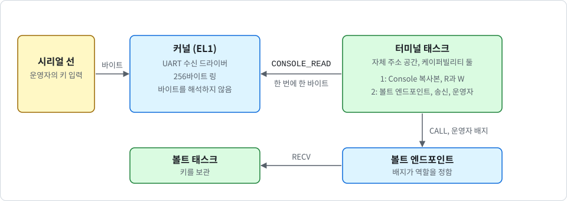

# 시리얼 입력과 운영자 터미널

<div align="center">

[English](../en/terminal.md) | 한국어

</div>

이 노트는 사람이 시리얼 선으로 K0와 대화하는 방법을 설명합니다. 커널이 콘솔 UART에서 바이트를 받고, 시스템 콜 `CONSOLE_READ`로 태스크 하나, 즉 **터미널**에 넘겨 줍니다. 터미널은 볼트의 운영자입니다([vault_KR.md](vault_KR.md) 참고). 볼트의 상태를 보여 주고, 키를 만들고, 키를 지웁니다. 코드는 `crates/k0-conin`(수신 로직), `kernel/src/syscall.rs`(`CONSOLE_READ`), `userspace/k0-term`(터미널), `userspace/root-task/src/service.rs`(연결과 점검)에 있습니다.

> [!NOTE]
> 입력과 터미널은 선택 사항이며 기본값은 꺼짐입니다. `console-input` 없이 빌드한 이미지에는 수신 코드도, `CONSOLE_READ`도, 이 노트의 로그 줄도 없습니다. `terminal` 없이 빌드한 이미지에는 터미널 코드가 없습니다.

## 목적과 범위

앞선 노트의 볼트는 부팅 시드로 키를 한 번 만들고, 그 뒤에는 호출에 답하기만 합니다. 운영자가 없으면 아무도 볼트의 상태를 볼 수 없고, 아무도 키를 의도적으로 지울 수 없습니다. 터미널은 시리얼 선 위의 작고 고정된 텍스트 인터페이스로 이 빈틈을 메웁니다.

범위는 다음과 같습니다. 콘솔 UART 하나, 한 번에 읽는 태스크 하나, 호출 한 번에 바이트 하나, 운영자가 쓸 수 있는 볼트 연산 넷(`STATUS`, `PUBLIC_KEY`, `KEYGEN`, `ZEROIZE`)입니다. 터미널은 서명할 수 없고 시드를 전달할 수도 없습니다.

<p align="center">
  
</p>

## 커널이 입력을 받는 이유

유저 공간 드라이버는 UART의 레지스터와 인터럽트가 필요합니다. K0는 아직 장치나 인터럽트를 태스크에 위임할 수 없습니다. 그래서 수신 코드가 커널의 EL1에서 실행되고, 커널이 바이트를 유저 공간에 넘겨 줍니다.

커널 코드는 작게 유지하며, 바이트를 해석하지 않습니다. 줄, 명령, 제어 키가 무엇인지 커널은 모릅니다. 그것은 모두 유저 공간에 있는 터미널의 일입니다.

> [!NOTE]
> 수신 코드는 여전히 외부 당사자가 구동하는 커널 코드입니다. 유저 공간 드라이버는 아직 없습니다. 장치 및 인터럽트 위임이 아직 없기 때문입니다.

feature는 다음과 같으며, feature는 기능을 더하기만 합니다.

| `k0-kernel`의 feature | 추가하는 것 |
| --- | --- |
| `console-input` | 콘솔 UART용 커널 수신 경로와 `CONSOLE_READ`입니다. 동작하려면 콘솔 드라이버 feature가 필요합니다. 수신은 PL011과 SBSA UART에만 있습니다. |
| `terminal` | 루트 태스크 이미지 안의 터미널 태스크이며, 자가 테스트 뒤에 서비스로 시작합니다. `console-input`을 함께 켭니다. `vault`가 있으면 볼트의 운영자가 되고, `vault-ed25519`가 있으면 Ed25519 키를 만들 수 있습니다. |

다음과 같이 빌드하고 실행할 수 있습니다.

```sh
$ cargo build -p k0-kernel --features console,terminal,vault-ed25519
$ cargo run -p k0-kernel --features console,terminal,vault-ed25519
```

QEMU는 시리얼 포트를 사용자의 터미널에 연결합니다. `cargo run`에서 QEMU 자체의 이스케이프 키는 Ctrl-A이며(Ctrl-A x로 QEMU를 종료), 그래서 Ctrl-A는 K0에 전달되지 않습니다.

## 수신 경로와 그 한계

커널의 UART 드라이버는 받은 바이트를 모두 256바이트 링에 넣습니다. 수신 로직은 별도 크레이트 `crates/k0-conin`이며, 작은 레지스터 트레이트에 맞춰 작성해 호스트 테스트가 가짜 UART로 구동할 수 있습니다.

- **수신 인터럽트는 꺼진 채로 둡니다**: 태스크가 읽기 권한으로 콘솔 입력을 처음 읽을 때까지입니다. 그 첫 읽기는 장치가 쥐고 있던 바이트를 버립니다. 또한 `k0: tick lines off (console input in use)` 한 줄 뒤로 주기적인 `k0: tick N` 줄을 멈춥니다. 틱, 선점, 타임아웃은 계속 동작합니다.
- **커널 작업량의 한계**: 링이 가득 차면 커널이 UART의 수신 인터럽트를 스스로 마스크합니다. 읽는 쪽이 링의 절반을 가져간 뒤에 다시 엽니다. 그래서 폭주 상황에서 인터럽트 빈도는 보내는 쪽이 아니라 읽는 쪽이 정한 한계 안에 있습니다.
- **틱마다 비우기**: 같은 비우기를 틱마다 한 번 더 실행하므로, 인터럽트가 오지 않아도 입력은 (최대 한 틱 늦게) 도착합니다.
- **유실 표시**: FIFO 오버런, 브레이크, 프레이밍 오류, 패리티 오류는 구멍 뒤의 바이트에 표시됩니다. `CONSOLE_READ`가 이 표시를 읽는 쪽에 돌려줍니다.
- **인터럽트 번호**는 디바이스 트리(콘솔 노드의 `interrupts` 속성: 발견한 GIC의 SPI 하나, 레벨, active high)에서 가져오고, UEFI 로더를 거치면 ACPI SPCR 테이블에서 가져옵니다. 플랫폼 줄에 출력되며(예: `k0: platform con=pl011@0x9000000,irq33 ...`) 그래서 `K0_PIN`으로 고정됩니다. 이 변경 이전에 만든 핀 문자열은 더 이상 일치하지 않으므로 다시 만들어야 합니다. 사용할 수 있는 인터럽트가 없는 콘솔 노드는 부팅 거부 사유가 아닙니다. 입력만 꺼집니다.
- **잘못된 인터럽트 번호는 입력만 잃습니다**: 범위를 벗어났거나 쓸 수 없는 번호는 부팅 때 `k0: console input off (...)`가 됩니다. UART 원인 없이 계속 발생하는 선은 8번 진입 뒤에 `k0: console input off (interrupt N fired without a uart cause)`와 함께 꺼집니다.

부팅 때 커널은 `k0: console input on (pl011 irq 33)` 또는 `k0: console input off (<reason>)`를 출력합니다. 이유는 `no console`, `no receive driver for this uart`, `no usable interrupt in the device tree`, `register frame too small`, `console not attached`, `interrupt number out of range`, `interrupt not available`입니다.

## CONSOLE_READ와 Console 권한

`CONSOLE_READ`는 시스템 콜 16번입니다. 호출 한 번에 바이트 하나를 돌려줍니다.

| 레지스터 | 입력 | 출력 |
| --- | --- | --- |
| x0 | `Console` 케이퍼빌리티 슬롯 | 성공이면 0, 아니면 오류 |
| x1 | 플래그 | 바이트 |
| x2 | | 이 바이트 바로 앞에서 입력이 유실되었으면 1 |

플래그는 `NONBLOCK`(1), `FLUSH`(2)이고, 63비트부터 32비트까지는 틱 단위 타임아웃입니다. 다른 비트는 `BAD_FLAGS`로 거부됩니다. `NO_DEVICE`(-24)는 입력 경로가 없거나 꺼졌다는 뜻입니다.

`Console` 케이퍼빌리티에는 이제 권한이 있습니다. **R**은 입력 읽기, **W**는 출력 쓰기입니다. `CAP_COPY`는 권한을 제거하기만 할 수 있습니다. 루트 태스크의 케이퍼빌리티는 W를 가지며, R은 `console-input`이 있는 이미지에서만 가집니다. `DEBUG_PUTC`는 W가 필요합니다. `bootinfo::VERSION`은 4입니다.

출력 필터는 한 가지를 빼고 그대로입니다. R이 있는 `Console` 케이퍼빌리티(터미널의 것)는 백스페이스(0x08)도 내보낼 수 있습니다. 다른 제어 바이트는 여전히 `?`로 출력됩니다.

## 대기와 깨우기

입력을 기다릴 수 있는 태스크는 한 번에 하나입니다. 두 번째로 읽으려는 태스크는 `BUSY`(-23)를 받습니다. 링이 비어 있고 `NONBLOCK`을 요구하지 않은 읽기는 잠들며, 플래그에 타임아웃이 있으면 그 시간만큼만 잡니다.

- **바이트로 깨우기**: 바이트를 받으면 대기자를 깨웁니다. 대기자는 준비 큐의 맨 뒤로 갑니다. 입력 때문에 선점하지는 않습니다.
- **케이퍼빌리티 변경으로 깨우기**: 케이퍼빌리티가 삭제, 회수 또는 이동된 대기자는 즉시 `REVOKED`로 깨어납니다.
- **타임아웃으로 깨우기**: 플래그에 타임아웃을 준 읽기는 그 시간이 다 되면 깨어납니다(타임아웃은 [scheduling_KR.md](scheduling_KR.md) 참고).
- **조용한 유휴**: 기다릴 것이 콘솔 입력뿐이면 커널은 아무것도 출력하지 않습니다. 이것이 터미널 이미지의 정상 상태입니다. `k0: all tasks stopped (none ready, no timeout pending)`는 시간 제한이 있는 대기자도, 콘솔 대기자도 없을 때만 출력됩니다.

## 터미널의 연결과 적대적 태스크 점검

터미널 이미지는 자가 테스트를 모두 먼저 실행합니다. 그다음 루트 태스크가 다음을 합니다.

1. 새 볼트를 시작하고(빌드에 포함된 경우) 부팅 시드를 건넵니다. 로그 줄은 `root: vault seeded`, 또는 `root: vault has no seed (boot seed has no entropy)`, 또는 `root: vault has no seed (no algorithm in this image)`입니다.
2. 터미널과 똑같이 연결한 적대적 태스크 둘을 실행합니다. 둘 다 거부되어야 하며 폴트로 끝나야 합니다. 줄은 `root: terminal console filter [...]`, `root: terminal wiring holds`, 그리고 `k0: task fault` 두 줄입니다.
3. 자신의 admin 케이퍼빌리티를 버리고, 터미널을 시작하고, 영원히 블록합니다. 줄은 `root: service started`이며 그다음 배너가 나옵니다.

입력 경로가 없는 머신에서 루트 태스크는 `root: no console input, terminal not started`를 출력합니다.

터미널 태스크는 자체 주소 공간과 케이퍼빌리티 둘을 가집니다.

- R과 W가 있는 `Console` 복사본
- 송신 권한과 운영자 배지가 있는 볼트 엔드포인트

볼트의 응답 프레임은 터미널에 읽기 전용으로 매핑됩니다. 볼트는 배지와 연산만으로 어느 프레임을 읽고 쓸지 결정합니다. 운영자에게는 응답 프레임이 있고 요청 프레임은 없습니다. 가질 수 없는 본문을 가졌다고 주장하는 요청은 메모리를 건드리지 않고 거부됩니다.

적대적 태스크 둘은 연결이 말한 대로 작동하는지 확인하는 점검입니다. 터미널과 똑같이 연결되어 있고, 루트 태스크는 둘 다 거부되어 폴트로 끝나리라고 기대합니다. 하나라도 거부되지 않으면 점검이 실패합니다.

> [!WARNING]
> 시리얼 선에는 인증이 없습니다. 선을 쥔 사람이 운영자이며, 키 삭제를 포함해 운영자의 연산 넷을 그대로 할 수 있습니다. 운영자는 서명할 수 없고, 시드를 전달할 수 없고, 정책을 바꿀 수 없습니다.

## 화면과 명령 규칙

화면은 일반 텍스트입니다. 배너는 `K0 operator console, type 'help'`, 프롬프트는 `k0> `이고, 값은 `name=value`로 출력하며, 모든 명령은 정확히 한 줄 `ok` 또는 `err <reason>`으로 끝납니다.

| 명령 | 하는 일 |
| --- | --- |
| `help` | 명령 목록을 보여 줍니다. |
| `vault status` | 볼트의 상태를 출력합니다. |
| `vault pubkey` | 공개 키를 출력합니다. |
| `vault keygen <alg>` | 쥐고 있는 시드로 키를 만듭니다. 알고리즘은 `ed25519` 하나뿐입니다. |
| `vault zeroize confirm` | 키를 지웁니다. `vault zeroize`만 입력하면 `hint=type 'vault zeroize confirm' to erase the key`와 `err confirm-required`를 출력합니다. |

`vault status`는 `state=fresh|seeded|ready|zeroized|failed`, `alg=none|ed25519`, `selftest=passed|failed`, `seed=none|rng-seed|rndr|rng-seed+rndr`, `validated=no`를 출력합니다. `seed=rng-seed`는 바이트가 있었다는 뜻이지 예측할 수 없다는 뜻이 아닙니다. 구현에 어떤 종류의 검증도 없으므로 `validated=no` 줄은 항상 출력됩니다.

`vault pubkey`는 `pubkey=`와 16진수 32자를 출력하고, 7칸 들여 쓴 둘째 줄에 나머지 32자를 출력합니다.

오류 이름은 `unknown-command`, `bad-argument`, `line-too-long`, `input-lost`, `confirm-required`, `denied`, `no-vault`, `no-key`, `key-exists`, `no-entropy`, `unsupported-algorithm`, `zeroized`, `vault-failed`, `vault-timeout`입니다. 전달되었지만 제때 답을 받지 못한 keygen 또는 zeroize에는 `hint=run 'vault status' to see whether it took effect`가 붙습니다.

입력 규칙은 다음과 같습니다. 상태 기계는 `userspace/k0-term/src/lib.rs`의 `feed`입니다.

- 줄은 CR 또는 LF로 끝나고, 64자 이하이며, 출력 가능한 ASCII만 포함합니다.
- Backspace와 DEL은 한 글자를 지웁니다. Ctrl-C와 Ctrl-U는 줄을 취소하며 `^C`, `^U`로 표시됩니다.
- ESC 시퀀스(화살표 키)는 무시합니다.
- 프롬프트 전에 UART에 도착한 것은 버립니다.
- 유실이 보고되면 다음 줄 끝까지 모두 버리고 `err input-lost`를 출력합니다.
- vault feature가 없으면 `help`는 `help`만 나열하고 `vault ...`는 `err no-vault`로 답합니다.

이 feature와 함께 볼트 쪽도 바뀌었습니다. 엔드포인트 배지에 따른 역할은 빌드 때 고정되는 넷입니다. admin(루트 태스크), operator(터미널), signer, reader입니다. `INIT`(admin 전용, 한 번)은 이제 시드를 전달하기만 합니다. 볼트는 엔트로피 규칙을 검사하고 시드를 `seeded` 상태로 쥐고 있습니다. 새 연산 `KEYGEN`(admin과 operator)은 쥐고 있던 시드로 키를 만들고 시드를 지웁니다(`ready` 상태). 부팅 한 번에 키 하나입니다. 두 번째 `KEYGEN`은 `key-exists`로 거부되고, `ZEROIZE` 뒤에는 재부팅이 필요합니다. `failed`로 들어가는 모든 길은 시드와 키를 지웁니다.

## 테스트 방법

**호스트 테스트**(`tools/host-test.sh`): `k0-conin`은 가짜 UART로 15개, `k0-term`은 vault feature가 있으면 24개, 없으면 21개, `k0-vault`는 Ed25519가 있으면 20개, 없으면 11개입니다. 전체는 ARM 호스트에서 354개, 다른 호스트에서 268개입니다.

**부팅 매트릭스**: 새 행은 `input-only`, `input-gicv2`, `input-16550`, `input-bad-irq`, 정적 행 `input-symbols`(`console-input`이 없는 이미지에는 수신 코드도 새 로그 줄도 없음), `term`, `term-max`, `term-el2`, `term-gicv2`, `term-16k`, `term-no-vault`, `term-no-alg`, `term-uefi`, `term-uefi-acpi`, `hvf-term`입니다. 매트릭스는 HVF가 있는 Mac에서 76행, CI에서 65행입니다.

**스크립트 세션**: `tools/term-test.py <image>`는 QEMU의 시리얼 포트를 파이프에 연결해 이미지를 부팅하고 세션을 실행합니다. 모든 명령과 모든 오류, 지우기와 취소, CR LF, ESC 시퀀스, 너무 긴 줄, 키 생성, 공개 키 형식, zeroize, 줄 끝이 없는 200 kB, 연속 2000줄, 시리얼 브레이크를 다룹니다. `tools/qemu-boot-test.sh`는 `K0_BOOT_INPUT=on|off`, `K0_BOOT_SERVICE=vault|plain|none`, 판정 전용 모드 `K0_BOOT_JUDGE`를 읽습니다.

**루트 태스크 자가 테스트**(`console-input`이 있는 이미지): `root: backspace without the input right [?]`와 `root: console input tests pass`입니다. 테스트 중에 바이트가 도착하면 둘째 줄은 `... pass (no input path)` 또는 `... cut short (the line is busy)`일 수도 있습니다. 터미널 이미지는 터미널이 없는 같은 이미지보다 `k0: task fault` 줄이 둘 더 나옵니다(볼트 없이 8줄, 볼트와 함께 10줄).

## 알려진 공백

> [!NOTE]
> 실제 하드웨어에서는 아무것도 실행하지 않았습니다. SBSA UART 경로, FIFO 오버런, 수신 타임아웃 인터럽트는 QEMU에서 실행되지 않으며, 가짜 UART를 쓰는 호스트 테스트로만 확인했습니다. UART 원인 없이 발생하는 인터럽트 선을 끄는 동작도 호스트 테스트로만 확인했습니다.

- **인증 없음**: 시리얼 선은 그 선에 닿을 수 있는 사람만큼만 신뢰할 수 있습니다. 운영자는 키를 지울 수 있지만(설계상의 서비스 거부) 서명을 얻지 못하고 정책을 바꿀 수 없습니다.
- **외부가 구동하는 커널 코드**: 수신 코드는 EL1에서 실행됩니다.
- **분석하지 않은 타이밍 채널**: 외부 당사자가 이제 태스크가 실행되는 동안 인터럽트를 일으킬 수 있습니다(읽는 쪽이 정한 한계 안에서). 읽는 쪽은 틱보다 세밀한 도착 시각을 알게 되고, 다른 태스크는 빼앗긴 시간을 알아챌 수 있습니다.
- **지연**: 입력은 실행 중인 태스크 뒤에서 기다립니다. 우선순위가 없으므로 준비된 태스크마다 최대 한 틱씩 지연됩니다.
- **16550 콘솔에는 입력 없음**: 16550 콘솔에는 출력만 있고 입력은 없습니다.
- **폭주 중 측정 없음**: 어떤 테스트도 머신에서 폭주 중 커널 시간을 측정하지 않습니다. 한계는 게이트로 논증하고 호스트 테스트로 보였습니다.
- **프롬프트 전에 버림**: UART에 도착한 바이트를 센 것입니다. 바이트를 붙잡고 있는 에뮬레이터나 어댑터는 나중에 전달합니다(QEMU가 그렇습니다).
- **갈라진 화면 줄**: 운영자가 입력하는 동안 커널 줄이 나타나면 화면 줄은 갈라지지만 버퍼는 온전합니다. Enter는 버퍼 전체를 실행합니다.
- **줄을 흉내 낼 수 있음**: `Console` 출력이 있는 태스크는 여전히 커널 또는 루트 태스크 줄처럼 보이는 줄을 출력할 수 있습니다. 접두어를 인증하는 것이 없기 때문입니다. 터미널은 추가로 현재 줄 안에서 지울 수 있습니다.
- **서비스 모드에 서명 클라이언트 없음**: 키는 만들어 보여 주지만 다른 태스크가 아직 쓰지 않습니다. 클라이언트 서명은 자가 테스트가 보여 줍니다.
- **재시작 없음**: 터미널과 볼트는 죽어도 다시 시작되지 않습니다. 루트 태스크는 신뢰합니다.
- **부트 로그 몫**: 터미널 출력은 메모리 부트 로그의 사용자 몫을 소모합니다. 그 몫이 가득 차면 이후 태스크 출력은 거기에 기록되지 않습니다.
- **볼트의 이전 한계는 모두 유지**: 구현은 검증되지 않았고, 부채널 분석이 없고, 키는 승인된 난수 비트 생성기에서 나오지 않고, 영속성이 없고, 양자 내성 알고리즘이 없습니다. 가용성은 보호되지 않습니다([ipc_KR.md](ipc_KR.md) 참고).
