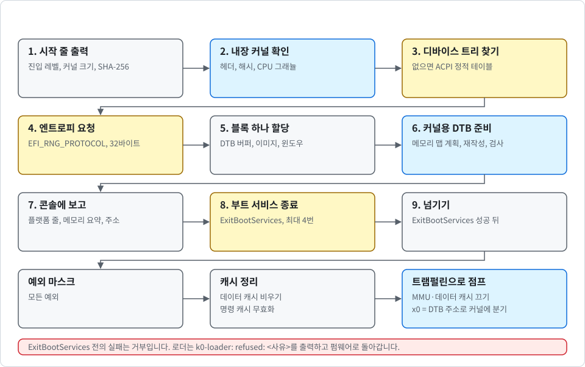
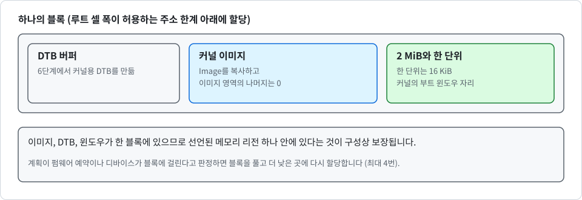

# UEFI 로더

<div align="center">

[English](../en/uefi.md) | 한국어

</div>

이 노트는 UEFI 로더를 다룹니다. 왜 있는지, 왜 커널 안이 아니라 별도 프로그램인지, 펌웨어와 커널의 첫 명령 사이에서 무엇을 하는지, 어떤 메모리를 RAM으로 인정하지 않는지, 무엇을 부팅해 보았고 무엇을 해 보지 못했는지를 설명합니다.

순수 로직은 `crates/k0-efi`에 있습니다. UEFI 애플리케이션은 `loader/`에 있으며, 다음 표와 같이 파일별로 역할이 나뉩니다.

| 파일 | 역할 |
| --- | --- |
| `efi.rs` | 펌웨어 바인딩 |
| `load.rs` | 실행 흐름 |
| `handoff.rs` | 캐시 비우기, MMU 끄기, 점프 |
| `build.rs` | 내장 커널 |

커널 자체는 바뀌지 않았습니다. 로더는 `crates/k0-boot`에 있는 커널의 파서와 검사를 그대로 재사용합니다.

## 왜 로더가 필요하고, 왜 커널 밖에 두는가

UEFI 펌웨어는 커널이 기대하는 Linux arm64 부트 프로토콜을 따르지 않습니다([boot_KR.md](boot_KR.md) 참고). 펌웨어는 MMU와 캐시를 켜고 서비스를 살려 둔 채 애플리케이션에 진입합니다. 메모리는 디바이스 트리뿐 아니라 UEFI 메모리 맵으로도 설명합니다. 이를 커널의 진입 규약으로 바꿔 줄 주체가 있어야 하며, 진입 규약은 다음과 같습니다.

- MMU와 데이터 캐시가 꺼져 있습니다.
- CPU가 하나입니다.
- `x0`이 **메모리 설명이 사실인 DTB**를 가리킵니다.

마지막 조건이 로더가 단순한 트램펄린 이상인 이유입니다. EDK2를 사용하는 QEMU에서 펌웨어의 디바이스 트리는 512 MiB 전체를 RAM이라고 선언하는데, 그 안에 펌웨어 런타임 영역이 들어 있습니다. 수정하지 않은 커널은 이 블롭을 받아들이고 약 5.5 MiB의 펌웨어 메모리를 untyped 메모리로 사용자 공간에 넘기게 됩니다. 그래서 메모리 설명은 어느 범위가 비어 있는지 알려 주는 UEFI 메모리 맵에서 나와야 합니다. 이 맵은 로더가 실행되는 동안에만 존재하므로 읽을 수 있는 것은 로더뿐입니다.

로더를 별도 프로그램으로 둔 이유는 세 가지입니다.

- **커널은 작고 그대로입니다**: 진입 규약은 하나로 유지됩니다. UEFI 타입도, 펌웨어 호출도, 두 번째 부트 경로도 커널에 들어오지 않습니다. 이번 작업에서 커널의 동작은 바뀌지 않았습니다.
- **커널의 판단을 복제하지 않고 재사용합니다**: 로더는 파서를 따로 두지 않습니다. `k0-boot`를 링크해서, 자신이 방금 작성한 DTB에 커널의 DTB 파서, 디바이스 발견, `Platform::validate`, 부트 윈도우 탐색을 점프 전에 실행합니다. 부트 윈도우 탐색은 `crates/k0-boot/src/window.rs`의 `boot_window`이며, 둘이 같은 코드를 실행하도록 커널에서 옮겨 왔습니다. 커널이 거부할 DTB는 펌웨어 콘솔이 살아 있는 동안 로더가 먼저 거부합니다.
- **unsafe 코드가 작고 분리되어 있습니다**: `k0-efi`는 `#![forbid(unsafe_code)]`인 순수 로직입니다. 바이트를 받아 바이트를 내며 호스트에서 테스트합니다. `unsafe`는 펌웨어 호출과 마지막 몇 개의 명령을 위해 `loader/`에만 있습니다.

로더는 커널 Image를 자신의 PE 파일에 내장합니다. 디스크에서 커널을 읽어 오지 않으므로, **서명된 파일 하나에 실행되는 모든 것이 들어 있습니다**.

## 실행 흐름

`loader/src/load.rs`의 `efi_main`이 다음 단계를 실행합니다. `ExitBootServices` 전의 실패는 거부입니다("거부" 참고). 다음 그림은 단계의 순서를 보여 줍니다.

<p align="center">
  
</p>

각 단계는 다음과 같습니다.

1. **시작 줄**: `k0-loader: start ...`를 출력합니다. 진입 예외 레벨, 내장 커널의 크기와 그래뉼, SHA-256의 앞 4바이트가 들어 있습니다.
2. **내장 커널 확인**: 헤더는 임의의 주소에 적재할 수 있는 리틀 엔디언 Linux arm64 Image여야 합니다. 페이지 크기는 4 KiB 또는 16 KiB이고, 크기는 64 MiB 이내여야 합니다(`image.rs`). 헤더는 빌드 때 기록해 둔 값과 같아야 합니다. Image 전체의 SHA-256도 기록해 둔 해시와 같아야 합니다(손상 검사이며, "알려진 공백" 참고). CPU는 커널의 그래뉼을 지원해야 합니다. 사유가 화면에 남도록 커널의 `enable_paging`과 같은 판정으로 확인합니다.
3. **펌웨어 디바이스 트리 찾기**: UEFI 구성 테이블에서 찾습니다. 없으면 대신 ACPI 정적 테이블을 읽습니다("디바이스 트리 없는 ACPI" 참고). 디바이스 트리도 ACPI RSDP도 없으면 거부합니다. 둘 다 있으면 펌웨어 디바이스 트리를 먼저 사용하고 ACPI는 읽지 않습니다. 헤더를 읽고 40바이트에서 2 MiB 사이의 크기를 받아들이며, 그 길이만큼을 사용합니다.
4. **엔트로피 요청**: 펌웨어에 `EFI_RNG_PROTOCOL`이 있으면 32바이트를 받습니다. 비어 있거나 한 바이트 값으로만 채워진 출력은 엔트로피로 치지 않습니다. 로더는 `k0-loader: entropy from the firmware` 또는 `entropy none from the firmware`를 출력합니다.
5. **블록 하나 할당**: 루트 셀 폭이 허용하는 주소 한계 아래에서 `[DTB 버퍼 | 커널 이미지 | 2 MiB와 한 단위]` 순서로 배치합니다. 한 단위는 16 KiB이고, 꼬리는 커널의 부트 윈도우 자리입니다. 이미지, DTB, 윈도우가 한 블록에 있으므로 선언된 하나의 메모리 리전 안에 있다는 것이 구성상 보장됩니다. 펌웨어 예약이나 디바이스가 블록에 걸린다고 계획이 판정하면 블록을 풀고 더 낮은 곳에 다시 할당하며, 최대 4번 반복합니다. 펌웨어 디바이스 트리가 방금 할당한 메모리 안에 있으면 읽는 내용을 로더가 덮어쓰게 되므로 거부합니다.
6. **커널용 DTB 준비**: 커널용 DTB를 만들고 확인합니다(`crates/k0-efi/src/prepare.rs`의 `prepare`. "재작성"과 "자가 검사" 참고). 그다음 커널 Image를 제자리에 복사하고 이미지 영역의 나머지는 0으로 채웁니다.
7. **보고**: 펌웨어 콘솔에 플랫폼 줄, 메모리 요약, 주소를 출력합니다.
8. **부트 서비스 종료**: 최대 4번 시도합니다. 시도마다 새 메모리 맵을 읽고 준비 전체를 다시 실행합니다. 무엇이든 할당하면 맵과 그 키가 바뀌기 때문입니다. 맵을 읽은 뒤 `ExitBootServices`를 호출하기까지 로더는 아무것도 할당하지도 출력하지도 않습니다. 펌웨어가 `INVALID_PARAMETER`로 답하면 맵이 낡은 것이므로 반복합니다. 그 밖의 실패, 또는 첫 시도 뒤의 준비 실패는 파킹합니다.
9. **넘기기**: 뒤의 "넘기기" 절에서 설명합니다.

5단계에서 할당하는 블록은 다음과 같이 배치됩니다.

<p align="center">
  
</p>

Homebrew EDK2를 사용하는 QEMU 11.1.3에서 한 번 실행하면 다음 순서로 출력됩니다.

```
k0-loader: start at el1, kernel image 664 KiB with 4K granule, sha-256 b4554f24
k0-loader: entropy none from the firmware
k0-loader: platform con=pl011@0x9000000 gic=v3@0x8000000 rd=0x80a0000+0xf60000 tmr=27
k0-loader: memory 8 regions, 478 of 478 MiB usable kept, 0 ranges dropped, 27 MiB of boot services memory left unused
k0-loader: image at 0x5c410000, dtb at 0x5c1fc000
k0-loader: exiting boot services
```

펌웨어 메시지는 첫 로더 줄보다 앞에 나옵니다. 마지막 줄 뒤에는 커널의 줄이 이어집니다. 커널에 콘솔이 없게 되면 로더가 `k0-loader: the kernel will have no console (...)`를 출력합니다. 로더에서 패닉이 나면 펌웨어 콘솔이 살아 있는 동안 `k0-loader: panic at <file>:<line>`을 출력합니다.

## 메모리 정책

`crates/k0-efi/src/memmap.rs`가 커널이 RAM으로 불러도 되는 범위를 정합니다. 원칙은 **메모리를 잃는 것은 괜찮지만** 펌웨어나 디바이스의 메모리를 "RAM"이라고 부르는 것은 안 된다는 것입니다.

디스크립터가 RAM으로 인정되려면 다음 표의 조건을 모두 만족해야 합니다. 그 밖의 모든 것은 인정하지 않으며, 로더가 모르는 타입도 같습니다.

| 조건 | 내용 |
| --- | --- |
| 타입 | `EfiConventionalMemory`, `EfiLoaderCode`, `EfiLoaderData` 중 하나 |
| 있어야 하는 속성 | write-back |
| 없어야 하는 속성 | 런타임, 특수 목적, 비휘발 |

다음 표는 계획이 따르는 규칙입니다.

| 항목 | 규칙 |
| --- | --- |
| 부트 서비스 메모리 | 사용하지 않습니다. 규격상으로는 `ExitBootServices` 뒤에 풀려나는데도 그렇습니다. EDK2에서는 약 23~32 MiB가 사용되지 않고 남습니다(위 실행에서는 27 MiB). 의도한 것입니다. 펌웨어가 거기에 표를 남겨 두고, 펌웨어가 켜 둔 디바이스가 계속 써 넣을 수 있기 때문입니다. |
| 겹치는 디스크립터 | "RAM 아님"으로 정리됩니다. 쓸 수 있는 디스크립터가 덮고 거부 디스크립터는 덮지 않는 바이트만 RAM입니다. |
| 예약과 디바이스 | 잘라 냅니다. 로더는 펌웨어 DTB에 커널의 파서를 실행해 메모리 예약을 가져오고, 커널의 발견이 찾은 디바이스 구간도 가져옵니다. 이들을 제거합니다. |
| 경계 | 모든 경계는 16 KiB로 안쪽으로 맞춥니다. 두 그래뉼의 공배수이므로 계획 하나로 어느 커널 이미지에든 사용할 수 있습니다. 구멍은 바깥쪽으로 맞춥니다. |
| `reg` 항목 | 최대 8개입니다. 커널의 한계입니다. 넘으면 가장 작은 구간부터 버리고, 블록이 든 구간은 남깁니다. 손실은 QEMU 맵에서 0이었고, 구간이 11개인 공개된 서버 맵에서는 약 112 KiB였습니다. 로더는 버린 구간 수를 출력합니다. |
| 주소 한계 | 펌웨어 DTB의 루트 셀 폭을 따릅니다(주소 셀이 1이면 4 GiB, 아니면 2^47). 항목 하나는 크기 셀이 허용하는 것보다 클 수 없습니다. |
| 출력의 예약 구간 | 없습니다. 펌웨어 DTB 자신의 `/memory` 노드, `/reserved-memory`, memory reservation block은 버립니다. 펌웨어가 지키려던 곳은 이미 계획 밖에 있습니다. |

형식이 잘못된 디스크립터(4 KiB 정렬이 아닌 시작 주소, 넘치는 주소 계산, 구조체보다 작은 간격, 간격의 배수가 아닌 맵 길이)가 하나라도 있으면 로더는 맵 전체를 거부합니다.

> [!IMPORTANT]
> UEFI에서는 이 로더만 커널을 시작할 수 있습니다. 펌웨어 디바이스 트리를 그대로 넘기는 범용 UEFI 부트로더는 펌웨어 메모리를 사용자 공간에 넘기게 됩니다.

## 재작성

`crates/k0-efi/src/fdtw.rs`가 커널용 DTB를 작성합니다. 처음부터 만들지는 않습니다. 커널의 순회기로 펌웨어 DTB를 읽고 토큰 단위로 다시 작성하므로, 커널이 거부할 구조는 여기서도 거부됩니다(메모리 항목 8개 초과, 예약 32개 초과, `linux,usable-memory` 프로퍼티, `/chosen` 노드 두 개. 마지막 경우를 커널의 파서는 `DuplicateChosen`으로 보고하므로, 로더가 펌웨어 DTB를 검사하는 단계에서 다시 쓰기 전에 거부됩니다). 문자열 블록은 새로 만듭니다. 재작성이 **바꾸는 것은 다음 표가 전부**입니다.

| 대상 | 동작 |
| --- | --- |
| 루트 바로 아래의 메모리 노드(`memory`, `memory@...`)와 `reserved-memory` | 제거합니다. |
| memory reservation block | 비웁니다. |
| `/chosen`의 `linux,initrd-start`, `linux,initrd-end`, `linux,usable-memory-range` | 제거합니다. |
| `/chosen`의 `rng-seed` | 바꿉니다. 펌웨어 자신의 시드(최대 32바이트) 뒤에 로더의 엔트로피(최대 32바이트)를 붙입니다. |
| 메모리 노드 | 계획한 구간을 담은 노드 하나를 루트의 마지막 자식으로 추가합니다. |

콘솔, 인터럽트 컨트롤러, 타이머를 위해 커널이 읽는 노드를 포함한 나머지는 그대로 통과합니다. 펌웨어 시드의 사본은 어느 경로로 끝나든 지웁니다.

## 자가 검사

점프 전에(그리고 `ExitBootServices` 시도마다 다시) 로더는 자신이 작성한 DTB에 커널의 판정을 그대로 실행합니다. `crates/k0-efi/src/prepare.rs`의 `prepare`가 다음 순서로 진행합니다.

1. **원본 읽기**: 커널의 파서와 디바이스 발견이 펌웨어 DTB를 읽습니다. 예약과 디바이스의 출처는 이 하나입니다.
2. **계획과 재작성**: 계획하고 재작성합니다. 출력은 커널이 받는 2 MiB에 들어가야 합니다.
3. **출력 읽기**: 커널의 파서가 출력을 읽습니다. 메모리는 계획과 같아야 하고 예약은 없어야 합니다. 출력에 실행한 커널의 발견은 펌웨어 DTB에서와 같은 플랫폼을 찾아야 합니다.
4. **부트 윈도우 탐색**: 커널의 `boot_window`가 출력에서 윈도우를 찾아야 합니다.
5. **독립 검증**: `crates/k0-efi/src/verify.rs`의 `verify`가 계획과 코드를 공유하지 않고 결과를 다시 확인합니다. 출력의 구간마다 원본 메모리 맵을 직접 따라가며 디스크립터를 자신의 규칙으로 분류합니다. 모든 바이트를 쓸 수 있는 디스크립터가 덮어야 하고, 거부 디스크립터나 구멍과 겹치면 안 되며, 이미지, DTB, 부트 윈도우는 한 구간 안에 있어야 합니다. 계획의 버그가 펌웨어 메모리를 통과시키면 여기서 걸리고, 양쪽 어디든 공유 규칙을 잘못 고쳐도 걸립니다.
6. **플랫폼 검사**: 커널의 `Platform::validate`가 새 메모리 맵에 대해 플랫폼을 검사합니다. 쓸 수 없고 디바이스 레지스터 영역도 아닌 펌웨어 메모리는 여기서 예약으로 넘기므로, 그 위에 놓인 디바이스는 커널보다 엄격하게 거부됩니다.

어느 단계든 실패하면 펌웨어 콘솔이 살아 있는 동안 사유와 함께 부팅을 거부합니다.

## 넘기기

`crates/k0-efi`는 호스트에서 테스트합니다. 마지막 단계는 그렇지 못합니다. `handoff.rs`는 `ExitBootServices`가 성공한 뒤 다음을 실행합니다.

1. 모든 예외를 마스크합니다.
2. 로더가 할당한 블록 전체를 `dc civac`으로 데이터 캐시에서 메모리까지 밀어내고 캐시에서 비운 뒤 `dsb sy`를 실행합니다. 트램펄린도 같게 합니다. 비우기까지 하는 이유는, 커널이 MMU를 끈 채 기록한 내용을 캐시에 남은 옛 줄이 나중에 가리지 못하게 하기 위해서입니다.
3. 명령 캐시를 무효화합니다(`ic ialluis`, `dsb ish`, `isb`). 복사한 커널 코드에 옛 항목이 남지 않게 하기 위해서입니다.
4. PE의 `.text` 안에 있는 트램펄린으로 점프합니다. UEFI는 identity 매핑으로 실행하므로 MMU가 꺼져도 프로그램 카운터가 유효합니다. 트램펄린은 현재 레벨의 `SCTLR_EL2` 또는 `SCTLR_EL1`에서 MMU와 데이터 캐시 비트를 끄고, `x0` = DTB 주소, `x1`~`x3` = 0으로 커널에 분기합니다.

예외 레벨은 그대로 넘깁니다. 커널이 EL1 진입과 EL2 진입을 모두 처리합니다. 로더는 타이머와 인터럽트 컨트롤러를 건드리지 않습니다. 커널이 인터럽트를 풀기 전에 인터럽트 컨트롤러를 스스로 정리하고, EL1 게스트에서는 물리 타이머 레지스터 접근이 하이퍼바이저로 트랩될 수 있기 때문입니다.

> [!NOTE]
> QEMU의 TCG에는 캐시가 없어 비우기가 빠져도 결과가 달라지지 않습니다. 실제 보드에서 실행해 본 적은 없습니다.

HVF도 빠진 비우기를 드러내지 못했습니다. 이 순서는 아키텍처 규칙, Linux가 MMU를 끈 채 커널에 들어가던 때의 순서, 그리고 `tools/pe-check.py`에 근거합니다. 이 스크립트는 빌드된 파일에 명령과 두 번의 비우기 호출이 순서대로 있는지를 검사하며, 실제 하드웨어에서 올바른지는 검사하지 않습니다.

## 거부

부트 서비스가 끝나기 전의 거부는 다음 동작을 합니다. 펌웨어 콘솔에 `k0-loader: refused: <사유>`를 출력하고, 시드와 DTB 버퍼를 지우고, 로더가 할당한 것을 풀어 주고, 펌웨어에 오류 상태를 돌려줍니다. 펌웨어는 보통 다음 부트 항목을 시도합니다.

`refuse-halt` feature로 빌드하면 **돌려주지 않고 파킹**합니다. K0로 부팅하거나 아니면 아무것도 하지 않아야 하는 머신을 위한 것입니다. 다음과 같이 빌드할 수 있습니다.

```sh
$ K0_LOADER_FEATURES=refuse-halt tools/build-loader.sh
```

첫 `ExitBootServices` 시도 뒤에는 돌아갈 곳이 없으므로 모든 실패가 파킹입니다. 다음 표는 거부 사유와 원인입니다.

| 사유(줄의 앞부분) | 원인 |
| --- | --- |
| `embedded kernel image header: ...` | 헤더가 로더가 배치할 수 있는 Linux arm64 Image가 아님 |
| `embedded kernel image differs from the one checked at build time` | 빌드 이후 크기나 그래뉼이 달라짐 |
| `embedded kernel image is corrupt (sha-256 mismatch)` | 해시 불일치 |
| `this cpu has no 4K translation granule` (또는 16K) | CPU가 내장 커널을 실행할 수 없음 |
| `the firmware provides neither a device tree nor ACPI tables` | 구성 테이블에 디바이스 트리도 ACPI 2.0 RSDP도 없음 |
| `ACPI tables: <reason>` | RSDP, XSDT, MADT, GTDT, SPCR 중 하나가 손상되었거나, 길이나 체크섬이 잘못되었거나, 맵이 허용하는 메모리 밖에 있거나, (콘솔을 제외한) 장치가 RAM이나 펌웨어 메모리에 있다고 기술함 |
| `device tree from ACPI tables: <reason>` | ACPI에서 읽은 값이 최소 트리에 맞지 않음 |
| `the firmware device tree has a bad header` | 매직이나 크기가 잘못됨 |
| `the firmware device tree lies in memory the firmware gave to the loader` | 펌웨어 자신의 맵이 모순됨 |
| `... failed: <status>` | 펌웨어 호출 실패 |
| `device tree for the kernel: ...` | 위 단계 중 하나의 실패. 단계 이름이 붙음 |
| `no usable memory for the kernel image block` | 할당이나 배치 실패 |

## Secure Boot

로더에는 서명 코드가 없습니다. Secure Boot에서는 펌웨어가 PE 파일 전체를 검증하고 PE에 커널이 내장되어 있으므로, **서명 하나가 로더와 커널을 함께 덮습니다**. 로더 자신의 SHA-256 검사는 공격자가 아니라 손상을 막는 두 번째 층입니다("알려진 공백" 참고). 키는 소유자의 것입니다. Microsoft 제3자 서명 경로(shim)는 준비하지 않았습니다.

## 테스트 방법

- **호스트 단위 테스트**: `crates/k0-efi/src/tests.rs`에 32개가 있습니다. 벡터는 실제로 측정한 펌웨어 메모리 맵입니다. 디스크립터 규칙, 겹침, 항목 한계, 작성기와 재작성, 검증기, ACPI 리더, 트리 합성을 다룹니다. 네 번째 퍼저 `fuzz_acpi_with_mutated_tables`는 테이블 이미지를 변형합니다. 2026-11-12에 200만에서 300만 케이스의 캠페인이 통과했고, 앞서 실제 불일치 하나를 찾았습니다(리더가 커널의 디스커버리가 거부하는 GIC 프레임 정렬을 받아들였습니다). 커널의 배치 규칙을 리더에 적용해 수정했습니다.
- **결정적 퍼저 셋**: `k0-efi`의 `fuzz_plan_with_random_maps`, `fuzz_rewrite_with_mutated_trees`, `fuzz_prepare_end_to_end`입니다. 다른 퍼저와 같은 변수 `K0_FUZZ_ITERS`, `K0_FUZZ_SEED`, `K0_FUZZ_CASE`를 사용합니다. 기본값은 각각 20,000, 20,000, 5,000개의 케이스입니다. 주간 워크플로가 셋 모두를 500만 케이스로 실행합니다. 2026-11-12에 각각 500만 케이스의 캠페인이 통과했습니다. 계획 퍼저는 앞서 실제 버그 하나를 찾았습니다(물리 주소 0의 블록이 받아들여졌습니다). 수정되었습니다.
- **호스트 테스트 스크립트**: `tools/host-test.sh`는 이제 ARM 호스트에서 276개(`k0-abi` 14, `k0-cap` 42, `k0-boot` 82, `k0-efi` 32, Ed25519 포함 13개와 제외 7개의 `k0-vault`, 두 그래뉼 각각에 `k0-mm` 43)를, `k0-mm` 테스트를 건너뛰는 그 밖의 호스트에서 190개를 실행합니다.
- **PE 검사**: `tools/pe-check.py <loader>.efi`는 PE 형태(섹션 4개, 쓰기와 실행이 함께 가능한 섹션 없음)와 캐시 및 MMU 명령의 순서를 검사하고 `pe-check: ok (...)`를 출력합니다.
- **EDK2 부팅 테스트**: `tools/qemu-virt-runner.sh`는 `.efi` 인자를 EDK2 펌웨어로 부팅합니다. 기본 머신은 `virt,gic-version=3,acpi=off`이므로 디바이스 트리 경로입니다. ACPI 행은 `K0_QEMU_MACHINE=virt,gic-version=3` 또는 `virt,gic-version=2`를 넘깁니다. `tools/qemu-boot-test.sh`는 로더의 첫 줄 `k0-loader: start`부터 실패를 판정하므로 펌웨어 메시지는 세지 않습니다. `tools/build-loader.sh <커널 ELF>`는 이미 빌드된 커널을 내장하고 `.efi`의 경로(`<커널 ELF>.efi`)를 출력합니다. 그래서 UEFI 행도 다른 행과 같은 커널 바이너리를 부팅합니다. 명령은 [USAGE_KR.md](../../USAGE_KR.md)에 있습니다.

## 부팅해 본 환경

> [!NOTE]
> 지원한다고 부를 수 있는 것은 1단계와 2단계뿐입니다.

- **1단계, CI가 실행합니다**: `tools/boot-matrix.sh`가 실행하는 행입니다(Debian bookworm 컨테이너, QEMU 7.2.22, 펌웨어 `qemu-efi-aarch64` 2022.11, 네트워크 비활성). 이 행들은 Homebrew EDK2 stable202408을 사용하는 QEMU 11.1.3에서 로컬로도 실행합니다. 디바이스 트리 행은 `acpi=off`인 QEMU virt에서 실행합니다. 다음 표는 행과 내용입니다.

  | 행 | 내용 |
  | --- | --- |
  | `uefi-pe` | PE 파일 둘(4 KiB와 16 KiB 커널)의 정적 검사 |
  | `uefi-gic3-el1`, `uefi-gic3-el2`, `uefi-gic2-el1`, `uefi-gic2-el2` | GICv3와 GICv2를 EL1과 EL2에서 |
  | `uefi-max` | CPU `max`, PAC·BTI·PAN |
  | `uefi-smp4` | CPU 4개 |
  | `uefi-16k` | 16 KiB 커널 |
  | `uefi-rng` | `virtio-rng-pci` 장치. 로더가 펌웨어에서 엔트로피를 받음 |
  | `uefi-esp` | `-kernel`이 아니라 `EFI/BOOT/BOOTAA64.EFI`에 둔 FAT 드라이브로 부팅 |
  | `uefi-16k-on-a72` | 직렬 로그에서 읽는 거부("this cpu has no 16K translation granule") |
  | `uefi-corrupt` | 직렬 로그에서 읽는 거부("embedded kernel image is corrupt", 한 바이트를 뒤집음) |
  | `uefi-acpi-gic3-el1`, `uefi-acpi-gic3-el2`, `uefi-acpi-gic2-el1`, `uefi-acpi-smp4`, `uefi-acpi-16k`, `uefi-acpi-rng` | ACPI를 켜고 실행하며 로더 줄 `k0-loader: device tree built from ACPI tables`를 요구함. `uefi-acpi-rng`는 `k0: entropy dtb=32B`도 요구함 |

  거부 행 `uefi-no-dtb`는 그 펌웨어가 이제 부팅하므로 더 이상 없습니다.
- **2단계, 2026-11-12 기준**
  - `K0_MATRIX_HVF=1`로 `uefi-hvf-el1`, `uefi-hvf-el2`, `uefi-hvf-16k` 행을 Apple M5 Pro, HVF를 사용하는 QEMU 11.1.3, 같은 펌웨어로 실행했습니다.
  - `uefi-hvf-acpi` 행을 Apple M5 Pro, HVF를 사용하는 QEMU 11.1.3에서 직접 실행했습니다.
  - 실제 로더의 Secure Boot도 시험했습니다. 키는 일회용 컨테이너에서 pip 패키지 `virt-firmware`로 등록했고, 펌웨어는 하나뿐입니다(Debian 2022.11 AAVMF, QEMU 7.2 TCG). 서명한 로더는 FAT 드라이브 경로와 `-kernel` 모두에서 부팅합니다. 서명하지 않은 로더, 내장 커널의 한 바이트를 뒤집고 다시 서명하지 않은 로더, 등록되지 않은 키로 서명한 로더는 로더 코드가 실행되기 전에 펌웨어가 거부합니다. `-kernel` 경로도 펌웨어가 검증하므로 우회가 아닙니다. 부팅은 각각 60초에서 끊었습니다.
- **3단계, 계약상 기대하지만 부팅해 본 적 없음**
  - 실제 ACPI 머신 전부(서버, 클라우드 VM, 노트북), EDK2 ArmVirtQemu 외의 펌웨어, GICv4, CPU 항목으로 기술된 리디스트리뷰터, SBSA UART와 16550 콘솔입니다.
  - 모든 실제 보드, U-Boot의 EFI 구현, Raspberry Pi UEFI, EDK2 ArmVirtQemu 외의 펌웨어, KVM, UEFI에서의 고정 모드(`K0_PIN`), 실제 하드웨어에서의 캐시 비우기입니다.

## 알려진 공백

1. **펌웨어 가정**: 펌웨어는 잘못될 수 있다고만 가정하고, 적대적이라고는 가정하지 않습니다. 펌웨어는 로더보다 먼저 같거나 더 높은 권한으로 실행됩니다. 로더는 착오가 있는 펌웨어는 막지만 공격자인 펌웨어는 막지 못합니다.
2. **로더 전용 시작**: UEFI에서는 이 로더만 커널을 시작할 수 있습니다. 펌웨어 디바이스 트리를 그대로 넘기는 범용 UEFI 부트로더는 펌웨어 메모리를 사용자 공간에 넘깁니다("메모리 정책" 참고).
3. **내장 Image의 SHA-256**: 서명이 아니라 손상 검사입니다. 진위는 소유자가 키를 등록한 펌웨어의 Secure Boot에서만 나옵니다. Microsoft 제3자 경로(shim)는 준비하지 않았습니다.
4. **기본 거부**: 펌웨어로 돌아갑니다. 펌웨어는 다음 부트 항목을 시도합니다. K0로 부팅하거나 아니면 아무것도 하지 않아야 하는 머신은 `refuse-halt`로 빌드해야 합니다.
5. **캐시 비우기와 MMU 끄기**: QEMU로 테스트할 수 없습니다. "넘기기"를 참고하세요. `tools/pe-check.py`는 존재를 검사할 뿐 하드웨어에서의 정확성을 검사하지 않습니다.
6. **UEFI에서의 고정 모드**: 테스트하지 않았습니다. 고정 줄에는 RAM 범위가 들어 있고, UEFI에서 이 범위는 펌웨어 빌드와 RAM 크기에 따라 달라집니다. 불일치하면 커널이 화면에 아무것도 남기지 않고 멈춥니다. 사유는 커널의 메모리 내 부트 로그에 있으며, 읽는 데 필요한 주소를 로더가 출력합니다. `k0-loader: image at 0x..., dtb at 0x...`입니다.
7. **부트 서비스 메모리와 디바이스**: 부트 서비스 메모리는 사용하지 않지만, 펌웨어가 켜 둔 디바이스가 `ExitBootServices` 뒤에 다른 메모리에 쓰는 것은 막지 못합니다. K0에는 IOMMU 지원이 없습니다.
8. **로더가 더한 엔트로피**: 커널이 루트 태스크에 진입하기 직전에 디바이스 트리의 `rng-seed` 바이트를 0으로 채우고 `k0: dtb seeds wiped <n>B`를 출력합니다(자세한 내용은 [boot_KR.md](boot_KR.md) 참고). 로더나 펌웨어가 다른 곳에 보관하는 사본은 지우지 않습니다. `EFI_RNG_PROTOCOL`이 없으면 커널은 펌웨어 디바이스 트리가 담고 온 것만 받는데, ACPI로 만든 트리에는 펌웨어 시드가 없으므로 그때는 아무것도 받지 못합니다.
9. **UEFI 런타임 서비스**: 커널은 호출하지 않습니다. 변수 접근도, 펌웨어를 통한 리셋이나 전원 끄기도 없고, 런타임 영역은 사용되지 않은 채 남습니다.
10. **예약 타입으로 기술된 디바이스 레지스터**: 펌웨어가 디바이스 레지스터를 `EfiReservedMemoryType`으로 기술하면(맵에서 제외하거나 MMIO로 표시하는 대신) 로더가 거부합니다. 형식이 잘못된 디스크립터 하나도 맵 전체의 거부를 부릅니다. 둘 다 닫힌 채로 실패합니다.
11. **실행해 보지 못한 경로**: 블록을 다시 배치하는 경로와 거부할 때 메모리를 푸는 경로는 QEMU에서 실행해 볼 수 없었습니다.
12. **빌드 재현성**: `.efi`는 빌드 디렉터리가 달라지면 비트 단위로 재현되지 않습니다. 로더가 출력하는 내장 커널의 해시는 재현됩니다.
13. **ACPI 머신**: 지금까지 부팅한 유일한 ACPI 머신은 QEMU virt입니다. 실제 ACPI 머신, 다른 펌웨어, GICv4, CPU 항목으로 기술된 리디스트리뷰터는 테스트하지 않았습니다.
14. **SBSA UART와 16550**: 식별 검사가 없습니다. 레지스터가 더 넓은 16550은 콘솔을 주지 못합니다.
15. **GICv2 프레임 크기**: 가정한 값입니다(Linux처럼 4 KiB와 8 KiB). 테이블이 크기를 주지 않기 때문입니다.
16. **테이블 장치 검사**: 테이블 장치가 메모리에 있지 않은지 보는 검사는 로더에만 있습니다. 커널은 펌웨어 소유 범위를 받지 않습니다.
17. **예약 타입 메모리의 테이블**: 읽지 않습니다.

그 밖에, 디바이스 트리를 주는 펌웨어는 그것을 사용하며 ACPI는 읽지 않습니다. ACPI만 주는 펌웨어는 위에서 설명한 정적 테이블로만 부팅합니다. 테이블로 표현할 수 없는 것이 있으면 거부하지 않고 콘솔 없이 부팅합니다. 디바이스 트리도 RSDP도 주지 않는 펌웨어는 거부합니다.

## 디바이스 트리 없는 ACPI

**이유**: EDK2를 사용하는 QEMU는 `-machine acpi=off`일 때만 디바이스 트리를 넘기고, 실제 ARM 펌웨어 대부분은 머신을 ACPI로 기술합니다. 로더는 정적 테이블을 읽어 최소 디바이스 트리를 만듭니다. 이 트리는 펌웨어 트리와 완전히 같은 경로를 탑니다. UEFI 메모리 맵으로 메모리 계획, 재작성, 커널 자신의 파서로 하는 자가 검사, 디스커버리와 검증, 넘기기입니다. 커널은 바뀌지 않습니다.

**읽는 것**: RSDP(구성 테이블의 ACPI 2.0 GUID에서), XSDT, MADT, GTDT, SPCR입니다(`crates/k0-efi/src/acpi.rs`). 트리는 `crates/k0-efi/src/synth.rs`가 작성합니다.

> [!IMPORTANT]
> AML은 해석하지 않습니다. 메모리는 ACPI에서 오지 않습니다.

**규칙**

- **읽는 범위**: 테이블은 전체 범위가 메모리인 메모리 맵 디스크립터 하나(타입 1부터 7, 9, 10) 안에 있을 때만 읽습니다. 주소 0은 거부합니다. 길이와 체크섬을 검사합니다. 따라서 예약 타입 메모리에 있는 테이블은 읽을 수 없습니다. 부팅을 거부하며, SPCR이면 콘솔 없이 계속합니다.
- **MADT의 GIC**: 분배기 항목 하나입니다. 버전 2는 GICv2, 3과 4는 GICv3, 0은 리디스트리뷰터가 기술되었는지로 정하고, 그 밖의 값은 거부합니다. GICv2 프레임 크기는 테이블에 없으므로 로더는 분배기에 4 KiB, CPU 인터페이스에 8 KiB를 사용합니다(Linux가 사용하는 값). GICv3 리디스트리뷰터는 GICR 항목(최대 4개)에서 오고, 없으면 CPU 항목에서 오며, 인접하면 128 KiB 또는 256 KiB 간격으로 병합합니다. 부트 CPU의 항목이 그 안에 있어야 합니다. 프레임은 정렬되어 있어야 하고, 서로 겹치지 않아야 하며, 메모리 맵 기준으로 RAM이나 펌웨어 메모리에 있으면 안 됩니다. 그렇지 않으면 로더가 거부합니다.
- **GTDT의 타이머**: 가상 EL1 타이머 인터럽트는 16에서 31이어야 합니다.
- **SPCR의 콘솔**(선택): PL011(타입 0x03), SBSA UART(0x0D, 0x0E), 그리고 16550(0x00, 0x01, 0x12)은 8비트 레지스터와 바이트 접근일 때만 받습니다. SPCR이 레지스터 간격을 표현할 수 없기 때문입니다.
- **거부와 콘솔 없는 부팅의 구분**: 잘못된 테이블, GIC, 타이머, 메모리에 있는 장치는 거부합니다(`ACPI tables: <reason>`). 커널에 드라이버가 없는 콘솔, 잘못된 SPCR, 메모리에 있는 콘솔은 콘솔 없는 부팅이 됩니다. 로더는 `k0-loader: device tree built from ACPI tables (MADT, GTDT and SPCR)` 또는 `(MADT and GTDT, no usable SPCR console)`을 출력합니다.
- **엔트로피**: ACPI로 만든 트리에는 펌웨어 시드가 없습니다. 펌웨어에 `EFI_RNG_PROTOCOL`이 있으면 커널이 32바이트를 받고, 없으면 아무것도 받지 못합니다(`k0: entropy dtb=0B`를 로그에 남기고 계속합니다).
- **작업 영역 비우기**: 로더는 점프 전에 작업 영역도 데이터 캐시에서 비웁니다. `tools/pe-check.py`는 비우기 호출 셋(블록, 작업 영역, 트램펄린)을 요구합니다.

**한계**

- 지금까지 부팅한 유일한 ACPI 머신은 QEMU virt입니다.
- SBSA UART와 16550에는 식별 검사가 없습니다. 레지스터가 더 넓은 16550은 콘솔을 주지 못합니다.
- GICv2 프레임 크기는 가정한 값입니다.
- 테이블 장치가 메모리에 있지 않은지 보는 검사는 커널이 펌웨어 소유 범위를 받지 않으므로 로더에만 있습니다. 커널은 GIC 식별 레지스터와 PL011 식별을 검사합니다.
- 예약 타입 메모리에 있는 테이블은 읽지 않습니다.
- UEFI에서의 고정 모드는 여전히 테스트하지 않았습니다.
- 같은 머신에서 ACPI로 만든 트리와 펌웨어 트리는 QEMU의 GICv3에서 같은 플랫폼 줄을 줍니다.
