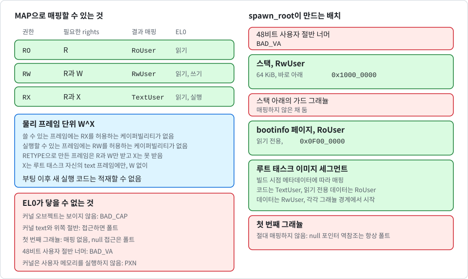

# 사용자 주소 공간

[English](../en/user-address-space.md) | 한국어

이 노트는 K0가 부팅할 때 루트 태스크의 주소 공간을 어떻게 만들고, 사용자 공간이 `RETYPE`으로 추가 주소 공간을 어떻게 만들며, `MAP`과 `UNMAP`으로 어떻게 채우는지 설명합니다. 코드는 `crates/k0-mm/src/user.rs`, `crates/k0-task/src/lib.rs`(`spawn_root`), `kernel/src/syscall.rs`의 `sys_retype`·`sys_map`·`sys_unmap`, 케이퍼빌리티 제거 시의 정리를 맡는 `kernel/src/object.rs`에 있습니다. 설명 대상은 현재 `main` 브랜치(미배포)입니다.

## 부트 프레임 윈도우

루트 태스크가 생기기 전에 커널은 루트 태스크의 이미지, 스택, 페이지 테이블, bootinfo 페이지를 담을 메모리가 필요합니다. `kernel_main`은 이를 위해 커널 이미지 바로 뒤의 RAM 2 MiB를 윈도우로 예약합니다([boot_KR.md](boot_KR.md) 참고). `FrameAlloc`은 이 윈도우에서 프레임을 차례로 내주며 해제는 하지 않습니다. 각 프레임은 내주기 전에 커널 별칭을 통해 0으로 채웁니다.

루트 CNode를 채울 때 이 윈도우는 **예약된 영역**으로 기록되므로 어느 부분도 untyped 메모리가 되지 않습니다. 루트 태스크가 자신의 페이지 테이블이 든 프레임을 retype하는 일은 없습니다.

## 루트 태스크의 테이블 만들기

다음 그림은 태스크의 사용자 주소 공간을 나타냅니다. 매핑할 수 있는 프레임과 권한, 부트 때의 배치, EL0가 닿을 수 없는 영역, 프레임 단위 W^X를 담고 있습니다.

  

`spawn_root`는 무결성 검사를 이미 통과한 루트 태스크 이미지([hardening_KR.md](hardening_KR.md) 참고)를 받아 다음을 수행합니다.

1. 평평한 이미지를 연속된 프레임에 복사하고 명령 캐시를 동기화합니다. 복사는 데이터 쓰기였고 EL0가 곧 이를 실행하기 때문입니다.
2. `UserSpace::new`로 빈 레벨 0 테이블을 만듭니다.
3. 빌드 시점 메타데이터에 따라 모든 세그먼트를 매핑합니다. 각 세그먼트는 이미지 안에서 그래뉼 경계에 시작해야 하고, 이미지 안에서 끝나야 하며, 크기가 0이 아니어야 합니다. 진입점은 이미지 안에 있어야 하고, text가 아닌 세그먼트에 있어서는 안 됩니다.
4. `0x1000_0000` 바로 아래에 64 KiB 스택을 매핑합니다. 스택 아래의 그래뉼은 가드로 매핑하지 않은 채 둡니다.
5. bootinfo 페이지를 `0x0F00_0000`에 읽기 전용으로 매핑합니다.
6. 루트 TCB의 저장된 컨텍스트를 채웁니다. 프로그램 카운터는 진입점, 스택 포인터는 스택 꼭대기, 저장된 프로세서 상태는 인터럽트를 마스크하지 않은 EL0입니다.

`UserSpace::map_range`는 다음 범위를 모두 거부합니다.

- 그래뉼에 정렬되지 않은 범위
- 첫 번째 그래뉼을 매핑하게 되는 범위
- 48비트 사용자 절반을 넘어서는 범위

첫 번째 그래뉼은 절대 매핑되지 않으므로 사용자 공간의 **null 포인터 역참조는 항상 폴트**를 냅니다.

## 사용자 권한

다음 표는 사용자 매핑의 종류와 권한을 나타냅니다.

| 종류 | 용도 | EL0 | EL1 |
| --- | --- | --- | --- |
| `TextUser` | 루트 태스크 코드, `MAP` `RX`로 매핑한 프레임 | 읽기와 실행 | 읽기, 실행 불가 |
| `RoUser` | 읽기 전용 데이터, bootinfo, 읽기 전용 프레임 | 읽기 | 읽기, 실행 불가 |
| `RwUser` | 데이터, 스택, 읽기·쓰기 프레임 | 읽기와 쓰기 | 읽기와 쓰기, 실행 불가 |

모든 사용자 매핑은 `PXN`을 설정하므로 커널이 사용자 메모리를 실행하는 일은 없습니다. `UXN`을 해제하는 것은 `TextUser`뿐이고, `TextUser`는 읽기 전용입니다. `TextUser` 매핑은 두 곳에서 나옵니다. 하나는 부트 빌더이고, 다른 하나는 권한 `RX`를 준 `MAP`입니다. 후자에는 `X` 권한을 가진 `Frame` 케이퍼빌리티가 필요합니다(뒤의 "권한과 rights" 절 참고).

> [!IMPORTANT]
> 어떤 프레임도 한 곳에서 쓰기 가능하면서 다른 곳에서 실행 가능할 수 없으므로, 부팅 이후에는 새 실행 코드를 적재할 수 없습니다.

## `TTBR0` 전환

`install_user_ttbr0`는 identity 매핑을 루트 태스크의 테이블로 바꾸고 TLB를 무효화합니다. 이양 이후에는 다음 태스크의 주소 공간 루트가 `current_user_root()`와 다를 때마다 스케줄러가 이 함수를 다시 부릅니다. 이 시점부터 물리 주소를 포인터로 사용하는 것은 커널에게 의미가 없습니다. 콘솔(그 드라이버를 포함해 빌드한 이미지에서), GIC, DTB, 모든 페이지 테이블은 이미 커널 별칭을 통해 접근하고 있으며, 그래서 이 전환이 `kernel_main`의 늦은 시점에 일어납니다.

전환 직후 `check_user_wx`가 주소 변환 명령으로 결과를 검사합니다. 다음 표는 검사 항목과 기대 결과를 나타냅니다.

| 검사 | 기대 결과 |
| --- | --- |
| EL0에서 사용자 text를 읽을 수 있음 | 예 |
| EL0에서 사용자 text에 쓸 수 있음 | 아니오 |
| EL0에서 사용자 스택의 맨 위 페이지에 쓸 수 있음 | 예 |
| EL0에서 사용자 스택 가드 페이지를 읽을 수 있음 | 아니오 |
| EL0에서 커널 text를 읽을 수 있음 | 아니오 |
| EL0에서 bootinfo를 읽을 수 있음 | 예 |
| EL0에서 bootinfo에 쓸 수 있음 | 아니오 |
| EL1에서 사용자 text를 읽을 수 있음 | PAN을 검사할 수 있으면 아니오, 아니면 예 |
| 커널 text의 예전 identity 매핑을 읽을 수 있음 | 아니오 |

> [!NOTE]
> PAN 검사에는 FEAT_PAN2의 `AT S1E1RP` 명령이 필요합니다. 이 명령이 없는 CPU에서는 페이지 권한으로 대체하며, 이 권한은 EL1이 사용자 text를 읽는 것을 허용합니다.

## 오브젝트로서의 주소 공간

루트 태스크의 주소 공간은 더 이상 유일하지 않습니다. `RETYPE`에 `ADDR_SPACE`를 주면 untyped 그래뉼이 `AddrSpace` 오브젝트, 즉 0으로 채워진 레벨 0 테이블 하나가 됩니다. 그래뉼은 케이퍼빌리티가 생기기 전에 커널 별칭을 통해 0으로 채웁니다. 태스크는 `TCB_CONFIGURE`로 주소 공간에 묶이며, 이때 `AddrSpace` 케이퍼빌리티를 받아 그 복사본을 TCB에 저장합니다([capabilities_KR.md](capabilities_KR.md) 참고). 서로 다른 주소 공간의 태스크는 서로의 메모리를 볼 수 없고, 각 태스크는 슬롯 번호를 자기 CNode에서만 해석합니다.

> [!NOTE]
> 여기서 격리는 기밀성과 무결성을 뜻하며 가용성은 포함하지 않습니다.

### 등록부

`k0-mm`의 등록부(`AddrSpaces`)는 부팅 때 크기가 정해집니다. untyped 메모리로 넘기는 **모든 구간의 그래뉼마다 8바이트 항목이 하나씩** 있습니다. 항목은 세대 카운터와 "살아 있음" 비트입니다. 항목은 커널 페이지 테이블과 같은 구간 맨 위 예약 영역에 있고([memory_KR.md](memory_KR.md) 참고) 부팅 때 소거합니다.

- 주소 공간의 번호(`asid`)는 그 루트 테이블이 놓인 그래뉼의 번호(`root_pa / GRANULE`)이고 `u64`입니다. `Cap::AddrSpace`와 매핑 기록에서 같은 번호를 씁니다.
- 주소 공간을 해제하면 세대가 올라갑니다. 따라서 옛 `(asid, generation)` 쌍은 같은 그래뉼에 새 주소 공간이 생겨도 다시는 일치하지 않습니다.
- 루트 태스크의 주소 공간은 루트 테이블이 untyped 메모리가 아니라 부트 윈도우에 있습니다. 전용 항목 하나(`register_boot`)를 쓰며 `kernel_main`에서 등록합니다. 나머지는 `sys_retype`에서 등록합니다.
- 주소 공간 하나는 루트로 그래뉼 하나가 필요하므로, 메모리가 허락하는 모든 주소 공간에는 항목이 있습니다. **주소 공간의 수에는 메모리 말고 다른 한도가 없고**, `AddrSpace`의 `RETYPE`이 빈 항목이 모자라 실패하는 일은 없습니다.
- 더 올릴 수 없게 된 세대는 포화합니다. 그 그래뉼은 퇴역해 다시는 주소 공간의 루트가 되지 않습니다. 다른 그래뉼에는 영향이 없습니다.

> [!NOTE]
> 항목의 비용은 그래뉼마다 8바이트로, 4 KiB 그래뉼에서 RAM의 약 0.2 %, 16 KiB 그래뉼에서 약 0.05 %입니다. 부팅 로그 줄 `k0: kernel reserve <T> tables + <E> address space entries = <B> bytes in <N> ranges`가 합계를 보여 줍니다.

`Frame`이나 `PageTable` 케이퍼빌리티는 자신이 매핑된 위치를 `(asid, 세대, va, 레벨)` 기록으로 기억하며, 포인터는 절대 저장하지 않습니다. 주소 공간이 먼저 파괴되면 이 기록은 더 이상 해석되지 않으므로, 커널은 메모리가 이미 다른 용도로 바뀌었을 수 있는 루트 테이블을 걷지 않습니다.

## 실행 중 주소 공간 확장

사용자 공간은 `MAP`으로 주소 공간에 매핑합니다. 커널은 테이블을 별칭을 통해 워크하며, 한 가지 확고한 규칙이 있습니다.

> [!IMPORTANT]
> 실행 중의 워커는 페이지 테이블을 절대 할당하지 않습니다.

- `user_map_frame`으로 `Frame` 케이퍼빌리티를 **매핑**하면 리프 엔트리 하나를 만듭니다. 도중에 중간 테이블이 없으면 호출은 `MISSING_TABLE`로 실패합니다. 리프는 비어 있어야 하며, 그렇지 않으면 호출은 `OVERLAP`으로 실패합니다.
- `user_install_table`로 `PageTable` 케이퍼빌리티를 **매핑**하면 주어진 주소의 경로를 따라 내려가며 처음 만나는 빈 레벨에 테이블을 연결합니다. 경로가 리프 레벨까지 이미 완성되어 있으면 호출은 `OVERLAP`으로 실패합니다.

따라서 사용자 공간은 `PageTable` 오브젝트를 retype하는 방식으로, 자신의 untyped 메모리를 들여 자기 페이지 테이블 비용을 직접 부담합니다. 커널 자신의 테이블은 사용자 매핑에 대해 소모되지 않습니다.

`sys_map`의 추가 규칙은 다음과 같습니다.

- 타겟 주소 공간은 항상 `x3`의 `AddrSpace` 케이퍼빌리티로 지정하며, 호출자 자신의 CNode에서 찾습니다. 커널은 "현재 주소 공간"을 가정하지 않고 설치된 `TTBR0`도 사용하지 않습니다.
- 각 `Frame`과 각 `PageTable` 케이퍼빌리티는 한 번만 매핑할 수 있습니다. 케이퍼빌리티의 매핑 기록이 이를 추적하며, 두 번째 시도는 `ALREADY_MAPPED`로 실패합니다. `UNMAP` 뒤에는 다시 매핑할 수 있습니다.
- `Frame`과 `PageTable`이 아닌 케이퍼빌리티는 모두 `BAD_CAP`으로 실패합니다. 커널 오브젝트는 EL0에서 절대 보이지 않습니다.
- 정렬되지 않은 주소, null 그래뉼, 48비트 사용자 절반을 넘는 주소는 `BAD_VA`로 실패합니다.
- 워크 중에 발견한 손상된 엔트리는 커널 불변식 위반으로 취급합니다. 커널은 `k0: FATAL user page table corrupt`를 출력하고 정지합니다.

### 권한과 rights

`Frame` 매핑의 권한 인자는 케이퍼빌리티의 rights가 포괄해야 합니다. 다음 표는 권한, 필요한 rights, 결과 매핑을 나타냅니다.

| 권한 | 필요한 rights | 결과 매핑 |
| --- | --- | --- |
| `RO` | `R` | `RoUser` |
| `RW` | `R`과 `W` | `RwUser` |
| `RX` | `R`과 `X` | `TextUser` |

알 수 없는 권한은 `BAD_PERM`, rights 부족은 `NO_RIGHTS`로 실패합니다. rights는 제거만 가능하고 그것도 `CAP_COPY`로만 할 수 있으므로, 케이퍼빌리티가 원본보다 많은 권한을 얻는 일은 없습니다. `RETYPE`으로 만든 프레임은 `R`과 `W`를 받고 `X`는 절대 받을 수 없습니다. `X` rights는 루트 태스크 자신의 text 프레임에 대한 `Frame` 케이퍼빌리티에만 있으며, 커널이 부팅 때 `W` 없이 넘겨줍니다.

이로써 W^X가 매핑 단위가 아니라 **물리 프레임 단위**로 성립합니다. 쓸 수 있는 프레임에는 `RX`를 허용하는 케이퍼빌리티가 없고, 실행할 수 있는 프레임에는 `RW`를 허용하는 케이퍼빌리티가 없습니다. 어느 주소 공간에서든 한 곳에서 쓰기 가능하면서 다른 곳에서 실행 가능한 물리 프레임은 없습니다. 그 결과를 분명히 밝혀 둡니다. **부팅 이후에는 새 실행 코드를 적재할 수 없습니다**. 격리된 태스크는 루트 태스크 이미지의 text를 자기 주소 공간에 `RX`로 매핑해서 실행합니다.

### 매핑 해제

`UNMAP`은 현재 매핑된 `Frame` 또는 `PageTable` 케이퍼빌리티를 받습니다(아니면 `BAD_STATE`).

- `Frame`은 자신의 리프를 지웁니다. 기록이 아직 살아 있는 주소 공간으로 해석되고 엔트리가 여전히 바로 이 프레임을 가리킬 때만 지웁니다. 기록이 낡았거나 다른 프레임이 그 자리를 차지했다면 테이블은 건드리지 않습니다.
- `PageTable`은 부모 엔트리에서 떼어 냅니다. 이것도 엔트리가 아직 이 테이블을 가리킬 때만 합니다. 그 뒤 테이블은 기록이 낡았더라도 **항상 0으로 채웁니다**. 따라서 기록이 빈 테이블은 언제나 전부 0이며, 떼어 낸 테이블이 옛 매핑을 다른 자리나 다른 주소 공간으로 가져가는 일은 없습니다. 파괴된 주소 공간에서 도달할 수 있던 테이블이라면 어차피 도달 불가능하므로 0으로 채워도 무해합니다.

`CAP_DELETE`와 `CAP_REVOKE`는 지우는 모든 `Frame`과 `PageTable` 케이퍼빌리티에 같은 제거 절차를 같은 검사와 함께 수행합니다. 삭제되는 `PageTable`의 테이블은 오브젝트가 사라지므로 그 시점에는 0으로 채우지 않으며, 재사용 전에 `RETYPE`이 그래뉼을 0으로 채웁니다.

떼어 낸 테이블 아래 프레임의 케이퍼빌리티는 기록을 그대로 갖고 있습니다. 이 기록은 무해합니다. 나중에 `UNMAP`을 하면 경로가 없거나 다른 곳을 가리키는 것을 확인하고 아무것도 지우지 않습니다.

### TLB 정책

K0는 하드웨어 ASID를 사용하지 않습니다. `TTBR0`를 바꿀 때, 그리고 모든 매핑 해제, 테이블 분리, 주소 공간 파괴마다 TLB 전체를 무효화합니다(`flush_user_tlb`). 그래서 TLB에는 설치된 주소 공간의 변환만 남습니다. `MAP`은 무효 엔트리를 유효하게 만들 뿐이라 무효화가 필요 없습니다.

### 주소 공간 파괴

`AddrSpace` 원본 케이퍼빌리티가 제거되면(그 원본의 삭제 또는 revoke) 오브젝트가 종료됩니다. 커널은 등록부 항목을 해제해 세대를 올리고, 그 주소 공간이 `TTBR0`에 설치되어 있으면 `TTBR0`를 커널 풀의 빈 루트 테이블로 옮기고 TLB를 비웁니다. 그 주소 공간에 묶인 태스크는 묶인 케이퍼빌리티를 잃고 종료 처리됩니다([capabilities_KR.md](capabilities_KR.md) 참고). 큐에서 빠지고, 응답 연결이 끊어지고, Dead 상태가 됩니다. 등록부 기록이 어긋나 있으면 커널은 `k0: FATAL address space registry corrupt`를 출력하고 정지합니다.

## PAN과 사용자 메모리에 대한 커널 접근

CPU에 FEAT_PAN이 있으면 커널은 PAN을 설정한 채 실행되므로, 사용자 가상 주소를 통한 EL1 접근은 모두 폴트가 납니다. K0는 지금 이것이 문제가 되지 않도록 만들어져 있습니다. 커널은 사용자 프레임을 자신의 별칭을 통해서만 건드리고, 어떤 시스템 콜도 사용자 버퍼를 읽거나 쓰지 않습니다. 진입점, 스택 포인터, 인자는 레지스터 값으로만 커널에 전달됩니다. 이제 태스크마다 주소 공간이 다르므로, 사용자 가상 주소를 통한 커널 접근은 그때 설치된 공간에서 해석되어 의미도 없습니다. 사용자 메모리를 복사해야 하는 시스템 콜이 앞으로 생긴다면 권한 없는 로드·스토어 명령(`LDTR`, `STTR`)을 사용해야 합니다.

## 테스트 방법

- `crates/k0-mm/src/user/tests.rs`의 호스트 단위 테스트는 다음을 확인합니다.
  - 모든 사용자 권한의 W^X 속성
  - 어떤 테이블도 건드리기 전에 잘못된 입력을 거부해야 하는 검증 경로
  - 호스트 메모리 위에서 도는 실제 워커: 테이블의 위에서 아래 순서 설치(`tables_install_top_down_and_frames_need_the_full_path`), 바로 그 프레임의 리프만 지우는 unmap(`unmap_clears_only_the_leaf_that_maps_this_very_frame`), 링크 하나만 끊는 uninstall(`uninstall_cuts_exactly_one_link_and_a_zeroed_table_carries_nothing`), 무작위 map·unmap 순서에 대한 모델 테스트(`random_map_and_unmap_agree_with_a_model`), 48비트 범위 전체 커버리지입니다.
  - 등록부: 구간의 모든 그래뉼이 동시에 주소 공간을 가질 수 있음(`every_granule_of_a_range_can_hold_an_address_space_at_once`), 등록부가 다루지 않는 번호의 거부(`registry_rejects_what_it_does_not_cover`), 낡은 세대(`a_stale_generation_never_resolves_again`), 무작위 등록·해제 순서(`registry_survives_random_register_release_sequences`), 소진된 세대의 퇴역(`a_granule_whose_generation_is_exhausted_is_retired`), 루트 태스크의 전용 항목(`the_root_task_address_space_has_its_own_entry`), 서로 독립인 구간과 한도가 있는 구간 표(`ranges_are_independent_and_the_table_of_ranges_is_bounded`)
- `tools/host-test.sh`는 `k0-mm`을 AArch64 호스트에서만 두 그래뉼 모두로 실행합니다.
- 루트 태스크 자가 테스트는 실행 중 경로를 점검합니다. 점검 항목은 다음과 같습니다.
  - 페이지 테이블이 생기기 전의 매핑
  - 이중 매핑
  - null 주소 매핑
  - 잘못된 권한
  - 겹치는 매핑
  - retype한 프레임의 실행 매핑(`NO_RIGHTS`)
  - text 프레임의 `RX`와 `RW`(`NO_RIGHTS`)
  - 복사로도 늘지 않는 rights
  - 해제 후 재매핑
  - 이동한 케이퍼빌리티를 따라가는 매핑
  - 떼어 낸 테이블이 옛 리프를 새 자리로 가져가지 않는 것
  - 테이블이 분리된 뒤의 낡은 프레임 기록
  - 새 매핑을 통한 읽기와 쓰기
  - 주소 공간 300개가 동시에 살아 있는 경우로, 예전 등록부가 담던 수보다 많음(`test_reserve`)
- 격리 자가 테스트는 자기 CNode와 자기 주소 공간(이미지 text와 읽기 전용 데이터만 매핑)을 가진 격리 태스크를 만들어, 루트 전용 주소를 읽으면 정확히 그 주소에서 폴트가 나는지, 읽기 전용 페이지 쓰기·스택 페이지 실행·커널 주소 읽기가 폴트를 내는지, 주소 공간이 삭제되면 태스크가 죽는지를 확인합니다.
- `tools/qemu-boot-test.sh`는 `k0: user w^x checks pass`, `root: retype/map tests pass`, `root: isolation tests pass`, `root: teardown tests pass`, `root: revocation tests pass` 등을 요구하고, `k0: task fault` 줄의 정확한 개수도 요구합니다.

## 알려진 공백

- **가용성**: 격리는 가용성을 포함하지 않습니다. 모든 태스크가 막혀도 커널은 더 이상 멈추지 않으며, 등록부와 커널 페이지 테이블은 태스크가 소진시킬 수 없게 되었습니다([memory_KR.md](memory_KR.md)와 [SECURITY_KR.md](../../SECURITY_KR.md) 참고). 타임아웃 없이 기다리는 태스크는 여전히 영원히 기다릴 수 있고, 우선순위와 CPU 예산은 없습니다. untyped 메모리를 가진 태스크는 주소 공간과 태스크를 많이 만들어 다른 태스크의 몫을 희석시킬 수 있습니다.
- **격리 태스크에 데이터 세그먼트 없음**: 격리된 태스크는 이미지 text와 읽기 전용 데이터만 매핑하므로 쓰기 가능한 정적 데이터가 없습니다. 키 볼트는 이 규칙에 의존합니다. 볼트는 자기 주소 공간에서 실행되고, 키는 자기 스택과 받은 프레임에 있습니다(자세한 내용은 [vault_KR.md](vault_KR.md) 참고).
- **새 실행 코드**: 설계상(프레임 단위 W^X) 부팅 이후에는 새 실행 코드를 적재할 수 없습니다. 격리된 태스크는 루트 태스크 이미지의 코드만 실행할 수 있습니다.
- **하드웨어 ASID**: 하드웨어 ASID가 없으므로 `TTBR0` 전환과 모든 매핑 해제마다 TLB 전체를 비웁니다. 안전이 아니라 성능의 비용입니다.
- **커널 별칭**: 사용자 공간에 매핑된 모든 프레임은 커널 별칭에도 읽기·쓰기로 매핑되어 있습니다. retype 중에 커널이 그곳에서 프레임을 0으로 채웠기 때문입니다.
- **사용자 버퍼**: 커널은 사용자 버퍼를 복사하지 않습니다. 앞으로 그런 시스템 콜이 생기면 `LDTR`과 `STTR`을 사용하고 버퍼를 호출자의 주소 공간에서 해석해야 합니다.
- **아직 없는 것**: 코어는 하나뿐이며, 알림, 핸들러 태스크로의 폴트 전달, IPC를 통한 케이퍼빌리티 전달이 없습니다.
