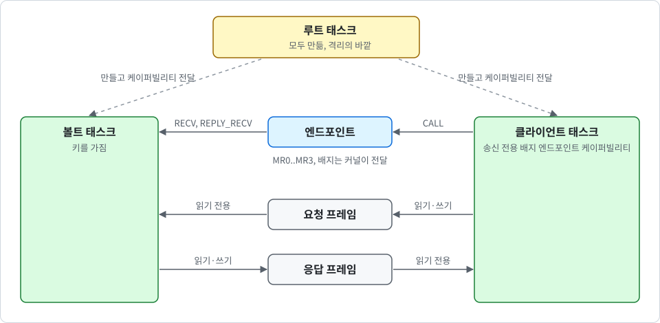

# 서명 오라클 (키 볼트)

<div align="center">

[English](../en/vault.md) | 한국어

</div>

이 노트는 K0의 격리 코어 위에 올라가는 첫 번째 서비스를 설명합니다. **볼트** 태스크가 Ed25519 키 하나를 보관합니다. 클라이언트 태스크는 IPC로 서명과 공개 키를 받고, 키는 받지 못합니다. 코드는 `userspace/k0-vault`(크레이트), `userspace/root-task/src/oracle.rs`(연결과 자가 테스트), `userspace/root-task/src/service.rs`(자가 테스트 뒤에 시작하는 서비스), `crates/k0-boot`(부팅 시드)에 있습니다. `terminal`로 빌드한 이미지에서는 직렬 터미널이 볼트의 운영자입니다("서비스 볼트와 운영자" 절 참고).

> [!NOTE]
> 볼트는 선택 사항이며 기본값은 꺼짐입니다. 기본 이미지에는 볼트도 암호 코드도 없습니다.

## 목적과 범위

볼트는 격리 코어가 비밀을 그것을 쓰는 태스크로부터 떼어 놓을 수 있음을 보여 줍니다. 서비스는 작고 고정되어 있습니다. 상태를 알려 주고, 공개 키를 돌려주고, 1024바이트까지의 메시지에 서명합니다. 키는 두 단계로 만들어집니다. 루트 태스크가 시드를 넘기고, 그다음 admin 또는 operator가 키를 만들게 합니다.

알고리즘은 Ed25519입니다(SHA-512를 쓰는 PureEdDSA, FIPS 186-5와 RFC 8032). 구현은 vendor에 넣은 크레이트 `ed25519-dalek` 2.2.0이며 어떤 종류의 검증도 받지 않았습니다. 키는 승인된 난수 비트 생성기에서 나오지 않습니다. 이를 위해 `vendor/`에 크레이트 14개를 추가했고, 그중 절반은 빌드 시점 또는 다른 타겟용 코드라서 K0 이미지에 컴파일되어 들어가지 않습니다.

## 오브젝트와 누가 무엇을 매핑할 수 있는가

<p align="center">
  
</p>

루트 태스크는 다음 오브젝트를 만듭니다.

- **엔드포인트 하나**: 볼트가 여기서 받습니다. 클라이언트의 CNode에는 송신 전용 배지 복사본만 있습니다(자가 테스트에서는 보고용 엔드포인트도 있습니다). 터미널은 operator 배지가 붙은 같은 종류의 복사본을 받습니다.
- **볼트 태스크**: 자체 주소 공간과 자체 스택을 가집니다. 키는 여기에 있습니다.
- **호출자마다 요청 프레임과 응답 프레임**: 요청 프레임은 호출자가 읽기·쓰기, 볼트가 읽기 전용입니다. 응답 프레임은 볼트가 읽기·쓰기, 호출자가 읽기 전용입니다. 프레임 케이퍼빌리티의 권한을 줄인 복사본으로 강제합니다. operator는 예외입니다. 읽기 전용으로 매핑된 응답 프레임만 있고 요청 프레임은 없습니다.

> [!WARNING]
> 루트 태스크가 이 모든 것을 만들므로 격리의 바깥에 있으며 볼트를 읽을 수 있습니다. 성립하는 문장은 "루트 태스크 외의 어떤 태스크도 볼트의 메모리를 매핑할 수 없다"입니다.

## 프로토콜

클라이언트는 `CALL`을 사용합니다([ipc_KR.md](ipc_KR.md) 참고). 요청 레지스터는 다음과 같습니다.

| 레지스터 | 내용 |
| --- | --- |
| MR0 | 연산과 알고리즘(`proto::word`) |
| MR1 | 요청 프레임에 있는 본문의 길이 |
| MR2 | 호출자가 고른 nonce |

응답은 네 레지스터를 모두 설정합니다.

| 레지스터 | 내용 |
| --- | --- |
| MR0 | 상태 |
| MR1 | 길이(`STATUS`에서는 볼트 상태) |
| MR2 | 지표 비트 |
| MR3 | nonce |

연산은 다음과 같습니다.

| 연산 | 의미 |
| --- | --- |
| `STATUS` | 상태, 키의 알고리즘, 이미지에 들어 있는 알고리즘 |
| `PUBLIC_KEY` | 응답 프레임으로 받는 공개 키 |
| `SIGN` | 요청 프레임에 있는 1024바이트까지의 메시지에 서명 |
| `INIT` | 시드와 시드 정보(40바이트)를 넘깁니다(admin 전용, 한 번). 키는 만들지 않습니다 |
| `KEYGEN` | MR0에 실린 알고리즘으로 쥐고 있는 시드에서 키를 만들고 시드를 지움 |
| `ZEROIZE` | 키와 쥐고 있는 시드를 지움 |

`STATUS`는 상태, 키의 알고리즘, 이미지에 들어 있는 알고리즘을 MR1의 한 워드에 묶습니다(`proto::status_word`).

**단일 가져오기**: `server::fetch`는 길이를 먼저 고정한 뒤 본문을 volatile 읽기로 비공개 버퍼에 한 번만 읽습니다. 사본만 사용하므로 호출 중에 프레임을 바꾸는 호출자는 얻는 것이 없습니다. 응답 프레임은 nonce와 길이로 시작하고, `server::publish`는 nonce를 마지막에 기록합니다. 클라이언트는 자신의 nonce가 담긴 `OK` 응답을 받은 뒤에만 프레임을 믿어야 합니다.

볼트는 배지와 연산만으로 어느 프레임을 읽고 쓸지 정합니다(`proto::fetch_plan`과 `proto::publish_plan`). 요청 본문이 있는 연산은 `SIGN`과 `INIT`뿐이고, 응답 본문이 있는 연산은 `PUBLIC_KEY`와 `SIGN`뿐입니다. 가질 수 없는 본문을 가졌다고 말하는 요청은 `BAD_REQUEST`로 거부되고, 볼트는 그때 메모리를 건드리지 않습니다. 요청 프레임이 없는 operator에게 이것이 중요합니다. 꾸며 낸 길이로 볼트가 매핑되지 않은 주소를 읽게 할 수 없습니다.

상태 기계는 `userspace/k0-vault/src/server.rs`의 `Vault::handle`입니다. 볼트는 다섯 상태 중 하나입니다.

| 상태 | 의미 |
| --- | --- |
| `fresh` | 시드도 키도 없음 |
| `seeded` | `INIT`이 엔트로피 규칙을 통과한 시드를 넘겼고 볼트가 쥐고 있음 |
| `ready` | `KEYGEN`이 키를 만들고 시드를 지움 |
| `zeroized` | `ZEROIZE`가 키와 시드를 지움. 새 키는 재부팅해야 만들 수 있음 |
| `failed` | 자가 테스트 또는 쌍 일관성 테스트가 실패함. 이 상태로 가는 모든 길에서 시드와 키를 지움 |

키는 부팅당 하나입니다. 두 번째 `KEYGEN`은 `KEY_EXISTS`(터미널에서는 `key-exists`)로 거부됩니다.

## 고정된 정책과 배지

정책은 빌드 시점에 고정되며 엔드포인트 배지를 키로 사용합니다. 배지는 커널이 전달하며 클라이언트가 위조할 수 없습니다([ipc_KR.md](ipc_KR.md) 참고). 역할은 빌드 시점에 고정된 네 가지입니다.

| 역할 | 연산 |
| --- | --- |
| admin (루트 태스크) | `STATUS`, `INIT`, `KEYGEN`, `ZEROIZE`, `SIGN`과 `PUBLIC_KEY`는 불가 |
| operator (터미널) | `STATUS`, `PUBLIC_KEY`, `KEYGEN`, `ZEROIZE`, `SIGN`과 `INIT`은 불가 |
| signer | `STATUS`, `PUBLIC_KEY`, `SIGN` |
| reader | `STATUS`, `PUBLIC_KEY` |

operator는 서명을 받을 수도 시드를 넘길 수도 없습니다. 배지가 없거나 알 수 없는 배지의 호출은 거부됩니다. 어떤 연산도 정책을 바꾸지 않습니다. 모든 signer가 키 하나를 공유하므로 서명에는 클라이언트 신원이 담기지 않습니다.

## 프로바이더 경계

`userspace/k0-vault/src/provider.rs`만 암호 크레이트에 닿습니다.

- **자가 테스트**: 시작할 때 RFC 8032 벡터 두 개로 알려진 답 테스트를 합니다(공개 키, 서명, 검증, 바뀐 메시지와 바뀐 서명의 거부).
- **시드 검사와 엔트로피 규칙**: 부팅 시드에 `rng-seed` 32바이트 이상 또는 RNDR 256비트가 없으면 `INIT`은 시드를 거부하고(상태 `NO_ENTROPY`), 전부 0인 시드도 거부합니다. 알고리즘이 없는 이미지의 볼트는 시드를 거부하고(`UNSUPPORTED`) `fresh`에 머뭅니다. QEMU virt는 32바이트 `rng-seed`를 제공합니다.
- **키 생성**: `KEYGEN`은 고른 알고리즘으로 쥐고 있는 시드에서 키를 만들고, 키가 나오든 아니든 시드를 지웁니다.
- **쌍 일관성 테스트**: 키 생성 뒤에 자신의 서명이 검증되는지 확인합니다. 자가 테스트 실패 또는 쌍 일관성 테스트 실패는 볼트를 `STATUS` 외의 모든 것을 거부하는 `failed` 상태로 만듭니다.
- **엄격한 검증**: 검증은 `verify_strict`를 사용합니다.
- **키 내보내기 없음**: 키를 돌려주는 연산이 없습니다.
- **제로화**: `ZEROIZE`는 키(크레이트가 지웁니다)와 쥐고 있는 시드를 버립니다. 이후 볼트는 `SIGN`, `PUBLIC_KEY`, `KEYGEN`을 거부합니다.
- **지표 비트**: 모든 응답에 비트 네 개가 있습니다. 알고리즘이 FIPS 186-5에 있음, 자가 테스트 통과, `rng-seed` 32바이트 이상이 키 시드에 들어감, RNDR이 키 시드에 들어감입니다. `STATUS`는 뒤의 두 비트를 볼트가 아직 쥐고 있는 시드에 대해서도 알립니다. 비트는 바이트가 있었다는 뜻이지 그 바이트를 예측할 수 없었다는 뜻이 아닙니다.

## 부팅 시드 경로

커널은 루트 태스크용 32바이트를 자체 도메인 문자열로 SHA-256에 넣어 만듭니다. 입력은 DTB 엔트로피, 카운터, 그리고 CPU에 RNDR이 있으면 새 RNDR 워드 네 개입니다(`k0_boot::derive_root_seed`). 도메인 분리로 PAC 키와는 서로 독립입니다. 시드는 입력만큼만 좋습니다.

시드는 루트 태스크의 진입 레지스터 `x0`부터 `x3`로 전달됩니다. `x4`는 사용한 `rng-seed` 바이트 수(비트 15부터 0)이고, 비트 16은 RNDR이 기여했음을 뜻합니다. bootinfo 페이지에는 없으며 `bootinfo::VERSION`은 4입니다. 루트 태스크는 `root: boot seed from rng-seed bytes 0x... and rndr` 또는 `... without rndr`만 출력하고 시드는 출력하지 않습니다. 이후 `INIT`으로 시드를 볼트에 주며, `INIT`은 시드를 전달할 뿐입니다. 키는 나중에 `KEYGEN`이 만듭니다.

**시드 지우기**: FDT 파서는 `rng-seed`와 `kaslr-seed` 값의 위치를 기록하고, 두 번째 `/chosen` 노드는 거부합니다(`DuplicateChosen`, 파서를 공유하는 UEFI 로더의 사전 검사에서도 같습니다). 커널은 루트 태스크에 진입하기 직전에 그 바이트를 0으로 만듭니다. `k0_mm::wipe_ro_alias`가 페이지의 읽기 전용 별칭 항목을 제자리에서 읽기·쓰기로 바꾸고(break-before-make), 0을 쓰고, 캐시 라인을 clean 및 invalidate한 뒤 되돌립니다. 이어서 커널은 그 바이트를 다시 읽어 확인하고, `BootInfo`에 있는 자신의 사본을 지우고, `k0: dtb seeds wiped <n>B`(QEMU virt에서는 40B)를 출력하고, 살아 있는 프레임 아래의 부트 스택을 0으로 만듭니다. 이것이 커널이 DTB 매핑으로 하는 유일한 쓰기이며, DTB를 파싱하고 검증한 뒤에 일어납니다.

> [!NOTE]
> 펌웨어나 UEFI 로더가 보관하는 사본과 부트 스택의 살아 있는 프레임 안의 값은 지워지지 않습니다. 스택 사본 지우기(커널 부트 스택, 키 생성과 서명 뒤의 볼트 스택)는 최선 노력입니다.

## 서비스 볼트와 운영자

진짜 부트 시드는 정확히 한 번 쓰입니다. `terminal`과 `vault`로 빌드한 이미지에서 루트 태스크는 먼저 자가 테스트를 모두 실행합니다. 그다음 새 볼트인 **서비스 볼트**를 띄우고 `INIT`으로 부트 시드를 넘깁니다. 그리고 `root: vault seeded`, `root: vault has no seed (boot seed has no entropy)`, `root: vault has no seed (no algorithm in this image)` 중 하나를 출력합니다. 그 밖의 모든 이미지에서 루트 태스크는 진입하자마자 시드를 지웁니다.

이어서 루트 태스크는 터미널과 똑같이 배선한 적대적 태스크 둘을 실행합니다. 둘은 거부되어야 하고 폴트로 끝나야 합니다. 그 뒤 루트 태스크는 자신의 admin 케이퍼빌리티를 버리고, 터미널을 시작하고, 영원히 대기합니다. 터미널은 operator 배지로 서비스 볼트에 `STATUS`, `PUBLIC_KEY`, `KEYGEN`, `ZEROIZE`만 요청할 수 있습니다. 터미널의 명령, 화면, 한계는 [USAGE_KR.md](../../USAGE_KR.md)에 있습니다.

> [!WARNING]
> 직렬 선에는 인증이 없습니다. 선에 닿는 사람은 누구나 operator이며, 키 소거를 포함한 operator의 네 연산을 그대로 할 수 있습니다. operator는 서명을 받을 수 없고 정책을 바꿀 수 없습니다.

자가 테스트 볼트는 다른 볼트입니다. 공개된 RFC 8032 시험 시드와 진짜 시드 정보로 키를 만들어서 엔트로피 규칙은 그대로 실행되고, 진짜 시드는 이 볼트에 닿지 않습니다.

## feature와 고정된 이미지

`k0-kernel` 크레이트에는 feature가 둘 있으며 feature는 더하기만 합니다.

- `vault`: 서비스, 프로토콜, 정책, 자가 테스트이며 서명 알고리즘은 없습니다. 모든 서명 요청에 `UNSUPPORTED`로 답합니다.
- `vault-ed25519`: Ed25519를 추가합니다.

같은 크레이트의 feature `terminal`은 운영자 터미널을 추가합니다. `vault`와 함께 쓰면 터미널이 볼트의 operator가 되고, `vault-ed25519`와 함께 쓰면 Ed25519 키를 만들 수 있습니다. 기본값은 꺼짐이며 콘솔 드라이버가 필요합니다. 터미널 이미지는 다음과 같이 빌드합니다.

```sh
$ cargo build -p k0-kernel --features console,terminal,vault-ed25519
```

볼트가 든 이미지는 다음과 같이 빌드할 수 있습니다.

```sh
$ cargo build -p k0-kernel --features console,vault-ed25519
```

`crates/k0-boot/build.rs`가 feature를 루트 태스크의 중첩 빌드로 전달합니다. 볼트의 코드는 루트 태스크 이미지의 일부이며 이전처럼 부팅 시 SHA-256으로 검사됩니다. 부팅 뒤에는 아무것도 적재하지 않습니다. Ed25519를 넣으면 이미지는 4 KiB 프레임 24개입니다(한도 78개).

## 테스트 방법

**호스트 테스트**(`tools/host-test.sh`가 알고리즘 feature 유무로 `k0-vault`를 실행합니다). 테스트는 `userspace/k0-vault/src/tests.rs`에 있으며 Ed25519가 있으면 20개, 없으면 11개입니다. 이름은 다음과 같습니다.

- 항상: `badges_map_to_fixed_roles_and_frames`, `each_role_may_do_exactly_its_operations`, `no_frame_is_touched_for_a_request_that_cannot_have_a_body`, `a_request_that_claims_a_body_it_cannot_have_is_refused`, `the_status_word_packs_state_algorithm_and_what_is_built`, `a_call_without_a_known_badge_is_denied`, `malformed_requests_are_refused_whole`, `a_seed_without_real_entropy_makes_no_key`, `the_seed_is_taken_once_and_zeroize_is_final`, `fetch_clamps_the_length_and_publish_writes_header_and_body`, 그리고 `without_an_algorithm_the_vault_takes_no_seed_and_serves_nothing`(마지막 것은 알고리즘이 없을 때만).
- Ed25519가 있을 때: `the_self_test_passes_and_is_reported`, `key_generation_follows_the_states`, `the_operator_gets_the_public_key_and_never_a_signature`, `a_vault_that_fails_holds_no_secret`, `signatures_verify_and_the_key_follows_the_seed`, `a_public_key_request_carries_no_body`, `unknown_algorithms_are_unsupported`, `nothing_is_served_after_zeroize`, `a_small_order_public_key_is_refused_even_with_a_matching_signature`, `a_failed_vault_refuses_everything_but_status`.

다른 크레이트와 합치면 호스트 테스트는 ARM 호스트에서 354개, 그 외 호스트에서 268개입니다(`k0-mm` 제외).

**루트 태스크 자가 테스트**(`userspace/root-task/src/oracle.rs`의 `test_oracle`, `vault`로 빌드한 이미지에만 있음). 다음을 검사합니다.

- 자가 테스트가 보고되고, 배지 없는 호출이 거부됩니다.
- 자가 테스트 볼트가 `INIT`으로 공개된 RFC 8032 시험 시드를 받고(상태 `seeded`), operator는 시드를 넘기거나 서명할 수 없으며, 두 번째 `INIT`은 거부됩니다.
- `KEYGEN`이 그 시드로 키를 만들고, 두 번째 `KEYGEN`은 거부됩니다(`KEY_EXISTS`).
- admin은 서명할 수 없습니다.
- signer 클라이언트는 검증되는 서명을 받고, 바뀐 메시지나 바뀐 서명에는 검증이 실패합니다.
- reader는 `SIGN`을 거부당합니다.
- 읽기 전용 응답 프레임에 쓰는 클라이언트와, 볼트가 다른 호출자의 요청을 보는 위치를 읽는 클라이언트는 폴트로 종료됩니다(`k0: task fault` 줄이 6개가 아니라 8개).
- `ZEROIZE` 뒤에는 서명이 거부됩니다.
- 삭제된 볼트에 대한 호출은 `TIMEOUT`으로 끝납니다.
- 볼트에서 회수한 메모리는 retype 뒤에 0으로 읽힙니다.

표지는 `root: oracle tests pass`입니다. 클라이언트 태스크는 루트 CNode 슬롯이 부족해 하나의 클라이언트 주소 공간에서 차례로 실행됩니다. 이 테스트는 볼트와 클라이언트 사이의 격리를 보여 주며 클라이언트끼리의 격리는 보여 주지 않습니다.

**부팅 매트릭스 행**: `vault`, `vault-max`(RNDR), `vault-el2`, `vault-16k`, `vault-no-alg`, `hvf-vault`, 그리고 정적 행 `vault-symbols`(기본 이미지에는 볼트나 암호 코드가 없고, 볼트 이미지에는 그 코드에서 온 쓰기 가능한 정적 변수가 없음)입니다. 매트릭스는 HVF가 있는 Mac에서 76행, CI에서 65행입니다. 터미널용 행은 `term`, `term-max`, `term-el2`, `term-gicv2`, `term-16k`, `term-no-vault`, `term-no-alg`, `term-uefi`, `term-uefi-acpi`, `hvf-term`입니다. `tools/term-test.py <image>`는 QEMU의 직렬 포트를 파이프에 연결해 터미널 이미지를 부팅하고 스크립트로 짠 세션을 실행합니다. 이제 모든 이미지는 `k0: dtb seeds wiped <n>B`와 `root: boot seed from rng-seed bytes ...`도 출력합니다.

## 알려진 공백

> [!NOTE]
> 구현은 검증을 받지 않았고, 이 커널에서 크레이트의 부채널 분석은 없으며, 오라클은 QEMU(TCG와 HVF)에서만 실행했습니다.

- **키 하나**: 영속성, 키 가져오기·내보내기, DRBG, 양자 내성 알고리즘이 아직 없습니다. 새 키를 만들려면 재부팅해야 합니다.
- **서비스 모드에 서명 클라이언트 없음**: 서비스 볼트의 키는 만들어지고 표시되지만 아직 다른 태스크가 쓰지 않습니다. 클라이언트 서명은 자가 테스트가 보여 줍니다.
- **터미널과 볼트는 죽어도 다시 시작하지 않습니다**: 죽으면 그대로 멈춥니다. 루트 태스크는 신뢰 대상입니다.
- **가용성은 보호되지 않습니다**: 클라이언트는 엔드포인트 하나를 공유하며 모든 호출에 타임아웃을 써야 합니다([ipc_KR.md](ipc_KR.md) 참고).
- **루트 태스크는 신뢰 대상입니다**: 볼트를 만들고 읽을 수 있습니다.
- **클라이언트 신원 없음**: 모든 signer가 키 하나를 공유합니다.
- **엔트로피**: 시드는 입력만큼만 좋습니다. 키는 승인된 난수 비트 생성기에서 나오지 않습니다.
- **최선 노력의 지우기**: 부팅 시드 경로 절의 참고를 보십시오.
